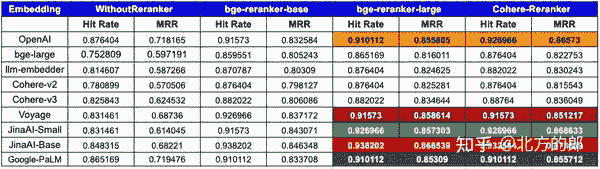

# 提升 RAG：选择最佳嵌入和重新排序模型

> 来源：[https://agijuejin.feishu.cn/docx/CQiNdn1uvogzMYx89AqctuVmnYe](https://agijuejin.feishu.cn/docx/CQiNdn1uvogzMYx89AqctuVmnYe)

> 作者：北方的郎

> 原文：[https://zhuanlan.zhihu.com/p/677164358](https://zhuanlan.zhihu.com/p/677164358)

在构建 RAG 应用的时候，嵌入及重排序模型是非常重要的组成部分。Ravi Theja 写的《Boosting RAG: Picking the Best Embedding & Reranker models》介绍了如何通过选择最佳的嵌入模型和重新排名器来优化检索增强生成（RAG）管道的性能。作者使用了 `LlamaIndex` 的检索评估模块，主要依赖于两个度量标准，即命中率和平均倒数排名（MRR），来评估检索系统的效果。

文章得出的结论是，为了达到最佳性能，需要在嵌入模型和重新排名器之间找到合适的组合。在这个特定的实验中，`OpenAI` 或 `JinaAI-Base` 的嵌入模型与 `CohereRerank`/`bge-reranker-large` 的重新排名器的组合表现最佳。文章也强调了基础的嵌入模型选择的重要性，即使是最好的重新排名器在基础搜索结果不好的情况下也无法发挥太大作用。

原文链接：[https://blog.llamaindex.ai/boosting-rag-picking-the-best-embedding-reranker-models-42d079022e83](https://blog.llamaindex.ai/boosting-rag-picking-the-best-embedding-reranker-models-42d079022e83)


译文如下，翻译的过程中有小调整：

**更新**：`Jina AI` 嵌入的汇集方法已调整为使用均值汇集，并相应地更新了结果。注意的是，具有 `bge-reranker-largenow` 的 `JinaAI-v2-base-en` 表现出 0.938202 的命中率和 0.868539 的 MRR（平均倒数排名），具有 `CohereRerank` 的命中率为 0.932584，MRR 为 0.873689。

在构建检索增强生成（RAG）管道时，一个关键组件是检索器。我们有多种嵌入模型可供选择，包括 `OpenAI`、`CohereAI` 和开源句子转换器。此外，`CohereAI` 和句子转换器还提供了几种重新排名器。

但是在所有这些选择中，我们如何确定最佳的嵌入和重新排名模型的组合以实现卓越的检索性能？我们如何知道哪个嵌入模型最适合我们的数据？或者哪个重新排名器能够最大程度地提高我们的结果？

在这篇博文中，我们将使用 `LlamaIndex` 的检索评估模块迅速确定嵌入和重新排名模型的最佳组合。让我们深入了解吧！

让我们首先了解以下可用的指标 Retrieval Evaluation

## 了解检索评估中的指标

为了衡量我们检索系统的效率，我们主要依靠两个广泛接受的指标：命中率 和 平均倒数排名（MRR）。让我们深入研究这些指标，以了解它们的重要性以及它们的运作方式。

**命中率：**

命中率计算在前 `k` 个检索到的文档中找到正确答案的查询的比例。简单来说，就是我们的系统在前几个猜测中正确的频率。

**平均倒数排名 (MRR)：**

对于每个查询，MRR 通过查看最高排名的相关文档的排名来评估系统的准确性。具体来说，它是在所有查询中这些排名的倒数的平均值。因此，如果第一个相关文档是顶部结果，则倒数排名为 1；如果是第二个，则倒数排名为 1/2，依此类推。

现在我们已经确定了范围并熟悉了指标，是时候深入实验了。如需亲身体验，您还可以使用我们的 Google Colab Notebook 进行操作

## 设置环境

```
!pip install llama-index Sentence-transformers cohere anthropic voyageai protobuf pypdf
```

## 设置按键

```
openai_api_key = '您的 OPENAI API 密钥'
cohere_api_key = '您的 COHEREAI API 密钥'
anthropic_api_key = '您的 ANTHROPIC API 密钥'
openai.api_key = openai_api_key
```

## 下载数据

我们将使用 `Llama2` 纸进行此实验。让我们下载论文。

```
!wget --user-agent "Mozilla" "https://arxiv.org/pdf/2307.09288.pdf" -O "llama2.pdf"
```

## 加载数据

让我们加载数据。我们将使用从开始到 36 页进行实验，不包括目录、参考文献和附录。

然后，该数据被解析并转换为节点，这些节点代表我们想要检索的数据块。我们确实使用了 `chunk_size` 作为 512。

```
documents = SimpleDirectoryReader(input_files=["llama2.pdf"]).load_data()

node_parser = SimpleNodeParser.from_defaults(chunk_size=512)
nodes = node_parser.get_nodes_from_documents(documents)
```

## 生成问题-上下文对

出于评估目的，我们创建了一个问题-上下文对的数据集。该数据集可以看作是我们数据中的一组问题及其相应的上下文。为了消除嵌入（`OpenAI` / `CohereAI`）和 Reranker（`CohereAI`）评估的偏差，我们使用 `Anthropic` LLM 来生成问题上下文对。

让我们初始化一个提示模板来生成问题-上下文对。

```
# Prompt to generate questions
qa_generate_prompt_tmpl = """\
Context information is below.

---------------------
{context_str}
---------------------

Given the context information and not prior knowledge.
generate only questions based on the below query.

You are a Professor. Your task is to setup \
{num_questions_per_chunk} questions for an upcoming \
quiz/examination. The questions should be diverse in nature \
across the document. The questions should not contain options, not start with Q1/ Q2. \
Restrict the questions to the context information provided.\
"""
```

```
llm = Anthropic(api_key=anthropic_api_key)
qa_dataset = generate_question_context_pairs(
    nodes, llm=llm, num_questions_per_chunk=2
)
```

过滤掉句子的函数，例如 - Here are 2 questions based on provided context

```
# function to clean the dataset
def filter_qa_dataset(qa_dataset):
    """
    Filters out queries from the qa_dataset that contain certain phrases and the corresponding
    entries in the relevant_docs, and creates a new EmbeddingQAFinetuneDataset object with
    the filtered data.

    :param qa_dataset: An object that has 'queries', 'corpus', and 'relevant_docs' attributes.
    :return: An EmbeddingQAFinetuneDataset object with the filtered queries, corpus and relevant_docs.
    """

    # Extract keys from queries and relevant_docs that need to be removed
    queries_relevant_docs_keys_to_remove = {
        k for k, v in qa_dataset.queries.items()
        if 'Here are 2' in v or 'Here are two' in v
    }

    # Filter queries and relevant_docs using dictionary comprehensions
    filtered_queries = {
        k: v for k, v in qa_dataset.queries.items()
        if k not in queries_relevant_docs_keys_to_remove
    }
    filtered_relevant_docs = {
        k: v for k, v in qa_dataset.relevant_docs.items()
        if k not in queries_relevant_docs_keys_to_remove
    }

    # Create a new instance of EmbeddingQAFinetuneDataset with the filtered data
    return EmbeddingQAFinetuneDataset(
        queries=filtered_queries,
        corpus=qa_dataset.corpus,
        relevant_docs=filtered_relevant_docs
    )

# filter out pairs with phrases `Here are 2 questions based on provided context`
qa_dataset = filter_qa_dataset(qa_dataset)
```

## 自定义检索器

为了确定最佳的检索器，我们使用嵌入模型和重新排名器的组合。最初，我们建立了一个基本的 `VectorIndexRetriever`。在检索节点之后，我们引入一个重新排名器来进一步优化结果。值得注意的是，在这个特定的实验中，我们将 `similarity_top_k` 设置为 10，并选择带有重新排名器的前 5 个结果。然而，根据您特定实验的需求，可以随时调整这个参数。我们在这里展示了使用 `OpenAIEmbedding` 的代码，请参阅 笔记本 以获取其他嵌入的代码。

```
embed_model = OpenAIEmbedding()
service_context = ServiceContext.from_defaults(llm=None, embed_model=embed_model)
vector_index = VectorStoreIndex(nodes, service_context=service_context)
vector_retriever = VectorIndexRetriever(index=vector_index, similarity_top_k=10)
```

```
class CustomRetriever(BaseRetriever):
    """Custom retriever that performs both Vector search and Knowledge Graph search"""

    def __init__(
        self,
        vector_retriever: VectorIndexRetriever,
    ) -> None:
        """Init params."""

        self._vector_retriever = vector_retriever

    def _retrieve(self, query_bundle: QueryBundle) -> List[NodeWithScore]:
        """Retrieve nodes given query."""

    retrieved_nodes = self._vector_retriever.retrieve(query_bundle)

    if reranker != 'None':
      retrieved_nodes = reranker.postprocess_nodes(retrieved_nodes, query_bundle)
    else:
      retrieved_nodes = retrieved_nodes[:5]
      
    return retrieved_nodes

    async def _aretrieve(self, query_bundle: QueryBundle) -> List[NodeWithScore]:
        """Asynchronously retrieve nodes given query.

        Implemented by the user.

        """
        return self._retrieve(query_bundle)

    async def aretrieve(self, str_or_query_bundle: QueryType) -> List[NodeWithScore]:
        if isinstance(str_or_query_bundle, str):
            str_or_query_bundle = QueryBundle(str_or_query_bundle)
        return await self._aretrieve(str_or_query_bundle)

custom_retriever = CustomRetriever(vector_retriever)
```

## 评估

为了评估我们的检索器，我们计算了平均倒数排名（MRR）和命中率指标：

```
retriever_evaluator = RetrieverEvaluator.from_metric_names(
    ["mrr", "hit_rate"], retriever=custom_retriever
)
eval_results = await retriever_evaluator.aevaluate_dataset(qa_dataset)
```

## 结果

我们测试了各种嵌入模型和重新排序器。以下是我们考虑的模型：

### 嵌入模型

+ `OpenAI Embedding`
+ `Voyage Embedding`
+ `CohereAI Embedding` (v2.0/ v3.0)
+ `Jina Embeddings` (small/ base)
+ `BAAI/bge-large-en`
+ `Google PaLM Embedding`

### 重新排序

+ `CohereAI`
+ `bge-reranker-base`
+ `bge-reranker-large`

> 值得一提的是，这些结果提供了对该特定数据集和任务的性能的深入了解。然而，实际结果可能会因数据特征、数据集大小和其他变量（如 `chunk_size`、`similarity_top_k` 等）而有所不同。

下表展示了基于命中率和平均倒数排名（MRR）指标的评估结果：



## 分析

### 嵌入性能


# 嵌入模型与重排序器性能评估

+ `OpenAI`：展示了顶级性能，尤其是 `CohereRerank`（**0.926966命中率，0.86573 MRR）和 `bge-reranker-large`（**0.910112命中率，0.855805 MRR），表明与重排名工具具有很强的兼容性。

+ `bge-large`：通过重新排名器体验显着改进，并获得最佳结果 `CohereRerank`（0.876404 命中率，0.822753 MRR）。

+ `llm-embedder`：从重新排名中受益匪浅，特别是 `CohereRerank`（0.882022 命中率，0.830243 MRR），它提供了显着的性能提升。

+ `Cohere`：`Cohere` 最新的 v3.0 嵌入优于 v2.0，并且通过原生 `CohereRerank` 的集成，显著提高了其指标，拥有 0.88764 的命中率和 0.836049 MRR。

+ `Voyage`：具有强大的初始性能，并进一步放大 `CohereRerank`（0.91573 命中率，0.851217 MRR），表明对重新排名的高响应能力。

+ `JinaAI`、`bge-reranker-large`：表现非常强劲，（0.938202 命中率，0.868539 MRR）和 `CohereRerank`（0.932584 命中率，0.873689）有显著收益，表明重新排名显著提高了其性能。

+ `Google-PaLM`、`CohereRerank`：该模型表现出强大的性能，在使用（0.910112 命中率，0.855712 MRR）时具有可测量的收益。这表明重新排名对其整体结果有明显的提升。

## 重新排序的影响：

+ `WithoutReranker`：这提供了每个嵌入的基线性能。

+ `bge-reranker-base`：通常可以提高嵌入的命中率和 MRR。

+ `bge-reranker-large`：此重新排序器经常为嵌入提供最高或接近最高的 MRR。对于多种嵌入，其性能可与或超过 `CohereRerank`。

+ `CohereRerank`：持续增强所有嵌入的性能，通常提供最佳或接近最佳的结果。

## 重新排序的必要性：

+ 这些数据清楚地表明了重新排名器在优化搜索结果方面的重要性。几乎所有嵌入都受益于重新排名，显示出命中率和 MRR 的提高。

+ 尤其是重新排序器 `CohereRerank`，已经证明了它们将任何嵌入转变为竞争性嵌入的能力。

## 综合优势：

+ `OpenAI + CohereRerank` 当同时考虑命中率和 MRR 时，`JinaAI-Base + bge-reranker-large/CohereRerank` 的组合成为顶级竞争者。

+ `CohereRerank/bge-reranker-large` 然而，无论使用何种嵌入，重排序器在各种嵌入中带来的持续改进使它们成为提高搜索质量的最佳选择。

总之，为了在命中率和 MRR 方面实现峰值性能，重新排名器的组合 `OpenAI` 或 `JinaAI-Base` 嵌入 `CohereRerank/bge-reranker-large` 非常突出。

> 请注意，我们的基准测试旨在为您自己的数据提供可重现的脚本。尽管如此，请将这些数字视为估计值，并在解释它们时谨慎行事。

## 结论：

在这篇博文中，我们演示了如何使用各种嵌入和重新排序来评估和增强检索器的性能。以下是我们的最终结论。

+ 嵌入：`OpenAI` 和 `JinaAI-Base` 嵌入，尤其是与 `CohereRerank/bge-reranker-large` 重新排名器配合使用时，为命中率和 MRR 设定了黄金标准。

+ 重新排名器：重新排名器的影响尤其 `CohereRerank/bge-reranker-large` 不容小觑。它们在提高许多嵌入的 MRR 方面发挥着关键作用，显示了它们在改善搜索结果方面的重要性。

+ 基础是关键：为初始搜索选择正确的嵌入至关重要；如果基本搜索结果不好，即使是最好的重新排名器也无济于事。

+ 合作：为了充分利用检索器，找到嵌入和重新排序的正确组合非常重要。这项研究表明仔细测试并找到最佳配对是多么重要。
