# 高级 RAG 技术：图解概述

> 来源：[https://agijuejin.feishu.cn/docx/Mid1dNczBod7imxkkiJc4CuTn4g](https://agijuejin.feishu.cn/docx/Mid1dNczBod7imxkkiJc4CuTn4g)

> 作者：北方的郎

> 原文：[https://zhuanlan.z](https://zhuanlan.zhihu.com/p/674914860)hihu.com/p/674914...

看到一篇对于RAG介绍得非常好的文章，简单翻译了一下。

英文原文地址： [ht](https://link.zhihu.com/?target=https%3A//pub.towardsai.net/advanced-rag-techniques-an-illustrated-overview-04d193d8fec6)tps:// pub.towardsai.net/advan ced-rag-techniques-an-illustrated-overview-04d193d8fec6

以下为译文，翻译过程中有删减。

本文对高级检索增强生成技术和算法的全面研究，将各种方法系统化。 由于本文的目标是对可用的 RAG 算法和技术进行概述和解释，因此我不会深入研究代码中的实现细节，只是引用它们并将其留给可用的大量文档和教程。

##  介绍

检索增强生成（又名 RAG）为LLM提供从某些数据源检索到的信息**，作为**其生成答案的依据。 基本上[，RAG 是搜](https://link.zhihu.com/?target=https%3A//github.com/chroma-core/chroma)索 [+ LLM 提示 ，您要](https://link.zhihu.com/?target=https%3A//weaviate.io/)求模[型回答查询，并提供](https://link.zhihu.com/?target=https%3A//www.pinecone.io/)通过搜索算法找到的信息作为上下文。查询[和检索到的上下](https://link.zhihu.com/?target=https%3A//github.com/nmslib/nmslib)文都被注入到发送给 LLM[ 的提示中。

RAG 是 2023 ](https://link.zhihu.com/?target=https%3A//docs.llamaindex.ai/en/stable/)[年最](https://link.zhihu.com/?target=https%3A//python.langchain.com/docs/get_started/introduction)流行的基于 LLM 的系统架构。有许多产品几乎完全基于 RAG 构建——从将网络搜索引擎与 LLM 相结合的问答服务到数百个与数据聊天的应用程序。

尽管基于嵌入的 搜索 引擎是在 2019 年与 faiss合作开发的，但即使是矢量搜索领域也受到了这种炒作的推动。像 chroma 、 weavaite.io 和 pinecone 这样的矢量数据库初创公司都是建立在现有的开源搜索索引（主要是 faiss 和 nmslib ）之上的最近为输入文本添加了额外的存储空间以及一些其他工具。

基于 LLM 的管道和应用程序有两个最著名的开源库 ——LangChain和 LlamaIndex ，它们分别于 2022 年 10 月和 11 月成立 ， 相差一个月，受到 ChatGPT 发布的启发，并在 2023 年获得了大规模采用。

本文的目的是系统化关键的高级 RAG 技术，并参考其实现（主要在 LlamaIndex 中），以便于其他开发人员深入研究该技术。

问题在于，大多数教程都挑选一种或几种技术并详细解释如何实现它们，而不是描述所有可用的工具。

另一件事是，LlamaIndex 和 LangChian 都是令人惊叹的开源项目，其发展速度如此之快，以至于它们的文档已经比 2016 年的机器学习教科书还要厚。

##  简单的RAG

本文 RAG 管道从一个文本文档语料库开始，直接跳过如何通过数据加载器从Youtube等数据源获取步骤。

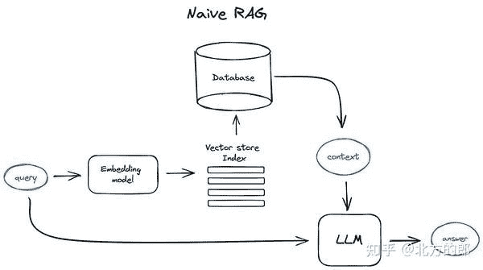

**简单 RAG 案例 **简而言之，如下所示：将文本分割成块，然后使用一些 Transformer Encoder 模型将这些块嵌入到向量中，将所有这些向量放入索引中，最后创建一个 LLM 提示，告诉模型回答给定我们在搜索步骤中找到的上下文的用户查询。

在运行时，我们使用同一编码器模型对用户的查询进行向量化，然后搜索该查询向量的索引，找到 top-k 个结果，从我们的数据库中检索相应的文本块，并将它们作为上下文输入到 LLM 提示中。

提示可能如下所示：

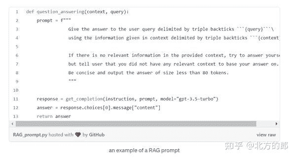

[

提示工程（P](https://link.zhihu.com/?target=https%3A//platform.openai.com/docs/guides/prompt-engineering/strategy-write-clear-instructions)r[ompt En](https://link.zhihu.com/?target=https%3A//www.anthropic.com/product)[gineerin](https://link.zhihu.com/?target=https%3A//mistral.ai/news/mixtral-of-experts/)[g）是您可以](https://link.zhihu.com/?target=https%3A//www.microsoft.com/en-us/research/blog/phi-2-the-surprising-power-of-small-language-models/)尝试改进 RAG 管道的[最便宜的方法。](https://link.zhihu.com/?target=https%3A//huggingface.co/blog/llama2)确保[您已经检查过相当全面](https://link.zhihu.com/?target=https%3A//huggingface.co/openlm-research)的 [OpenAI ](https://link.zhihu.com/?target=https%3A//huggingface.co/tiiuae)提示工程指南 。

显然，尽管 OpenAI 是 LLM 提供商的市场领导者，但仍有许多替代方案，例如Anthropic 的 Claude 、最近流行的较小但功能强大的模型，例如 Mixtral 形式的 Mistral、 Microsoft 的 Phi-2 以及许多开源选项，例如 Llama2 、 OpenLLaMA 、 Falcon ，因此您可以为 RAG 管道选择合适得大脑（大模型）。

##  高级RAG

现在我们将深入了解高级 RAG 技术的概述。这是一个描述核心步骤和所涉及算法的方案。为了保持方案的可读性，省略了一些逻辑循环和复杂的多步骤代理行为。

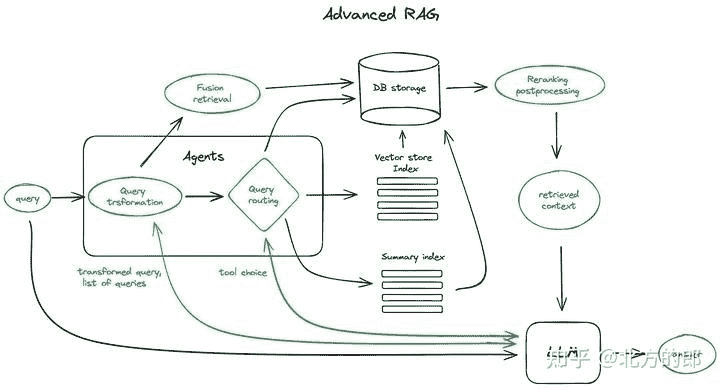

方案中的绿色元素是进一步讨论的核心 RAG 技术，蓝色元素是文本。并非所有先进的 RAG 想法都可以在单个方案中轻松可视化，例如，省略了各种上下文放大方法 - 我们将在后续深入探讨。

###  1. 分块（Chunking）和矢量化（Vectorisation）

首**先，我们要创建一****个向量索引，表示我们的文档内容**，然**后在运行时搜索所有这些向量与对应于最接近**语义[的查询向](https://link.zhihu.com/?target=https%3A//www.pinecone.io/learn/chunking-strategies/)**量之间的最小余弦距**离。

1.1 分块（Chun**k**ing）

Tran**sformer 模型**具有固定的输入序列长度，即使**输入上下文窗**口很[大，一个或几个句子的](https://link.zhihu.com/?target=https%3A//huggingface.co/BAAI/bge-large-en-v1.5)向量[也比几](https://link.zhihu.com/?target=https%3A//huggingface.co/intfloat/multilingual-e5-large)页文本的平均向量更好地表[示其语义含义（也取](https://link.zhihu.com/?target=https%3A//huggingface.co/spaces/mteb/leaderboard)决于模型，但是一般来说，这是正确的），因此 [对数据](https://link.zhihu.com/?target=https%3A//docs.llamaindex.ai/en/latest/module_guides/loading/ingestion_pipeline/root.html%23)进行分块 ——将初始文档分割成一定大小的块，而不会失去其含义（将文本分割成句子或段落，而不是将单个句子分成两部分）。有多种文本分割器实现能够完成此任务。

块的大小是一个需要考虑的参数 - 它取决于您使用的嵌入模型及其令牌容量，标准转换器编码器模型（例如基于 BERT 的句子转换器）最多需要 512 个令牌，OpenAI ada-002 能够处理更长的序列，如 8191 个标记，但 这里的妥协是LLM有足够的上下文来推理与足够具体的文本嵌入，以便有效地执行搜索 。 在这里 您可以找到说明块大小选择问题的研究。 在 LlamaIndex 中， NodeParser 类 涵盖了这一点，其中包含一些高级选项，如定义您自己的文本拆分器、元数据、节点/块关系等。

1.2 矢量化（ Vectorisation ）

下一步是选择一个 模型来嵌入我们的块 - 有很多选择，我选择搜索 优化模型， 如 bge-large 或 E5 嵌入系列 - 只需检查 MTEB 排行榜 以获取最新更新。

对于分块和矢量化步骤的端到端实现，请查看LlamaIndex 中完整数据摄取管道的 示例。

###  2. 搜索索引

**

2.1 向量存储索**引

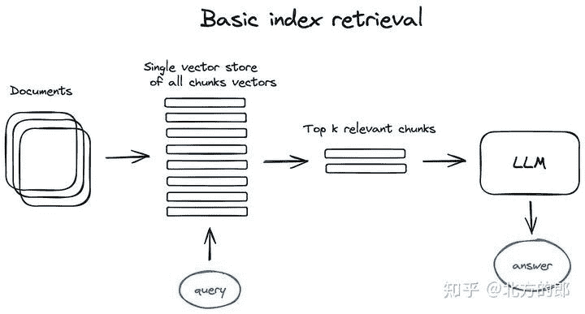

RA[G 管道的关](https://link.zhihu.com/?target=https%3A//faiss.ai/)键部[分是搜索索引 ](https://link.zhihu.com/?target=https%3A//github.com/nmslib/nmslib)，用[于存储我们在](https://link.zhihu.com/?target=https%3A//github.com/spotify/annoy)[上一步中获](https://link.zhihu.com/?target=https%3A//www.pinecone.io/learn/series/faiss/hnsw/)得[的矢量化内容。最简](https://link.zhihu.com/?target=https%3A//www.pinecone.io/)单的[实现使用平面索引—](https://link.zhihu.com/?target=https%3A//weaviate.io/)—查[询向量和所有块](https://link.zhihu.com/?target=https%3A//www.trychroma.com/)向量之间的强**力距离计算。

****为在 10000 **多个元素尺度上 进行有效检索而优化的适当搜索索引是矢量索引， 如 faiss 、 nmslib 或 annoy ，使用一些近似最近邻实现（如聚类、树或 HNSW 算法）。

还有 OpenSearch 或 ElasticSearch 等托管解决方案以及矢量数据库，负责在后台处理步骤 1 中描述的数据摄取管道，例如 Pinecone 、 Weaviate 或 Chroma 。

根据您的索引选择、数据和搜索需求， 您还可以将元数据与向量一起存储 ，然后使用 元数据过滤器 来搜索某些日期或来源内的信息。

LlamaIndex 支持大量 向量存储索引 ，但也支持其他更简单的索引实现，例如列表索引、树索引和关键字表索引 - 我们将在 Fusion 检索部分讨论后者。

2. 2 层次索引

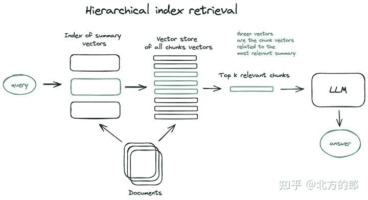

如果您有许多文档需要检索，您需要能够有效地在其中进行搜索，找到相关**信息并将其综合到一个答案中并**参考来源。在大型数据库的情况下，一种有效的方法是创建 两个索引——一个由摘要组成，另一个由文档块组成 ，并分两步搜索，首先[**通过摘要过**](https://link.zhihu.com/?target=http%3A//boston.lti.cs.cmu.edu/luyug/HyDE/HyDE.pdf)**滤掉相关文档，然后**只搜[**索在这个相关组内。

2.**](https://link.zhihu.com/?target=https%3A//docs.llamaindex.ai/en/stable/examples/node_postprocessor/MetadataReplacementDemo.html)3 假设问题和 HyDE

另一种方法是要求LLM 为每个块生成一个问题并将这些问题嵌入到向量中 ，在运行时针对该问题向量索引执行查询搜索（用索引中的问题向量替换块向量），然后在检索后路由到原始数据文本块并将它们作为上下文发送给LLM以获得答案。与实际块相比， 查询和假设问题之间的语义相似性更高，

因此这种方法提高了搜索质量。

还有一种称为 HyDE 的反向逻辑方法- 您要求LLM根据给定的查询生成假设的响应，然后使用其向量和查询向量来提高搜索质量。

2.4 上下文丰富

这里的概念是检索较小的块以获得更好的搜索质量 ， 但添加周围的上下文供 LLM 进行推理 。

有两种选择：通过围绕较小检索块的句子来扩展上下文，或者将文档递归地拆分为多个包含较小子块的较大父块。

2.4.1 句子窗口检索

在该方案中，文档中的每个句子都是单独嵌入的，这为上下文余弦距离搜索提供了很高的查询精度。

为了在获取最相关的单个句子后更好地对找到的上下文进行推理，我们将上下文窗口在检索到的句子之前和之后 扩展了k 个句子，然后将此扩展的上下文发送给 LLM。

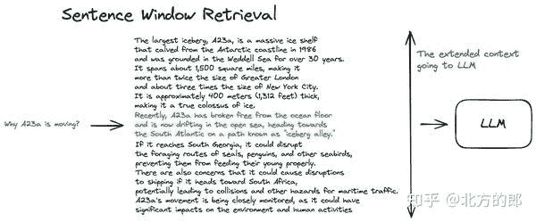

**

绿色部分是**[**在索引中搜索时找**](https://link.zhihu.com/?target=https%3A//docs.llamaindex.ai/en/latest/examples/retrievers/auto_merging_retriever.html)**到的句子**[**嵌入，整个黑色**](https://link.zhihu.com/?target=https%3A//python.langchain.com/docs/modules/data_connection/retrievers/parent_document_retriever)**+**绿色段落被馈送到LLM以扩大其上下文，同时根据所提供的查询进行推理

2.4.2 自动合并检索器 （又名 父文档检索器 ）

这里的想法与句子窗口检索器非常相似——搜索更细粒度的信息，然后扩展上下文窗口，然后将所述上下文提供给LLM进行推理。文档被分割成较小的子块，引用较大的父块。

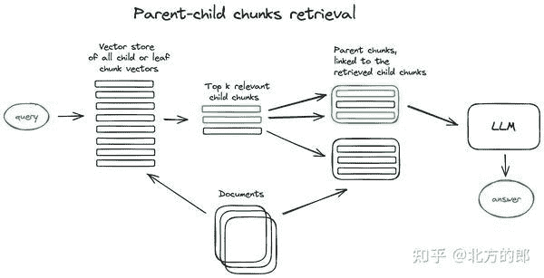

首先在检索期间获取较小的块，**然后如果前k 个 检索到的**块中超过 n 个 块链[接到同一父节点](https://link.zhihu.com/?target=https%3A//en.wikipedia.org/wiki/Tf%25E2%2580%2593idf)（较大的块），我[们将通过该](https://link.zhihu.com/?target=https%3A//en.wikipedia.org/wiki/Okapi_BM25)父节**点替换馈**送到 LLM 的上下文 - 工作原理类似于自动合并一些[检索到的块块合](https://link.zhihu.com/?target=https%3A//plg.uwaterloo.ca/~gvcormac/cormacksigir09-rrf.pdf)并成一个更大的父块，因此得名方法。请注意 - 搜索仅在子节点索引内执行。 查看有关递归检索器 + 节点引用 的 LlamaIndex 教程以进行更深入的了解。

2.5 融合检索或混合搜索

一个相对古老的想法是，您可以充分 利用两个世界的优点——基于关键字的老式搜索 ——稀疏检索算法（如 tf-idf 或搜索行业标准 BM25 ） 和现代 语义或 向量搜索，并将其组合到一个检索结果中。

这里唯一的技巧是将检索到的结果与不同的相似度分数正确地结合起来——这个问题通常是借助 倒数排名融合 算法来解决的，对检索到的结果进行重新排序以获得最终输出。

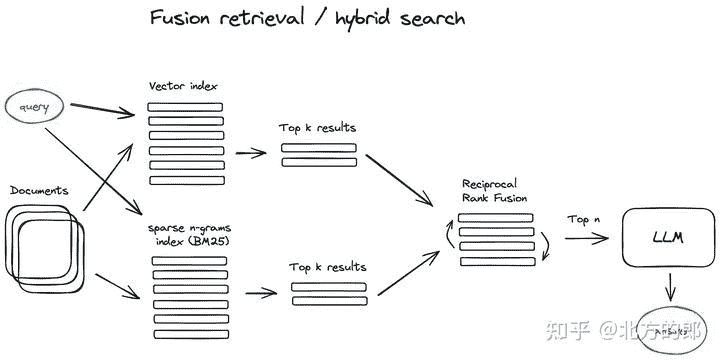

[

在 L](https://link.zhihu.com/?target=https%3A//docs.llamaindex.ai/en/stable/examples/retrievers/reciprocal_rerank_fusion.html)angChain 中，这是在 Ensemble Retriever 类中实现的，结合了您定义的检索器列表，例如 faiss 矢量索引和基于 BM25 的检索器，并使用 RRF 进行重新排名。

在 LlamaIndex 中，这是以非常相似的方式 完成的。

混合或融合搜索通常会提供更好的检索结果，因为结合了两种互补的搜索算法，同时考虑了查询与存储文档之间的语义相似性和关键字匹配。

###  3. 重新排序和过滤

[**因此，我们**](https://link.zhihu.com/?target=https%3A//docs.llamaindex.ai/en/stable/module_guides/querying/node_postprocessors/root.html)使用[上述任何算法都得到了检](https://link.zhihu.com/?target=https%3A//www.sbert.net/examples/applications/cross-encoder/README.html)索结果，现在是时候通过过滤[、重新](https://link.zhihu.com/?target=https%3A//txt.cohere.com/rerank/)排序或某种转换来优化它们了。在 LlamaIndex 中，有各种可用的 后处理器 ， 根据相似度得分、关键词、元数据过滤结果，或使用其他模型（ 如 LLM、

句子转换器交叉编码器 、Cohere 重新排名 端点 ）或基于日期新近度等元数据对结果进行重新排名 - 基本上，一切你能想象到的。这是将检索到的上下文提供给 LLM 以获得结果答案之前的最后一步。

现在是时候学习更复杂的 RAG 技术了，比如查询转**换和路由，它们都涉及 LLM，从**而代表 代理行为——一些复杂的逻辑，涉及我们的 RAG 管道中的 LLM 推理。

###  4. 查询转换

**

查询转换是一系列使用 LLM 作为推理**引擎来修改用户输入以提高检索质量的技术。 有不同的选择可以做到这一点。

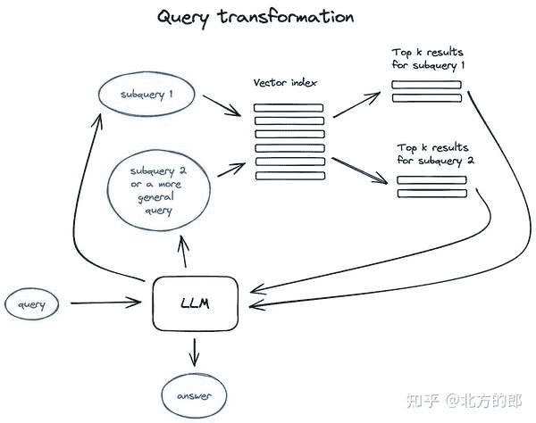

如果查询很复杂，LLM可以将其分解为多个子查询。 例如，如果你问：

“哪个框架在 Github、Langchain 或 L[lamaInd](https://link.zhihu.com/?target=https%3A//python.langchain.com/docs/modules/data_connection/retrievers/MultiQueryRetriever%3Fref%3Dblog.langchain.dev)ex 上有更多的星星？”，

并且我们不太可能在语料库中的某些文本中找到直接比较，因此将这个问题分解为有意义的两个子查询以更简单、更具体的信息检索为前提：

——“Langchain 在 Github 上有多少颗星？”

— “Llamaindex 在 Github 上有多少颗星？”

它们将并行执行，然后将检索到的上下文合并到一个提示中，供 LLM 合成初始查询的最终答案。这两个库都实现了此功能 - 作为Langchain 中的 多查询检索器 和 Llamaindex 中的子问题查询引擎 。

1.  [**后退提示 **](https://link.zhihu.com/?target=https%3A//arxiv.org/pdf/2310.06117.pdf%3Fref%3Dblog.langchain.dev)（[Ste](https://link.zhihu.com/?target=https%3A//github.com/langchain-ai/langchain/blob/master/cookbook/stepback-qa.ipynb%3Fref%3Dblog.langchain.dev)p-back prompting ） 使用 LLM 生成更一般的查询 ，并检索我们获得更一般或高级上下文的内容，这些上下文对于我们原始查询的答案很有用。
还执行原始查询的检索，并且在最终答案生成步骤中将两个上下文馈送到 LLM。这是 LangChain 的 实现 。

1.  [查询重写使用 LLM ](https://link.zhihu.com/?target=https%3A//llamahub.ai/l/llama_packs-fusion_retriever-query_rewrite)重新制定初始查询 以改进检索。Lan[g](https://link.zhihu.com/?target=https%3A//github.com/langchain-ai/langchain/blob/master/cookbook/rewrite.ipynb%3Fref%3Dblog.langchain.dev)Chain和 LlamaIndex 都有实现，只是有点不同，我发现 LlamaIndex 解决方案在这里更强大 。

### 5. [聊天引擎](https://link.zhihu.com/?target=https%3A//docs.llamaindex.ai/en/stable/module_guides/deploying/chat_engines/root.html)

构建一个可以针对单个查询多次工**作的优秀 RAG 系统的**下一件大事是聊天 逻辑，考虑到对话上下文 ，与 LLM[ 时代](https://link.zhihu.com/?target=https%3A//python.langchain.com/docs/modules/agents/agent_types/openai_multi_functions_agent)之前的经典聊天机器人相同。

这需要支持与先前对话上下文相关的后续问题、照应或任意用户命令。它是通过 查询压缩技术解决的，将聊天上下文 与用户查询一起考虑在内。

与往常一样，有几种方法可以实现上下文压缩——一种流行且相对简单的 ContextChatEngine ，首先检索与用户查询相关的上下文，然后将其与 内存 缓冲区中的聊天历史记录一起发送给 LLM，以便 LLM 知道之前的上下文，同时生成下一个答案。

更复杂的情况是 CondensePlusContextMode — 在每次交互中，聊天历史记录和最后一条消息都会压缩为一个新查询，然后该查询转到索引，检索到的上下文与原始用户消息一起传递给 LLM，以生成一个回答。

值得注意的是，LlamaIndex 中还支持 基于 OpenAI 代理的聊天引擎， 提供更灵活的聊天模式，Langchain 还 支持 OpenAI 功能 API。

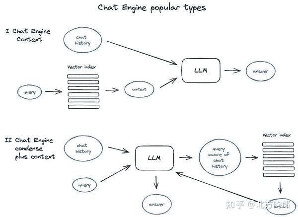

还有其他聊天引擎类型，例如 [ReAct Agent ](https://link.zhihu.com/?target=https%3A//docs.llamaindex.ai/en/stable/examples/chat_engine/chat_engine_react.html)，但让我们在第 7 节中跳到代理本身。

###  6. 查询路由

查询路由是LLM支持的决策步骤，根据给定的用户查询下一步该做什么 ——选项通**常是总结、针对某**[些数据索引执行搜索或尝](https://link.zhihu.com/?target=https%3A//docs.llamaindex.ai/en/stable/module_guides/querying/router/root.html)试多[种不同的路由，然后将](https://link.zhihu.com/?target=https%3A//python.langchain.com/docs/expression_language/how_to/routing%3Fref%3Dblog.langchain.dev)其输出综合到单一答案。

查询路由器还用于选择索引或更广泛的数据存储，将用户查询发送到何处 - 要么您有多个数据源，例如经典向量存储和图形数据库或关系数据库，要么您有索引的层次结构 - 对于多文档存储，一个非常经典的情况是摘要索引和文档块向量的另一个索引。

定义查询路由器包括设置它可以做出的选择。

路由选项的选择是通过 LLM 调用执行的，以预定义的格式返回其结果，用于将查询路由到给定的索引，或者，如果我们采用亲属行为，则路由到子链甚至其他代理如下图的 多文档代理方案 所示。

LlamaIndex 和 LangChain 都支持查询路由器。

###  7. RAG 中的代理

代理（由[ Langchain](https://link.zhihu.com/?target=https%3A//python.langchain.com/docs/modules/agents/) 和[ LlamaIndex](https://link.zhihu.com/?target=https%3A//docs.llamaindex.ai/en/latest/use_cases/agents.html%23) 支持[**）几乎自第一个**](https://link.zhihu.com/?target=https%3A//platform.openai.com/docs/assistants/tools/function-calling) LLM AP[I 发布以来就已经存在了](https://link.zhihu.com/?target=https%3A//docs.llamaindex.ai/en/stable/examples/agent/openai_agent.html)—— 其想法是[**提供一个能够**](https://link.zhihu.com/?target=https%3A//docs.llamaindex.ai/en/stable/examples/agent/multi_document_agents.html)推理的 LL**M，**并提供一组工具和一个要完[成的](https://link.zhihu.com/?target=https%3A//docs.llamaindex.ai/en/stable/examples/agent/openai_agent.html)**任务 。这些工具可**能包括一些确定性函数，例如任何代码函数或外部 API 甚至其他代理——这种 LLM 链思想就是 LangChain 名称的由来。

代理本身就是一件大事，不可能在 RAG 概述中对这个主题进行足够深入的研究，因此我将继续基于代理的多文档检索案例，并在 OpenAI Assistants 站短暂停留，因为 它这是一个相对较新的东西，在 最近的 OpenAI 开发者大会上以 GPT 的形式 出现，并在下面描述的 RAG 系统的底层工作。

OpenAI Assistants 基本上已经实现了我们之前在开源中拥有的 LLM 所需的许多工具——聊天记录、知识存储、文档上传接口，以及也许最重要的函数 调用 API 。后者提供将 自然语言转换为对外部工具或数据库查询的 API 调用的功能。

在 LlamaIndex 中，有一个 OpenAIAgent 类将这种高级逻辑与 ChatEngine 和 QueryEngine 类结合起来，提供基于知识和上下文感知的聊天，以及在一个对话轮中调用多个 OpenAI 函数的能力，这真正带来了智能代理行为。

让我们看一下 多文档代理 方案- 一个非常复杂的设置，涉及在每个文档上 初始化代理 （ OpenAIAgent ） ，能够进行文档摘要和经典的 QA 机制， 以及一个顶级代理 ，负责将查询路由到文档代理并用于最终答案合成。

每个文档代理都有两个工具 - 向量存储索引和摘要索引，并根据路由查询决定使用哪一个。

而对于顶级代理人来说，所有的文件代理人都尊称是工具。

该方案展示了一种先进的 RAG 架构，其中包含每个相关代理做出的大量路由决策。 这种方法的好处是能够比较不同文档中描述的不同解决方案或实体及其摘要 以及经典的单文档摘要和 QA 机制 - 这基本上涵盖了最常见的与文档集合聊天的用例。

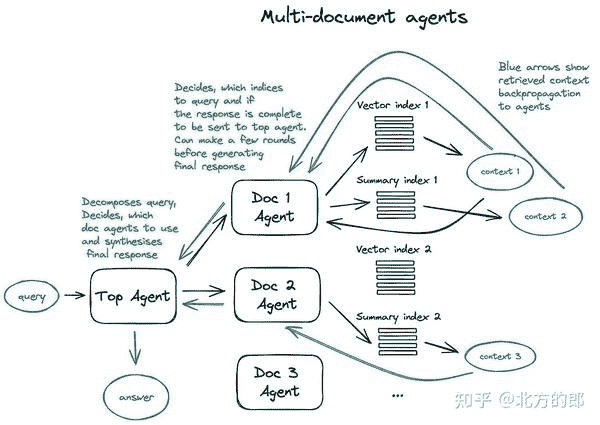

这种复杂方案的缺点可以从图片中猜到 - 由于我们的代理内部的 LLM 进行了多次来回迭代，它有点慢。以防万一，LLM 调用始终是 RAG 管道中最长的操作 - 搜索在设计上针对速度进行了优化。因此，对于大型多文档存储，我建议对该方案进行一些简化，使其具有可扩展性。

###  8.响应合成器

**

这是任何 RAG 管****道的最后**一步 **- 根据我们仔细检索**的所有上下文和初始用户查**询生成答案。

**最简单的方法是**将所有获取**的上下文（高于某个相关阈值[）与查询一起连接并立](https://link.zhihu.com/?target=https%3A//docs.llamaindex.ai/en/stable/module_guides/querying/response_synthesizers/root.html)即提供给 LLM。

但是，与往常一样，还有其他更复杂的选项，涉及多个 LLM 调用，以细化检索到的上下文并生成更好的答案。

响应合成的主要方法是：

1.通过将检索到的上下文逐块发送到 LLM 来迭代地 细化答案

2. 总结检索到的上下文 以适合提示

3.根据不同的上下文块 生成多个答案 ，然后连接或 总结他们 。

有关更多详细信息，请查看 响应合成器模块文档 。

##  编码器和 LLM 微调

这种方法涉及对 RAG 管道中涉及的两个 DL 模型中的一些进行微调 - 要么是 Transformer 编码器，负责嵌入质量，从而负责上下文检索质量 ，要么是 LLM，负责最好地使用所提供的上下文来回答用户查询 ——幸运的是，后者是一个很好的投篮学习者。

如今的一大优势是可以使用 GPT-4 等高端LLM来生成高质量的合成数据集。

但您应该始终意识到，采用由专业研究团队在仔细收集、清理和验证的大型数据集上训练的开源模型，并使用小型合成数据集进行快速调整可能会缩小模型的总体能力。

###  编码器微调

我对编码器的 funetuning [方法也有点怀疑，因](https://link.zhihu.com/?target=https%3A//huggingface.co/spaces/mteb/leaderboard)为针对搜索优化的最新 Transformer 编码器非常高效。 因此，我在LlamaIndex 笔记本

设置中测试了通过微调 bge-large-en-v1.5 （撰写本文时 MTEB 排行榜 前 4 名）带来的性能提升，结果显示检索质量提高了 2%。没什么戏剧性的，但很高兴了解这个选项，特别是如果您正在为其构建 RAG 的狭窄域数据集。

###  排名微调

另一个好的旧选项是使用交叉编码器， 如果您不完全信任您的基本编码器，则可以对检索到的结果进行重新排名。

它的工作方式如下：将查询和检索到的前 k 个文本块传递给交叉编码器，并用 SEP 令牌分隔，并将其微调为输出 1 表示相关块，输出 0 表示不相关。 这种调整过程的一个很好的例子可以在这里

找到，结果表明，通过交叉编码器微调，成对分数提高了 4%。

###  LLM微调

[

最近 ](https://link.zhihu.com/?target=https%3A//platform.openai.com/docs/guides/fine-tuning)Op[enA](https://link.zhihu.com/?target=https%3A//docs.llamaindex.ai/en/stable/examples/finetuning/openai_fine_tuning.html)I 开始提供 LLM 微调 API ，LlamaIndex 有一个关于 在 RAG 设置中微调 GPT-3.5-turbo 的 教程 ，以[“提炼”一些](https://link.zhihu.com/?target=https%3A//docs.ragas.io/en/latest/index.html) GPT-**4 知识。这里的想法是拿一份文档，用 **GPT-3.5-turbo 生成一些问题，然后使用 GPT-4 根据文档内容生成这些问题的答案（构建一个由 GPT4 驱动的 RAG 管道），然后进行细化-在该问答对数据集上调整 GPT-3.5-turbo。用于 RAG 管道评估的 ragas 框架显示 忠实度指标增加了 5%，这意味着经过微调的 GPT 3.5-turbo 模型 比原始模型更好地利用提供的上下文来生成答案。

[

最近的论文](https://link.zhihu.com/?target=https%3A//arxiv.org/pdf/2310.01352.pdf)** RA-DIT： M****eta AI **Research 的[ 检索](https://link.zhihu.com/?target=https%3A//docs.llamaindex.ai/en/stable/examples/finetuning/knowledge/finetune_retrieval_aug.html%23fine-tuning-with-retrieval-augmentation)增强双指令调整 中演示了一种更复杂的方法，提出了一种 在查询三元组上调整 LLM 和检索器

（原始论文中的双编码器）的技术， 上下文和答案 。具体实现请参考本 指南 。

该技术用于通过微调 API 和 Llama2 开源模型（在原始论文中）对 OpenAI LLM 进行微调，从而使知识密集型任务指标增加约 5%（与带有 RAG 的 Llama2 65B 相比）常识推理任务也增加了几个百分点。

如果您知道 RAG 的 LLM 微调的更好方法，请在评论部分分享您的专业知识，特别是如果它们应用于较小的开源 LLM。

##  评估

有 多个 RAG[ 系统性能评估框](https://link.zhihu.com/?target=https%3A//docs.ragas.io/en/latest/index.html)[架 共享](https://link.zhihu.com/?target=https%3A//docs.ragas.io/en/latest/concepts/metrics/faithfulness.html)一些[独立指标的想](https://link.zhihu.com/?target=https%3A//docs.ragas.io/en/latest/concepts/metrics/answer_relevance.html)[法，例如](https://link.zhihu.com/?target=https%3A//docs.ragas.io/en/latest/concepts/metrics/context_precision.html)整体[ 答案相](https://link.zhihu.com/?target=https%3A//docs.ragas.io/en/latest/concepts/metrics/context_recall.html)[关性、答案基础性、](https://link.zhihu.com/?target=https%3A//github.com/truera/trulens/tree/main)忠实性和检索到的上下文相关[性 。

上一节提到的 Ra](https://link.zhihu.com/?target=https%3A//learn.deeplearning.ai/building-evaluating-advanced-rag/)gas使用 忠实**度 和 答案相关**性 作为生成的答案质量指标，**并使用经典的上下****文 精**确度 和 召回率 作为** RAG 方案的检索部**分。

在Andrew NG、**Llam**aInde**x 和评估框架 Truelens 最近发布**的优秀短期课程《 构建和评估高级 RAG》 中，他们提出了 RAG 三元组 ——检索到的与查询的上下文 相关性、接地性 （LLM 答案在多大程度上受到所提供上下文的支持）并 回答 与查询相关的问题。

关键和最可控的指标是 检索到的上下文相关性 - 基本上上述高级 RAG 管道的第 1-7 部分加上编码器和Ranker 微调部分旨在改进该指标，而第 8 部分和 LLM 微调则用于改进该指标。注重答案的相关性和基础性。

可以在此处 找到一个非常简单的检索器评估管道的好示例，并将其应用于编码器微调部分。OpenAI 食谱中演示了

一种更先进的方法，不仅考虑 命中率 ，还考虑 平均倒数排名（一种常见的搜索引擎指标），以及生成的答案指标（例如忠诚度和相关性） 。

LangChain 有一个非常先进的评估框架 LangSmith， 可以在其中实现自定义评估器，并且它监视 RAG 管道内运行的跟踪，以使您的系统更加透明。

如果您使用 LlamaIndex 进行构建，可以使用 rag_evaluator llama pack ，它提供了一个快速工具来使用公共数据集评估您的管道。

##  结论

**

我试图概述 RAG 的核心算**法方法**，并举例说明其中的一些方**法，希望这可能会激发一些新颖的[想法，以](https://link.zhihu.com/?target=https%3A//github.com/run-llama/rags)便在您的 **RAG 管道中**进行尝试，或[者为我今年发明](https://link.zhihu.com/?target=https%3A//blog.langchain.dev/openais-bet-on-a-cognitive-architecture/)的各种技术带来一些系统2023[** 年是迄今为止 M**](https://link.zhihu.com/?target=https%3A//blog.langchain.dev/adding-long-term-memory-to-opengpts/)L 领域最激动人心的一年。

还有很多 其他事情需要考虑， 例如 基于网络搜索的 RAG （由 LlamaIndex、 webLangChain等提供的 RAG ）、深入 研究代理架构 （以及最近 OpenAI 在这个游戏中的股份）以及关于 LLM 长期记忆 的一些想法。

除了答案相关性和忠实性之外，RAG 系统的主要生产挑战是速度 ，特别是如果您喜欢更灵活的基于代理的方案，但这是另一篇文章的内容。ChatGPT 和大多数其他助手使用的这种流媒体功能并不是随机的赛博朋克风格，而仅仅是一种缩短感知答案生成时间的方法。

这就是为什么我看到较小的LLM有一个非常光明的未来，最近发布的 Mixtral 和 Phi-2 正在引领我们朝这个方向发展。