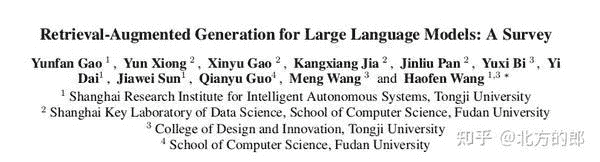
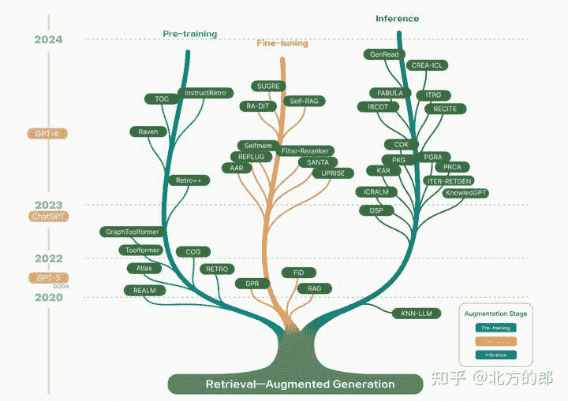
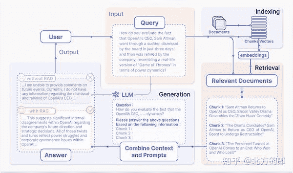
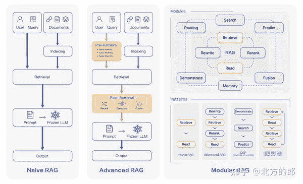
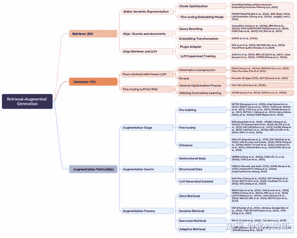
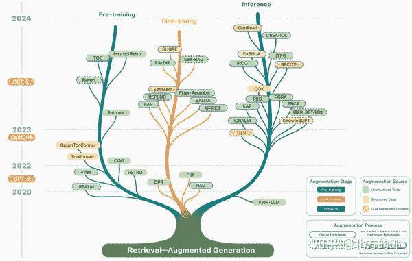
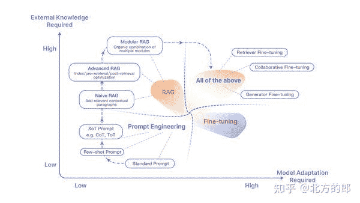
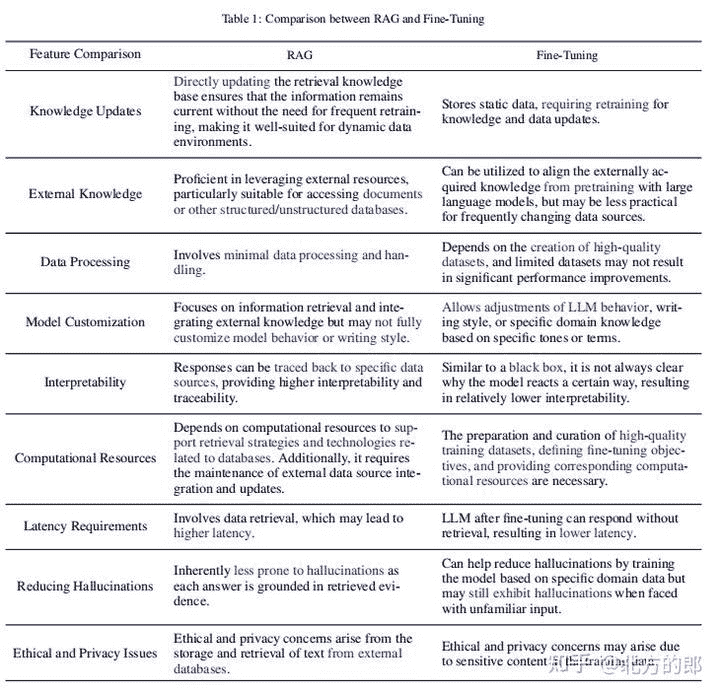
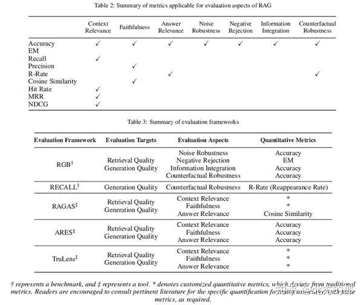
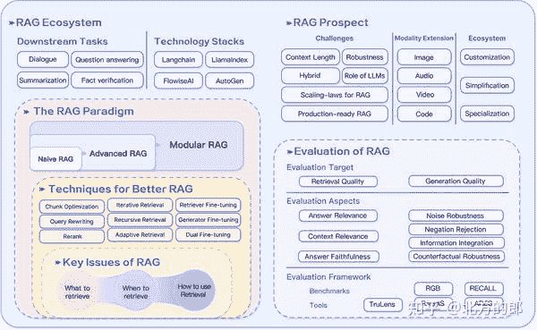

# 大语言模型检索增强生成（RAG）综述

> 来源：[https://agijuejin.feishu.cn/docx/MPDpdTKIQo3FKNxT0oWckR3ynge](https://agijuejin.feishu.cn/docx/MPDpdTKIQo3FKNxT0oWckR3ynge)

> 作者：北方的郎

> 原文：[https://zhuanlan.zhihu.com/p/676162484](https://zhuanlan.zhihu.com/p/676162484)

最近在研究怎么优化大语言模型检索增强生成（RAG），看了很多相关文章，感觉这篇国内研究者写的综述整理的挺详细的。

论文地址：[Retrieval-Augmented Generation for Large Language Models: A Survey](https://arxiv.org/abs/2312.10997)

以下为译文，翻译的过程中有小调整。

## Abstract

大型语言模型（`LLM`）展示了重要的能力，但面临着幻觉、过时的知识以及不透明、不可追踪的推理过程等挑战。通过整合外部数据库的知识，检索增强生成（`RAG`）已成为一种有前景的解决方案。这提高了模型的准确性和可信度，特别是对于知识密集型任务，并允许持续的知识更新和特定领域信息的集成。`RAG` 将`LLM`的内在知识与外部数据库的庞大动态存储库协同融合。这篇综合综述论文详细研究了 `RAG` 范式的进展，包括 `Naive RAG`、`Advanced RAG` 和 `Modular RAG`。它仔细研究了 `RAG` 框架的三方基础，包括检索、生成和增强技术。该论文重点介绍了每个关键组件中嵌入的最先进技术，让人们对 `RAG` 系统的进步有了深刻了解。此外，本文还介绍了评估 `RAG` 模型的指标和基准，以及最新的评估框架。总之，本文描绘了未来的研究途径，包括识别挑战、扩展多模式以及 `RAG` 基础设施及其生态系统的进展。1。

## 1 简介

大型语言模型（`LLM`），例如 `GPT`系列[布朗等人.,2020，OpenAI，2023]和 `LLama` 系列 [Touvron 等人。 , 2023 ] 以及 `Gemini` [Google, 2023 ] 等其他模型在自然语言处理方面取得了显着的成功，展示了超强的性能。通讯作者邮箱：`haofen.wang@tongji.edu.cn`1 资源可在 `https://github.com/Tongji-KGLLM/RAG-Surveyrior` 在包括 `Super-GLUE` 在内的各种基准上的性能 [Wang 等人.,2019]，`MMLU` [Hendrycks 等人.,2020]，和 `BIG-bench` [Srivastava 等人.,2022]。尽管取得了这些进步，`LLM`仍表现出明显的局限性，特别是在处理特定领域或高度专业化的查询时 [Kandpal 等人.,2023]。一个常见的问题是产生不正确的信息，或“幻觉”[Zhang et al.，2017].,2023b]，特别是当查询超出模型的训练数据或需要最新信息时。这些缺点凸显了在没有额外保障措施的情况下在现实生产环境中将`LLM`部署为黑盒解决方案是不切实际的。减轻这些限制的一种有前途的方法是检索增强生成（`RAG`），它将外部数据检索集成到生成过程中，从而增强模型提供准确和相关响应的能力。

`RAG`，由 Lewis 等人引入。[刘易斯等人。 , 2020]2020 年中期，成为`LLM`领域的典范，增强生成性任务。具体来说，`RAG` 涉及一个初始检索步骤，其中`LLM`查询外部数据源以获取相关信息，然后再继续回答问题或生成文本。这个过程不仅为后续生成阶段提供信息，而且确保响应基于检索到的证据，从而显着提高输出的准确性和相关性。在推理阶段从知识库动态检索信息使 `RAG` 能够解决诸如生成不正确的内容（通常称为“幻觉”）等问题。 `RAG` 与`LLM`的集成得到了迅速采用，并已成为完善聊天机器人功能和使`LLM`更适合实际应用的关键技术。

`RAG` 的演化轨迹经历了四个不同的阶段，如图 1 所示。自 2017 年诞生以来，随着 `Transformer` 架构的出现，主要推动力是通过预训练模型 (`PTM`) 吸收额外的知识增强语言模型。这个时代见证了 `RAG` 的基础工作主要针对优化预训练方法。

在这个初始阶段之后，在 `chatGPT` 出现之前，出现了一段相对休眠期，在此期间，`RAG` 的相关研究进展甚微。`chatGPT`的后续到来标志着该领域的关键时刻`Xiv:2312.10997v3 [cs.CL] 3 Jan 2024图1：以代表性工作轨迹为特色的RAG研究发展技术树`，将`LLM`推向最前沿。社区的焦点转向利用`LLM`的能力来提高可控性并满足不断变化的要求。因此，`RAG` 的大部分工作集中在推理上，少数致力于微调过程。随着`LLM`能力的不断进步，特别是随着 `GPT-4` 的引入，`RAG` 技术的面貌发生了重大转变。重点演变成一种混合方法，结合了 `RAG` 和微调的优势，同时少数专门人员继续关注优化预训练方法。

该领域缺乏系统的整合和抽象，这给理解 `RAG` 进展的全面景观带来了挑战。本次调查旨在通过对`LLM`检索增强进行彻底检查，概述整个 `RAG` 流程，并涵盖 `RAG` 研究当前和未来的方向。

因此，本文旨在对`LLM`出现后的技术原理、发展历史、内容，特别是相关方法和应用，以及`RAG`的评估方法和应用场景进行全面的总结和整理。它旨在对现有 `RAG` 技术进行全面的概述和分析，并为未来的开发方法提供结论和前景。本次调查旨在让读者和从业者对大型模型和`RAG`有一个全面、系统的理解，阐明检索增强的进展和关键技术，阐明各种技术的优点和局限性及其适用环境，并预测未来潜在的发展.我们的贡献如下：

+ 我们对最先进的 `RAG`，通过包括 `Naive RAG`、`Advanced RAG` 和 `Modular RAG`。这篇评论结合了更广泛的背景`LLM`领域内的 `RAG` 研究范围。
+ 我们确定并讨论 `RAG` 流程中不可或缺的核心技术，特别关注“检索”、“生成”和“增强”方面，以及
+ 深入研究它们的协同作用，阐明这些组件如何错综复杂地协作形成一个有凝聚力且有效的 `RAG` 框架。
+ 我们为`RAG` 构建了完整的评估框架，概述了评估目标和指标。我们的比较分析从各个角度阐明了 `RAG` 与微调相比的优缺点。此外，我们预计 `RAG` 的未来方向，强调潜在的增强功能应对当前的挑战、向多模式环境扩展以及生态系统的发展。

本文的展开如下：第 2 节和第 3 节定义了 `RAG` 并详细介绍了其发展过程。第 4 节到第 6 节探索核心组件——检索、“生成”和“增强”——重点介绍了不同的嵌入式技术。第 7 节重点介绍 `RAG` 的评估系统。第 8 节将 `RAG` 与其他 `LLM` 优化方法进行比较提出其发展的潜在方向。本文在第 9 节中总结。

## 2 定义

`RAG` 的定义可以从其工作流程来概括。图 2描述了典型的 `RAG` 应用程序工作流程。在这个场景中，用户向 `ChatGPT` 询问最近发生的一件备受瞩目的事件（即 `OpenAI` 首席执行官的突然解雇和复职），该事件引起了相当多的公众讨论。`ChatGPT` 作为最著名和广泛使用的`LLM`，受其预训练数据的限制，缺乏对最近发生的事件的了解。 `RAG` 通过从外部知识库检索最新文档摘录来弥补这一差距。在这种情况下，它会获取与调查相关的精选新闻文章。这些文章与最初的问题一起合并成一个丰富的提示，使 `ChatGPT` 能够综合明智的响应。这个例子说明了 `RAG` 过程，展示了它通过实时信息检索增强模型响应的能力。

从技术上讲，`RAG` 通过各种创新方法得到了丰富，解决了诸如“检索什么”、“何时检索”和“如何使用检索到的信息”等关键问题。信息”。对于“检索什么”的研究已经从简单的标记开始取得进展 [`Khandelwal` 等人.,2019]身份检索[`Nishikawa` 等人.,2022]更复杂的结构，如块[`Ram` 等人.,2023]和知识图谱[`Kang` 等人.,2023]，研究重点是检索的粒度和数据结构化的水平。粗粒度带来更多信息，但精度较低。检索结构化文本可提供更多信息，但会牺牲效率。 “何时检索”的问题导致了从单一的策略[`Wang et al.` ，2023e，`Shi` 等人.,2023]到自适应[`Jiang` 等人.,2023b，`黄`等人.,2023]和多重检索[`Izacard` 等人.,2022]方法。检索频率高带来的信息较多，但效率较低。至于“如何使用”检索到的数据，已经在模型架构的各个级别上开发了集成技术，包括输入[`Khattab` 等人，2017].,2022]，中级 [`Borgeaud` 等人.,2022]，和输出层[`Liang` et al.,2023]。虽然“中间层”和“输出层”的效果比较好，但存在需要训练、效率低的问题。

`RAG` 是一种通过整合外部知识库来增强`LLM`的范式。它采用协同方法，结合信息检索机制和情境学习（`ICL`）来提高`LLM`的表现。在此框架中，用户发起的查询提示通过搜索算法检索相关信息。然后，这些信息将被融入到`LLM`的提示中，为生成过程提供额外的上下文。 `RAG` 的主要优势在于它无需针对特定任务的应用程序对`LLM`进行再培训。开发人员可以添加外部知识库，丰富输入，从而提高模型的输出精度。 `RAG`因其高实用性和低进入门槛而成为`LLM`系统中最受欢迎的架构之一，许多会话产品几乎完全基于`RAG`构建。

`RAG`工作流程包括三个关键步骤。首先，将语料库划分为离散块，在这些块上利用编码器模型构建向量索引。其次，`RAG` 根据块与查询和索引块的向量相似性来识别和检索块。最后，该模型根据从检索到的块中收集的上下文信息合成一个响应。这些步骤构成了 `RAG` 流程的基本框架，支撑着其信息检索和上下文感知生成功能。接下来，我们将介绍`RAG`研究框架。

## 3 RAG框架

`RAG` 研究范式在不断发展，本节主要描述其进展。我们将其分为三种类型：`Naive RAG`、`Advanced RAG` 和`Modular RAG`。虽然 `RAG` 具有成本效益并且超越了本地`LLM`的表现，但它们也表现出一些局限性。 `Advanced RAG` 和`Modular RAG` 的发展正是针对`Naive RAG` 的这些具体缺点的回应。

### 3.1 朴素的 RAG

`Naive RAG` 研究范式代表了最早的方法，在 `ChatGPT` 广泛采用后不久就得到了重视。 `Naive RAG` 遵循传统的过程，包括索引、检索和生成。它也被称为“检索-读取”框架 [`Ma` et al. ，2023a]。

#### 索引

索引过程是数据准备中至关重要的初始步骤，该步骤离线进行并涉及多个阶段。它从数据索引开始，原始数据被清理和提取，各种文件格式（例如 `PDF`、`HTML`、`Word` 和 `Markdown`）被转换为标准化的纯文本。为了适应语言模型的上下文限制，该文本在称为分块的过程中被分割成更小、更易于管理的块。这些块随后通过嵌入模型转换为向量表示，该模型是根据推理效率和模型大小之间的平衡而选择的。这有利于检索阶段的相似性比较。最后，创建一个索引来将这些文本块及其向量嵌入存储为键值对，从而实现高效且可扩展的搜索功能。

#### 恢复

收到用户查询后，系统采用与索引阶段使用的相同编码模型进行转码。 图 2：应用于将输入问答到矢量表示的 `RAG` 过程的代表性实例。然后，它继续计算查询向量与索引语料库中的向量化块之间的相似性分数。系统优先考虑并检索与查询表现出最大相似性的前 `K` 个块。这些块随后被用作解决用户请求的扩展上下文基础。

#### Generation

提出的查询和选定的文档被合成为一个连贯的提示，大型语言模型的任务是制定响应。该模型的回答方法可能会根据特定任务的标准而有所不同，从而允许它利用其固有的参数知识或限制其对所提供文档中包含的信息的响应。在持续对话的情况下，任何现有的对话历史都可以集成到提示中，使模型能够有效地进行多轮对话交互。

#### Naive RAG 的缺点

`Naive RAG` 在三个关键领域面临重大挑战：“检索”、“生成”和“增强”。

检索质量带来了多种挑战，包括精度低，导致检索到的块未对齐以及幻觉或空中掉落等潜在问题。低召回率也会发生，导致无法检索所有相关块，从而阻碍了`LLM`制定全面答复的能力。过时的信息进一步加剧了问题，可能会产生不准确的检索结果。响应生成质量提出了幻觉挑战，其中模型生成的答案不基于所提供的上下文，以及不相关上下文和模型输出中的潜在毒性或偏差的问题。该过程在有效地将检索到的段落中的上下文与当前生成任务整合方面提出了挑战，可能导致脱节或不连贯的输出。冗余和重复也是问题，特别是当多个检索到的段落包含相似信息时，导致生成的响应中出现重复内容。

辨别多个重新检索的段落对生成任务的重要性和相关性是另一个挑战，需要适当平衡每个段落的价值。此外，协调写作风格和语气的差异以确保输出的一致性至关重要。

最后，存在生成模型过度依赖增强信息的风险，可能导致输出仅仅重复检索到的内容，而不提供新的价值或综合信息。

### 3.2 高级RAG

`Advanced RAG` 的开发具有针对性的增强功能，以解决 `Naive RAG` 的缺点。在检索质量方面，`Advanced RAG`实施检索前和检索后策略。为了解决`Naive RAG` 遇到的索引挑战，`Advanced RAG` 使用滑动窗口、细粒度分段和元数据等技术改进了其索引方法。它还引入了各种方法来优化检索过程[`ILIN`，2023]。

#### 预检索过程

优化数据索引。优化数据索引的目标是提高索引内容的质量。这涉及五个主要策略：增强数据粒度、优化索引结构、添加元数据、对齐优化和混合检索。

增强数据粒度旨在提升文本标准化、一致性、事实准确性和丰富上下文，从而提高 `RAG` 系统的性能。这包括删除不相关的信息、消除实体和术语中的歧义、确认事实的准确性、维护上下文以及更新过时的文档。

优化索引结构包括调整块的大小以捕获相关上下文，跨多个索引路径进行查询，以及通过利用图数据索引中节点之间的关系合并来自图结构的信息以捕获相关上下文。

添加元数据信息涉及将引用的元数据（例如日期和目的）集成到块中以用于过滤目的，并合并引用的章节和小节等元数据以提高检索效率。对齐优化通过引入“假设问题”来解决文档之间的对齐问题和差异[`Li` et al] .,2023d]写入文件以纠正对齐问题和差异。

#### 恢复

在检索阶段，主要重点是通过计算查询和块之间的相似性来识别适当的上下文。嵌入模型是这个过程的核心。在先进的 `RAG` 中，嵌入模型有优化的潜力。

##### 微调嵌入。

微调嵌入模型显著影响 `RAG`systems 中检索内容的相关性。这个过程涉及定制嵌入模型以增强特定领域上下文中的检索相关性，特别是对于处理不断发展的或稀有术语的专业领域。 `BGE`嵌入模型[`BAAI`，2023]，例如`BAAI`2开发的`BGE-large-EN`，是高性能嵌入模型的一个例子，可以通过微调来优化检索相关性。可以使用 `GPT-3.5-turbo` 等语言模型生成用于微调的训练数据，以制定基于文档块的问题，然后将其用作微调对。

动态嵌入适应单词使用的上下文，这与静态嵌入不同，静态嵌入为每个单词使用单个向量 [`Karpukhin` 等人，2017].,2020]。例如，在像 `BERT` 这样的 `Transformer` 模型中，同一个单词可以根据周围的单词有不同的嵌入。 `OpenAI` 的 `embeddings-ada-02` 模型，基于像 `GPT` 这样`LLM`的原理构建。是一种复杂的动态嵌入模型，可以捕获上下文理解。然而，它可能无法表现出与 `GPT-4` 等最新全尺寸语言模型相同的对上下文的敏感性。

#### 检索后流程

从数据库中检索有价值的上下文后，必须将其与查询合并作为 `LLM` 的输入，同时解决上下文窗口限制带来的挑战。简单地一次性向`LLM`提交所有相关文件可能会超出上下文窗口限制，引入噪音，并妨碍对关键信息的关注。为了解决这些问题，需要对检索到的内容进行额外处理。重新排名。重新排列检索到的信息以将最相关的内容重新定位到提示的边缘是一个关键策略。这一理念已被实践在 `LlamaIndex`4、`LangChain`5 等框架中`HayStack` [`Blagojevi`，2023]。例如，`DiversityRanker`6 根据文档多样性优先重新排序，而 `LostInTheMiddleRanker` 交替将最佳文档放置在上下文窗口的开头和结尾。此外，诸如 `cohereAI rerank` [`Cohere`, 2023]、`bge-rerank`7 和 `LongLLMLingua` [`Jiang` et al. 2023] 等方法，2023a]重新计算相关文本和查询之间的语义相似度，解决解释基于向量的模拟搜索语义相似度的挑战。

##### 迅速压缩。

研究表明，重新检索的文档中的噪声会对 `RAG` 性能产生不利影响。后期处理的重点在于压缩无关上下文、突出关键段落、减少整体上下文长度。选择性语境和 `LLMLingua` 等方法 [`Litman` 等人.,2020，`安德森`等人.,2022]利用小语言模型计算即时互信息或困惑度，估计元素重要性。 `Recomp` [`Xue` et al。 [`Xue` et al., 2023a] 通过以不同粒度训练压缩器来解决这个问题，而 `LongContext` [`Xue` et al. ，2023b]和“在记忆迷宫中行走”[`Chen` 等人.,2023a]设计摘要技术以增强`LLM`的关键信息感知，特别是在处理广泛的上下文时。

### 3.3 模块化RAG

模块化 `RAG` 结构不同于传统的`Naive RAG` 框架，提供更大的多功能性和灵活性。它集成了各种方法来增强功能模块，例如合并用于相似性检索的搜索模块以及在检索器中应用微调方法[`Lin` et al.,2023]。 `RestructedRAG` 模块 [`Yue` et al.,2022]和迭代方法，例如[`Shao` et al.，2022].,2023]是为了解决特定问题而制定的。模块化 `RAG` 范式日益成为 `RAG` 领域的规范，允许跨多个模块进行序列化管道或端到端训练方法。例如图 3 中所示的三种 `RAG` 范式之间的比较。但是，模块化 `RAG` 并不是独立的。 `Advanced RAG` 是模块化`RAG` 的一种特殊形式，此外，`Naive RAG` 本身是`Advanced RAG` 的特例。三种范式之间是继承与发展的关系。

## 新模块

搜索模块。与 `Naive RAG`/`Advanced RAG` 中的相似性检索相比，搜索模块是针对特定场景量身定制的，并结合了对附加语料库的直接搜索。这种集成是通过使用 LLM 生成的代码、`SQL` 或 `Cypher` 等查询语言以及其他自定义工具来实现的。这些搜索的数据源可以包括搜索引擎、文本数据、表格数据和知识图谱 [Wang 等人，2017].,2023d]。

### 内存模块

该模块利用内存 LLM 指导检索的能力。该方法涉及识别与当前输入最相似的记忆。`Selfmem` [Cheng 等人。 , 2023b] 利用检索增强生成器迭代创建无界内存池，结合“原始问题”和“对偶问题”。通过采用检索增强的生成模型，该模型使用自己的输出来改进自身，文本在推理过程中变得更加符合数据分布。因此，使用模型自身的输出而不是训练数据 [Wang 等人.,2022a]。

### 融合

`RAG-Fusion` [Raudaschl，2023] 通过使用 LLM 将用户查询扩展到多个、不同视角的多查询方法解决传统搜索系统的局限性，从而增强传统搜索系统。这种方法不仅捕获了用户寻求的明确信息，而且还揭示了更深层次的变革性知识。融合过程涉及原始查询和扩展查询的并行矢量搜索、智能重新排序以优化结果，以及将最佳结果与新查询配对。这种复杂的方法可确保搜索结果与用户的显式和隐式意图紧密结合，从而实现更有洞察力和相关性的信息发现。

### 路由

RAG 系统的检索过程利用不同领域、语言和格式的不同来源，这些来源可以根据情况进行交替或合并 [Liet al.，2014].,2023b]。查询路由决定用户查询的后续操作，选项范围包括摘要、搜索特定数据库或将不同路径合并为单个响应。查询路由器还为查询选择适当的数据存储，其中可能包括各种源，如向量存储、图形数据库、关系数据库或索引层次结构，例如用于多文档存储的摘要索引和文档块向量索引。查询路由器的决策是预先定义的，并通过 LLM 调用执行，该调用将查询定向到所选索引。

### 额外生成模块

解决了检索内容中冗余和噪音的常见问题。该模块不是直接从数据源检索，而是利用 LLM 生成必要的上下文 [Yuet al. ，2022]。与通过直接检索获得的内容相比，LLM 生成的内容更有可能包含相关信息。任务自适应模块。该模块重点关注使 RAG 适应各种下游任务。`UPRISE` 自动从预先构建的数据池中检索零样本任务输入的提示，从而增强跨任务和模型的通用性 [Cheng 等人，2017].,2023a]。与此同时，`PROMPTAGATOR` [Daiet al.,2022] 利用 LLM 作为几次查询生成器，并根据生成的数据创建特定于任务的检索器。通过利用 LLM 的泛化能力，它可以用最少的示例开发特定于任务的端到端检索器。

## 新模式

模块化 RAG 的组织结构具有高度适应性，允许在 RAG 流程中替换或重新安排模块以适应特定的问题环境。`Naive RAG` 和 `Advanced RAG` 都可以被视为由一些固定的模块组成。如图 3 所示，`Naive RAG` 主要由“检索”和“读取”模块组成。高级 RAG 的典型模式建立在朴素 RAG 的基础上，添加了“重写”和“重新排序”模块。但总体而言，模块化 RAG 具有更大的多样性和灵活性。

当前的研究主要探索两种组织范式。第一个涉及添加或替换模块，第二个侧重于调整模块之间的组织流程。这种灵活性使得能够定制 RAG 流程以有效地解决各种任务。添加或替换模块。

### 引入或替换模块

的策略包括维护检索读取流程的核心结构，同时集成附加模块以增强特定功能。`RRR` 模型 [Maet al.,2023a] 引入了重写-检索-读取过程，利用 LLM 的表现作为重写模块的强化学习激励。这使得重写器能够微调检索查询，从而提高读取器的下游任务性能。

类似地，模块可以在方法中选择性地交换，例如生成-读取 [Yu et al.,2022]，其中 LLM 的生成模块取代了检索模块。背诵-阅读方法 [Sunet al.,2022] 将外部检索转变为模型权重检索，要求 LLM 最初记住特定于任务的信息，然后产生能够处理知识密集型自然语言处理任务的输出。调整模块之间的流程。

### 模块流程调整

的重点是增强语言模型和检索模型之间的交互。`DSP` [Khattab 等人.,2022] 引入了演示-搜索-预测框架，将情境学习系统视为一个显式程序而不是最终的任务提示，从而更有效地处理知识密集型任务。`ITER-RETGEN` [Shao 等人.,2023] 方法利用生成的内容来指导检索，在检索-读取-检索-读取流程中迭代实现“检索增强生成”和“生成增强检索”。该方法展示了一种使用一个模块的输出来改进另一个模块的功能的创新方法。

## 优化 RAG 管道

检索过程的优化旨在提高 RAG 系统中信息的效率和质量。当前的研究重点是整合不同的搜索技术、完善检索步骤、结合认知回溯、实施多功能查询策略以及利用嵌入相似性。这些努力共同努力在 RAG 系统中实现检索效率和上下文信息深度之间的平衡。

### 混合搜索探索

RAG 系统通过智能集成各种技术（包括基于关键字的搜索、语义搜索和向量搜索）来优化其性能。这种方法利用每种方法的独特优势来适应不同的查询类型和信息需求，确保高度相关和上下文丰富的信息的一致检索。混合搜索的使用可以作为检索策略的有力补充，从而增强 RAG 管道的整体效率。

### 递归检索和查询引擎

递归检索涉及在初始检索阶段获取较小的块以捕获关键语义。随后，包含更多上下文信息的更大块将在该过程的后期阶段提供给 LLM。这种两步重新检索方法有助于在效率和提供上下文丰富的响应之间取得平衡。

### 后退提示方法

鼓励 LLM 远离具体实例并围绕更广泛的概念和原则进行推理 [Zheng et al. ，2023]。实验结果表明，当使用向后提示时，各种具有挑战性的基于推理的任务的性能显著提高，突出了它们对 RAG 过程的自然适应性。这些检索增强步骤既可以应用于生成对后向提示的响应，也可以应用于最终的问答过程。

### 子查询

根据场景的不同，可以采用各种查询策略，例如使用 `LlamaIndex` 等框架提供的查询引擎、利用树查询、利用向量查询或执行简单的块顺序查询。

### 假设的文档嵌入（Hypothetical Document Embeddings）

`HyDE` 运行于相信生成的答案可能比直接查询更接近嵌入空间。使用 LLM，`HyDE` 创建一个假设文档（答案）来响应查询，嵌入该文档，并使用生成的嵌入来检索与假设文档类似的真实文档。这种方法不是基于查询来寻求嵌入相似性，而是专注于从一个答案到另一个答案的嵌入相似性 [Gao et al.，2017].,2022]。然而，它可能不会始终如一地产生理想的结果，特别是当语言模型不熟悉主题时，可能会导致更多错误实例。

## 4 检索

在 RAG 的背景下，从数据源中有效检索相关文档至关重要。然而，培养一只熟练的猎犬却面临着巨大的挑战。本节探讨三个基本问题：1）我们如何实现准确的语义表示？ 2）什么方法可以对齐查询和文档的语义空间？ 3）检索器的输出如何与大语言模型的偏好保持一致？

### 4.1 增强语义表示

在 RAG 中，语义空间至关重要，因为它涉及查询和文档的多维映射。该语义空间中的检索准确性会显著影响 RAG 结果。本节将介绍两种构建准确语义空间的方法。

#### 块优化

管理外部文档时，第一步是将它们分解成更小的块以提取细粒度的特征，然后嵌入这些特征来表示它们的语义。然而，嵌入过大或过小的文本块可能会导致次优结果。因此，确定语料库中文档的最佳块大小对于确保检索结果的准确性和相关性至关重要。

选择合适的分块策略需要仔细考虑几个重要因素，例如索引内容的性质、嵌入模型及其最佳块大小、用户查询的预期长度和复杂性以及特定应用程序对索引的利用。 - 取得的结果。例如，分块模型的选择应该基于内容的长度——无论是长还是短。此外，不同的嵌入模型在不同的块大小下表现出不同的性能特征。例如，`sentence-transformer` 对于单个句子表现更好，而 `text-embedding-ada-002` 对于包含 256 或 512 个标记的块表现更好。

此外，用户输入问题的长度和复杂性以及应用程序的特定需求（例如语义搜索或问答）等因素也会影响分块策略的选择。这种选择可能会直接受到所选 LLM 的代币限制的影响，需要调整区块大小。实际上，获得精确的查询结果需要灵活应用不同的分块策略。不存在放之四海而皆准的“最佳”策略，只有最适合特定情况的策略。

RAG 当前的研究探索了各种旨在提高检索效率和准确性的块优化技术。其中一种方法涉及使用滑动窗口技术，通过跨多个检索过程合并全局相关信息来实现分层检索。另一种策略称为“小到大”方法，在初始搜索阶段利用小文本块，随后向语言模型提供较大的相关文本块进行处理。

摘要嵌入技术根据文档摘要（或摘要）优先进行前 K 项重新检索，从而提供对整个文档上下文的全面理解。此外，元数据过滤技术利用文档元数据来增强过滤过程。图索引技术是一种创新方法，将实体和关系转换为节点和连接，显著提高了相关性，特别是在多跳问题的背景下。这些不同方法的结合带来了无表进步，从而增强检索结果并提高 RAG 性能。

#### 微调嵌入模型

一旦确定了适当的块大小，下一个关键步骤涉及使用嵌入模型将这些块和查询嵌入到语义空间中。嵌入的有效性至关重要，因为它影响模型表示语料库的能力。最近的研究引入了著名的嵌入模型，如 `AngIE`、`Voyage`、`BGE` 等 [Li and Li, 2023, `VoyageAI`, 2023, `BAAI`, 2023]。这些模型已经过广泛的语料库的预训练。然而，当应用于专门领域时，它们准确捕获特定领域信息的能力可能会受到限制。

此外，嵌入模型的特定于任务的微调对于确保模型在内容相关性方面理解用户查询至关重要。未经微调的模型可能无法充分满足特定任务的要求。因此，微调嵌入模型对于下游应用程序至关重要。嵌入微调方法有两种主要范例。

领域知识微调。为了确保嵌入模型准确捕获特定领域的信息，必须利用特定领域的数据集进行微调。此过程与标准语言模型微调不同，主要在于所涉及数据集的性质。通常，用于嵌入模型微调的数据集包含三个主要元素：查询、语料库和相关文档。该模型使用这些查询来识别语料库中的相关文档。然后根据模型响应查询重新检索这些相关文档的能力来衡量模型的有效性。数据集构建、模型微调和评估阶段都面临着不同的挑战。`LlamaIndex` [Liu，2023] 引入了一套关键类和函数，旨在增强嵌入模型微调工作流程，从而简化这些复杂的过程。通过策划一个充满领域知识的语料库并利用所提供的方法，人们可以熟练地微调嵌入模型，以紧密地符合目标领域的特定要求。

下游任务的微调。微调下游任务的嵌入模型是增强模型性能的关键一步。在利用 RAG 完成这些任务的领域中，已经出现了利用 LLM 的能力来微调嵌入模型的创新方法。例如，`PROMPTAGATOR` [Daiet al.,2022 年]

利用 LLM 作为几次查询生成器来创建特定于任务的检索器，解决监督微调方面的挑战，特别是在数据稀缺领域。另一种方法，`LLM-Embedder` [Zhang 等人.,2023a]，利用 LLM 为跨多个下游任务的数据生成奖励信号。检索器使用两种类型的监督信号进行微调：数据集的硬标签和 LLM 的软奖励。这种双信号方法促进了更有效的微调过程，根据不同的下游应用定制嵌入模型。虽然这些方法通过结合领域知识和特定于任务的微调来改进语义表示，但检索器可能并不总是表现出最佳性能与某些 LLM 的兼容性。为了解决这个问题，一些研究人员探索了利用 LLM 的反馈来直接监督微调过程。这种直接监督旨在使检索器与 LLM 更加紧密地结合起来，从而提高下游任务的表现。第 4.3 节中对此主题进行了更全面的讨论

### 4.2 对齐查询和文档

在 RAG 应用程序的上下文中，检索器可以利用单个嵌入模型来编码查询和文档，或者为每个模型使用单独的模型。此外，用户的原始查询可能会受到措辞不精确和缺乏语义信息的影响。因此，将用户查询的语义空间与文档的语义空间保持一致至关重要。本节介绍旨在实现这种对齐的两种基本技术。

#### 查询重写

查询重写是对齐查询和文档语义的基本方法。方法例如 `Query2Doc` 和 `ITER-RETGEN` 利用 LLM 通过结合原始文件来创建伪文档。带有附加指导的最终查询 [Wang 等人.,2023c，Shao 等人.,2023]。`HyDE` 使用文本提示构建查询向量，以生成捕获基本模式的“假设”文档 [Gao 等人，2017].,2022]。`RRR` 引入了一个反转传统检索和读取顺序的框架，重点关注查询重写 [Maet al. ，2023a]。`STEP-BACKPROMPTING` 使 LLM 能够执行基于高级概念的抽象推理和检索 [Zheng et al. ，2023]。此外，多查询检索方法利用 LLM 同时生成和执行多个搜索查询，有利于解决具有多个子问题的复杂问题。

#### 嵌入变换

除了查询重写等广泛策略之外，还存在专门为嵌入转换设计的更细粒度的技术。`LlamaIndex` [Liu, 2023] 通过引入一个可以集成在查询编码器之后的适配器模块来举例说明这一点。该适配器有助于微调，从而优化查询嵌入的表示，将它们映射到与预期任务更紧密相关的潜在空间中。

`SANTA` 解决了将查询与结构化外部文档对齐的挑战，特别是在解决结构化数据和非结构化数据之间的不一致时.,2023d]。它通过两种预训练策略增强检索器对结构化信息的敏感性：首先，利用结构化和非结构化数据之间的内在一致性，在结构化感知预训练方案中进行对比学习；其次，通过实施屏蔽实体预测。后者利用以实体为中心的屏蔽策略，鼓励语言模型预测和填充屏蔽实体，从而促进对结构化数据的更深入理解。将查询与结构化外部文档对齐的问题，特别是在处理差异时 `SANTA` [Liet al. 2017] 解决了结构化和非结构化数据之间的问题.,2023d]。

该方法通过两种预训练策略提高了检索器识别结构化信息的能力：首先，利用结构化和非结构化数据之间的内在一致性来指导结构化感知预训练方案中的对比学习；其次，通过使用屏蔽实体预测。后者使用以实体为中心的屏蔽策略提示语言模型来预测和完成屏蔽实体，从而促进对结构化数据的更深刻的理解。

### 4.3 对齐检索器和 LLM

在 RAG 流程中，通过各种技术提高检索命中率不一定会改善最终结果，因为检索到的文档可能不符合 LLM 的具体要求。因此，本节介绍两种旨在使检索器输出与 LLM 的偏好保持一致的方法。

#### 微调检索器

一些研究利用 LLM 的反馈信号来完善检索模型。例如，`AAR` [Yuet al。 , 2023b] 引入了使用编码器-解码器架构的预训练检索器的监督信号。这是通过 `FiD` 交叉注意力分数识别 LM 的首选文档来实现的。随后，检索器通过硬负采样和标准交叉熵损失进行微调。最终，改进后的检索器可以直接应用于增强未见过的目标语言模型，从而提高目标任务的性能。此外，建议 LLM 可能更倾向于关注可读性而非信息丰富的文档。

`REPLUG` [Shiet al.,2023] 利用检索器和 LLM 来计算检索到的文档的概率分布，然后通过计算 KL 散度来执行监督训练。这种简单有效的训练方法通过使用 LM 作为监督信号来增强检索模型的性能，从而消除了对特定交叉注意机制的需要。

`UPRISE` [Cheng 等人。 , 2023a] 还使用冻结的 LLM 来微调提示检索器。 LLM 和检索器都将提示输入对作为输入，并利用 LLM 提供的分数来监督检索器的训练，从而有效地将 LLM 视为数据集标记器。此外，`Atlas` [Izacard 等人.,2022] 提出了四种监督微调嵌入模型的方法：

+   注意蒸馏（`Attention Distillation`）。这种方法利用 LLM 在输出过程中生成的交叉注意力分数来提取模型的知识。
+   `EMDR2`。通过使用期望最大化算法简单地说，该方法使用检索到的文档作为潜在变量来训练模型。
+   困惑度蒸馏（`Perplexity Distillation`）使用生成的令牌的困惑度作为指标直接训练模型。
+   `LOOP`。该方法根据文档删除对 LLM 预测的影响提出了一种新颖的损失函数，提供了一种有效的训练策略，使模型更好地适应特定任务。

这些方法旨在提高检索者和 LLM 之间的协同作用，从而提高检索性能并更准确地响应用户查询。

#### 适配器

微调模型可能会带来挑战，例如通过 API 集成功能或解决因有限的本地计算资源而产生的约束。因此，一些方法选择结合外部适配器来帮助对齐。

`PRCA` 通过上下文提取来训练适配器阶段和奖励驱动阶段。然后使用基于令牌的自回归策略优化检索器的输出 [Yang et al. ，2023b]。令牌过滤方法采用交叉注意力分数来有效地过滤令牌，仅选择得分最高的输入到令牌 [Berchansky et al. 2017].,2023] 。`RECOMP` 引入了用于摘要生成的提取式和生成式压缩器。这些压缩器要么选择相关句子，要么合成文档信息，创建适合多文档查询的摘要 [Xuet al.，2023].,2023a]。

此外，`PKG` 引入了一种创新方法，通过指令微调将知识集成到白盒模型中 [Luoet al. ，2023]。在这种方法中，检索器模块被直接替换以根据查询生成相关文档。该方法有助于解决微调过程中遇到的困难并提高模型性能。

## 5 Generation

RAG 的一个重要组成部分是它的生成器，它负责将检索到的信息转换为连贯且流畅的文本。与传统语言模型不同，RAG 的生成器通过合并检索到的数据来提高准确性和相关性，从而脱颖而出。在 RAG 中，生成器的输入不仅包含典型的上下文信息，还包含通过检索器获得的相关文本片段。这种全面的输入使生成器能够深入了解问题的上下文，从而产生信息更丰富且与上下文相关的响应。此外，生成器以检索到的文本为指导，以确保生成的内容和获得的信息之间的连贯性。多样化的输入数据导致了在生成阶段有针对性的努力，所有这些都是为了改进大型模型对从查询和文档导出的输入数据的适应。在下面的小节中，我们将通过深入研究检索后处理和微调的方面来探索生成器的引入。

### 5.1 冻结 LLM 的检索后处理

# 检索后处理与 RAG 模型优化

在不可调节的 LLM 领域，许多研究依赖于 GPT-4 [OpenAI，2023] 等成熟的模型来利用其全面的内部知识来系统地综合从各种文档中检索到的信息。然而，这些大型模型仍然存在挑战，包括局限性关于上下文长度和对冗余信息的敏感性。为了解决这些问题，某些研究工作已将重点转向检索后处理。检索后处理涉及处理、过滤或优化检索器从大型文档数据库中检索到的相关信息。其主要目标是提高检索结果的质量，使其与用户需求或后续任务更紧密地结合。它可以被视为对检索阶段获得的文档的处理。检索后处理中的常见操作通常包括信息压缩和结果重排序。

## 信息压缩

检索器擅长从庞大的知识库中检索相关信息，但管理检索文档中的大量信息是一个挑战。正在进行的研究旨在扩展大型语言模型的上下文长度来解决这个问题。然而，当前的大型模型仍然面临上下文限制。因此，在某些情况下压缩信息变得有必要。信息压缩对于减少噪音、解决上下文长度限制和增强生成效果具有重要意义。

PRCA 通过训练信息提取器解决了这个问题 [Yang 等人.,2023b]。在上下文提取阶段，当提供输入文本 `Sinput` 时，它能够生成表示来自输入文档的压缩上下文的输出序列 `Cextracted`。训练过程旨在最小化 `Cextracted` 和实际上下文 `Ctruth` 之间的差异。

同样，RECOMP 采用了类似的方法使用对比学习训练信息冷凝器[Xuet al.,2023a]。每个训练数据点由一个正样本和五个负样本组成，编码器在整个过程中使用对比损失进行训练 [Karpukhin 等人，2017].,2020]。

另一项研究采取了不同的方法，目标是：减少文档数量以提高模型答案的准确性。在[Maet al.的研究中.,2023b]，他们提出了“Filter-Reranker”范式，结合了LLM和小语言模型（SLM）的优势。在此范例中，SLM 充当过滤器，而 LLM 则充当重新排序代理。研究表明，指导LLM重新排列 SLM 识别的挑战性样本可以显着改进各种信息提取 (IE) 任务。

## 重新排名

重新排序模型对于优化从检索器检索的文档集至关重要。当引入额外的上下文时，语言模型通常会面临性能下降的问题，而重新排序可以有效地解决这个问题。核心概念涉及重新排列文档记录，将最相关的项目优先排列在顶部，从而限制文档的总数。这不仅解决了检索过程中上下文窗口扩展的挑战，而且还提高了检索效率和响应能力。

重新排名模型自始至终都承担着双重角色信息检索过程，既充当优化器又充当细化器。为后续语言模型处理提供更有效、更准确的输入[Zhang et al. ，2023]。

上下文压缩被纳入重新排序过程中，以提供更精确的检索信息。这种方法需要减少单个文档的内容并过滤整个文档，最终目标是在搜索结果中呈现最相关的信息，以便更集中和准确地显示相关内容。

## 5.2 RAG 的 LLM 微调

优化 RAG 模型中的生成器是其架构的一个关键方面。生成器的作用是获取检索到的信息并生成相关文本，形成模型的最终输出。生成器的优化旨在确保生成的文本既自然又有效地利用检索到的文档来更好地满足用户的查询需求。

在标准 LLM 生成任务中，输入通常由查询组成。 RAG 的突出之处在于不仅将查询纳入输入，而且将检索器检索到的各种文档（结构化/非结构化）纳入输入中。这些附加信息可以显著影响模型的理解，特别是对于较小的模型。在这种情况下，微调模型以适应查询和检索文档的输入变得至关重要。在将输入呈现给微调模型之前，通常会对检索器检索到的文档进行检索后处理。值得注意的是，RAG 中生成器的微调方法与 LLM 的一般微调方法一致。下面，我们将简要描述一些涉及数据（格式化/未格式化）和优化函数的代表性工作。

### 一般优化流程

作为一般优化过程的一部分，训练数据通常由输入输出对组成，旨在训练模型在给定输入 `x` 的情况下产生输出 `y`。在 Self-Mem 的工作中 [Cheng 等人。 , 2023b]，采用传统的训练过程，其中给定输入 `x`，检索相关文档 `z`（在论文中选择 Top-1），并在整合 `(x,z)` 后，模型生成输出 `y`。论文利用了两种常见的范式用于微调，即联合编码器和双编码器 [Arora 等人.,2023，王等人.,2022b，刘易斯等人.,2020，夏等人.,2019，Caiet 等人.,2021 年，Cheng 等人.,2022]。

在联合编码器范例中，使用基于编码器-解码器的标准模型。这里，编码器最初对输入进行编码，解码器通过注意力机制结合编码结果以自回归方式生成令牌。另一方面，在双编码器范例中，系统设置两个独立的编码器，每个编码器分别对输入（查询、上下文）和文档进行编码。由此产生的输出由解码器按顺序进行双向交叉注意处理。两种架构都利用 Trans-former [Vaswani 等人.,2017]作为基础模块，并用负对数似然损失进行优化。利用对比学习在为语言模型准备训练数据的阶段，通常会创建输入和输出的交互对。这种传统方法可能会导致“暴露偏差，”其中模型仅在单独的、正确的输出示例上进行训练，从而限制其暴露于一系列可能的输出引用序列。这种限制可能会导致模型过度拟合训练集中的特定示例，从而阻碍模型在现实世界中的性能，从而降低其在各种上下文中进行泛化的能力。

为了减轻曝光偏差，SURGE [Kang 等人.,2023]提出使用图文对比学习。该方法包括一个对比学习目标，该目标促使模型产生一系列合理且连贯的响应，扩展到训练数据中遇到的实例之外。这种方法对于减少过度拟合和增强模型的泛化能力至关重要。

对于涉及结构化数据的检索任务，SANTA 框架 [Liet al. ，2023d]实施三方培训方案，以有效封装结构和语义的细微差别。初始阶段侧重于检索器，其中利用对比学习来细化查询和文档嵌入。

随后，生成器的初步训练阶段采用对比学习来将结构化数据与其非结构化文档描述对齐。在生成器训练的进一步阶段，该模型承认实体语义在检索文本数据的表示学习中的关键作用，正如 [Sciavolino 等人，2017] 所强调的那样.,2021，张等人.,2019]。该过程从识别结构化数据中的实体开始，然后对生成器的输入数据中的这些实体应用掩码，从而为模型预测和预测这些掩码元素奠定了基础。

训练方案随着模型学习利用上下文信息重建屏蔽实体而进展。这项练习培养了模型对文本数据结构语义的理解，并促进结构化数据中相关实体的对齐。总体优化目标是训练语言模型准确地恢复模糊的跨度，从而丰富其对实体语义的理解[耶特等人。 , 2020 ].

# RAG 增强

本节围绕三个关键方面进行构建：增强阶段、增强数据源和增强过程。这些方面阐明了对 RAG 开发至关重要的关键技术。分类法RAG 的核心组件如图 4 所示。

## 6.1 增强阶段的 RAG

RAG是一项知识密集型的工作，在语言模型训练的预训练、微调和推理阶段融合了多种技术方法。

### 预训练阶段

在预训练阶段，研究人员通过图 4：RAG 核心组件基于检索的策略的分类，研究了支持开放域 QA 的 PTM 的方法。 REALM 模型采用结构化、可解释的方法进行知识嵌入、框架预训练和微调，作为掩码语言模型 (MLM) 框架内的检索然后预测工作流程 [Arora 等人，2017].,2023]。

复古 [Borgeaud 等人.,2022]利用检索增强从头开始进行大规模预训练，实现了模型参数的减少，同时在困惑度方面超越了标准 GPT 模型。 RETRO 的独特之处在于，它有一个额外的编码器，旨在处理从外部知识库检索的实体特征，建立在 GPT 模型的基础结构之上。

阿特拉斯 [Izacard 等人.,2022]还将检索机制合并到 T5 架构中[Raffel et al.，2022].,2020]在预训练和微调阶段。它使用预训练的 T5 来初始化编码器-解码器语言模型，并使用预训练的密集检索器 Contriever，提高其复杂语言建模任务的效率.,2022]引入了一种新颖的文本生成方法，该方法模拟从预先存在的集合中复制文本片段。利用高效的矢量搜索工具，COG 计算并索引文本片段的上下文有意义的表示，与 RETRO 相比，在问答和领域适应等领域展示了卓越的性能。

标度律的出现促进了模型参数的增长，推动自回归模型进入主流。研究人员正在将 RAG 方法扩展到预训练的更大模型，RETRO++ 通过扩大模型参数同时保持或增强性能来例证这一趋势 [Wang 等人，2017].,2023b]。

经验证据强调了文本生成质量、事实准确性、毒性降低和下游任务熟练程度的显著提高，特别是在开放域 QA 等知识密集型应用中。这些结果表明，将检索机制集成到自回归语言模型的预训练中构成了一条有前途的途径，将复杂的检索技术与扩展的语言模型相结合，以产生更精确、更高效的语言生成。

尽管如此，这种方法面临着一些挑战，例如需要大量的预训练数据集和资源，以及随着模型大小的增加而降低更新频率。尽管存在这些障碍，该方法在模型弹性方面提供了显著的优势。经过训练后，检索增强模型可以独立于外部库运行，从而提高生成速度和运行效率。所确定的潜在收益使该方法成为人工智能和机器学习领域持续调查和创新的引人注目的主题。

### 微调阶段

RAG 和微调是增强功能的强大工具LLM，两者结合可以满足更具体场景的需求。一方面，微调允许检索具有独特风格的文档，实现更好的语义表达并对齐查询和文档之间的差异。这确保了检索器的输出更适合当前的场景。另一方面，微调可以满足风格化、针对性调整的生成需求。此外，还可以使用微调来对齐检索器和生成器，以提高模型协同作用。

微调检索器的主要目标是提高语义表示的质量，这是通过使用语料库直接微调嵌入模型来实现的[Liu, 2023]。通过反馈信号将检索器的功能与LLM的偏好保持一致, 两者都可以更好地协调[Yuet al.,2023b，Izacard 等人.,2022，杨等人.,2023b，Shi 等人.,2023]。针对特定的下游任务微调检索器可以提高适应性[引用]。引入与任务无关的微调目的是为了增强检索器在多任务场景中的多功能性[Cheng等人.,2023a]。

微调发生器可以产生更加风格化和定制化的输出。一方面，它允许用于专门适应不同的输入数据格式。例如，微调 LLM 以适应知识图的结构 [Kang 等人.,2023]，文本对的结构[Kang 等人.,2023，Cheng 等人.,2023b]，以及其他特定结构[Liet al.,2023d]。另一方面，通过构建指令数据集，人们可以要求LLM生成特定格式的内容。例如，在自适应迭代检索场景中，LLM经过微调以生成有助于确定下一步行动的时间的内容[Jiang et al.，2017].,2023b，Asai 等人.,2023]。通过协同微调检索器和生成器，我们可以增强模型的泛化能力，并避免单独训练它们可能出现的过度拟合。然而，联合微调也会导致资源消耗增加。 RA-DIT [Linet 等.,2023]提出了一个轻量级的双指令调优框架，可以有效地为任何LLM添加检索功能。检索增强指令微调更新了LLM，指导其更有效地利用检索到的信息并忽略分散注意力的内容。

尽管有其优点，但微调也有其局限性，包括需要专门的数据集进行 RAG 微调以及需要大量的计算资源。但是，此阶段允许根据特定需求和数据格式自定义模型，与预训练阶段，同时仍然能够微调模型的输出风格。

总之，微调阶段对于 RAG 模型适应特定任务至关重要，从而能够细化检索器和生成器。尽管存在资源和数据集要求带来的挑战，但该阶段增强了模型对各种任务的多功能性和适应性。因此，RAG 模型的战略微调是开发高效且有效的检索增强系统的关键组成部分。

### 推理阶段

RAG 模型的推理阶段至关重要，因为它涉及与LLM的广泛集成。传统的 RAG 方法，也称为 Naive RAG，涉及在此阶段合并检索内容来指导生成过程。为了克服 Naive RAG 的局限性，先进的技术在推理过程中引入了更多上下文丰富的信息。 DSP 框架 [Khattab 等人.,2022]利用冻结 LM 和检索模型 (RM) 之间复杂的自然语言文本交换，丰富环境，从而改善生成结果。 PKG [Luoet al。 , 2023]方法装备LLM知识引导模块，允许在不修改语言模型参数的情况下检索相关信息，从而实现更复杂的任务执行。 CREA-ICL [Liet al.,2023b]采用跨语言知识的同步检索来增强上下文，而 RE-CITE [Sunet al. ，2022]通过直接从LLM中采样段落来生成上下文。

#### 在推理期间进一步细化 RAG 过程

在满足需要多步骤推理的任务的方法中可以看到这一点。 ITRG [冯等人.,2023]迭代地检索信息以识别正确的推理路径，从而提高任务适应性。 ITER-RETGEN [Shao 等人.,2023]遵循迭代策略，将检索和生成合并在一个循环过程中，在“检索增强生成”和“生成增强检索”之间交替。对于非知识密集型（NKI）任务，PGRA [Guo et al. ，2023]提出了一个两阶段框架，首先是一个与任务无关的检索器，然后是一个提示引导的重新排序器来选择证据并对其进行优先级排序。相比之下，IRCOT [Trivedi 等人.,2022]将 RAG 与思想链 (CoT) 方法相结合，将 CoT 引导的检索与检索通知的 CoT 过程交替进行，显著提高了 GPT-3 在各种问答任务中的性能。本质上，这些推理阶段的增强提供了轻量级，具有成本效益的替代方案，利用预训练模型的功能，无需进一步训练。主要优点是维护静态 LLM 参数，同时提供上下文相关信息以满足特定任务需求。然而，这种方法并非没有局限性，因为它需要细致的数据处理和优化，并且受到基础模型固有功能的约束。为了有效地解决不同的任务要求，该方法通常与程序优化技术结合使用，例如逐步推理、迭代检索和自适应检索策略。

## 6.2 增强源

RAG 模型的有效性很大程度上受到增强数据源选择的影响。不同层次的知识和维度需要不同的处理技术。它们被分类为非结构化数据、结构化数据和LLM生成的内容。图 5 描绘了具有不同增强方面的代表性 RAG 研究的技术树。叶子以三种不同的颜色着色，代表使用各种类型的数据进行的增强：非结构化数据、结构化数据和LLM生成的内容。该图清楚地表明，最初，增强主要通过非结构化数据（例如纯文本）来实现。这种方法后来扩展到包括使用结构化数据（例如知识图）来进一步改进。最近，利用LLM自己生成的内容进行检索和增强目的的研究趋势不断增长。

### 使用非结构化数据进行增强

非结构化文本是从语料库中收集的，例如用于微调大型模型的提示数据 [Cheng 等人.,2023a]和跨语言数据[Liet al.,2023b]。检索单位从标记（例如，kNN-LM [Khandelwal et al.，2019]）到短语（例如，NPM、COG [Leeet al.，2020，Lan et al.，2022]）和文档段落不同，具有更细的粒度，提供预检索。 -以增加检索复杂性为代价的切除。FLARE [Jiang 等人。 , 2023b]引入了一种主动检索方法，由 LM 生成低概率单词触发。它创建一个用于文档检索的临时句子，然后使用重新检索的上下文重新生成该句子以预测后续句子。 RETRO使用前一个 `chunk` 来检索 `chunk` 级别的最近邻居，结合前一个 `chunk` 的上下文，指导下一个 `chunk` 的生成。为了保持因果关系，下一个块 `Cionly` 的生成利用前一个块 `N(Ci − 1)` 的最近邻居，而不是 `N(Ci)`。

### 用结构化数据增强

结构化数据，例如知识图（KG），提供高质量的上下文并减轻模型幻觉。 RET-LLMs [Modarressi 等人.,2023]从过去的对话构建知识图记忆以供将来参考。 SUGRE [康等人.,2023]采用图神经网络（GNN）来编码相关的知识图谱子图，通过多模式对比学习确保检索到的事实和生成的文本之间的一致性。 Knowl-edGPT [Wang 等人.,2023d]生成知识库搜索查询并将知识存储在个性化库中，从而增强 RAG 模型的知识丰富性和上下文性。

### RAG 中 LLM 生成的内容

为了解决 RAG 中外部辅助信息的局限性，一些研究集中于利用LLM的内部知识。 SKR [王等人.,2023e]将问题分类为已知或未知，有选择地应用检索增强。 GenRead [悦等.,2022]用 LLM 生成器替换了检索器，发现 LLM 生成的上下文通常包含更准确的答案，因为与因果语言建模的预训练目标更好地保持一致。 Selfmem [程等人。 , 2023b]迭代地创建一个带有检索增强生成器的无界内存池，使用内存选择器来选择作为原始问题的对偶问题的输出，从而自我增强生成模型。

这些方法强调了 RAG 中创新数据源利用的广度，努力提高模型性能和任务有效性。

## 6.3 增强过程

在 RAG 领域，标准实践通常涉及单个检索步骤，然后是生成，这可能导致效率低下。当单次检索产生可能稀释或矛盾基本信息的冗余内容，从而降低生成质量时，就会出现一个值得注意的问题，称为“迷失中间”现象.,2023a]。此外，这种单一检索通常不足以解决需要多步骤推理的复杂问题，因为它提供的信息范围有限[Yoran et al. ，2023]。

如图5所示，为了规避这些挑战，当代研究提出了改进检索过程的方法：迭代检索、递归检索和自适应检索。迭代检索允许模型参与多个检索周期，从而增强所获得信息的深度和相关性。递归检索过程，其中一次检索操作的结果用作后续检索的输入。它有助于深入研究相关信息，特别是在处理复杂或多步骤查询时。递归检索通常用于需要逐步方法才能得出最终答案的场景，例如学术研究、法律案例分析或某些类型的数据挖掘任务。另一方面，自适应检索提供了动态调整机制，根据不同任务和上下文的特定需求定制检索过程。

### 迭代检索

RAG 模型中的迭代检索是一个根据初始查询和迄今为止生成的文本重复收集文档的过程，为`LLM`提供更全面的知识库 [Borgeaud 等人.,2022，阿罗拉等人.,2023]。事实证明，这种方法可以通过多次重新检索迭代提供额外的上下文参考，从而增强后续答案生成的稳健性。然而，它可能会受到语义不连续性和不相关信息积累的影响，如图 5：具有不同增强方面的代表性 RAG 研究的技术树，它通常依赖于 `n` 个标记的序列来划分生成的文本和检索到的文档之间的边界。利用特定的数据场景、递归检索和多跳检索技术。递归检索涉及以分层方式处理和检索数据的结构化索引，这可能包括在基于此摘要执行检索之前对文档或冗长的 PDF 的各个部分进行摘要。随后，文档内的二次检索完善了搜索，体现了该过程的递归性质。相比之下，多跳检索旨在更深入地研究图结构数据源，提取互连信息[Liet al.，2017].,2023c]。

此外，一些方法集成了检索和生成的步骤。`ITER-RETGEN` [Shao 等人.,2023]采用协同方法，利用“检索增强生成”和“生成增强重检索”来完成需要再现特定信息的任务。该模型利用处理输入任务所需的内容作为检索相关知识的上下文基础，这反过来又有助于在后续迭代中生成改进的响应。

### 递归检索

递归检索通常用于信息检索和自然语言处理，以提高搜索结果的深度和相关性。该过程涉及根据先前搜索获得的结果迭代地细化搜索查询。递归检索旨在通过反馈循环逐渐收敛最相关的信息来增强搜索体验。`IRCoT` [Trivedi 等人.,2022]使用思想链来指导检索过程，并利用获得的检索结果细化`CoT`。`ToC` [Kim 等人.,2023]创建一个澄清树，系统地优化查询中不明确的部分。它在复杂的搜索场景中特别有用，在这些场景中，用户的需求从一开始就不完全清楚，或者所寻求的信息高度专业化或细致入微。该过程的递归性质允许持续学习和适应用户的需求，通常会提高对搜索结果的满意度。

### 自适应检索

自适应检索方法，例如`Flare`和`Self-RAG` [Jiang 等人.,2023b，Asai 等人.,2023]，通过使`LLM`能够主动确定检索的最佳时刻和内容来完善`RAG`框架，从而提高所获取信息的效率和相关性。

这些方法是更广泛趋势的一部分，其中`LLM`在其运作中采用积极的判断，因为在`AutoGPT`、`Toolformer`等模型代理中看到`Graph-Toolformer` [Yang 等人.,2023c，Schick 等人.,2023，张，2023]。例如，`Graph-Toolformer`将其重新检索过程分为不同的步骤，其中`LLM`主动进行检索、应用自我询问技术，并采用少量提示来启动搜索查询。这种积极主动的立场使`LLM`能够决定何时搜索必要的信息，类似于代理人如何使用工具。

`WebGPT` [Nakano 等人.,2021]集成了强化学习框架来训练`au-`中的`GPT-3`模型标记来导航此过程，这些标记有助于执行搜索引擎查询、浏览结果和引用参考文献等操作，从而通过使用外部搜索引擎扩展`GPT-3`的功能。

`Flare`通过监控生成过程的置信度（如生成术语的概率所示）来自动执行定时检索 [Jiang et al., 2017].,2023b]。当概率低于某个阈值时将激活检索系统来收集相关信息，从而优化检索周期。

`Self-RAG` [Asai 等人.,2023]引入了“`reflection to-kens`”，允许模型内省其输出。这些令牌有两种类型：“检索”和“评论家”。该模型自主决定何时激活检索，或者，预定义的阈值可能会触发该过程。在检索过程中，生成器在多个段落中进行片段级波束搜索，以得出最连贯的序列。批评分数用于更新细分分数，并在推理过程中灵活调整这些权重，从而定制模型的行为。`Self-RAG`的设计消除了对额外分类器的需要或对自然语言推理(`NLI`)模型的依赖，从而简化了何时使用重新检索机制的决策过程，并提高了模型生成准确响应的自主判断能力。

### 6.4 RAG 与微调

`LLM`优化由于其日益流行而受到了极大的关注。即时工程、微调(`FT`)和`RAG`等技术各自具有独特的特征，如图 6 所示。虽然即时工程利用模型的固有功能，但优化`LLM`通常需要应用`RAG`和`FT`方法。`RAG`和`FT`之间的选择应基于场景的具体要求以及每种方法的固有属性。`RAG`和`FT`的详细比较如表 1 所示。

`RAG`就像为模型提供了一本用于定制信息检索的教科书，非常适合特定查询。另一方面，`FT`就像学生随着时间内化知识，更好地复制特定的结构、风格或格式。`FT`可以通过强化基础模型知识、调整输出和教授复杂指令来提高模型性能和效率。然而，它不太适合集成新知识或快速迭代新用例。`RAG`和`FT`这两种方法并不相互排斥，而是可以互补，在不同层面上增强模型的能力。在某些情况下，将它们结合使用可能会产生最佳性能。涉及`RAG`和`FT`的优化过程可能需要多次迭代才能获得满意的结果。

## 7 RAG 评估

`RAG`在自然语言处理(`NLP`)领域的快速发展和日益广泛的采用，将`RAG`模型的评估推向了`LLM`社区研究的前沿。此评估的主要目标是了解和优化`RAG`模型在不同应用场景中的性能。

从历史上看，`RAG`模型评估集中在他们在特定下游任务中的执行情况。这些评估采用适合当前任务的既定指标。例如，问答评估可能依赖于`EM`和`F1`分数 [Wang 等人。 , 2023a,希特等人.,2023，冯等人.,2023，Ma 等人.,2023a]，而事实检查任务通常取决于作为主要指标的准确性[Lewis et al.，2023a].,2020，伊扎卡德等人.,2022，邵等人.,2023]。`RALLE`等工具专为`RAG`应用程序的自动评估而设计，同样将其评估基于这些特定于任务的指标 [Hoshi 等人，2017].,2023]。尽管如此，致力于评估`RAG`模型独特特征的研究仍然非常缺乏，相关研究也屈指可数。

以下部分将重点从特定于任务的评估方法和指标转移到基于其独特属性的现有文献的综合。这一探索涵盖了`RAG`评估的目标、评估这些模型的方面以及可用于此类评估的基准和工具。目的是提供`RAG`模型评估的全面概述，概述专门解决这些先进生成系统独特方面的方法。

### 7.1 评价目标

`RAG`模型的评估主要围绕两个关键组件：检索和生成模块。该部门确保对所提供的上下文的质量和所生成的内容的质量进行彻底的评估。检索质量评估检索质量对于确定检索器组件所提供的上下文的有效性至关重要。来自搜索引擎、推荐系统和信息检索系统领域的标准度量被用来测量`RAG`检索模块的性能。命中率、`MRR`和`NDCG`等指标通常用于此目的 [Liu, 2023,Nguyen, 2023]。

#### 生成质量

生成质量的评估集中于生成器从检索到的上下文中合成连贯且相关的答案的能力。该评估可以根据内容的目标进行分类：未标记的内容和已标记的内容。对于未标记的内容，评估包括生成答案的真实性、相关性和无害性。相反，对于标记内容，重点在于图6：`RAG`与其他模型优化方法模型相比产生的信息的准确性 [Liu，2023]。此外，检索和生成质量评估都可以通过手动或自动评估方法进行[Liu，2023，Lan et al.,2022，Leng 等人.,2023]。

### 7.2 评价方面

当前`RAG`模型的评估实践强调三个主要质量分数和四个基本能力，它们共同指导`RAG`模型的两个主要目标的评估：检索和生成。

#### 质量分数

质量分数包括上下文相关性、答案可信度和答案相关性。这些质量分数在信息检索和生成过程中从不同角度评估`RAG`模型的效率 [Eset al. ，2023，Saad-Falcon 等人.,2023，贾维斯和阿拉德，2023]。质量分数（上下文相关性、答案忠实度和答案相关性）从各个角度评估`RAG`模型在整个信息检索和生成过程中的效率 [Eset al. ，2023，Saad-Falcon 等人.,2023，Jarvis 和 Allard，2023]。上下文相关性评估检索到的上下文的精确度和特异性，确保相关性并最大限度地减少与无关内容相关的处理成本。

答案忠实性确保生成的答案与检索到的上下文保持一致，保持一致性并避免矛盾。答案相关性要求生成的答案与提出的问题直接相关，有效解决核心问题。

#### 所需能力

`RAG`评估还包括四种表明其适应性和效率的能力：噪声鲁棒性、负拒绝、信息集成和反事实鲁棒性.,2023b，刘等人.,2023b]。这些能力对于模型在各种挑战和复杂场景下的性能至关重要，影响质量分数。噪声鲁棒性评估模型管理与问题相关但缺乏实质性信息的噪声文档的能力。

否定拒绝评估模型在检索到的文档不包含回答问题所需的知识时避免回答的辨别力。信息集成评估模型从多个文档中合成信息以解决复杂问题的熟练程度。

反事实稳健性测试模型识别和忽略文档中已知不准确之处的能力，即使在被指示有关潜在错误信息的情况下也是如此。

上下文相关性和噪声鲁棒性对于评估检索质量很重要，而答案忠实度、答案相关性、否定拒绝、信息整合和反事实鲁棒性对于评估生成质量很重要。

表2总结了每个评估方面的具体指标。必须认识到，这些源自相关工作的指标是传统的衡量标准，尚未代表量化`RAG`评估方面的成熟或标准化方法。针对`RAG`模型的细微差别量身定制的自定义指标虽然未包含在此处，但也已在一些评估研究中得到开发。

### 7.3 评估基准和工具

本节描述了`RAG`模型的评估框架，包括基准测试和自动评估工具。这些工具提供的定量指标不仅可以衡量`RAG`模型的性能，还可以增强对模型在各个评估方面的能力的理解。著名的基准测试，例如`RGB`和`RECALL` [Chen 等人.,2023b，刘等人。 , 2023b]重点评估`RAG`模型的基本能力。同时，最先进的自动化工具，如`RA-GAS` [Eset al.,2023]，`ARES` [Saad-Falcon 等人.,2023]，`TruLens`8 采用`LLM`来判定质量分数。这些工具和基准共同构成了`RAG`模型系统评估的稳健框架，如表 3 所示。

† 代表基准，‡ 代表工具。* 表示定制的定量指标，与传统指标不同。我们鼓励读者根据需要查阅相关文献，了解与这些指标相关的具体量化公式。

## 8 未来展望

本节探讨了`RAG`的三个未来前景：未来挑战、模式扩展和`RAG`生态系统。

### 8.1 `RAG`的未来挑战

尽管`RAG`技术取得了相当大的进步，但仍然存在一些需要深入研究的挑战：

上下文长度。`RAG`的功效受到大型语言模型(`LLM`)上下文窗口大小的限制。平衡窗口太短（可能导致信息不足）和太长（可能导致信息稀释）之间的权衡至关重要。随着不断努力将`LLM`上下文窗口扩展到几乎无限的大小，`RAG`对这些变化的适应提出了一个重要的研究问题[Xuet al.,2023c，Packer 等人.,2023，肖等人., 2023]。稳健性。检索过程中存在的噪音或矛盾信息可能会对`RAG`的输出质量产生不利影响。这种情况被形象地称为“错误信息可能比没有信息更糟糕”。提高`RAG`对此类对抗性或反事实输入的抵抗力正在获得研究动力，并已成为一个关键的绩效指标 [Yuet al. 2017].,2023a，Glass 等人.,2021，Baek 等人.,2023]。混合方法（`RAG+FT`）。将`RAG`与微调正在成为一种主导策略。确定`RAG`的最佳集成和微调（无论是顺序的、交替的还是通过端到端的联合训练）以及如何利用参数化和非参数化的优势都是值得探索的领域 [Linet al. 2017].,2023]。扩大`LLM`的角色。除了生成最终答案之外，`LLM`还可以在`RAG`框架内进行检索和评估。寻找进一步释放`RAG`系统中`LLM`潜力的方法是一个不断发展的研究方向。

缩放法则。虽然缩放定律[Kaplan 等人.,2020]是为`LLM`设立的，它们对`RAG`的适用性仍然不确定。初步研究[Wang 等人。 , 2023b]已经开始解决这个问题，但`RAG`模型中的参数计数仍然落后于`LLM`。`Inverse ScalingLaw9`的可能性（其中较小的模型优于较大的模型）特别有趣，值得进一步研究。生产就绪`RAG`。`RAG`的实用性和与工程要求的一致性促进了其采用。然而，提高检索效率、改善大型知识库中的文档召回以及确保数据安全（例如防止`LLM`无意中泄露文档源或元数据）是关键的工程挑战，仍有待解决[Alon 等人。 , 2022 ]。

#### `RAG`的模态扩展

`RAG`已经超越了最初基于文本的问题—回答限制，拥抱各种模态数据。这种扩展催生了创新的多模态模型，将`RAG`概念集成到各个领域：

图像 。`RA-CM3` [安永等人.,2022]是检索和生成文本和图像的开创性多模态模型。`BLIP-2` [等人.,2023a]利用 freezeimage 编码器和`LLM`进行高效的视觉语言预训练，实现零样本图像到文本的转换。“写作前可视化”方法 [Zhuet al.，2023a] ，2022]利用图像生成来引导`LM`的文本生成，在开放式文本生成任务中显示出前景。

音频和视频。`GSS`方法检索并拼接音频剪辑，将机器翻译的数据转换为语音翻译的数据 [Zhao 等人，2017].,2022]。`UEOP`通过整合用于语音到文本转换的外部离线策略，标志着端到端自动语音识别的重大进步 [Chan 等人，2017].,2023]。此外，基于`KNN`的注意力融合利用音频嵌入和语义相关的文本嵌入来完善 ASR，从而加速领域适应。`Vid2Seq`使用专门的时间标记增强了语言模型，有助于在统一的输出序列中预测事件边界和文本描述 [Yang 等人，2017].,2023a]。

代码 。`RBPS` [纳希德等人.,2023]通过编码和频率分析检索与开发者目标一致的代码示例，擅长小规模学习任务。这种方法在测试断言生成和程序修复等任务中证明了有效性。对于结构化知识，`CoK`方法 [Liet al. , 2023c]首先从知识图谱中提取与输入查询相关的事实，然后将这些事实作为提示集成到输入中，从而提高知识图谱问答任务的性能。

### 8.2 `RAG`生态系统

#### 下游任务和评估

`RAG`在丰富语言模型方面表现出了巨大的潜力，能够利用广泛的知识库处理复杂的查询并生成详细的响应。经验证据表明，`RAG`在各种下游任务中表现出色，包括开放式问答和事实验证。`RAG`的集成不仅增强了响应的准确性和相关性，而且增强了响应的多样性和深度。

`RAG`生态系统的跨多个领域的可扩展性和多功能性值得进一步研究，特别是在医学、法律和教育等专业领域。在这些领域，与专业领域知识问答中的传统微调方法相比，`RAG`可以潜在地降低培训成本并提高性能。

同时，完善`RAG`的评估框架对于最大限度地提高其在不同任务中的功效和效用至关重要。这需要开发细致入微的指标和评估工具，可以衡量上下文相关性、内容的创造力和非恶意等方面。此外，提高`RAG`驱动模型的可解释性仍然是一个关键目标。这样做可以让用户了解模型生成的响应背后的推理，从而促进`RAG`应用程序使用的信任和透明度。

#### 技术栈

`RAG`生态系统的发展很大程度上受其技术栈的进步影响。随着`ChatGPT`的出现，`LangChain`和`LLamaIndex`等关键工具迅速流行起来，提供了广泛的`RAG`相关 API，并成为`LLM`领域的必备工具。新兴技术堆栈虽然不像`LangChain`和`LLamaIndex`那样功能丰富，但凭借专业化的产品而脱颖而出。例如，`Flowise AI`10优先考虑低代码方法，使用户能够通过用户友好的拖放界面来部署包括`RAG`在内的 AI 应用程序。`HayStack`、`Meltano`11 和`Co-here Coral`12 等其他技术也因其对该领域的独特贡献而受到关注。

除了专注于人工智能的提供商之外，传统软件和云服务提供商也在扩展其产品范围，以包括以`RAG`为中心的服务。`Weaviate`的`Verba`13 专为个人助理应用程序而设计，而亚马逊的`Kendra`14 提供智能企业搜索服务，允许用户使用内置连接器浏览各种内容存储库。在`RAG`技术格局的演变过程中，不同专业领域存在明显的分歧，例如： 1) 定制。定制`RAG`以满足特定要求。 2）简化。使`RAG`更易于使用，从而缩短初始学习曲线。 3）专业化。完善`RAG`以更有效地服务生产环境。

#### `RAG`模型及其技术的共同成长

堆栈很明显；技术进步不断为现有基础设施制定新标准。反过来，技术堆栈的增强又推动了`RAG`功能的发展。`RAG`工具包正在融合成一个基础技术堆栈，为高级企业应用程序奠定了基础。然而，完全集成的综合平台的概念仍处于萌芽阶段，有待进一步创新和发展。

## 9 结论

如图 7 所示，本文的摘要强调了`RAG`通过将来自语言模型的参数化知识与来自外部知识库的大量非参数化数据相集成，在增强`LLM`能力方面取得的重大进展。我们的调查说明了`RAG`技术的演变及其对知识密集型任务的影响。我们的分析描绘了`RAG`框架内的三种开发范式：`Naive`、`Advanced`和`Modular RAG`，每种都标记为对其前身的逐步增强。高级`RAG`范例通过合并复杂的架构元素（包括查询重写、块重新排序和提示摘要），超越了`Naive`方法。这些创新带来了更加细致和模块化的架构，增强了`LLM`的性能和可解释性。`RAG`与微调和强化学习等其他人工智能方法的技术集成进一步扩展了其功能。在内容检索中，利用结构化和非结构化数据源的混合方法正在成为一种趋势，提供更丰富的检索过程。`RAG`框架内的前沿研究正在探索新的概念，例如`LLM`的自我检索和信息检索的动态定时。

尽管`RAG`技术取得了长足的进步，但在提高其稳健性和管理扩展上下文的能力方面仍有很多研究机会。`RAG`的应用范围也正在扩展到多模态领域，调整其原理来解释和处理不同的数据形式，例如图像、视频和代码。此次扩展凸显了`RAG`对人工智能部署的重大实际影响，吸引了学术界和工业界的兴趣。以`RAG`为中心的人工智能应用程序的增加和支持工具的持续开发凸显了`RAG`生态系统的不断发展。然而，随着`RAG`应用领域的扩大，迫切需要完善评估方法以跟上其发展的步伐。确保绩效评估保持准确和代表性对于充分了解`RAG`对人工智能研究和开发社区的贡献至关重要。
