# 大模型RAG 场景、数据、应用难点与解决

> 来源：[https://agijuejin.feishu.cn/docx/LoKsdiNywoutk2xDvJTcrU3Xneb](https://agijuejin.feishu.cn/docx/LoKsdiNywoutk2xDvJTcrU3Xneb)

> 作者：悟乙己

> 原文： [https://zhuanlan.z](https://zhuanlan.zhihu.com/p/673465732)hihu.com/p/673465...

放一段RAG解释：

> RAG（Retrieval-Augmented Generation）检索增强生成，即大模型LLM在回答问题或生成文本时，会先从大量的文档中检索出相关信息，然后基于这些检索出的信息进行回答或生成文本，从而可以提高回答的质量，而不是任由LLM来发挥。

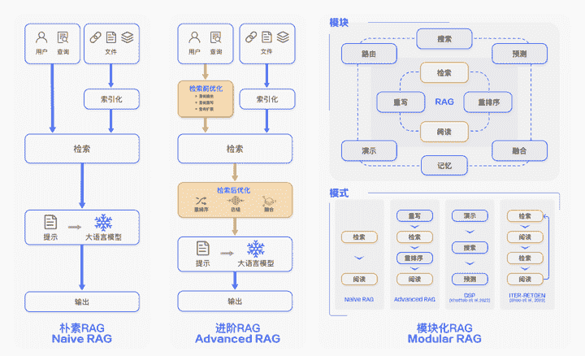

在早些 【 悟乙己：想自己利用OpenAI做一个文档问答的话...... ?】笔者看到了非常多文档问答的技术实践，技术路线大同小异，不过笔者在实践过程中恍然， 垃圾进，垃圾出 的定律在文档问答同样存在，所以，手上的文档该如何整理会让召回提升呢？

在【 队长：对于大模型RAG技术的一些思考 】也有一些吐槽：即使基于单篇文档回答，它们（ChatDoc，WPS AI）在我们垂直领域的文档的幻想问题还是很严重。但是输出的答案不认真看的话，确实挺惊艳。例如问个操作步骤问题，文档压根没这个内容，但是它一步步输出的极其自信。反正最后就想感慨一下，RAG确实没有想的那么容易。

不过RAG也在很多行业积极实践中，在【 RAG行业交流中发现的一些问题和改进方法 】提到了，RAG应该算是核心底层，适配各行各业，依然需要基础组件和各行业的适配应用：

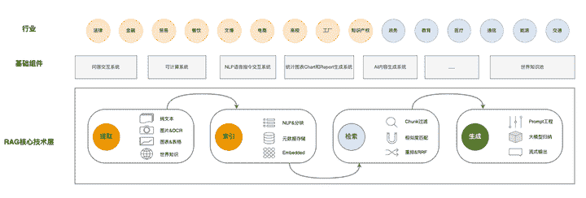

笔者见到的比较完整、深入RAG的架构有三套：

第一套来自文章 [Advanced RAG Techniques: an I](https://link.zhihu.com/?target=https%3A//pub.towardsai.net/advanced-rag-techniques-an-illustrated-overview-04d193d8fec6)llustrated Overview ：

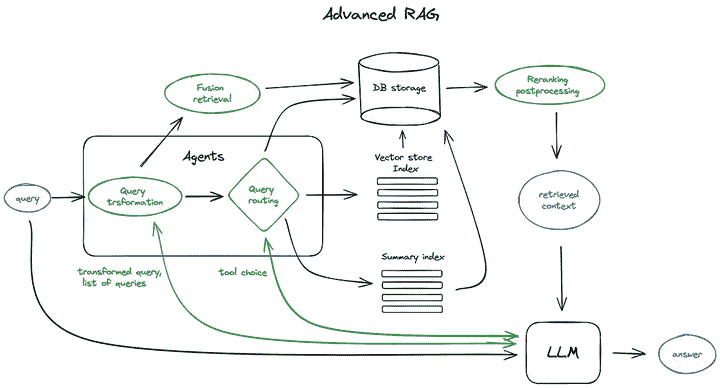

第二套：（文章【 谈谈RAG存在的一些问题和避免方式 】、【 大模型主流应用RAG的介绍——从架构到技术细节 】）

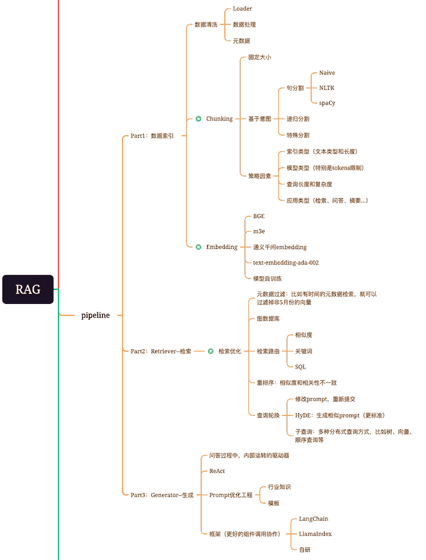

第三套【 专补大模型短板的RAG有哪些新进展？这篇综述讲明白了 】：

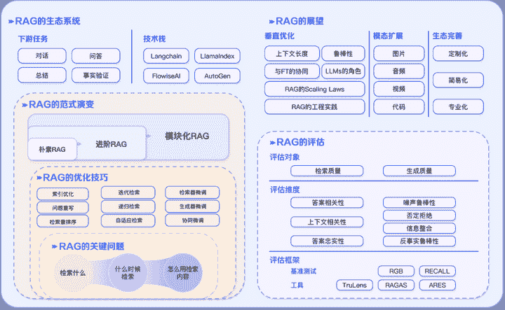

还有一篇（ [advanced-rag ](https://link.zhihu.com/?target=https%3A//blog.llamaindex.ai/a-cheat-sheet-and-some-recipes-for-building-advanced-rag-803a9d94c41b)）也把一些RAG的优化点进行罗列：

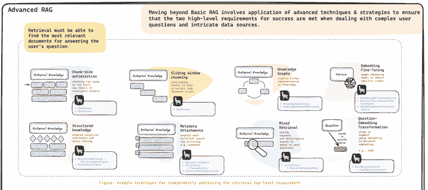

当然在进行RAG后续展开之前，还有一个问题需要在前言提一句，就是：

> 做搜索优化是直接微调模型 还是 使用 RAG技术？

这个问题笔者在【 RAG和微调哪个是LLM优化的最优解 】看到了比较丰富的论证。需要做以上的选择考虑的因素还是不少的，包括：

+   有多少有标签的训练数据可用?

+   数据是静态的还是动态的? RAG系统在具有动态数据的环境中具有固有的优势

+   LLM应用程序需要有多透明/可解释? RAG系统提供了在单独调优的模型中通常找不到的透明度级别

总的来说，如果我们需要倾向于获取外部知识和重视透明度，RAG是我们的首选。另一方面，如果我们正在使用稳定的标记数据，并旨在使模型更接近特定需求，则微调是更好的选择。

另外在【 专补大模型短板的RAG有哪些新进展？这篇综述讲明白了 】也提到两者的差异：

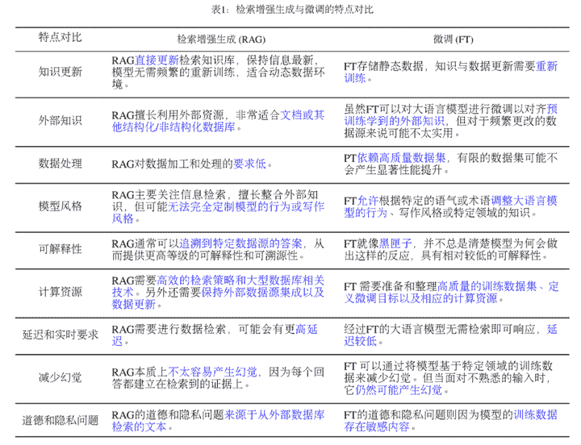

RAG 和 FT，并不是相互排斥的，它们可以是互补的，联合使用可能会产生最佳性能。

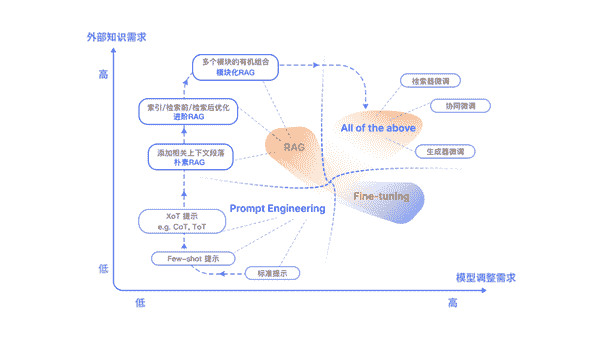

本篇把一些笔者看到的难点/处理建议贴一下。前几篇相关的文章是：

悟乙己：大模型+知识库/数据库问答实践过程的经验汇总（三）

悟乙己：大模型与商业智能BI：LLM-as-数据小助理（二）

悟乙己：大模型与数据科学：从Text-to-SQL 开始（一）

悟乙己：RAG 分块Chunk技术常见方法小结（五）

---

## 0 使用场景

来自： 瀚海方舟：ChatGPT应用：如何征服市场眼中的“万能RAG”

RAG 适用场景：

+   第一：私有数据存在一定频率的动态更新的；

+   第二：需要给出引用原文的；

+   第三：硬件资源（GPU）不是太充足的（即使用RAG也需要微调，但一次微调处处可用，远比每个企业私有库微调一个模型成本低的多）

RAG任务几个具体问题场景【 RAG行业交流中发现的一些问题和改进方法 】：

1.  **不擅长小范围的描述性问题回答 **。例如，哪个主体具有某些特征?

1.  **不擅长关系推理 **，即寻找从实体A到实体B的路径或识别实体集团。

1.  **不擅长时间跨度很长的总结 **。例如，“列出所有哈利波特的战斗”或“哈利波特有多少次战斗?”

RAG应用程序在这类任务上的表现很差，因为只有少数chunk可以输入到LLM中，而且这些chunk是分散的。LLM会缺少很多辅助信息，比如元数据和世界知识。

为RAG寻找最适合的领域，避免强行进入错误的地方，比如千万别让RAG去写诗，它的算数能力也很差，我们现在是自己做了外挂程序（胶水组件）来完成这部分工作的。

在【 瀚海方舟：ChatGPT应用：如何征服市场眼中的“万能RAG” 】一文中提到了非常多针对性的解决方式：

+   内容切片不够好，容易切碎，于是有了段落智能划分；

+   向量生成的质量不可控，于是有了可根据不同QA场景动态生成向量的Instructor；

+   隐式的动态向量不够过瘾，再用HyDE做个中间层：先生成一些虚拟文档/假设文档再做召回，提升召回率；

+   如果向量这一路召回不够，再上关键词召回，传统BM25+向量HNSW融合各召回通路；

+   召回的太多容易干扰答案生成，探究一下Lost in the Middle，搞一搞trick，或者用LLMLingua压缩；

+   嫌召回太麻烦？直接扩到100k窗口全量怼进大模型，LongLoRA横空出世；

+   刚才提到的各个环节需要改进的点太多，懒得手工做，直接交给大模型，用Self-RAG替你完成每个步骤

按照上述的内容全部撸一遍，但是仍然有非常多的问题，然后又需要：

+   要建立元 **数据过滤单元 **，不是一上来就全文检索，要有更精细化的索引，根据查询需求先做一遍过滤，比如时间、内容源等等；

+   要建立 **全文处理单元 **，解决由于切割带来的信息损耗，需要从离线、在线两部分同时考虑，离线预计算覆盖高频需求，在线覆盖长尾需求；

+   要建立 **数值计算单元 **，弥补大模型在做数学题上的缺陷，并且补充足够的金融行业计算公式或企业自定义计算公式；

+   要建立 **数据库查询单元 **，区别于“数值计算”，这里主要是指NL2Sql，有些信息查询需要走数据库而不仅仅是文章内容；

+   要建立 **意图澄清单元 **，我们允许用户发起五花八门的查询请求，但当查询需求不明确时，系统要有能力帮助用户改进查询语言

---

## 1 RAG的难点

### 1.1 数据难点： **文档种类多**

有doc、ppt、excel、pdf，pdf也有扫描版和文字版。

真正难处理的是ppt和pdf，ppt中包含大量架构图、流程图等图示，以及展示图片。pdf基本上也是这种情况。

抽取出来的文字信息，呈现碎片化、不完整的特点。

PPT的难点在于，如何对PPT中大量的流程图，架构图进行提取。因为这些图多以形状元素在PPT中呈现，如果光提取文字，大量潜藏的信息就完全丢失了。于是这里只能先将PPT转换成PDF形式，然后用上述处理PDF的方式来进行解析。

图片信息如何还原的问题。大量的文档使用了图文混排的形式，例如上述的PPT文件，转换成PDF后，仅仅是能够识别出这一块是一幅图片，对于图片，直接转换成向量，不利于后续的检索。

### 1.2 数据难点：不同文档结构影响，需要不同的切片方式

这个可是老大难问题了，不好的切片方式会造成：

+   如果切片太大，查询精准度会低

+   一段完整的话可能被切成好几块，每一段文本包含的语义信息实际上也是不够完整的

+   一些鸡肋切片，其实可以删掉

### 1.3 数据难点： **内部知识专有名词不好查询**

目前较多的方式是向量查询，对于专有名词非常不友好；影响了生成向量的精准度，以及大模型输出的效果。

### 1.4 用户提问的随意性 + 大众对RAG的定位混乱

大部分用户在提问时，写下的query是较为模糊笼统的，其实际的意图埋藏在了心里，而没有完整体现在query中。使得检索出来的文本段落并不能完全命中用户想要的内容，大模型根据这些文本段落也不能输出合适的答案。

同时，企业员工在使用RAG时，所发起的查询需求都是哪些，企业对RAG的定义也许是 【信息抽取问答+数值计算问答+逻辑推理类问答+...】 的一个“全家桶”，“狭义RAG方案”在“广义RAG需求”上往往是不匹配的，查询效果也达不到预期。

### 1.5 公域与私域知识混淆难定位

```
提问：乙烯和丙烯的关系是什么？
```

大模型应该回答两者都属于有机化合物，还是根据近期产业资讯回答，两者的价格均在上涨？

来自： 瀚海方舟：ChatGPT应用：如何征服市场眼中的“万能RAG”

### 1.6 新旧版本文档同时存在

来自： 瀚海方舟：ChatGPT应用：如何征服市场眼中的“万能RAG”

召回的文档如下：

```
（某日）……对化学制品行业的关注度近一周下降，目前降至第8……
（某日）……对化学制品行业的关注度近一周下降，目前降至第7……
（某日）……对化学制品行业的关注度近一周下降，目前降至第6……
（此处省略多条相似结果）
```

某一些报告可能是周期更新的，那么查询的时候就会出现上述问题

### 1.7 **多条件约束失效**

来自： 瀚海方舟：ChatGPT应用：如何征服市场眼中的“万能RAG”

```
提问：昨天《独家新闻》统计的化学制品行业的关注度排名第几？
```

加上约束之后，如何让大模型读懂什么叫“昨天”，又有哪段内容属于《独家新闻》？

### **1.8 全文/多文类意图失效**

来自： 瀚海方舟：ChatGPT应用：如何征服市场眼中的“万能RAG”

```
提问：近期《独家新闻》系列文章对哪些行业关注度最高？
```

**受限于文**档切割，遇到横跨多篇文章，或全篇文章的提问，基本上 凉凉了 。

### **1.9 复杂逻辑推理**

来自： 瀚海方舟：ChatGPT应用：如何征服市场眼中的“万能RAG”

```
提问：近期碳酸锂和硫酸镍同时下跌的时候，哪个在上涨？
```

除非原文中有显性且密集型相关内容，大模型可能能够直接回答正确，否则凉凉的概率极高。

而用户在提问这类问题时，往往是无法在某一段落中直接找到答案的，需要深层次推理。

### 1.10 **金融行业公式计算**

来自： 瀚海方舟：ChatGPT应用：如何征服市场眼中的“万能RAG”

```
提问：昨天哪些股票发生了涨停？
```

如何让大模型理解“涨停”意味着 (收盘价/昨日收盘价-1)≥10%

### 1.11 **人工搜索效率低下**

来自【 使用RAG-Fusion和RRF让RAG在意图搜索方面更进一步 】

人类并不擅长在搜索系统中输入他们想要的东西，比如打字错误、模糊的查询或有限的词汇，这通常会导致错过明显的顶级搜索结果之外的大量信息。虽然RAG有所帮助，但它并没有完全解决这个问题。

### 1.12 **长下文长度**

检索内容过多，超过窗口限制怎么办 ？如果 LLMs 的上下文窗口不再受限制，RAG 应该如何改进？

### 1.13 向量检索的弊端

参考自： 腾讯云ES RAG最佳实践：向量+文本混合搜索的相关性调优

向量检索是基于词向量的相似度计算

如果查询语句太短，比如只有一个ID、一个哈希码或者一个产品名称，那么它们的词向量可能无法反映出它们的真实含义，也无法和其他相关的文档进行有效的匹配。这样就会导致向量检索的结果不准确，甚至出现一些完全不相关的内容。类似的，如果我们查询“8XLARGE64”，“99.9%”，这样的一些关键字时，向量搜索会得出一些毫不相干的内容，以至于让背后的大模型毫无用武之地，甚至可能被误导

---

## 2 知识库文档预处理

大部分建议来自： [最佳实践](https://link.zhihu.com/?target=https%3A//github.com/chatchat-space/Langchain-Chatchat/wiki/%25E6%259C%2580%25E4%25BD%25B3%25E5%25AE%259E%25E8%25B7%25B5%23%25E6%258E%25A8%25E8%258D%2590%25E7%259A%2584%25E6%25A8%25A1%25E5%259E%258B%25E7%25BB%2584%25E5%2590%2588)

在载入知识库文件的时候，直接上传文档虽然能实现基础的问答，但是，其效果并不能发挥到最佳水平。因此，我们建议开发者对知识库文件做出以下的预处理。 以下方式的预处理如果执行了，有概率提升模型的召回率。

### 2.1 使用 TXT / Markdown 等格式化文件，并按照要点排版

例如，以下段落应该被处理成如下内容后在嵌入知识库，会有更好的效果。

```
原文: PDF类型
查特查特团队荣获AGI Playground Hackathon黑客松“生产力工具的新想象”赛道季军
2023年10月16日, Founder Park在近日结束的AGI Playground Hackathon黑客松比赛中，查特查特团队展现出色的实力，荣获了“生产力工具的新想象”赛道季军。本次比赛由Founder Park主办，并由智谱、Dify、Zilliz、声网、AWS云服务等企业协办。
比赛吸引了120多支参赛团队，最终有36支队伍进入决赛，其中34支队伍成功完成了路演。比赛规定，所有参赛选手必须在短短的48小时内完成一个应用产品开发，同时要求使用智谱大模型及Zilliz向量数据库进行开发。
查特查特团队的现场参赛人员由两名项目成员组成：
来自A大学的小明负责了Agent旅游助手的开发、场地协调以及团队住宿和行程的安排；在保证团队完赛上做出了主要贡献。作为队长，栋宇坚持自信，创新，沉着的精神，不断提出改进方案并抓紧落实，遇到相关问题积极请教老师，提高了团队开发效率。
作为核心开发者的B公司小蓝，他则主管Agent智能知识库查询开发、Agent底层框架设计、相关API调整和UI调整。在最后，他代表团队在规定的时间内呈现了产品的特点和优势，并完美的展示了产品demo。为团队最终产品能够得到奖项做出了重要贡献。
```

修改后的Markdown文件，具有更高的召回率

```
# 查特查特团队荣获AGI Playground Hackathon黑客松“生产力工具的新想象”赛道季军。

## 报道简介
2023年10月16日, Founder Park在近日结束的AGI Playground Hackathon黑客松比赛中，查特查特团队展现出色的实力，荣获了“生产力工具的新想象”赛道季军。本次比赛由Founder Park主办，并由智谱、Dify、Zilliz、声网、AWS云服务等企业协办。

## 比赛介绍

比赛吸引了120多支参赛团队，最终有36支队伍进入决赛，其中34支队伍成功完成了路演。比赛规定，所有参赛选手必须在短短的48小时内完成一个应用产品开发，同时要求使用智谱大模型及Zilliz向量数据库进行开发。

## 获奖队员简介

+ 小明，A大学
  + 负责Agent旅游助手的开发、场地协调以及团队住宿和行程的安排
  + 在保证团队完赛上做出了主要贡献。作为队长，栋宇坚持自信，创新，沉着的精神，不断提出改进方案并抓紧落实，遇到相关问题积极请教老师，提高了团队开发效率。

+ 小蓝，B公司
  + 主管Agent智能知识库查询开发、Agent底层框架设计、相关API调整和UI调整。
  + 代表团队在规定的时间内呈现了产品的特点和优势，并完美的展示了产品demo。
```

当然也可以自定义一些规律的规则：

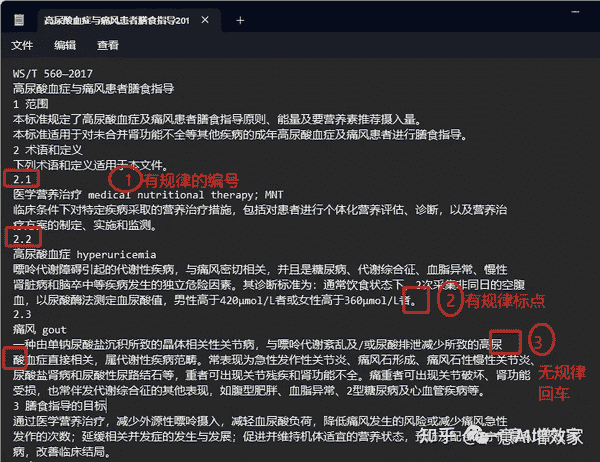

1）规律的编号：看上图，看到整篇内容都是有规律的编号的！

2）规律的标点符号：每一个段落，都有句号“。”

### 2.2 减少文件中冲突的内容，分门别类存放数据

就像人类寻找相关点一样，如果在多份文件中存在相似的内容，可能会导致模型无法准确的搜索到相关内容。 因此，需要减少文件中相似的内容，或将其分在不同的知识库中。 例如，以下两个句子中，如果搜索外籍教师，则具有歧义，非常容易搜索到错误答案。

```
文件一：
在大数据专业中，我们已经拥有超过1/3的外籍博士和教师。

文件二：

本专业具有40%的外籍教师比例，
本专业有博士生10人，研究生12人。
```

### 2.3 减少具有歧义的句子

知识库中应该减少具有歧义的句子和段落，或者汉语的高级用法，例如

```
1. 他说他会杀了那个人。
2. 你说啥子？
3. 我喜欢你的头发。
4. 地板真的滑，我差点没摔倒。
```

在相似度模型对比的时候，仅仅能搜索句子的表面意思，因此，使用有歧义的句子和段落可能导致搜索错误。

### 2.4 减少单个文件的大小，减少文件中的特殊符号

+   上传知识库的单个文件不建议超过5MB，以免出现向量化中断卡死等情况。同时，上传大文件不要使用faiss数据库。

+   减少上传文件中的中文符号，特殊符号，无意义空格等。

### 2.5 结构复杂的先根据大模型以问答对的形式输出

一些报告图表较多的，可以先让大模型理解后，生成一些问答对；

[允许的话，人工简单浏览一下，比如这篇提到的： 一意AI增效家](https://zhuanlan.zhihu.com/p/671341770)：1万页PDF转大模型数据集2！批量把txt文本拆成CSV！准备生成问答对！27/45

### 2.6 对文档合理分块

不合理的分块会导致很多问题，过小的chunk导致上下文信息的缺失；连贯文章因为chunk而进行拆分，详情可参考【 谈谈RAG存在的一些问题和避免方式 】

这个其实涉及到的比较广了，分块的策略制定就很重要，比如langchain-chatchat较多的规则是根据文字长度：

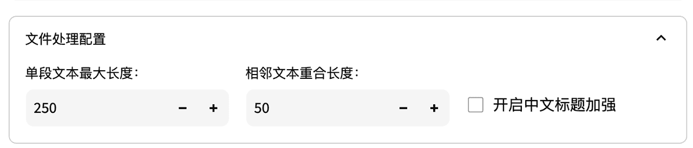

还有一些机构都有自己不同的规则设置，fastGPT 的是（ 推荐一个知识库系统，最好是开源的？ ）：

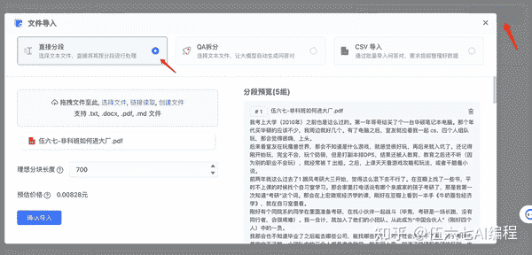

### 2.7 数据清洗

没接触大模型会觉得，大模型无所不能，啥数据，啥格式都可以接纳，但其实还是要走之后数据挖掘的老路，数据清洗就是一条老路，但是不得不走。

如果您的数据是从web爬取的，您可能需要删除HTML标记或特定的元素，保证文本的“纯洁”，减少文本的噪音。

还有就是信息整理成规范、统一的格式，参考【 RAG行业交流中发现的一些问题和改进方法 】,

例如有一家公司的员工信息结构如下：

```
project A
Client Contact: Steve
Team Members:
person A
person B
email of person A
email of person B
role of person A
role of person B
description of person A
description of person B

project B
```

脏乱差了属于，需要统一整理，比如以下格式：

```
file person_A.txt:
name: Adam Smith
email: adam.smith@xxx.com
role: engineer
description: Hobbies/passion: rock climbing

...
```

生成的文本文件很小，这似乎与RAG分块实践不一致。原因是合并后的文件避免了分裂的问题，完全消除了噪音。有了新生成的文件，RAG可以毫无问题地回答诸如“谁在做项目x?”以及“亚当·斯密的爱好是什么?”

然而，当我们把问题转过来:“亚当·斯密在做哪个项目?”我们看到亚当·斯密被列在项目成员名单中。我们不太确定为什么Embedding模型不能捕捉到它。为了帮助LLM完成工作，我们可以使信息脱颖而出。我们在这个人的文件中添加了一行，明确地说明了项目的参与情况:

```
file person_A.txt:
name: Adam Smith
email: adam.smith@xxx.com
role: engineer
description: Hobbies/passion: rock climbing

project: project_A
```

---

## 3 文档智能分块与解析

基础的分块研究可以参考【 悟乙己：RAG 分块Chunk技术常见方法小结（五） ?】

文章【 全面指南———用python提取PDF中各类文本内容的方法 】提到，目前不同类型的pdf，更具体地说，是出现最频繁的三种:

1.  **机器生成的pdf文件 **：这些pdf文件是在计算机上使用W3C技术(如HTML、CSS和Javascript)或其他软件(如Adobe Acrobat、Word或Typora等MarkDown工具)创建的。这种类型的文件可以包含各种组件，例如图像、文本和链接，这些组件都是可以被选中、搜索和易于编辑的。

1.  **传统扫描文档 **：**这些P**DF文件是通过扫描仪、手机是的扫描王这样的APP从实物上扫描创建的。这些文件只不过是存储在PDF文件中的 图像 集合。也就是说，出现在这些图像中的元素，如文本或链接是不能被选择或搜索的。本质上，PDF只是这些图像的容器而已。

1.  **带OCR的扫描文档 **：这种类似有点特殊，在扫描文档后，使用光学字符识别(OCR)软件识别文件中每个图像中的文本，将其转换为可搜索和可编辑的文本。然后软件会在图像上添加一个带有实际文本的图层，这样你就可以在浏览文件时选择它作为一个单独的组件。但是有时候我们不能完全信任OCR，因为它还是存在一定几率的识别错误的。

### 3.1 文档版面布局（Layout）分析

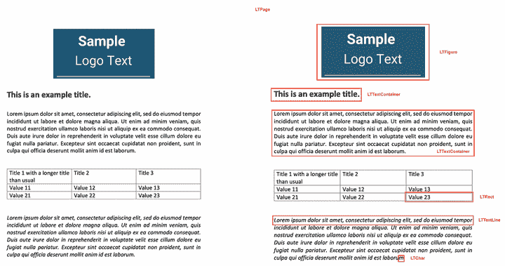

对于初步分析，我们使用PDFMiner的Python库将文档对象中的文本分离为多个页面对象，然后分解并检查每个页面的布局。PDF文件本身缺乏结构化信息，如我们可以一眼识别的段落、句子或单词等。相反，它们只理解文本中的单个字符及其在页面上的位**置。通过这种方**式，PDFMiner尝试将页面的内容重构为单个字符及其在文件中的位置。然后，通过比较这些字符与其他字符的距离，它组成适当的单词、句子、行和文本段落。为了实现这一点，PDFMiner使用高级函数extract_pages()从PDF文件中分离各个页面，并将它们转换为 LTPage 对象。

在【 [秋水札记：帮你测试LangChain中](https://zhuanlan.zhihu.com/p/672312554)三种处理文档中表格信息策略的精准度表现 】也给出一个分割板块的标准：

> 沿页面拆分文档。许多文档表格的设计都遵循页面边界，以提高人类的可读性。当然，在表格跨越页面边界的情况下，这种方法会崩溃。

然而，我们发现了另一个问题：包含我们最有价值的信息的表格中的块可以与文档文本正文中的块竞争。

一个简单的方法很有效：构建一个专注于表的检索器。

为此，我们使用 LLM 扫描每个页面并汇总页面中的任何表格。然后，我们将这些摘要编制索引以供检索，并使用多向量检索器存储包含表的原始页面文本。 最后，我们将检索到的表块与原始文本块集成在一起。集成检索器的好处是我们可以优先考虑某些源，这允许用于确保将任何相关的表块传递给 LLM。

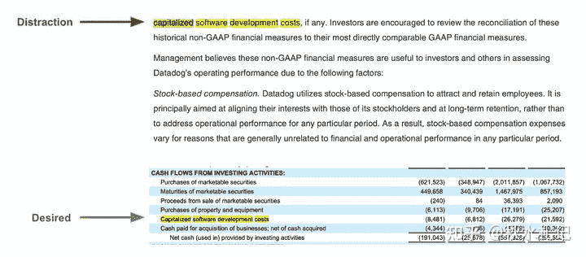

在【 队长：对于大模型RAG技术的一些思考 】中提及：

使用了百度的PP-StructureV2，能够对Text、Title、Figure、Figure caption、Table、Table caption、Header、Footer、Reference、Equation10类区域进行检测，统一了OCR和文本属性分类两个任务。

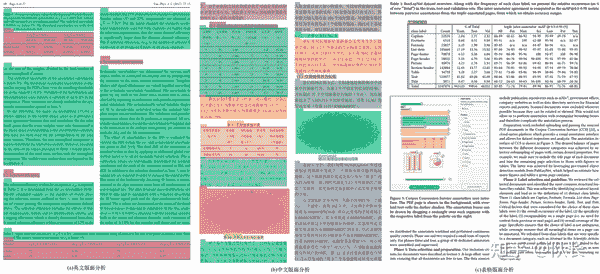

PPT的难点在于，如何对PPT中大量的流程图，架构图进行提取。因为这些图多以形状元素在PPT中呈现，如果光提取文字，大量潜藏的信息就完全丢失了。于是这里只能先将PPT转换成PDF形式，然后用上述处理PDF的方式来进行解析。

### 3.2 图片的信息抽取

所以我们只能通过一个较为昂贵的方案，即部署了一个多模态模型，通过prompt来对文档中的图片进行关键信息提取，形成一段摘要描述，作为文档图片的索引。效果类似下图。

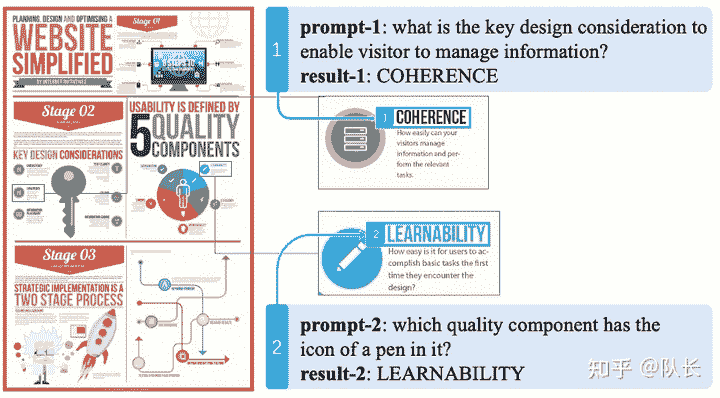

---

## 4 搜索架构、索引构建、Embedding

前面说的是一些前置的预处理的方法，检索的主要方式还是这几种：

+   **相似度检索 **：前面我已经写过那篇文章《大模型应用中大部分人真正需要去关心的核心——Embedding》种有提到六种相似度算法，包括欧氏距离、曼哈顿距离、余弦等，后面我还会再专门写一篇这方面的文章，可以关注我，yeah；

+   **关键词检索 **：这是很传统的检索方式，但是有时候也很重要。刚才我们说的元数据过滤是一种，还有一种就是先把chunk做摘要，再通过关键词检索找到可能相关的chunk，增加检索效率。据说Claude.ai也是这么做的；

+   **SQL检索 **：这就更加传统了，但是对于一些本地化的企业应用来说，SQL查询是必不可少的一步，比如我前面提到的销售数据，就需要先做SQL检索。

+   其他：检索技术还有很多，后面用到再慢慢说吧。

[向量检索是早期知识库版本比较核心的方法（图片来自 Adva](https://link.zhihu.com/?target=https%3A//pub.towardsai.net/advanced-rag-techniques-an-illustrated-overview-04d193d8fec6)nced RAG Techniques: an Illustrated Overview ：）：

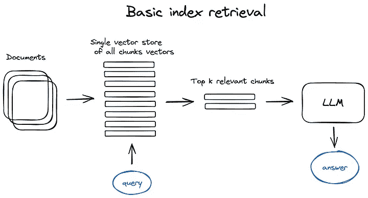

### 4.1 Embedding 选择与比较

> Embedding 应该尽量 与 回答问题大模型保持一致

来自【 RAG行业交流中发现的一些问题和改进方法 】

在大多数情况下，用户发送简短的查询，比如“告诉我更多关于徐悲鸿的信息”。然后，将查询转换为Embedding向量，该向量捕获该特定查询的本质。使用直接查询进行语义搜索可能具有挑战性，因为:

1.  用户查询很短，以问题的形式出现。它们包含有限的语义特征。虽然文档Embeddings以各种形式的语句的形式很长，但文档Embeddings在其向量中具有丰富得多的信息。

1.  由于用户查询中的语义特征有限，语义搜索功能热衷于过度解释查询中的琐碎细节，致使文档Embedding有很大的噪声。分块使情况变得更糟，因为许多关系、上下文和顺序链接都是错乱了。

1.  Embedding模型和LLM属于不同的家族。他们接受的训练不同，行为也不同（比如Baichuan2-13B和ChatGLM2-6B在功能和行为上就差异很大，一个马上会给出简洁明确的答案，另一个则更像诗人，可能答案也是对的，但是用词浮躁对于用户干扰很大）。Embedding模型不具有与生成大语言模型相同水平的推理能力。他们甚至不像生成大语言模型那样重视语言细节。直接使用用户输入进行查询，在最坏的情况下，会使语义搜索功能降级为关键字搜索。

1.  由于Embedding和LLM是两种不同**的模型，在整个过程中扮**演着不同的角色， 它们并不在同一层面上 。这两个模型根据他们自己对需求的理解来完成他们的工作，但他们彼此不交谈。检索到的信息可能不是LLM产生最佳结果所需的信息。这两个模型没有办法相互对齐。

同时本篇【 提升RAG——选择最佳Embedding和重新排名模型 】也对比了一些Embedding模型的好坏：

我们对各种Embedding模型和重新排序器进行了测试。以下是我们考虑的模型:

**向量模型 **:

+   OpenAI Embedding

+   Voyage Embedding

+   CohereAI Embedding (v2.0/ v3.0)

+   [Jina Embeddings](https://link.zhihu.com/?target=https%3A//huggingface.co/jinaai/jina-embeddings-v2-small-en)

+   BAAI/bge-large-en

下表展示了基于命中率和平均倒数排名(MRR)指标的评估结果:

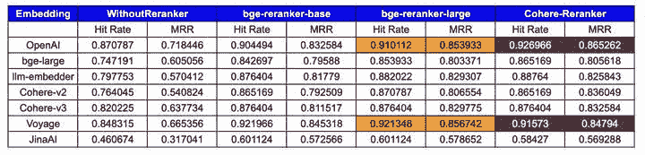

**Embedding性能:**

+   **OpenAI **:表现出顶级的性能，特别是cohererank(0.926966命中率，0.865262 MRR)和big-reranker-large(0.910112命中率，0.853993 MRR)，表明与重排名工具的兼容性很强。

+   **big-large **:在重新排序器上有了显著的改进，CohereRerank的结果最好(0.865169命中率，0.805618 MRR)。

+   **llm-embedder **：从重新排名中受益匪浅，特别是CohereRerank (0.887640命中率，0.825843 MRR)，它提供了实质性的性能提升。

+   **coherhere **: coherhere最新的v3.0Embeddings优于v2.0，并且通过集成本地CohereRerank，显着提高了其指标，拥有0.876404命中率和0.832584 MRR。

+   **Voyage **:具有较强的初始性能，并被cohererank (0.915730命中率，0.847940 MRR)进一步放大，表明对重新排名的响应性较高。

+   **JinaAI **:虽然起点较低，但big -rerank -large的收益显著(命中率0.601124,MRR 0.578652)，表明重新排名显著提升了它的性能。其性能不佳的一个潜在原因可能是Embedding针对8K上下文长度进行了优化

当然，最后也有一个问题，就是自己微调embedding会不会有逆天的效果，该文章【 手工微调embedding模型RAG检索能力 】做了一些实验，使用开源的sentence_transformers模型BAAI/big-small-en作为我们的基本Embedding模型，评估结果表明，微调Embedding模型的性能比基本模型提高了1-6%，与OpenAI的Embedding模型相比，微调模型的性能损失仅为4.85%。这种性能提升可能因数据集的质量和数量而异。

所以，整体来看还要不断测试才能知道自己微调这一方式是否值得去做。

在【 队长：对于大模型RAG技术的一些思考 】提到了 微调大模型 的方式：

这部分主要是为了解决垂直领域特殊词汇，在通用句向量中会权重过大的问题。比如有个通用句向量模型，它在训练中很少见到“SAAS”这个词，无论是文本段和用户query，只要提到了这个词，整个句向量都会被带偏。举个例子：

假如一个用户问的是：我是一个SAAS用户，我希望订购一个云存储服务。由于SAAS的权重很高，使得检索匹配时候，模型完全忽略了后面的那句话，才是真实的用户需求。返回的内容可能是SAAS的介绍、SAAS的使用手册等等。

这里的微调方法使用的数据，是让大模型对语义分割的每一段，形成问答对。用这些问答对构建了数据集进行句向量的训练，使得句向量能够尽量理解垂直领域的场景。

### 4.2 向量检索：层次索引

来自 [Advanced RAG Techniques: an I](https://link.zhihu.com/?target=https%3A//pub.towardsai.net/advanced-rag-techniques-an-illustrated-overview-04d193d8fec6)llustrated Overview ：

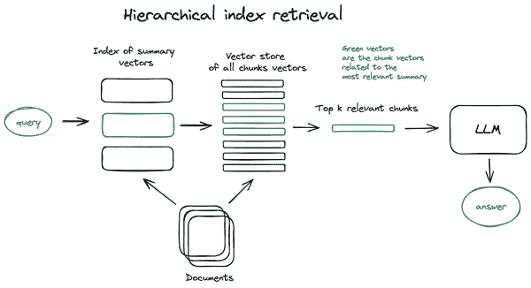

核心就是：一种有效的方法是创建两个索引，一个由摘要组成，另一个由文档块组成，并且分两步搜索，首先通过摘要过滤出相关文档，然后在相关组内搜索。

### 4.3 向量检索：假设的Query与文档问题生成

这里有两种方式去生成模拟的提问:

+   针对文档chunk，生成特定的提问，然后直接用query检索提问

+   **HyDE **：这是一种抄作业的方式，生成相似的，或者更标准的prompt模板，然后去检索文档chunk

### 4.4 检索时利用丰富的上下文信息

这里文章 [Advanced RAG Techniques: an I](https://link.zhihu.com/?target=https%3A//pub.towardsai.net/advanced-rag-techniques-an-illustrated-overview-04d193d8fec6)llustrated Overview 提到了几种方式：

### 4.4.1 chunk窗口检索

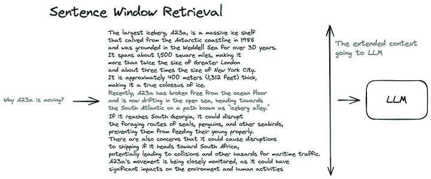

为了在获取最相关的单个句子后更好地推理找到的上下文，我们在检索到的句子之前和之后将上下文窗口扩展了 k 个句子句子，然后将此扩展上下文发送给LLM。

上文例子中就是，先检索到绿色部分，然后补充了上下文信息，一起丢给LLM。

### 4.4.2 多层次Child / Parent 文档检索

这[个方法是Auto-merging Retriever (](https://link.zhihu.com/?target=https%3A//pub.towardsai.net/advanced-rag-techniques-an-illustrated-overview-04d193d8fec6)aka Parent Document Retriever)，来自 Advanced RAG Techniques: an Illustrated Overview

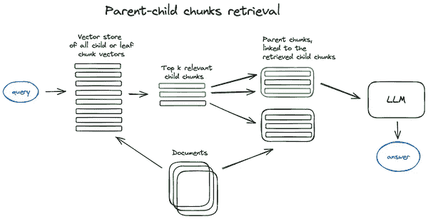

首先分chunks的时候拆分成子chunk，然后不同的子chunk在同一父chunk构建关联索引；

图中所示，就是先在子chunks堆里寻找topk相关的，然后在不同子chunks与不同的父chunk关联下，

把父chunk所有的都找出来，然后统一丢给LLM进行组合问答

### 4.5 混合检索：利用ES

其实就是多路召回，通过向量化召回一些，通过BM25或者TFIDF也召回一些CHUNK，然后组合丢给LLM

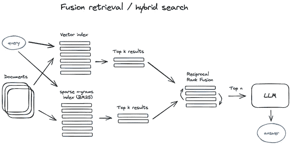

文章一 [TorchV的RAG实践分享(二)：基于Elasti](https://link.zhihu.com/?target=https%3A//mp.weixin.qq.com/s/EBaGXFOnNHmF_rj_NLf_Ww)cSearch的混合检索实战&原理分析 提到：

在做混合检索时，我们会接触到两类算法，需要对算法有一个基础了解，这有助于我们在应用产品的技术体系中做决策：

+   语义检索：基于向量空间的KNN算法

+   相关性检索：传统的文本精确匹配方法，包括BM25、TF-IDF

1、混合检索的权重设置：在上面的score分值计算公式中，我们其实知道es最终是通过 bm25*boost + knn*boost ,那么这个 boost 则可以影响我们最终的内容，因为并不是所有的客户和业务场景都适合knn检索，可能在其他关键的场景中，关键词检索会更适合(比如一些利用大模型做一些异步的任务提取，报告输出等等业务场景)，我们在产品设计中则可以根据不同的客户诉求以及业务诉求，就可以设置这个 boost 来影响最终的召回结果天平，从而改善我们的产品效果。

2、在BM25算法的场景中，分词是非常重要的一个特性，对于不同的行业客户，词库的收集建立对于产品应用的提升肯定是会有质的提升，也是每个公司做RAG产品的核心竞争力。

文章二【 腾讯云ES RAG最佳实践：向量+文本混合搜索的相关性调优 】提到，将关键词的全文检索 与 向量检索结合：

要做好混合搜索，在项目评估的时候需要注意以下方面：

+   更多的系统资源和设计成本。混合搜索需要同时使用向量检索和关键词检索的方法，这会增加系统的资源消耗和复杂度，也会增加系统的设计和维护的成本和难度。

+   一些向量检索和关键词检索的不一致性和冲突性。混合搜索需要对向量检索和关键词检索的结果进行合并和排序，这可能会出现一些不一致性和冲突性，比如两种检索方式返回的结果不同，或者两种检索方式的相似度或匹配度不同，或者两种检索方式的排序规则不同，这可能会影响检索结果的质量和可信度。

+   有效的过滤，可以使得搜索更加高效。

而当向量检索和关键词检索的结果出现不一致和冲突时，腾讯云ES也提供了多种手段方便我们对结果进行调试。目前，ES提供了比如：线性加权总和和基于结果倒数的融合排序（RRF）两种方式。这两种方式均可以在函数中方便修改，如上面提供的代码样例中：

线性加权总和：query: "boost":1; knn:"boost": 24

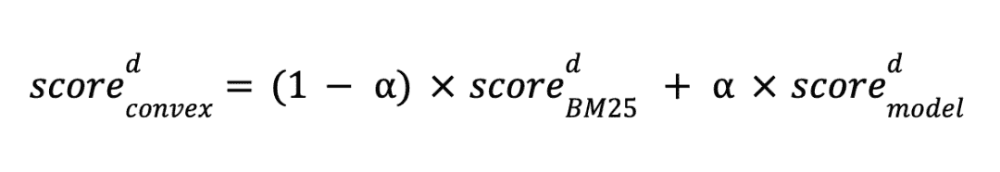

### 4.6 召回chunk带上文章开头与结尾

本篇来自【 战士金：【大模型外挂知识库优化】召回文档排序策略再思考与实验 】

观点：包含正确答案的文档片段在输入中的位置不同，会影响大模型的回答质量；

所以结论：包含正确答案的文档片段放到文段片段序列的开头或者结尾，能够让大模型回答的更好。

### 4.7 **图关系检索**

如果可以将很多实体变成node，把它们之间的关系变成relation，就可以利用知识之间的关系做更准确的回答。特别是针对一些多跳问题，利用图数据索引会让检索的相关度变得更高

### 4.8 检索时添加一些特殊符号

腾讯云ES RAG最佳实践：向量+文本混合搜索的相关性调优

文中提到了一些在检索的时候一些增加一些特殊符号：

+   增加查询语句的长度，比如在ID、哈希码或产品名称后面加上一些描述性的词语，或者使用一些常见的问题作为查询语句，这样可以增加查询语句的语义信息，提高向量检索的效果。

+   使用一些特殊的符号或标记，比如在ID、哈希码或产品名称前后加上双引号，或者使用一些特定的字段名，这样可以告诉向量检索系统，这些词语是需要精确匹配的，而不是基于相似度的。

+   结合关键词检索，比如在向量检索的结果中，再使用关键词检索的方法，对查询语句和文档进行文本匹配和过滤，这样可以排除一些不相关的内容，提高检索的准确性。

这些方法都可以在一定程度上改善向量检索在处理简短的查询语句时的问题，但是它们也有一些缺点，比如：

+   增加查询语句的长度，可能会增加用户的输入成本，而且用户可能不知道如何扩展查询语句，或者扩展后的查询语句可能不符合用户的真实意图。

+   使用特殊的符号或标记，可能会增加用户的学习成本，而且用户可能不熟悉这些符号或标记的用法，或者忘记使用它们，导致检索效果不佳。

+   结合关键词检索，可能会降低检索的效率，而且关键词检索也有一些局限性，比如无法处理语义相似但文本不同的情况，或者无法处理模糊、错别字等情况。

---

## 5 检索重排与过滤

很多时候我们的检索结果并不理想，原因是chunks在系统内数量很多，我们检索的维度不一定是最优的，一次检索的结果可能就会在相关度上面没有那么理想。这时候我们需要有一些策略来对检索的结果做重排序，比如使用planB重排序，或者把组合相关度、匹配度等因素做一些重新调整，得到更符合我们业务场景的排序。因为在这一步之后，我们就会把结果送给LLM进行最终处理了，所以这一部分的结果很重要。这里面还会有一个内部的判断器来评审相关度，触发重排序。

同时在【 提升RAG——选择最佳Embedding和重新排名模型 】、【 Rerank——RAG中百尺竿头更进一步的神器，从原理到解决方案 】文章中证明重排序的重要性、必要性

### 5.1 **RAG Fusion**

RAG-Fusion希望弥合用户明确提出的问题和他们（原本的意图）打算提出的问题之间的差距，更接近于发现通常仍然隐藏的变革性知识。

在【 队长：对于大模型RAG技术的一些思考 】提到：

检索增强这一块主要借鉴了RAG Fusion技术，这个技术原理比较简单，概括起来就是，当接收用户query时，让大模型生成5-10个相似的query，然后每个query去匹配5-10个文本块，接着对所有返回的文本块再做个倒序融合排序，如果有需求就再加个精排，最后取Top K个文本块拼接至prompt。

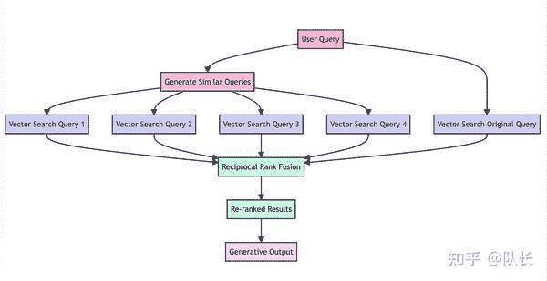

实际使用时候，这个方法的主要好处，是增加了相关文本块的召回率，同时对用户的query自动进行了文本纠错、分解长句等功能。但是还是无法从根本上解决理解用户意图的问题。

在文章【 使用RAG-Fusion和RRF让RAG在意图搜索方面更进一步 】提及：

RAG Fusion的基本三要素与RAG相似，并在于相同的三个关键技术:

+   一种通用 **编程语言 **，通常是Python。

+   一个专用的 **向量搜索数据库 **，如Elasticsearch或Pinecone，指导文档检索。

+   一个强大的 **大型语言模型 **，如ChatGPT，制作文本。

RAG-Fusion’s 工作步骤:

1.  **查询语句的相关性复制： **通过LLM将用户的查询转换为相似但不同的查询。

1.  **并发的向量搜索： **对原始查询及其新生成的同级查询执行并发的向量搜索。

1.  **智能重新排名： **聚合和细化所有结果使用倒数排序融合(RRF)。

1.  **最后优中选优： **将精心挑选的结果与新查询配对，引导LLM进行有针对性的查询语句输出，考虑所有查询和重新排序的结果列表。

具体的实践过程可参考文章【 使用RAG-Fusion和RRF让RAG在意图搜索方面更进一步 】

此时总结一下RAG-Fusion的优劣

> 优势：

**1、优质的原材料质量**

当您使用RAG Fusion时，您的搜索深度不仅仅是“增强”，并且其实搜索范围已经被放大了。相关文档的重新排序意味着你不仅仅是在抓取信息的字面意思，而是在深入这个搜索的意图，所以会涉及到更多的优质文档和待搜索内容。

**2、增强用户意图对齐**

RAG Fusion的设计理念中包含了自动提示，很多时候我们在搜索的时候并不知道应该怎么描述，像Google、百度就会进行输入框的自动补全提示。RAG Fusion可以捕获用户信息需求的多个方面，从而提供整体输出并与对用户意图进行增强。

**3、自动为用户查询输入纠错**

该系统不仅可以解释用户的查询，还可以精炼用户的查询。通过生成**多个查询变体，RAG** Fusion执行 隐式拼写和语法检查 ，从而提高搜索结果的准确性。

4、导航复杂查询（自动分解长句的意图）

人类**的语言在表达复**杂或**专门的思想时**往往会结结巴巴。该系统就像一个语言催化剂，生成各种变体，这些变体可能包含更集中、更相关的搜索结果所需的行话或术语。它还可以处理更长的、更复杂的查询，并将它们 分解成更小的 、 可理解的块 ，用于向量搜索。

5、搜索中的意外发现（关联推荐）

以前在亚马逊买书的时候，总能因为相关推荐发现我更想要的书，RAG Fusion允许这个偶然的发现。通过使用更广泛的查询范围，系统有可能挖掘到信息，而这些信息虽然没有明确搜索，但却成为用户的“啊哈”时刻。这使得RAG Fusion有别于其他传统的搜索模型。

> 劣势

**1、过于啰嗦的风险**

RAG-Fusion的深度有时会导致信息泛滥。输出可能会详细到令人难以承受的程度，把RAG-Fusion想象成一个过度解释事物的朋友。

**2、可能成本会比较昂贵**

多查询输入是需要LLM来做处理的，这时候，很有可能会引起更多的tokens消耗。

---

## 6 query改造、转换、意图识别

### 6.1 Query transformations：Query拆解

来自 [Advanced RAG Techniques: an ](https://link.zhihu.com/?target=https%3A//pub.towardsai.net/advanced-rag-techniques-an-illustrated-overview-04d193d8fec6)Illustrated Overview

如果查询很复杂，LLM 可以将其分解为多个子查询。 例如，如果您问：

— “什么框架有Github、Langchain 或 LlamaIndex 上有更多星星吗？”，

并且我们不太可能在语料库中的某些文本中找到直接比较，因此将这个问题分解为两个子问题是有意义的查询以更简单、更具体的信息检索为前提：

+   “Langchain 在 Github 上有多少颗星？”

+   “Llamaindex 在 Github 上有多少颗星？”

它们将并行执行，然后检索到的上下文将合并到 LLM 的单个提示中综合初始查询的最终答案。

### 6.2 **HyDE**

这是一种抄作业的方式，生成相似的，或者更标准的prompt模板，然后去检索文档chunk

### 6.3 Query向量化/文档向量化前加特定的Prompt

本篇【 大模型检索增强生成（RAG）有哪些好用的技巧？ 】提到：

做不同的任务时，分别给不同任务的query和key加上不同的prompt之后在做向量化。比如Query进行向量化时候，加入前缀：“为这个句子生成表示以用于检索相关文章：”。

而且在不同任务下，query 和 doc的前缀不同，此时分成了6个任务大类：

```

&quot;qa&quot;: {
        &quot;query&quot;: &quot;Represent this query for retrieving relevant documents: &quot;,
        &quot;key&quot;: &quot;Represent this document for retrieval: &quot;,
    },
    &quot;icl&quot;: {
        &quot;query&quot;: &quot;Convert this example into vector to look for useful examples: &quot;,
        &quot;key&quot;: &quot;Convert this example into vector for retrieval: &quot;,
    },
    &quot;chat&quot;: {
        &quot;query&quot;: &quot;Embed this dialogue to find useful historical dialogues: &quot;,
        &quot;key&quot;: &quot;Embed this historical dialogue for retrieval: &quot;,
    },
    &quot;lrlm&quot;: {
        &quot;query&quot;: &quot;Embed this text chunk for finding useful historical chunks: &quot;,
        &quot;key&quot;: &quot;Embed this historical text chunk for retrieval: &quot;,
    },
    &quot;tool&quot;: {
        &quot;query&quot;: &quot;Transform this user request for fetching helpful tool descriptions: &quot;,
        &quot;key&quot;: &quot;Transform this tool description for retrieval: &quot;
    },
    &quot;convsearch&quot;: {
        &quot;query&quot;: &quot;Encode this query and context for searching relevant passages: &quot;,
        &quot;key&quot;: &quot;Encode this passage for retrieval: &quot;,
    }
```

以上的六个大类分别是：

+   1.知识增强场景（qa）：最直观能想到的场景，我们使用外挂知识库或者说检索增强生成（RAG）给大模型提供额外的知识。query为用户问题，key为包含知识点的文档片段。

+   2.In-context Learning场景（icl）：few shot场景下，query为问题，key为相关问题的示例，也能提高回答效果。（这个场景挺有意思，有利于刷榜用:) ）

+   3.召回工具场景（tool）：agent场景下，有时候可能需要用到合适的外部工具，query为用户问题，key为工具的文本描述。

+   4.长对话场景（chat）：多轮对话场景下，query为问题，key为历史对话。

+   5.对话式搜索（convsearch）：query为用户当前问题和历史对话，key为相关文档片段。

+   6.长范围语言建模（lrlm）：query为当前当前文本片段，key为之前的文本片段。目标是生成接下来的文本。

### 6.4 query逻辑链的多跳实现

参考【 谈谈RAG存在的一些问题和避免方式 】

谁知道埃隆·马斯克？然后，系统将遍历向量数据库，提取埃隆·马斯克的联系人列表。由于chunk大小和top_k的限制，我们可以预期列表是不完整的；然而，从功能上讲，它是有效的。

现在，如果我们重新思考这个问题：除了艾梅柏·希尔德，谁能把约翰尼·德普介绍给伊隆·马斯克？单次信息检索无法回答这类问题。这种类型的问题被称为多跳问答。解决这个问题的一个方法是:

1.  找回埃隆·马斯克的所有联系人

1.  找回约翰尼·德普的所有联系人

1.  看看这两个结果之间是否有交集，除了艾梅柏·希尔德

1.  如果有交集，返回结果，或者将埃隆·马斯克和约翰尼·德普的联系方式扩展到他们朋友的联系方式并再次检查。

**有几种架构来适应这**种复杂的算法，其中**一个使用像R**eACT这样复杂的 prompt工程 ，另一个使用外部 图形数据库 来辅助推理。我们只需要知道这是RAG系统的限制之一。

### 6.5 **增加追问机制**

在【 队长：对于大模型RAG技术的一些思考 】提到：

这里是通过Prompt就可以实现的功能，只要在Prompt中加入“如果无法从背景知识回答用户的问题，则根据背景知识内容，对用户进行追问，问题限制在3个以内”。这个机制并没有什么技术含量，主要依靠大模型的能力。不过大大改善了用户体验，用户在多轮引导中逐步明确了自己的问题，从而能够得到合适的答案。

### 6.6 历史聊天融入成为统一的Prompt

来自 [Advanced RAG Techniques: an ](https://link.zhihu.com/?target=https%3A//pub.towardsai.net/advanced-rag-techniques-an-illustrated-overview-04d193d8fec6)Illustrated Overview

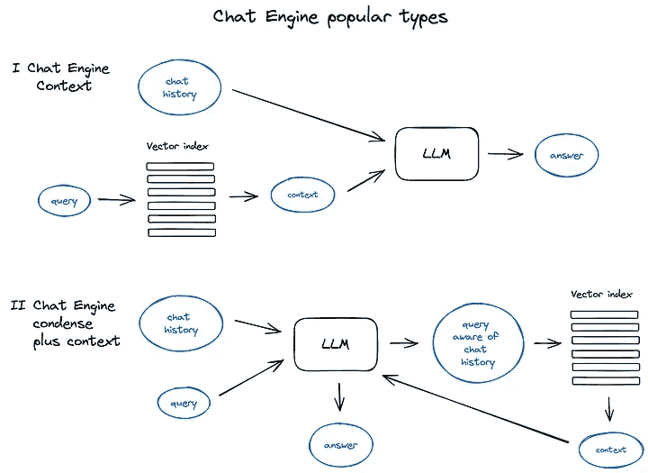

聊天历史可以一同融入进query，几种方式：

+   当下query去查询，然后把聊天历史 + 当下query查询出的chunk，联合丢给LLM

+   复杂的情况：CondensePlusContextMode，聊天历史 + 当下query丢给LLM，一次性生成统一的query，如果问题语义较丰富，可以拆分query，并行查询

### 6.7 意图识别模块

可以是分类模型、词典，甚至是知识库检索的时候加一个阈值都可以，一方面对知识库外的内容进行拒识（毕竟知识都不存在了，怎么在库里面查都是不对的），另一方面，在有知识类目下的对知识和query进行分类对应，能提升检索的准确性的同时，降低在检索错误时带来的伤害（即使错了知识点，也大概都能在一个领域内的）

来自： [RAG调优方案](https://link.zhihu.com/?target=https%3A//mp.weixin.qq.com/s/tDpU2xEf3rvqyJEMFKjlgA)

---

## 7 RAG的路由 + 代理

### 7.1 路由 Query Routing

查询路由是 LLM 支持的决策步骤，根据用户查询下一步要做什么 - 选项通常是总结、针对某些数据索引执行搜索或尝试多种不同的路线，然后将其输出综合为一个答案。

查询路由器还用于选择索引或更广泛的数据存储，将用户查询发送到何处

+   要么您有多个数据源，例如经典向量存储和图形数据库或关系数据库，要么您有索引的层次结构

+   对于多文档存储，一个非常经典的情况是摘要索引和文档块向量的另一个索引。

路由选项的选择是通过 LLM 调用执行的，以预定义的格式返回其结果。

### 7.2 代理 Agents in RAG

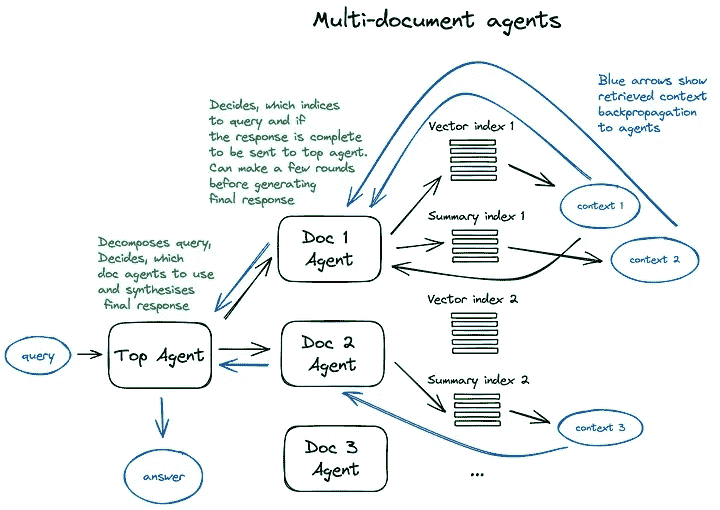

该方案展示了一种先进的 RAG 架构，其中包含每个相关代理做出的大量路由决策。

比如这篇文章有图，有表，有文字，那就图给专门处理图的代理，表格就专门丢给处理表格的代理，最后进行统一

---

## 8 响应合成Response synthesiser

这是任何 RAG 管道的最后一步 - 根据我们仔细检索的所有上下文和初始用户查询生成答案。

最简单的方法是将所有获取的上下文（高于某个相关阈值）与查询一起连接并立即提供给 LLM。

但是，一如既往，还有其他更复杂的选项，涉及多个 LLM 调用，以细化检索到的上下文并生成更好的答案。

**响应合成的主要方法是：**

1. 通过将检索到的上下文**逐块发送到 LLM** 来迭代完善答案

2**. 将qu**ery的 上下文一起丢进来 以适应提示

3. 根据不同的上下文块生成多个答案 ，然后连接或 总结它们 。

### 8.1 合成的Prompt

参考： [RAG调优方案](https://link.zhihu.com/?target=https%3A//mp.weixin.qq.com/s/tDpU2xEf3rvqyJEMFKjlgA)

```
RAG_PROMPT = &quot;&quot;&quot;请根据用户提问和参考资料进行回复，回复的内容控制在100字左右。

用户提问：{}

参考材料：
{}&quot;&quot;&quot;
```

在一些情况，我们是能添加一些限定条件或者是调整，使之符合我们实际任务的需求，我这里句一些例子：

+   字数限定。在一些情况，限定字数能让大模型的输出更加精准，废话比较少，同时说的少出错的概率也就小很多。

+   角色限定。“你是一名出色的律师”、“你是一名优秀的医生”，类似这样的角色限定，在一些情况能让最终输出的质量有所提升。

+   细化具体要求，如“只根据参考材料回复，如果参考材料回答不了问题，请拒绝回答”。

当然了，也可以配合上游的query理解、query拓展等操作，给出一些提示，这些提示能让模型的输出不那么离谱。例如：

+   “请注意，此问题需要关注的关键词是：XX”。

+   “文中提及了歌手【周杰伦】”。

---

## 9 **RAG 系统的评估指标**

参考： [杜军：LangChain - RAG: 做 RAG](https://zhuanlan.zhihu.com/p/656990524) 的天选打工人，拿这几个指标找老板加薪！

**Ragas（ **[**R**](https://link.zhihu.com/?target=https%3A//arxiv.org/abs/2309.15217)**AGAS: Automated Eval**uation of Retrieval Augmented Generation ） 把 RAG 系统的评估指标拆分为三个维度如下，这可不是 Benz 的标...

1.  实时性（faith fullness）

1.  答案相关性（answer relevance）

1.  **上下文相关性（context relevance，又细分为 Prec**ision 和 Recall，所以可以看到有些类似的框架引入了 F1 8 指标）

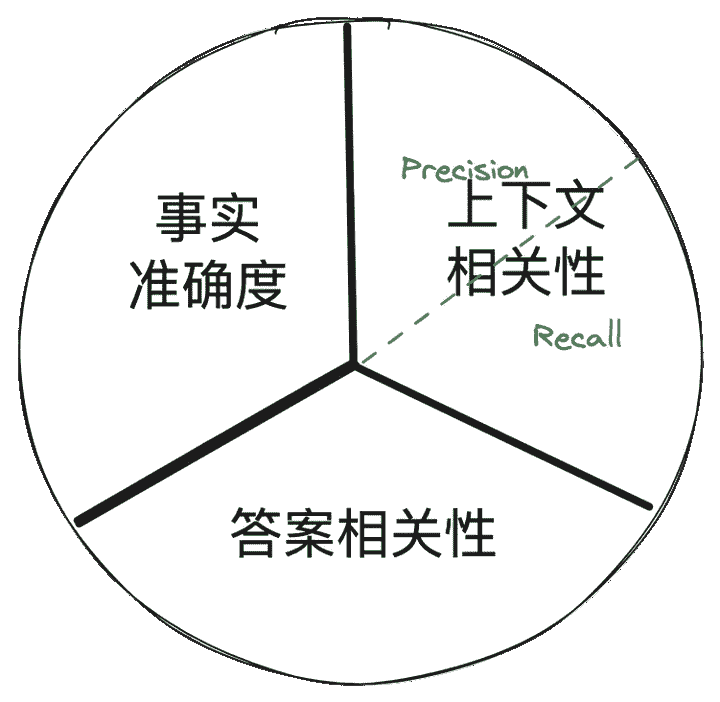

## 10 后处理/质检

质检，是否有不符合对应场景要求的，例如医疗领域的开药规则，金融领域的话术约束等。

某些约束是否有生效，例如字数。

如果有，则可以把条件再加入，然后让大模型再调整一次，能很大程度有特别的要求。