# RAG 分块Chunk技术优劣、技巧、方法汇总

> 来源：[https://agijuejin.feishu.cn/docx/Lu27dSRGEofNfCx8TracmaY5nIi](https://agijuejin.feishu.cn/docx/Lu27dSRGEofNfCx8TracmaY5nIi)

> 作者：悟乙己

> 原文： [https://zhuanlan.zhihu.com/p/673906072](https://zhuanlan.zhihu.com/p/673906072)

在上一篇【 悟乙己：大模型RAG 场景、数据、应用难点与解决（四） 】提到了RAG中文档数据不够干净，召回效果也不会好，同时在第2点提到了Langchian-Chatchat中提及到的一些文档预处理方法，包括更加规范的格式、小切片等。

在这其中其实有一个也是非常关键，就是如何切分Chunk，而且PDF中结构会比较复杂，包括图片，而且有些排版比较奇怪，所以分Chunk难度还是蛮大的。

+ chunk粒度是一个句子/单词，那么更加注重局部、关键信息的查询，相应的会缺失上下文的信息
+ 完整的长篇段落或文章，chunk 被embedding出来的就是整个文章的意思，但是很难精准到个体单词

这里有几个场景的区分，首先是🧣（少字符）、知乎/📕（中小量字符数）、博客（超多字符），还有专业性较强、专有名词较多的文章 与 综述类信息总结文章；不同类型的场景会需要不同chunk分块粒度。

此时Chunk会影响到以下的信息（ RAG行业交流中发现的一些问题和改进方法 ）：

+ **上下文信息：** 例如，《统计学习的要素》这本书有18章，每一章都专注于一个主题。每章有副标题和第二层副标题等。人们习惯于在语境中理解文章。
+ **位置信息：** 文本的权重取决于它们在文档中的位置。文档开头和结尾的文字比中间的文字更重要
+ **连续的信息：** 一个故事可能以“in the beginning”开头，然后以“then”、“therefore”、“after that”继续，直到以“finally”、“finally”等结尾。使用分块策略，这种连接不再是完整的。
+ **描述信息：** 使用分块，可能无法保证描述性信息集中在一起。想象一下你正在打电话，突然电话线被切断了。这取决于你的电话有多重要，当它发生时，影响范围从微不足道到非常令人沮丧。

由此RAG任务不擅长回答的几类问题：

1. **不擅长小范围的描述性问题回答。** 例如，哪个主体具有某些特征?
1. **不擅长关系推理，** 即寻找从实体A到实体B的路径或识别实体集团。
1. **不擅长时间跨度很长的总结。** 例如，“列出所有哈利波特的战斗”或“哈利波特有多少次战斗?”

此时借由【 最详细的文本分块(Chunking)方法，直接影响LLM应用效果 】文章信息，在确定最佳分块策略时，有几个因素会对我们的选择起到至关重要的影响：

1. **被索引内容的性质是什么？** 这可能差别会很大，是处理较长的文档(如文章或书籍)，还是处理较短的内容(如🧣或即时消息)？答案将决定哪种模型更适合您的目标，从而决定应用哪种分块策略。
1. 您使用的是哪种Embedding模型，它在多大的块大小上表现最佳？ 例如，`sentence-transformer` 模型在单个句子上工作得很好，但像 `text-embedding-ada-002` 这样的模型在包含256或512个tokens的块上表现得更好。
1. 你对用户查询的长度和复杂性有什么期望？ 用户输入的问题文本是简短而具体的还是冗长而复杂的？这也直接影响到我们选择分组内容的方式，以便在嵌入查询和嵌入文本块之间有更紧密的相关性。
1. 如何在您的特定应用程序中使用检索结果？例如，它们是否用于语义搜索、问答、摘要或其他目的？例如，和你底层连接的LLM是有直接关系的，LLM的tokens限制会让你不得不考虑分块的大小。

没有最好的分块策略，只有适合的分块策略，为了确保查询结果更加准确，有时候我们甚至需要选择性的使用几种不同的策略。

本篇，就是来小结Chunk的一些基本技术点，从Langchian 、 Langchian-Chatchat等进行参考。

---

## 1 一些产品化的分块模块

第一篇先列举一些已经产品化的分块模块，大多大同小异，以Langchain为基准使用。

### 1.1 FastGPT

包括分块长度

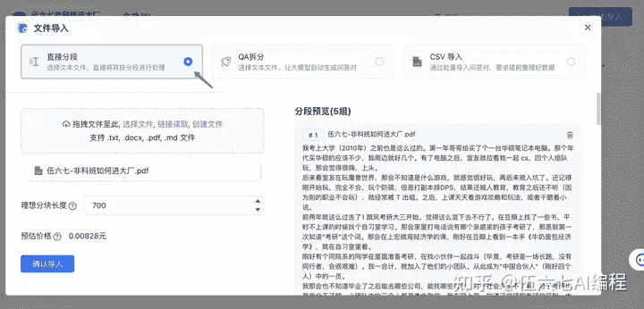

### 1.2 Langchian-Chatchat

分块长度、重合长度、中文标题加强

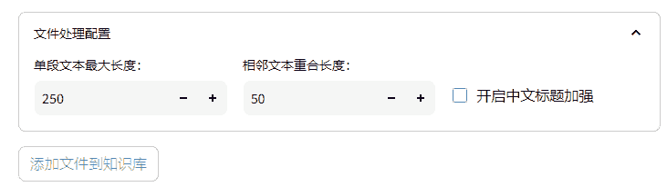

### 1.3 Baidu千帆知识库

非结构化数据预处理这里应该是非常丰富的，自动分段；自定义分段，包括了长度、重叠长度；还有层次分级，专门针对Doc

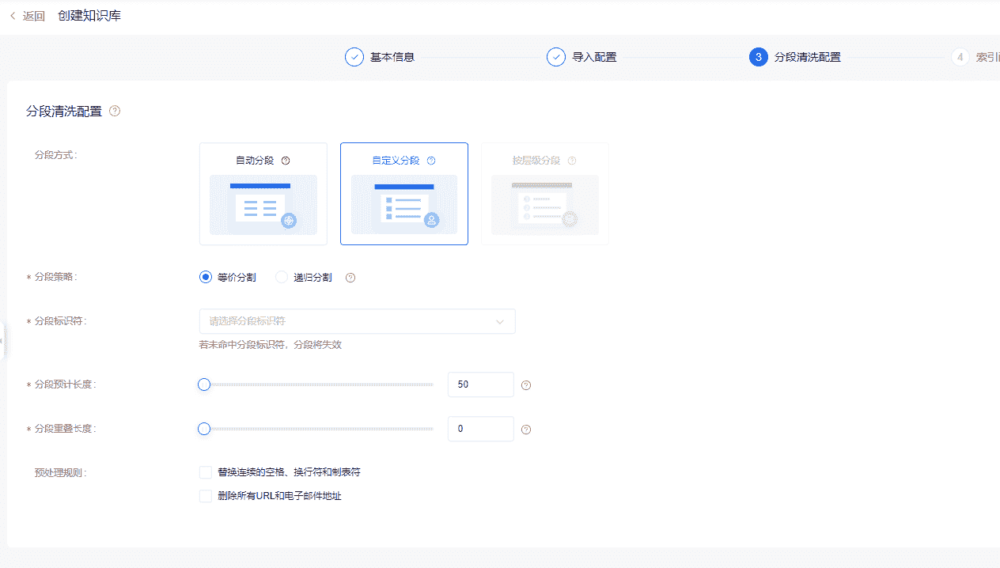

结构化数据，可以直接导入：

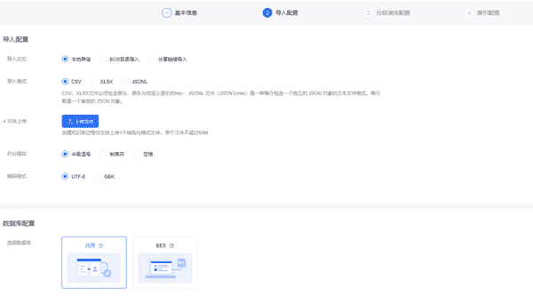

### 1.4 星火知识库

大概也是切分符、长度几个参数

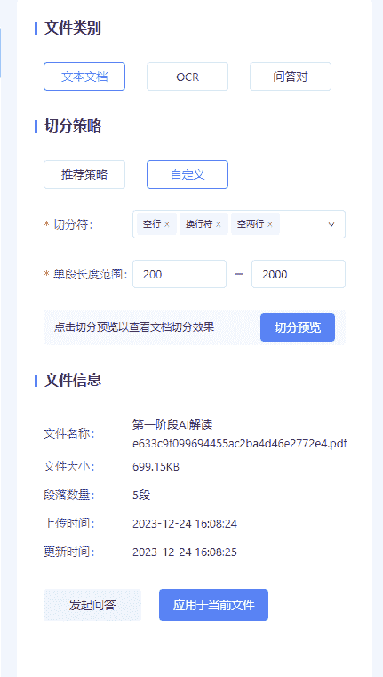

包括针对QA对的识别符：


### 1.5 Jina - Dify机器人

来自文档： 如何训练出专属于“你”的问答机器人？ - Dify

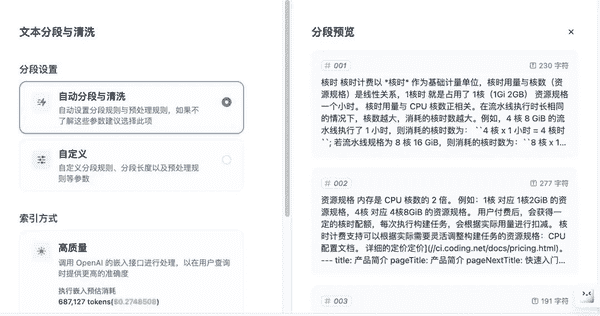

常规的自动分段与清洗

---

## 2 Langchain/Langchain-chatchat

Langchain提供了很多文本切割的工具，其中langchain默认使用`RecursiveCharacterTextSplitter()`：

+ `RecursiveCharacterTextSplitter()`：按字符串分割文本，递归地尝试按不同的分隔符进行分割文本。
+ `CharacterTextSplitter()`：按字符来分割文本。
+ `MarkdownHeaderTextSplitter()`：基于指定的标题来分割markdown 文件。
+ `TokenTextSplitter()`：按token来分割文本。
+ `SentenceTransformersTokenTextSplitter()`：按token来分割文本
+ `Language()` - 用于 CPP、Python、Ruby、Markdown 等。
+ `NLTKTextSplitter()`：使用 `NLTK`（自然语言工具包）按句子分割文本。
+ `SpacyTextSplitter()` - 使用 `Spacy`按句子的切割文本。

### 2.1 RecursiveCharacterTextSplitter：重叠滑窗分句方法

`RecursiveCharacterTextSplitter`是Langchain的默认文本分割器，它按不同的字符递归地分割文档，同时要兼顾被分割文本的长度和重叠字符，递归分块使用一组分隔符以分层和迭代的方式将输入文本分成更小的块。如果分割文本开始的时候没有产生所需大小或结构的块，那么这个方法会使用不同的分隔符或标准对生成的块递归调用，直到获得所需的块大小或结构。这意味着虽然这些块的大小并不完全相同，但它们仍然会逼近差不多的大小。

`RecursiveCharacterTextSplitter`默认使用 `\n\n`、`\n`、` `、`""` 这四个特殊符号作为分割文本的标记，下面对`RecursiveCharacterTextSplitter()`方法的参数说明如下：

+ `chunk_size`：被切割的字符串的最大长度
+ `chunk_overlap`：如果仅仅使用`chunk_size`来切割时，前后两段字符串重叠的字符数量。
+ `add_start_index`：是否在元数据中包含每个块在原始文档中的起始位置
+ `length_function`：如何计算块的长度。默认情况下，只计算字符数，但通常在此处传递令牌计数器

重复字段的意义：块之间保持一些重叠，以确保语义上下文不会在块之间丢失。在大多数情况下，固定大小的分块将是最佳方式。与其他形式的分块相比，固定大小的分块在计算上更加经济且易于使用，因为它在分块过程中不需要使用任何NLP库。

下面我们看个例子，在这个例子中我们要对一个字符串“abcdefghijklmnopqrstuvwxyz”进行分割：

```
from langchain.text_splitter import RecursiveCharacterTextSplitter, CharacterTextSplitter

r_splitter = RecursiveCharacterTextSplitter(
    chunk_size=26, #块长度
    chunk_overlap=4, #重叠字符串长度
    separators=["\n\n", "\n", " ", ""] #默认
)

#分割字符串
text1 = 'abcdefghijklmnopqrstuvwxyz'
r_splitter.split_text(text1)
>>> ['abcdefghijklmnopqrstuvwxyz']
```

看看另外情况：

```
r_splitter = RecursiveCharacterTextSplitter(
    chunk_size=10, #块长度
    chunk_overlap=4 #重叠字符串长度
)
>>> ['abcdefghij', 'ghijklmnop', 'mnopqrstuv', 'stuvwxyz']
```

所以，这里块长度、重叠字符串，都可以体现了，首先 `abcdefghij` 和 第二个结果 `ghijklmnop` 分别是10个，然后 `ghij` 四个是重叠的

另外可以根据 `separators` 自定义一些正则表达：

```
r_splitter = RecursiveCharacterTextSplitter(
    chunk_size=150,
    chunk_overlap=0,
    separators=["\n\n", "\n", "(?<=\. )", " ", ""]
)
r_splitter.split_text(some_text)
```

正则表达式 `(?<=\. )` ，它的意思是保证句号 `.` 前面一定会存在字符，这样就避免了句号被保留在句首的情况。

这个正则可以沿用到其他的地方

### 2.2 CharacterTextSplitter

按字符数来切割文档的文档切割组件,默认情况下是 `\n\n`

来看例子：

```
c_splitter = CharacterTextSplitter(
    chunk_size=5,
    chunk_overlap=4,
    separator = '\n\n'
)

text3 = "a b c d e f g h i j k l m n o p q r s t u v w x y z"
c_splitter.split_text(text3)
>>> ['a b c d e f g h i j k l m n o p q r s t u v w x y z']
```

```
c_splitter = CharacterTextSplitter(
    chunk_size=10,
    chunk_overlap=4,
    separator = ' '
)
>>> ['a b c d e',
 'd e f g h',
 'g h i j k',
 'j k l m n',
 'm n o p q',
 'p q r s t',
 's t u v w',
 'v w x y z']
```

这里要费点笔墨，此时可以看到上面 `chunk_size=5` 却没有按照`chunk_size`进行分割，是因为一定要触发 `separator` 的规则才会根据`size`进行分割；

所以，后面 `separator` 改成空格就会根据 `chunk_size` 进行分割了

### 2.3 TokenTextSplitter

`TokenTextSplitter` 是一种字节对编码（Byte Pair Encoder，BPE）方法，而BPE是一种自然语言处理领域中被经常使用的数据压缩算法。`TokenTextSplitter` 来自 `tiktoken` 库，`tiktoken` 库最先被用在 `GPT-2` 中，并随之被开源。我们首先介绍 `LangChain` 中内置的 `TokenTextSplitter` 实现和 `TokenTextSplitter` 中可以调用的 `tokenizer` 方法。

`Langchain`还提供了按token来分割文本的方法，所谓token可以理解为含义简单的最小词语单位，这里一个token大约由4个字符组成。因为大型语言模型(LLM),通常是以token的数量作为其计量(或收费)的依据。所以采用token分割也有助于我们在使用像chatGPT这样的LLM的同时更好的控制成本。

```
from langchain.text_splitter import TokenTextSplitter

text_splitter = TokenTextSplitter(chunk_size=1, chunk_overlap=0)

text1 = "foo bar bazzyfoo"
text_splitter.split_text(text1)
>>> ['foo', ' bar', ' b', 'az', 'zy', 'foo']
```

在使用token分割文本时英语中的一些非常用单词如这里的`bazzyfoo`会被分割成多个token,如这里将`bazzyfoo`分割成了4个token,它们分别是`b`, `az`, `zy`, `foo`。

另一种形态是 `tiktoken`

`tiktoken` 是由 `OpenAI` 开源的快速 `BPE` 分词器。

可以使用它来估算使用的token。对于 `OpenAI` 模型来说，它可能更准确。

1. 文本如何拆分：按照传入的字符
1. 块大小如何测量：通过 `tiktoken` 分词器

使用前需要先安装：

```
pip install tiktoken
```

需要配合`CharacterTextSplitter`来使用：

```
from langchain.text_splitter import CharacterTextSplitter


# 根据token拆分文本
text_splitter = CharacterTextSplitter.from_tiktoken_encoder(
    chunk_size=2, chunk_overlap=0,encoding_name = 'gpt2'
)
text = 'abcdefghi jklmno pqrstuvwxyz'
texts = text_splitter.split_text(text)

print(texts[0])
>>> abcdefghi jklmno pqrstuvwxyz

# 修改一下chunk_size
text_splitter = CharacterTextSplitter.from_tiktoken_encoder(
    chunk_size=20, chunk_overlap=0,encoding_name = 'gpt2'
)
text = 'abcdefghi jklmno pqrstuvwxyz'
texts = text_splitter.split_text(text)

print(texts[0])
>>> abcdefghi jklmno pqrstuvwxyz
```

可以看到这里其实先根据空格进行分割，然后如果分割后，为一个单词合并在一起，则会认为是一个单词，不会分开

在文章 [FurtheBBMachine：分词 -- 从源码解读LangChain-ChatGLM(二)](https://zhuanlan.zhihu.com/p/638929185) 提到：

`TokenTextSplitter` 主要可以通过两种方法初始化 `encoder`：


# tiktoken 与 Markdown 文本分割

## tiktoken 基本用法

```python
# 以下两种方式的结果一致
encoding = tiktoken.get_encoding("cl100k_base")
encoding = tiktoken.encoding_for_model("gpt-4")

encoding = tiktoken.get_encoding("cl100k_base")
print(encoding.encode("tiktoken is great!"))
# [83, 1609, 5963, 374, 2294, 0]

print(encoding.decode([83, 1609, 5963, 374, 2294, 0]))
# "tiktoken is great!"

print([encoding.decode_single_token_bytes(token) for token in [83, 1609, 5963, 374, 2294, 0]])
# [b't', b'ik', b'token', b' is', b' great', b'!']
```

[编码和使用该编码的模型对应](https://link.zhihu.com/?target=https%3A//github.com/openai/tiktoken%23what-is-bpe-anyway)关系如下，我们也可以用内置方法训练自己的 `encoder`：

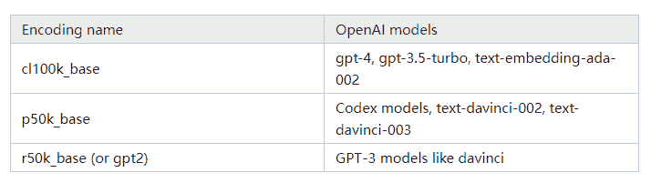

下面介绍 `allowed_special` & `disallowed_special`。在 `tiktoken` 的注释里这样写道：

> # `special_tokens`: A dictionary mapping special token strings to their token values.

我的理解是我们可以创建一些特殊字符和编码的映射，特殊的字符可以表示序列上下文信息，可以对应特殊的任务（`mask` 与补全任务）。我可以联想到的特殊字符有 [transformer](https://zhuanlan.zhihu.com/p/361169990) 结构中的各种位置编码（`positional encoding`），但由于 `tiktoken` 的文档和注释没有介绍这个部分，我简单了解了一些 NLP 中的特殊编码，例如 `bert` 中的 `[cls]`、`[sep]`、`[unk]`、`[pad]`、`[mask]`。

## Markdown 文本分割

### 2.4 MarkdownHeaderTextSplitter

Markdown 文件是由 h1、h2、h3 等多级标题组织的，我们可以根据 Markdown 标题分割文本内容，把标题相同的文本片段组织在一块。

我们可以使用 `MarkdownHeaderTextSplitter` 来保留块中的标题元数据：

```python
from langchain.document_loaders import NotionDirectoryLoader
from langchain.text_splitter import MarkdownHeaderTextSplitter
 
markdown_document = """# Title\n\n \
## Chapter 1\n\n \
Hi this is Jim\n\n Hi this is Joe\n\n \
### Section \n\n \
Hi this is Lance \n\n 
## Chapter 2\n\n \
Hi this is Molly"""
 
headers_to_split_on = [
    ("#", "Header 1"),
    ("##", "Header 2"),
    ("###", "Header 3"),
]
 
markdown_splitter = MarkdownHeaderTextSplitter(
    headers_to_split_on=headers_to_split_on
)
 
md_header_splits = markdown_splitter.split_text(markdown_document)


>>> [Document(page_content='Hi this is Jim  \nHi this is Joe', metadata={'Header 1': 'Title', 'Header 2': 'Chapter 1'}),
 Document(page_content='Hi this is Lance', metadata={'Header 1': 'Title', 'Header 2': 'Chapter 1', 'Header 3': 'Section'}),
 Document(page_content='Hi this is Molly', metadata={'Header 1': 'Title', 'Header 2': 'Chapter 2'})]
```

这里我们设置了抽取指定标题（如标题 1、标题 2、标题 3），且同一标题内的数据被放置在同一个块内。

再来看一个例子，先进行 Markdown 标题拆分，再进行内容拆分：

```python
# 待分割内容
markdown_document = "# Intro \n\n    ## History \n\n Markdown[9] is a lightweight markup language for creating formatted text using a plain-text editor. John Gruber created Markdown in 2004 as a markup language that is appealing to human readers in its source code form.[9] \n\n Markdown is widely used in blogging, instant messaging, online forums, collaborative software, documentation pages, and readme files. \n\n ## Rise and divergence \n\n As Markdown popularity grew rapidly, many Markdown implementations appeared, driven mostly by the need for \n\n additional features such as tables, footnotes, definition lists,[note 1] and Markdown inside HTML blocks. \n\n #### Standardization \n\n From 2012, a group of people, including Jeff Atwood and John MacFarlane, launched what Atwood characterised as a standardisation effort. \n\n ## Implementations \n\n Implementations of Markdown are available for over a dozen programming languages."

# 设置分割标题层级
headers_to_split_on = [
    ("#", "Header 1"),
    ("##", "Header 2"),
]

# 先用 Markdown 拆分器，拆分内容
markdown_splitter = MarkdownHeaderTextSplitter(headers_to_split_on=headers_to_split_on)
md_header_splits = markdown_splitter.split_text(markdown_document)

# 再次对拆分后的内容，进行二次拆分
from langchain.text_splitter import RecursiveCharacterTextSplitter

chunk_size = 250
chunk_overlap = 30
text_splitter = RecursiveCharacterTextSplitter(
    chunk_size=chunk_size, chunk_overlap=chunk_overlap
)

# Split
splits = text_splitter.split_documents(md_header_splits)
splits

>>> [Document(page_content='Markdown[9] is a lightweight markup language for creating formatted text using a plain-text editor. John Gruber created Markdown in 2004 as a markup language that is appealing to human readers in its source code form.[9]', metadata={'Header 1': 'Intro', 'Header 2': 'History'}),
     Document(page_content='Markdown is widely used in blogging, instant messaging, online forums, collaborative software, documentation pages, and readme files.', metadata={'Header 1': 'Intro', 'Header 2': 'History'}),
     Document(page_content='As Markdown popularity grew rapidly, many Markdown implementations appeared, driven mostly by the need for  \nadditional features such as tables, footnotes, definition lists,[note 1] and Markdown inside HTML blocks.  \n#### Standardization', metadata={'Header 1': 'Intro', 'Header 2': 'Rise and divergence'}),
     Document(page_content='#### Standardization  \nFrom 2012, a group of people, including Jeff Atwood and John MacFarlane, launched what Atwood characterised as a standardisation effort.', metadata={'Header 1': 'Intro', 'Header 2': 'Rise and divergence'}),
     Document(page_content='Implementations of Markdown are available for over a dozen programming languages.', metadata={'Header 1': 'Intro', 'Header 2': 'Implementations'})]
```

另外（可参考：悟乙己：LangChain:万能的非结构化文档载入详解（一）?）：

`MarkdownHeaderTextSplitter` 还有一个额外的参数 `strip_headers = False`

```python
markdown_splitter = MarkdownHeaderTextSplitter(
    headers_to_split_on=headers_to_split_on, strip_headers=False
)
md_header_splits = markdown_splitter.split_text(markdown_document)
md_header_splits

>>> [Document(page_content='# Foo  \n## Bar  \nHi this is Jim  \nHi this is Joe', metadata={'Header 1': 'Foo', 'Header 2': 'Bar'}),
 Document(page_content='### Boo  \nHi this is Lance', metadata={'Header 1': 'Foo', 'Header 2': 'Bar', 'Header 3': 'Boo'}),
 Document(page_content='## Baz  \nHi this is Molly', metadata={'Header 1': 'Foo', 'Header 2': 'Bar', 'Header 3': 'Baz'})]
```

因为 `MarkdownHeaderTextSplitter` 默认是把标题从正文中进行删除，放在 `metadata` 当中，如果要恢复，需要设置该参数。

同时 `MarkdownHeaderTextSplitter` 是根据 `#` 进行切分，所以会出现某一个分块字数过多的情况。

所以，一般需要 `MarkdownHeaderTextSplitter` 在加一个分块器，官网的案例（[MarkdownHeaderTextSplitter | ️ Langchain](https://link.zhihu.com/?target=https%3A//python.langchain.com/docs/modules/data_connection/document_transformers/markdown_header_metadata)）：


```markdown
markdown_document = "# Intro \n\n    ## History \n\n Markdown[9] is a lightweight markup language for creating formatted text using a plain-text editor. John Gruber created Markdown in 2004 as a markup language that is appealing to human readers in its source code form.[9] \n\n Markdown is widely used in blogging, instant messaging, online forums, collaborative software, documentation pages, and readme files. \n\n ## Rise and divergence \n\n As Markdown popularity grew rapidly, many Markdown implementations appeared, driven mostly by the need for \n\n additional features such as tables, footnotes, definition lists,[note 1] and Markdown inside HTML blocks. \n\n #### Standardization \n\n From 2012, a group of people, including Jeff Atwood and John MacFarlane, launched what Atwood characterised as a standardisation effort. \n\n ## Implementations \n\n Implementations of Markdown are available for over a dozen programming languages."

headers_to_split_on = [
    ("#", "Header 1"),
    ("##", "Header 2"),
]

# MD splits
markdown_splitter = MarkdownHeaderTextSplitter(
    headers_to_split_on=headers_to_split_on, strip_headers=False
)
md_header_splits = markdown_splitter.split_text(markdown_document)

# Char-level splits
from langchain.text_splitter import RecursiveCharacterTextSplitter

chunk_size = 250
chunk_overlap = 30
text_splitter = RecursiveCharacterTextSplitter(
    chunk_size=chunk_size, chunk_overlap=chunk_overlap
)

# Split
splits = text_splitter.split_documents(md_header_splits)
splits
```

### 2.5 `CodeTextSplitter`

按照代码进行分割，支持代码的语言包括 `cpp`、`go`、`java`、`js`、`php`、`proto`、`python`、`rst`、`ruby`、`rust`、`scala`、`swift`、`markdown`、`latex`、`html`、`sol`。

#### python代码

```
from langchain.text_splitter import (
    RecursiveCharacterTextSplitter,
    Language,
)

# 打印支持的编程语言
[e.value for e in Language]

# 指定语言使用的分隔符
RecursiveCharacterTextSplitter.get_separators_for_language(Language.PYTHON)
>>> ['\\nclass ', '\\ndef ', '\\n\\tdef ', '\\n\\n', '\\n', ' ', '']

PYTHON_CODE = """
def hello_world():
    print("Hello, World!")

# Call the function
hello_world()
"""
python_splitter = RecursiveCharacterTextSplitter.from_language(
    language=Language.PYTHON, chunk_size=50, chunk_overlap=0
)
python_docs = python_splitter.create_documents([PYTHON_CODE])
python_docs
>>> [Document(page_content='def hello_world():\n    print("Hello, World!")'),
 Document(page_content='# Call the function\nhello_world()')]
```

可以看到这里是通过 `\\nclass `、`\\ndef `、`\\n\\tdef `、`\\n\\n`、`\\n` 这些作为分割符

#### JS

使用 JS 文本分割器，拆分 JS 代码的示例

```
JS_CODE = """
function helloWorld() {
  console.log("Hello, World!");
}

// Call the function
helloWorld();
"""

js_splitter = RecursiveCharacterTextSplitter.from_language(
    language=Language.JS, chunk_size=60, chunk_overlap=0
)
js_docs = js_splitter.create_documents([JS_CODE])
js_docs
>>> [Document(page_content='function helloWorld() {\n  console.log("Hello, World!");\n}', metadata={}),
     Document(page_content='// Call the function\nhelloWorld();', metadata={})]
```

#### Markdown

这是拆分 Markdown 代码的例子

```
markdown_text = """
#  ️  LangChain

⚡ Building applications with LLMs through composability ⚡

## Quick Install

```bash
# Hopefully this code block isn't split
pip install langchain
```

As an open source project in a rapidly developing field, we are extremely open to contributions.
"""

md_splitter = RecursiveCharacterTextSplitter.from_language(
    language=Language.MARKDOWN, chunk_size=60, chunk_overlap=0
)
md_docs = md_splitter.create_documents([markdown_text])
md_docs


>>> [Document(page_content='#  ️  LangChain', metadata={}),
     Document(page_content='⚡ Building applications with LLMs through composability ⚡', metadata={}),
     Document(page_content='## Quick Install', metadata={}),
     Document(page_content="```bash\n# Hopefully this code block isn't split", metadata={}),

     Document(page_content='pip install langchain', metadata={}),

     Document(page_content='```', metadata={}),
     Document(page_content="As an open source project in a rapidly developing field, we're", metadata={}),
     Document(page_content='are extremely open to contributions.', metadata={})]
```

### 2.6 spaCy（`TokenTextSplitter`变形）

复杂的句子分割功能，可以有效地将文本分成单独的句子，从而在生成的块中更好地保存上下文。

使用 NLTK 的替代方案是使用 [`spaCy` 分词器](https://link.zhihu.com/?target=https%3A//spacy.io/api/tokenizer)。

1. 文本如何拆分：通过 `spaCy` 分词器
2. 如何测量块大小：按字符数计算

使用前需要安装：

```
pip install spacy
```

使用案例：

```
from langchain.text_splitter import SpacyTextSplitter
# 定义文本拆分器
text_splitter = SpacyTextSplitter(chunk_size=1000)
# 拆分文本
text = 'abcdefghi jklmno pqrstuvwxyz'
texts = text_splitter.split_text(text)
print(texts[0])
>>> abcdefghi jklmno pqrstuvwxyz
```

笔者报了一个错误：

```
[E050] Can't find model 'en_core_web_sm'. It doesn't seem to be a Python package or a valid path to a data directory.
```

此时需要安装：

```
python -m spacy download en_core_web_sm
```

在文章 [FurtheBBMachine：分词 -- 从源码解读 LangChain-ChatGLM(二)](https://zhuanlan.zhihu.com/p/638929185) 对齐进行拓展研究：

```
import spacy
nlp = spacy.load("en_core_web_sm")
for line in nlp.pipeline:
    print(line)
'''
('tok2vec', <spacy.pipeline.tok2vec.Tok2Vec object at 0x00000193337478E0>)
('tagger', <spacy.pipeline.tagger.Tagger object at 0x0000019333747DC0>)
('parser', <spacy.pipeline.dep_parser.DependencyParser object at 0x00000193338C8200>)
('attribute_ruler', <spacy.pipeline.attributeruler.AttributeRuler object at 0x00000193339680C0>)
('lemmatizer', <spacy.lang.en.lemmatizer.EnglishLemmatizer object at 0x00000193339433C0>)
('ner', <spacy.pipeline.ner.EntityRecognizer object at 0x00000193338C80B0>)
'''
```

对于一个 `spaCy` 数据处理方法对象 `nlp`，我们可以关注以下重点：

+   `spaCy` 支持提取丰富的语言特征。

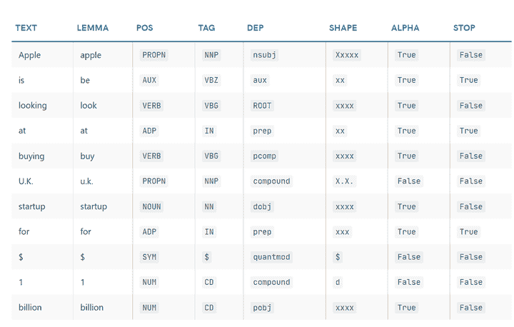

+   `spaCy` 使用的语言模型是预先训练的统计模型，例如 `en_core_web_sm`。针对不同语言的预训练模型和训练自己模型的方法详见 [Models & Languages · spaCy Usage Documentation](https://link.zhihu.com/?target=https%3A//spacy.io/usage/models)，使用基于 `transformer` 的更好的预训练模型方法详见 [Embeddings, Transformers and Transfer Learning · spaCy Usage Documentation](https://link.zhihu.com/?target=https%3A//spacy.io/usage/embeddings-transformers)

+   `Pipeline` 存储了 `nlp` 对象对文档执行操作的序列，一个 `blank pipeline` 等同于一个 `tokenizer`。我们可以在参数中使用 `able` 和 `disable` 关键字来部分执行这些操作，也可以自定义操作，具体方法见 [Language Processing Pipelines · spaCy Usage Documentation](https://link.zhihu.com/?target=https%3A//spacy.io/usage/processing-pipelines)。

### 2.7 `SentenceTransformersTokenTextSplitter`（`TokenTextSplitter`变形）

`SentenceTransformersTokenTextSplitter` 是专为 `sentence-transformer` 模型设计的文本分割器。默认行为是将文本分割成适合所需使用的 `sentence-transformer` 模型的 `token` 窗口大小的块。

需要额外安装：

```
pip install sentence-transformers
```

来看一个案例：


```
from langchain.text_splitter import SentenceTransformersTokenTextSplitter
splitter = SentenceTransformersTokenTextSplitter(chunk_overlap=0)
text = &quot;Lorem &quot;
count_start_and_stop_tokens = 2
text_token_count = splitter.count_tokens(text=text) - count_start_and_stop_tokens
print(text_token_count)
token_multiplier = splitter.maximum_tokens_per_chunk // text_token_count + 1

# `text_to_split` does not fit in a single chunk
text_to_split = text * token_multiplier
print(text_to_split )
&gt;&gt;&gt;  &#x27;Lorem Lorem Lorem Lorem Lorem Lorem Lorem Lorem Lorem Lorem Lorem Lorem Lorem Lorem Lorem Lorem Lorem Lorem Lorem Lorem Lorem Lorem Lorem Lorem Lorem Lorem Lorem Lorem Lorem Lorem Lorem Lorem Lorem Lorem Lorem Lorem Lorem Lorem Lorem Lorem Lorem Lorem Lorem Lorem Lorem Lorem Lorem Lorem Lorem Lorem Lorem Lorem Lorem Lorem Lorem Lorem Lorem Lorem Lorem Lorem Lorem Lorem Lorem Lorem Lorem Lorem Lorem Lorem Lorem Lorem Lorem Lorem Lorem Lorem Lorem Lorem Lorem Lorem Lorem Lorem Lorem Lorem Lorem Lorem Lorem Lorem Lorem Lorem Lorem Lorem Lorem Lorem Lorem Lorem Lorem Lorem Lorem Lorem Lorem Lorem Lorem Lorem Lorem Lorem Lorem Lorem Lorem Lorem Lorem Lorem Lorem Lorem Lorem Lorem Lorem Lorem Lorem Lorem Lorem Lorem Lorem Lorem Lorem Lorem Lorem Lorem Lorem Lorem Lorem Lorem Lorem Lorem Lorem Lorem Lorem Lorem Lorem Lorem Lorem Lorem Lorem Lorem Lorem Lorem Lorem Lorem Lorem Lorem Lorem Lorem Lorem Lorem Lorem Lorem Lorem Lorem Lorem Lorem Lorem Lorem Lorem Lorem Lorem Lorem Lorem Lorem Lorem Lorem Lorem Lorem Lorem Lorem Lorem Lorem Lorem Lorem Lorem Lorem Lorem Lorem Lorem &#x27;

print(f&quot;tokens in text to split: {splitter.count_tokens(text=text_to_split)}&quot;)
text_chunks = splitter.split_text(text=text_to_split)
print(text_chunks[1])
&gt;&gt;&gt;  &#x27;lorem&#x27;
```

可以看到这里通过 `SentenceTransformersTokenTextSplitter` 有一定去重的功效

### 2.8 `NLTKTextSplitter`（`TokenTextSplitter`变形）

自然语言工具包，或更常见的 `NLTK`，是用 Python 编程语言编写的一组用于符号和统计自然语言处理（NLP）的库和程序，用于英语。

提供了一个句子标记器，可以将文本分成句子，帮助创建更有意义的分块。

按 `\n\n` 拆分文本，我们可以使用 `NLTK` 基于 [NLTK 分词器](https://link.zhihu.com/?target=https%3A//www.nltk.org/api/nltk.tokenize.html)进行拆分。

1. 文本拆分方式：使用 `NLTK` 分词器。
2. 块大小的测量方式：按字符数测量。

```
from langchain.text_splitter import NLTKTextSplitter

# 定义文本拆分器
text_splitter = NLTKTextSplitter(chunk_size=1000)
# 拆分文本
text = &#x27;abcdefghi jklmno pqrstuvwxyz&#x27;
texts = text_splitter.split_text(text)
print(texts)
&gt;&gt;&gt; [&#x27;abcdefghi jklmno pqrstuvwxyz&#x27;]
```

另外在文章 [FurtheBBMachine：分词 -- 从源码解读LangChain-ChatGLM(二)](https://zhuanlan.zhihu.com/p/638929185) 对 `NLTK` 的分词进行进一步拓展，`nltk` 中实现的多种分词 & 预处理方法：

### 2.8.1 分成句 & 分成词

```
from nltk.tokenize import sent_tokenize, word_tokenize
print(&quot;en_doc: &quot;, en_doc)
print(&quot;sent_tokenize(en_doc): &quot;, sent_tokenize(en_doc))
print(&quot;word_tokenize(en_doc): &quot;, word_tokenize(en_doc))

# en_doc:  ChatGPT is a new artificial intelligence technology driven Natural language processing tool launched by OpenAI, an American artificial intelligence research laboratory. It uses the Transformer neural network architecture and also the GPT-3.5 architecture. It is a model used to process sequence data. It has the ability of language understanding and text generation. In particular, it will train models by connecting a large number of corpora, which contain dialogues in the real world, This enables ChatGPT to have the ability to learn about astronomy and geography, as well as interact based on the context of the chat, enabling communication with almost identical chat scenes to real humans.
# sent_tokenize(en_doc):  [&#x27;ChatGPT is a new artificial intelligence technology driven Natural language processing tool launched by OpenAI, an American artificial intelligence research laboratory.&#x27;, &#x27;It uses the Transformer neural network architecture and also the GPT-3.5 architecture.&#x27;, &#x27;It is a model used to process sequence data.&#x27;, &#x27;It has the ability of language understanding and text generation.&#x27;, &#x27;In particular, it will train models by connecting a large number of corpora, which contain dialogues in the real world, This enables ChatGPT to have the ability to learn about astronomy and geography, as well as interact based on the context of the chat, enabling communication with almost identical chat scenes to real humans.&#x27;]
# word_tokenize(en_doc):  [&#x27;ChatGPT&#x27;, &#x27;is&#x27;, &#x27;a&#x27;, &#x27;new&#x27;, &#x27;artificial&#x27;, &#x27;intelligence&#x27;, &#x27;technology&#x27;, &#x27;driven&#x27;, &#x27;Natural&#x27;, &#x27;language&#x27;, &#x27;processing&#x27;, &#x27;tool&#x27;, &#x27;launched&#x27;, &#x27;by&#x27;, &#x27;OpenAI&#x27;, &#x27;,&#x27;, &#x27;an&#x27;, &#x27;American&#x27;, &#x27;artificial&#x27;, &#x27;intelligence&#x27;, &#x27;research&#x27;, &#x27;laboratory&#x27;, &#x27;.&#x27;, &#x27;It&#x27;, &#x27;uses&#x27;, &#x27;the&#x27;, &#x27;Transformer&#x27;, &#x27;neural&#x27;, &#x27;network&#x27;, &#x27;architecture&#x27;, &#x27;and&#x27;, &#x27;also&#x27;, &#x27;the&#x27;, &#x27;GPT-3.5&#x27;, &#x27;architecture&#x27;, &#x27;.&#x27;, &#x27;It&#x27;, &#x27;is&#x27;, &#x27;a&#x27;, &#x27;model&#x27;, &#x27;used&#x27;, &#x27;to&#x27;, &#x27;process&#x27;, &#x27;sequence&#x27;, &#x27;data&#x27;, &#x27;.&#x27;, &#x27;It&#x27;, &#x27;has&#x27;, &#x27;the&#x27;, &#x27;ability&#x27;, &#x27;of&#x27;, &#x27;language&#x27;, &#x27;understanding&#x27;, &#x27;and&#x27;, &#x27;text&#x27;, &#x27;generation&#x27;, &#x27;.&#x27;, &#x27;In&#x27;, &#x27;particular&#x27;, &#x27;,&#x27;, &#x27;it&#x27;, &#x27;will&#x27;, &#x27;train&#x27;, &#x27;models&#x27;, &#x27;by&#x27;, &#x27;connecting&#x27;, &#x27;a&#x27;, &#x27;large&#x27;, &#x27;number&#x27;, &#x27;of&#x27;, &#x27;corpora&#x27;, &#x27;,&#x27;, &#x27;which&#x27;, &#x27;contain&#x27;, &#x27;dialogues&#x27;, &#x27;in&#x27;, &#x27;the&#x27;, &#x27;real&#x27;, &#x27;world&#x27;, &#x27;,&#x27;, &#x27;This&#x27;, &#x27;enables&#x27;, &#x27;ChatGPT&#x27;, &#x27;to&#x27;, &#x27;have&#x27;, &#x27;the&#x27;, &#x27;ability&#x27;, &#x27;to&#x27;, &#x27;learn&#x27;, &#x27;about&#x27;, &#x27;astronomy&#x27;, &#x27;and&#x27;, &#x27;geography&#x27;, &#x27;,&#x27;, &#x27;as&#x27;, &#x27;well&#x27;, &#x27;as&#x27;, &#x27;interact&#x27;, &#x27;based&#x27;, &#x27;on&#x27;, &#x27;the&#x27;, &#x27;context&#x27;, &#x27;of&#x27;, &#x27;the&#x27;, &#x27;chat&#x27;, &#x27;,&#x27;, &#x27;enabling&#x27;, &#x27;communication&#x27;, &#x27;with&#x27;, &#x27;almost&#x27;, &#x27;identical&#x27;, &#x27;chat&#x27;, &#x27;scenes&#x27;, &#x27;to&#x27;, &#x27;real&#x27;, &#x27;humans&#x27;, &#x27;.&#x27;]
```

### 2.8.2 基于过滤词的分词


```
import nltk
nltk.download("stopwords")
from nltk.corpus import stopwords
stop_words = set(stopwords.words("english"))
# 下载并打印内置 stopwords
print(stop_words)
'''
{'haven', "shouldn't", "mustn't", 'during', 'own', 'myself', 
"should've", 'under', 'himself', 'and', 't', "isn't", 'off', 
'on', "wasn't", "wouldn't", 'wasn', 'doesn', 'it', "that'll", 
'we', 'mustn', 'the', 'against', 'both', 'some', 'i', 'these', 
'll', 'again', 'why', 'so', 'up', 'having', "aren't", 'that', 
'not', 'your', 'then', 'how', 'such', "won't", 'has', "mightn't", 
'itself', 'being', 'below', "haven't", 'themselves', 'between', 
"you've", 'its', 'only', 'ours', 'ma', 'ain', 'ourselves', 'have', 
'does', 'there', 'or', "doesn't", 'into', 'theirs', "it's", "you're", 
'hers', 'hasn', 're', 'once', 'out', 've', 'been', 'as', 'more', 
'mightn', 'isn', "you'll", 'because', 'do', 'whom', 'wouldn', 'weren', 
'him', 'this', "needn't", 'am', 'most', "don't", 'shouldn', 'me', 'to', 
'their', 'you', 'after', 'same', 'just', 'nor', 'any', "shan't", 'by', 
"couldn't", 'had', 'now', "you'd", 'through', "didn't", 'than', 'aren', 
'his', 'what', 'them', 'will', 'shan', 'is', 'until', 'o', 'didn', 'an', 
'who', 'they', 'no', 'at', 'can', 'those', 'won', 'yourselves', 'my', 
"she's", 'are', 'too', 'don', 'other', 'few', 'hadn', 'when', 'doing', 
'couldn', 'further', 'her', 'a', 'which', 'y', 'in', 'but', 'all', 
'above', 'she', 'was', 'very', 'over', 'while', 'here', 'from', 's', 
"hasn't", 'with', "weren't", 'needn', 'about', 'herself', 'our', 
"hadn't", 'did', 'if', 'he', 'where', 'm', 'for', 'should', 'before', 
'yourself', 'down', 'yours', 'each', 'of', 'd', 'be', 'were'}
'''
```

### 2.8.3 词干提取 & 时态/语态/词性还原

为了应对部分语言中的词性和时态变化，[`nltk.stem`](https://github.com/nltk/nltk/tree/develop/nltk/stem) 提供了一个词干提取接口，并内置了多种词干提取算法。其中还有词性还原算法 `WordNetLemmatizer`。

本文对其中的三种词干提取算法进行测试，分别是：`PorterStemmer`、`LancasterStemmer` 和 `SnowballStemmer` 算法。

```
import nltk
nltk.download('wordnet')
from nltk.stem import WordNetLemmatizer
from nltk.stem import PorterStemmer, LancasterStemmer, SnowballStemmer, WordNetLemmatizer
from nltk.tokenize import word_tokenize
import pandas as pd

stemmer_p = PorterStemmer()
stemmer_l = LancasterStemmer()
stemmer_s = SnowballStemmer("english")
words = word_tokenize(en_doc)

Lemmatizer = WordNetLemmatizer()
lemmatizer_word = [Lemmatizer.lemmatize(word) for word in words]
p_word = [stemmer_p.stem(word) for word in words]
l_word = [stemmer_l.stem(word) for word in words]
s_word = [stemmer_s.stem(word) for word in words]
data = {"raw word": [], "PorterStemmer_result": [], "LancasterStemmer_result": [], "SnowballStemmer_result": [], "Lemmatizer_word_result": []}

for i in range(15):
    if words[i] != p_word[i] or words[i] != l_word[i] or words[i] != s_word[i]:
        data["raw_word"].append(words[i])
        data["Lemmatizer_word_result"].append(lemmatizer_word[i])
        data["PorterStemmer_result"].append(p_word[i])
        data["LancasterStemmer_result"].append(l_word[i])
        data["SnowballStemmer_result"].append(s_word[i])
table = pd.DataFrame(data, columns=["raw_word", "PorterStemmer_result", "LancasterStemmer_result", "SnowballStemmer_result", "Lemmatizer_word_result"])

print(table.to_string())

'''
       raw_word PorterStemmer_result LancasterStemmer_result SnowballStemmer_result Lemmatizer_word_result
0       ChatGPT              chatgpt                 chatgpt                chatgpt                ChatGPT
1    artificial             artifici                     art               artifici             artificial
2  intelligence             intellig                intellig               intellig           intelligence
3    technology            technolog               technolog              technolog             technology
4        driven               driven                    driv                 driven                 driven
5       Natural                natur                     nat                  natur                Natural
6      language              languag                   langu                languag               language
7    processing              process                 process                process             processing
8      launched               launch                  launch                 launch               launched
9        OpenAI               openai                   opena                 openai                 OpenAI
'''
```

可以看到，三种词干提取方法效果很一般：`PorterStemmer` 和 `SnowballStemmer` 无法识别过去被动语态单词 “driven”；`LancasterStemmer` 方法把 “artificial”和 “Natural”裁剪得快要只剩下前缀了；`WordNetLemmatizer` 方法干脆没有做任何的修改，我们再做一轮补充实验：

```
en_doc = "His friends weren't listening to what he said."

'''
    raw_word PorterStemmer_result LancasterStemmer_result SnowballStemmer_result Lemmatizer_word_result
0        His                   hi                     his                    his                    His
1    friends               friend                  friend                 friend                 friend
2       were                 were                     wer                   were                   were
3        n't                  n't                     n't                    n't                    n't
4  listening               listen                    list                 listen              listening
5         to                   to                      to                     to                     to
6       what                 what                    what                   what                   what
7         he                   he                      he                     he                     he
'''
```

`WordNetLemmatizer` 方法只改了个附属后缀。忍无可忍的我翻看了这方法的源码，猜测可能是个启发式算法，不想读辣。下面展示一个该方法的正确打开方式：


```
from nltk.stem import WordNetLemmatizer

lemmatizer = WordNetLemmatizer()
# 默认其为名词
print(lemmatizer.lemmatize("better"))
# 如果需要得到更精确的词元，需要告诉 WordNetLemmatizer 你感兴趣的词性是什么。
print(lemmatizer.lemmatize("better", pos="a"))
print(lemmatizer.lemmatize("good", pos="a"))
print(lemmatizer.lemmatize("goods", pos="a"))
print(lemmatizer.lemmatize("goods", pos="n"))
print(lemmatizer.lemmatize("goodness", pos="n"))
print(lemmatizer.lemmatize("best", pos="a"))

'''
better
good
good
goods
good
goodness
best
'''
```

### 2.8.4 标记词性

```
import nltk
from nltk.tokenize import word_tokenize
nltk.download('averaged_perceptron_tagger')
for line in nltk.pos_tag(word_tokenize((en_doc))[:5]):
    print(line)

'''
('ChatGPT', 'NNP')
('is', 'VBZ')
('a', 'DT')
('new', 'JJ')
('artificial', 'NN')
'''
# 打印文档可以查看词性对应关系,本文中仅展示部分
nltk.download('tagsets')
print(nltk.help.upenn_tagset())
'''
JJ: adjective or numeral, ordinal
    third ill-mannered pre-war regrettable oiled calamitous first separable
    ectoplasmic battery-powered participatory fourth still-to-be-named
    multilingual multi-disciplinary ...
JJR: adjective, comparative
    bleaker braver breezier briefer brighter brisker broader bumper busier
    calmer cheaper choosier cleaner clearer closer colder commoner costlier
    cozier creamier crunchier cuter ...
NN: noun, common, singular or mass
    common-carrier cabbage knuckle-duster Casino afghan shed thermostat
    investment slide humour falloff slick wind hyena override subhumanity
    machinist ...
'''
```

上述代码展示了用一个 pre-trained 词性分类器 Greedy Averaged Perceptron tagger 对文本中单词进行词性标记的过程和结果。令人感兴趣的是，我们可以使用自己的文本-词性对训练自己的词性分类器，代码如下：

```
from nltk.tag.perceptron import PerceptronTagger
# 初始化Tagger
tagger = PerceptronTagger(load=False)
# 加载训练集数据和标签
tagger.train([[('today', 'NN'), ('is', 'VBZ'), ('good', 'JJ'), ('day', 'NN')],
              [('yes', 'NNS'), ('it', 'PRP'), ('beautiful', 'JJ')]])
tagger.tag(['today', 'is', 'a', 'beautiful', 'day'])
# 训练
pretrain = PerceptronTagger()

data = {"word": [], "category": []}
for word, category in pretrain.tag('The quick brown fox jumps over the lazy dog'.split()):
    data["word"].append(word)
    data["category"].append(category)
table = pd.DataFrame(data, columns=["word", "category"])
print(table)

'''
    word category
0    The       DT
1  quick       JJ
2  brown       NN
3    fox       NN
4  jumps      VBZ
5   over       IN
6    the       DT
7   lazy       JJ
8    dog       NN
'''
```

### 2.8.5 基于词性标记的语法树构建

除此之外，NLTK提供了一个基于词性的正则解析器`RegexpParser`，可以通过正则表达式匹配特定标记的词块。下面的代码演示了主语-谓语-宾语结构的语法树 和 冠词-形容词-名词构成的短语块。

```
grammer = 'NP:{<DT>*<JJ>*<NN>+}'
cp = nltk.RegexpParser(grammer)
tree = cp.parse(sentence)
tree.draw()
```

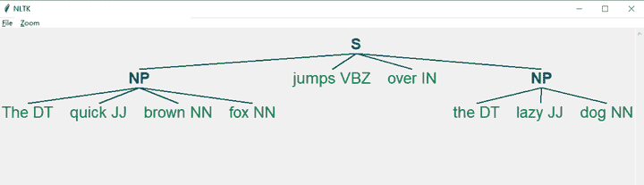

### 2.8.6 基于词性标记的命名实体识别 Using Named Entity Recognition (NER)

```
import nltk
nltk.download('maxent_ne_chunker')
nltk.download('words')
sentence = pretrain.tag(en_doc.split())[:10]
entity = nltk.chunk.ne_chunk(sentence)
print(entity)

'''
(S
  (ORGANIZATION ChatGPT/NNP)
  is/VBZ
  a/DT
  new/JJ
  artificial/JJ
  intelligence/NN
  technology/NN
  driven/RB
  Natural/NNP
  language/NN)
'''
```

### 2.9 `GPT2TokenizerFast` : Hugging Face tokenizer（`TokenTextSplitter`变形）

> Hugging Face有很多的分词器。

我们使用Hugging Face分词器中的 `GPT2TokenizerFast` 来计算文本长度的token数。

1. 文本是如何分割的：按照传入的字符进行分割。
1. 块的大小如何计算：由 Hugging Face 分词器计算得到的token数来衡量。

```
from transformers import GPT2TokenizerFast
from langchain.text_splitter import CharacterTextSplitter
tokenizer = GPT2TokenizerFast.from_pretrained("gpt2")

# 定义文本拆分器，拆分文本
text_splitter = CharacterTextSplitter.from_huggingface_tokenizer(
    tokenizer, chunk_size=100, chunk_overlap=0
)
text = 'abcdefghi jklmno pqrstuvwxyz'
texts = text_splitter.split_text(text)

>>> ['abcdefghi jklmno pqrstuvwxyz']
```

### 2.10 `AliTextSplitter` : Langchian-chatchat封装

这是Langchian-chatchat基于modelspace的 BERT文本分割-中文-通用领域 进行封装的

来看一下代码（[Langchain-Chatchat ali_text_splitter.py](https://github.com/chatchat-space/Langchain-Chatchat/blob/master/text_splitter/ali_text_splitter.py)）：

```
from langchain.text_splitter import CharacterTextSplitter
import re
from typing import List


class AliTextSplitter(CharacterTextSplitter):
    def __init__(self, pdf: bool = False, **kwargs):
        super().__init__(**kwargs)
        self.pdf = pdf

    def split_text(self, text: str) -> List[str]:
        # use_document_segmentation参数指定是否用语义切分文档，此处采取的文档语义分割模型为达摩院开源的nlp_bert_document-segmentation_chinese-base，论文见https://arxiv.org/abs/2107.09278
        # 如果使用模型进行文档语义切分，那么需要安装modelscope[nlp]：pip install "modelscope[nlp]" -f https://modelscope.oss-cn-beijing.aliyuncs.com/releases/repo.html
        # 考虑到使用了三个模型，可能对于低配置gpu不太友好，因此这里将模型load进cpu计算，有需要的话可以替换device为自己的显卡id
        if self.pdf:
            text = re.sub(r"\n{3,}", r"\n", text)
            text = re.sub('\s', " ", text)
            text = re.sub("\n\n", "", text)
        try:
            from modelscope.pipelines import pipeline
        except ImportError:
            raise ImportError(
                "Could not import modelscope python package. "
                "Please install modelscope with `pip install modelscope`. "
            )


        p = pipeline(
            task="document-segmentation",
            model='damo/nlp_bert_document-segmentation_chinese-base',
            device="cpu")
        result = p(documents=text)
        sent_list = [i for i in result["text"].split("\n\t") if i]
        return sent_list
```

整体还是比较简单的，最后 `[i for i in result["text"].split("\n\t") if i]` 输出句子块；

该模型的信息可以参考： BERT文本分割-中文-通用领域

> 该模型基于wiki-zh公开语料训练，对未分割的长文本进行段落分割。提升未分割文本的可读性以及下游NLP任务的性能。

文档分割被定义为自动预测文档的段（段落或章节）边界。近年来，诸多研究者提出了许多基于神经网络的文本分割算法。比如，当前文本分割的 state of the art (SOTA) 是 Lukasik等提出的基于BERT的cross-segment模型，将文本分割定义为逐句的文本分类任务。

然而，文档分割是一个强依赖长文本篇章信息的任务，逐句分类模型并不能很好的利用长文本的语义信息，导致模型性能有着明显的瓶颈。而层次模型面临计算量大，推理速度慢等问题。我们工作的目标是探索如何有效利用足够的上下文信息以进行准确分割以及在高效推理效率之间找到良好的平衡。

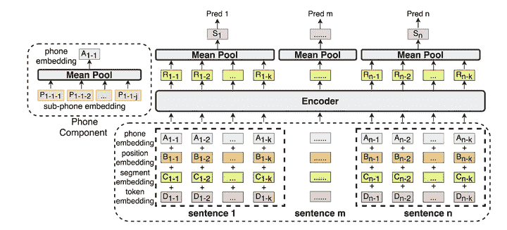

### 2.11 `ChineseRecursiveTextSplitter` : Langchian-chatchat封装

[Langchian-chatchat自定义的内容，代码](https://github.com/chatchat-space/Langchain-Chatchat/blob/master/text_splitter/chinese_recursive_text_splitter.py)


# 文本分割器

## ChineseRecursiveTextSplitter

```python
import re
from typing import List, Optional, Any
from langchain.text_splitter import RecursiveCharacterTextSplitter
import logging

logger = logging.getLogger(__name__)


def _split_text_with_regex_from_end(
        text: str, separator: str, keep_separator: bool
) -> List[str]:
    # Now that we have the separator, split the text
    if separator:
        if keep_separator:
            # The parentheses in the pattern keep the delimiters in the result.
            _splits = re.split(f"({separator})", text)
            splits = ["".join(i) for i in zip(_splits[0::2], _splits[1::2])]
            if len(_splits) % 2 == 1:
                splits += _splits[-1:]
        else:
            splits = re.split(separator, text)
    else:
        splits = list(text)
    return [s for s in splits if s != ""]


class ChineseRecursiveTextSplitter(RecursiveCharacterTextSplitter):
    def __init__(
            self,
            separators: Optional[List[str]] = None,
            keep_separator: bool = True,
            is_separator_regex: bool = True,
            **kwargs: Any,
    ) -> None:
        """Create a new TextSplitter."""
        super().__init__(keep_separator=keep_separator, **kwargs)
        self._separators = separators or [
            "\n\n",
            "\n",
            "。|！|？",
            "\.\s|\!\s|\?\s",
            "；|;\s",
            "，|,\s"
        ]
        self._is_separator_regex = is_separator_regex

    def _split_text(self, text: str, separators: List[str]) -> List[str]:
        """Split incoming text and return chunks."""
        final_chunks = []
        # Get appropriate separator to use
        separator = separators[-1]
        new_separators = []
        for i, _s in enumerate(separators):
            _separator = _s if self._is_separator_regex else re.escape(_s)
            if _s == "":
                separator = _s
                break
            if re.search(_separator, text):
                separator = _s
                new_separators = separators[i + 1:]
                break

        _separator = separator if self._is_separator_regex else re.escape(separator)
        splits = _split_text_with_regex_from_end(text, _separator, self._keep_separator)

        # Now go merging things, recursively splitting longer texts.
        _good_splits = []
        _separator = "" if self._keep_separator else separator
        for s in splits:
            if self._length_function(s) < self._chunk_size:
                _good_splits.append(s)
            else:
                if _good_splits:
                    merged_text = self._merge_splits(_good_splits, _separator)
                    final_chunks.extend(merged_text)
                    _good_splits = []
                if not new_separators:
                    final_chunks.append(s)
                else:
                    other_info = self._split_text(s, new_separators)
                    final_chunks.extend(other_info)
        if _good_splits:
            merged_text = self._merge_splits(_good_splits, _separator)
            final_chunks.extend(merged_text)
        return [re.sub(r"\n{2,}", "\n", chunk.strip()) for chunk in final_chunks if chunk.strip() != ""]


if __name__ == "__main__":
    text_splitter = ChineseRecursiveTextSplitter(
        keep_separator=True,
        is_separator_regex=True,
        chunk_size=50,
        chunk_overlap=0
    )
    ls = [
        """中国对外贸易形势报告（75页）。前 10 个月，一般贸易进出口 19.5 万亿元，增长 25.1%， 比整体进出口增速高出 2.9 个百分点，占进出口总额的 61.7%，较去年同期提升 1.6 个百分点。其中，一般贸易出口 10.6 万亿元，增长 25.3%，占出口总额的 60.9%，提升 1.5 个百分点；进口8.9万亿元，增长24.9%，占进口总额的62.7%， 提升 1.8 个百分点。加工贸易进出口 6.8 万亿元，增长 11.8%， 占进出口总额的 21.5%，减少 2.0 个百分点。其中，出口增 长 10.4%，占出口总额的 24.3%，减少 2.6 个百分点；进口增 长 14.2%，占进口总额的 18.0%，减少 1.2 个百分点。此外， 以保税物流方式进出口 3.96 万亿元，增长 27.9%。其中，出 口 1.47 万亿元，增长 38.9%；进口 2.49 万亿元，增长 22.2%。前三季度，中国服务贸易继续保持快速增长态势。服务 进出口总额 37834.3 亿元，增长 11.6%；其中服务出口 17820.9 亿元，增长 27.3%；进口 20013.4 亿元，增长 0.5%，进口增 速实现了疫情以来的首次转正。服务出口增幅大于进口 26.8 个百分点，带动服务贸易逆差下降 62.9%至 2192.5 亿元。服 务贸易结构持续优化，知识密集型服务进出口 16917.7 亿元， 增长 13.3%，占服务进出口总额的比重达到 44.7%，提升 0.7 个百分点。 二、中国对外贸易发展环境分析和展望 全球疫情起伏反复，经济复苏分化加剧，大宗商品价格 上涨、能源紧缺、运力紧张及发达经济体政策调整外溢等风 险交织叠加。同时也要看到，我国经济长期向好的趋势没有 改变，外贸企业韧性和活力不断增强，新业态新模式加快发 展，创新转型步伐提速。产业链供应链面临挑战。美欧等加快出台制造业回迁计 划，加速产业链供应链本土布局，跨国公司调整产业链供应 链，全球双链面临新一轮重构，区域化、近岸化、本土化、 短链化趋势凸显。疫苗供应不足，制造业“缺芯”、物流受限、 运价高企，全球产业链供应链面临压力。 全球通胀持续高位运行。能源价格上涨加大主要经济体 的通胀压力，增加全球经济复苏的不确定性。世界银行今年 10 月发布《大宗商品市场展望》指出，能源价格在 2021 年 大涨逾 80%，并且仍将在 2022 年小幅上涨。IMF 指出，全 球通胀上行风险加剧，通胀前景存在巨大不确定性。""",
    ]
    # text = """"""
    for inum, text in enumerate(ls):
        print(inum)
        chunks = text_splitter.split_text(text)
        for chunk in chunks:
            print(chunk)

    >>> 中国对外贸易形势报告（75页）。
前 10 个月，一般贸易进出口 19.5 万亿元，增长 25.1%，
比整体进出口增速高出 2.9 个百分点，占进出口总额的 61.7%，
较去年同期提升 1.6 个百分点。
其中，一般贸易出口 10.6 万亿元，增长 25.3%，占出口总额的 60.9%，
提升 1.5 个百分点；
进口8.9万亿元，增长24.9%，占进口总额的62.7%， 提升 1.8 个百分点。
加工贸易进出口 6.8 万亿元，增长 11.8%， 占进出口总额的 21.5%，
减少 2.0 个百分点。
```

是基于`langchian`的 `RecursiveCharacterTextSplitter` 进一步优化的，可以看到主要是 `["\n\n","\n","。|！|？", "\.\s|\!\s|\?\s","；|;\s","，|,\s"]` 进行分割。

## 2.12 `ChineseTextSplitter`：Langchain-Chatchat 封装

[代码](https://link.zhihu.com/?target=https%3A//github.com/chatchat-space/Langchain-Chatchat/blob/master/text_splitter/chinese_text_splitter.py)来自`Langchain-Chatchat`（`https://github.com/chatchat-space/Langchain-Chatchat/blob/master/text_splitter/chinese_text_splitter.py`）


```python
from langchain.text_splitter import CharacterTextSplitter
import re
from typing import List


class ChineseTextSplitter(CharacterTextSplitter):
    def __init__(self, pdf: bool = False, sentence_size: int = 250, **kwargs):
        super().__init__(**kwargs)
        self.pdf = pdf
        self.sentence_size = sentence_size

    def split_text1(self, text: str) -> List[str]:
        if self.pdf:
            text = re.sub(r"\n{3,}", "\n", text)
            text = re.sub('\s', ' ', text)
            text = text.replace("\n\n", "")
        sent_sep_pattern = re.compile('([﹒﹔﹖﹗．。！？]["’”」』]{0,2}|(?=["‘“「『]{1,2}|$))')  # del ：；
        sent_list = []
        for ele in sent_sep_pattern.split(text):
            if sent_sep_pattern.match(ele) and sent_list:
                sent_list[-1] += ele
            elif ele:
                sent_list.append(ele)
        return sent_list

    def split_text(self, text: str) -> List[str]:   ##此处需要进一步优化逻辑
        if self.pdf:
            text = re.sub(r"\n{3,}", r"\n", text)
            text = re.sub('\s', " ", text)
            text = re.sub("\n\n", "", text)

        text = re.sub('([;；.!?。！？\?])([^”’])', r"\1\n\2", text)  # 单字符断句符
        text = re.sub('(\.{6})([^”’”」』])', r"\1\n\2", text)  # 英文省略号
        text = re.sub('(\…{2})([^”’”」』])', r"\1\n\2", text)  # 中文省略号
        text = re.sub('([;；!?。！？\?]["’”」』]{0,2})([^;；!?，。！？\?])', r'\1\n\2', text)
        # 如果双引号前有终止符，那么双引号才是句子的终点，把分句符\n放到双引号后，注意前面的几句都小心保留了双引号
        text = text.rstrip()  # 段尾如果有多余的\n就去掉它
        # 很多规则中会考虑分号;，但是这里我把它忽略不计，破折号、英文双引号等同样忽略，需要的再做些简单调整即可。
        ls = [i for i in text.split("\n") if i]
        for ele in ls:
            if len(ele) > self.sentence_size:
                ele1 = re.sub('([,，.]["’”」』]{0,2})([^,，.])', r'\1\n\2', ele)
                ele1_ls = ele1.split("\n")
                for ele_ele1 in ele1_ls:
                    if len(ele_ele1) > self.sentence_size:
                        ele_ele2 = re.sub('([\n]{1,}| {2,}["’”」』]{0,2})([^\s])', r'\1\n\2', ele_ele1)
                        ele2_ls = ele_ele2.split("\n")
                        for ele_ele2 in ele2_ls:
                            if len(ele_ele2) > self.sentence_size:
                                ele_ele3 = re.sub('( ["’”」』]{0,2})([^ ])', r'\1\n\2', ele_ele2)
                                ele2_id = ele2_ls.index(ele_ele2)
                                ele2_ls = ele2_ls[:ele2_id] + [i for i in ele_ele3.split("\n") if i] + ele2_ls[ele2_id + 1:]
                        ele_id = ele1_ls.index(ele_ele1)
                        ele1_ls = ele1_ls[:ele_id] + [i for i in ele2_ls if i] + ele1_ls[ele_id + 1:]

                id = ls.index(ele)
                ls = ls[:id] + [i for i in ele1_ls if i] + ls[id + 1:]
        return ls
```

里面自带了一些比较特殊的预处理逻辑：

```python
        if self.pdf:
            text = re.sub(r"\n{3,}", r"\n", text)
            text = re.sub('\s', " ", text)
            text = re.sub("\n\n", "", text)

        text = re.sub('([;；.!?。！？\?])([^”’])', r"\1\n\2", text)  # 单字符断句符
        text = re.sub('(\.{6})([^”’”」』])', r"\1\n\2", text)  # 英文省略号
        text = re.sub('(\…{2})([^”’”」』])', r"\1\n\2", text)  # 中文省略号
        text = re.sub('([;；!?。！？\?]["’”」』]{0,2})([^;；!?，。！？\?])', r'\1\n\2', text)
```

会有比较多的清理步骤，将中、英文省略号进行规范等

## 2.13 zh_title_enhance：标题增强

代码来自 `Langchian-chatchat`

[zh_title_enhance.py](https://github.com/chatchat-space/Langchain-Chatchat/blob/master/text_splitter/zh_title_enhance.py)

通过增加标题判断，判断哪些文本为标题，并在 `metadata` 中进行标记；然后将文本与往上一级的标题进行拼合，实现文本信息的增强

这里判定 `title` 的规则，或者说判定哪些不是 `title` 的规则：

+ 文本长度为0的话，肯定不是 `title`
+ 文本中有标点符号，就不是 `title`
+ 文本长度不能超过设定值，默认20
+ 文本中数字的占比不能太高，否则不是 `title`
+ 开头的字符内应该有数字，默认5个字符内

---

## 3 如何确定最佳块大小

无他，`A/B Test` 是笔者认为最好的，运行一系列查询来评估质量，并比较不同块大小的性能。这是一个反复测试的过程，在这个过程中，针对不同的查询测试不同的块大小，直到找到最佳的块大小。在【 RAG行业交流中发现的一些问题和改进方法 】提到了一些具体的经验之谈：

为了获得更好的结果，建议使用较小的块大小。微软就有这样的分析:

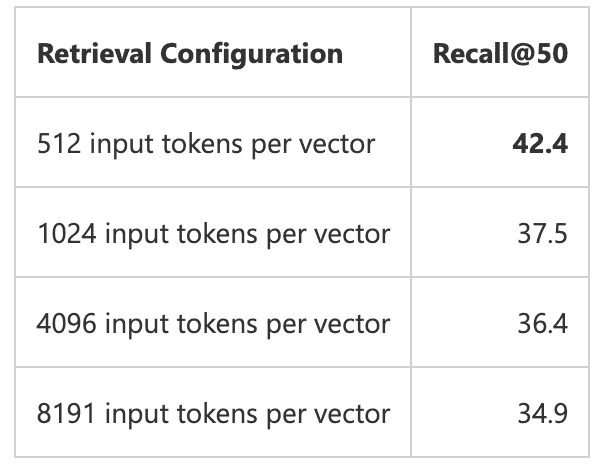

在分割文本时，我们也可以选择不同的分割策略。最简单的方法是在单词的中间切断。我们也可以尝试不同的策略，比如在一个句子或段落的中间切断。为了得到更好的结果，我们可以重叠相邻的块。来自微软分析的分块策略比较:

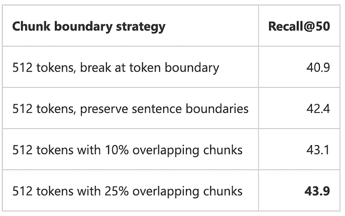

`Embedding` 模型的语义提取能力有限。它们在呈现多主题、多回合语料库时不如简单语料库有效。这就是为什么 `RAG` 更喜欢较短的块。那么块的大小是最好的呢? 在微软的分析中，最小的块大小是 512 个 `tokens`。一些企业级 `RAG` 应用程序中的块大小只有 100 个 `tokens`。最小的块大小是否总是能获得更好的结果?

如前所述，分块策略会将文本语料库分解成小块，导致信息丢失。数据块越小，丢失的信息就越多。所以，有一个最优的块大小。过小的分块可能不太理想。然而，寻找最优块大小就像超参数调优一样。你必须用你的数据做实验。

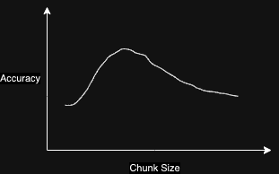

## 4 文本重叠对准确率的提升

来自【 RAG行业交流中发现的一些问题和改进方法 】

重叠背后的原因是重叠可以帮助将相邻的块链接在一起，并为块提供更好的上下文信息。然而，即使是非常激进的 25% 重叠也只能将准确率提高 1.5%，从 42.4% 提高到 43.9%。这意味着这不是优化 `RAG` 性能的最有效方法。我们不能通过更多的重叠来进一步提高 `RAG` 的性能。记住，重叠分块甚至不能用于小块。

但是重叠有时候在处理代词的时候很有效，比如上一个 `chunk` 说到 “徐悲鸿非常擅长画马”，然后下一句说 “他画马的主要技法是 xxxxx”，这时候如果缺少了重叠，就会让这个代词变成 “无主之地”。

当然，目前还有一种非常流行的做法是引入知识图谱，包括 `NebulaGraph` 提出的 `Graph RAG`。

在知识图谱的帮助下，`RAG` 可以将这些关系存储在图数据库中。块之间的连接可以完全保留。如果关系推理对您的项目至关重要，那么这是一个非常可观的解决方案。

然而，带有知识图谱的 `RAG` 并不是没有挑战的。从非结构化文本中建立知识图谱是非常重要的。有很多关于从文本输入中提取实体-关系三元组的实验。当你需要将解决方案产品化时，情况就不同了。自动提取的实体和关系可能包含大量的噪声，忽略了太多的真实信息。你们必须非常仔细地检查产品的质量。即使在填充知识图谱之后，所支持的查询也与图数据库设计紧密耦合。

支持向量搜索的关系数据库不像带有 `Knowledge Graph` 的 `RAG` 那么花哨，它也是工具箱中非常重要的组件。像 `pgvector` 这样的数据库允许您将复杂的信息存储为列，同时保留语义搜索功能。它比知识图谱更容易与其他企业系统集成，也更灵活。

## 5 参考文献

+ 派神 -：让 `Langchain` 与你的数据对话(一)：数据加载与分割
+ `LangChain` 按 `Token` 拆分文本内容
+ [Chunking Strategies for LLM Applications | Pinecone](https://www.pinecone.io/learn/chunking-strategies/)
+ RAG行业交流中发现的一些问题和改进方法
+ 最详细的文本分块 (`Chunking`) 方法，直接影响 `LLM` 应用效果
