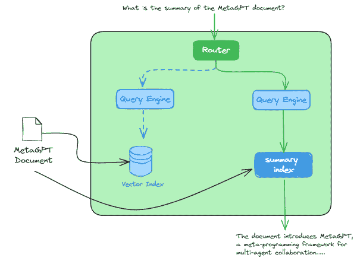

# 使用 LlamaIndex 构建代理式RAG(1)-Router Engine

> 来源：[https://agijuejin.feishu.cn/docx/YbQ5dp8G4ovQOTxaCeqczSuGnvh](https://agijuejin.feishu.cn/docx/YbQ5dp8G4ovQOTxaCeqczSuGnvh)

> 作者：lucas大叔

> 原文： [https://zhuanlan.z](https://zhuanlan.zhihu.com/p/698368940)hihu.com/p/698368...

本系列根据 DeepLearning.AI 的《Building Agentic RAG with Llamaindex》教程整理而得。在传统的 RAG 方法中，开发者需要编写显式的程序来检索信息以供输入到 LLM上下文中。在本系列课程中，将引入一项重要的变革，即构建具备检索信息工具的 RAG Agent。这样 Agent 就能够自主决定获取哪些信息，并且能够利用多步推理来回答更复杂的问题。

具体来说，你将学习以下内容：

+   Routing：agent将使用决策来将请求路由到多个工具。

+   Tool Use：创建接口让agent能够选择使用哪个工具（函数调用），并生成正确的参数。

+   Multi-step reasoning with tool use：利用 LLM 进行多步推理，同时在整个过程中保持记忆。

本节展示基于Routing的单文档常规问答和摘要问答。



## 配置

导入Open API KEY

```
from helper import get_openai_api_key

OPENAI_API_KEY = get_openai_api_key()
```

导入nest_asyncio模块，解决 Python 中异步编程库 asyncio 在嵌套调用时可能出现的问题的。在某些情况下，当在已经在事件循环中运行的情况下，再次尝试启动事件循环会引发异常。 nest_asyncio 库提供了一个解决方案，允许在已经运行事件循环的情况下重新应用一个新的事件循环。

具体来说， nest_asyncio.apply() 的作用是在当前的事件循环上下文中应用一个新的 asyncio 事件循环。这样做的主要目的是为了允许在 Jupyter notebook 等环境中嵌套使用 asyncio。

```
import nest_asyncio

nest_asyncio.apply()
```

## 加载数据

本示例以MetaGPT论文为样例文档。

```
from llama_index.core import SimpleDirectoryReader

# load documents
documents = SimpleDirectoryReader(input_files=[&quot;metagpt.pdf&quot;]).load_data()
```

## 定义LLM和embedding模型

定义Setting对象，此处使用gpt-3.5-turbo和text-embedding-ada-002。

```
from llama_index.core.node_parser import SentenceSplitter

splitter = SentenceSplitter(chunk_size=1024)
nodes = splitter.get_nodes_from_documents(documents)

from llama_index.core import Settings
from llama_index.llms.openai import OpenAI
from llama_index.embeddings.openai import OpenAIEmbedding

Settings.llm = OpenAI(model=&quot;gpt-3.5-turbo&quot;)
Settings.embed_model = OpenAIEmbedding(model=&quot;text-embedding-ada-002&quot;)
```

## 定义Summary Index和Vector Index

Index可以认为是数据的一组元数据，用户能够在不同的index上查询index，从而触发不同的检索行为。在Vector Index上查询将根据embedding相似度返回最相似的节点，Summary Index将返回索引上的所有节点

```
from llama_index.core import SummaryIndex, VectorStoreIndex

summary_index = SummaryIndex(nodes)
vector_index = VectorStoreIndex(nodes)
```

## 定义Query Engine & 设置元数据

把Summary Index和Vector Index转换为query engine和query tool。每个query engine表示存储在该index中数据的查询接口，并结合了检索和LLM合成。每个query engine擅长回答一种特定类型的问题，router可以在不同的query engine之间动态路由。

summary_query_engine中令use_async=True，利用异步能力使得query生成更快。

```
summary_query_engine = summary_index.as_query_engine(
    response_mode=&quot;tree_summarize&quot;,
    use_async=True,
)
vector_query_engine = vector_index.as_query_engine()
```

query tool是带元数据的query engine，描述了工具可以回答什么类型的问题。summary_tool用于回答MetaGPT相关的摘要问题，vector_tool用于检索MetaGPT论文中的特定上下文。

```
from llama_index.core.tools import QueryEngineTool


summary_tool = QueryEngineTool.from_defaults(
    query_engine=summary_query_engine,
    description=(
        &quot;Useful for summarization questions related to MetaGPT&quot;
    ),
)

vector_tool = QueryEngineTool.from_defaults(
    query_engine=vector_query_engine,
    description=(
        &quot;Useful for retrieving specific context from the MetaGPT paper.&quot;
    ),
)
```

## 定义Router Query Engine

LlamaIndex提供了几种不同类型的selector使得用户可以创建router。

+   LLM选择器：使用LLM输出解析的JSON和查询的相应索引

+   Pydantic选择器：使用OpenAI的函数调用API生成Pydantic选择对象，而不是解析原始JSON

此处尝试使用LLM single selector实现router query engine，提示LLM从query_engine_tools中选择单个tool。

```
from llama_index.core.query_engine.router_query_engine import RouterQueryEngine
from llama_index.core.selectors import LLMSingleSelector


query_engine = RouterQueryEngine(
    selector=LLMSingleSelector.from_defaults(),
    query_engine_tools=[
        summary_tool,
        vector_tool,
    ],
    verbose=True
)
```

测试摘要问题，从返回结果可以看到query engine调用了summary_tool。

```
response = query_engine.query(&quot;What is the summary of the document?&quot;)
print(str(response))
```

> **Selecting query engine 0: The document is asking **for a summary, which is related to summarization questions..

> The document introduces MetaGPT, a meta-programming framework for multi-agent collaboration based on Large Language Models (LLMs). It incorporates Standardized Operating Procedures (SOPs) to enhance collaboration efficiency and reduce errors among agents. MetaGPT assigns specific roles to agents, streamlining workflows and improving code generation quality. Through structured communication interfaces and an executable feedback mechanism, MetaGPT achieves state-of-the-art performance in evaluations, demonstrating its robustness and efficiency in developing LLM-based multi-agent systems. Additionally, the document discusses the software development process using MetaGPT for projects, outlining the involvement of various agents like Product Manager, Architect, Project Manager, Engineer, and QA Engineer in creating applications. It also delves into the performance evaluation of GPT models, highlighting differences between GPT-4 and GPT-3.5-Turbo in the HumanEval benchmark, addressing limitations, ethical concerns, and unique designs of MetaGPT in handling challenges like context utilization and reducing hallucinations.

```
print(len(response.source_nodes))
```

> 34

测试与论文内容相关的具体问题，query engine调用了vector_tool。

```
response = query_engine.query(
    &quot;How do agents share information with other agents?&quot;
)
print(str(response))
```

> **Selec**ting query engine 1: This choice is more relevant as it specifically mentions retrieving specific context, which is necessary for understanding how agents share information with other agents..

> Agents share information with other agents by utilizing a shared message pool. This shared message pool allows all agents to exchange messages directly. Agents publish their structured messages in the pool and can also access messages from other entities transparently. This system enables any agent to retrieve necessary information directly from the shared pool without the need to inquire about other agents and wait for their responses, ultimately enhancing communication efficiency.

## 集成

以上所有代码封装到一个helper函数，输入参数为文件路径，创建router query engine。

```
from utils import get_router_query_engine

query_engine = get_router_query_engine(&quot;metagpt.pdf&quot;)

response = query_engine.query(&quot;Tell me about the ablation study results?&quot;)
print(str(response))
```

> **Sel**ecting query engine 1: The ablation study results are specific context from the MetaGPT paper, making choice 2 the most relevant..

> The ablation study results provide insights into the impact of different components or features on the overall performance of a system or model. By systematically removing or disabling specific parts and observing how it affects the system's performance, researchers can understand the relative importance of each component. This analysis helps in identifying the most critical elements contributing to the system's effectiveness and can guide future improvements or optimizations.

## 参考文档

Building a Custom Agent

Multi-Document Agents