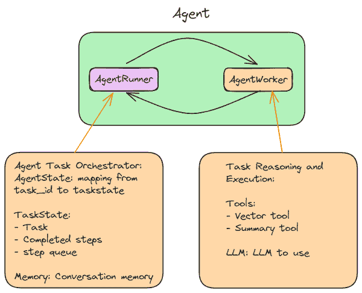
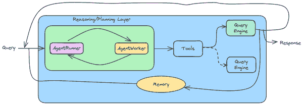

# 使用 LlamaIndex 构建代理式RAG(3)-创建Agent推理循环

> 来源：[https://agijuejin.feishu.cn/docx/YJZEdOTLooWPSsxO2Xic4sKVnRh](https://agijuejin.feishu.cn/docx/YJZEdOTLooWPSsxO2Xic4sKVnRh)

> 作者：lucas大叔

> 原文：[https://zhuanlan.z](https://zhuanlan.zhihu.com/p/698803949)hihu.com/p/698803...

到目前为止，我们的查询都是在单个前向传递中完成的。给定查询，调用正确的工具，并传递正确的参数，然后获取响应。但这样仍然相当有限，如果用户提出由多个步骤组成的复杂问题，或者是需要澄清的含糊问题呢？前面的方法显然都不适用。

本节将学习如何定义完整的agent推理循环。与单一调用工具不同，agent能够对工具和多个步骤进行推理。

## 配置

导入Open API KEY

```
from helper import get_openai_api_key

OPENAI_API_KEY = get_openai_api_key()
```

导入nest_asyncio模块

```
import nest_asyncio

nest_asyncio.apply()
```

## 配置查询工具

本示例仍然使用MetaGPT论文作为样例文档，创建上节的自检索工具和摘要工具。

```
from utils import get_doc_tools

vector_tool, summary_tool = get_doc_tools(&quot;metagpt.pdf&quot;, &quot;metagpt&quot;)
```

## 配置函数调用Agent

```
from llama_index.llms.openai import OpenAI

llm = OpenAI(model=&quot;gpt-3.5-turbo&quot;, temperature=0)
```

在LLamaIndex中，agent由两个主要组件组成：AgentWorker 和 AgentRunner。AgentWorker负责执行给定agent的下一步，而AgentRunner则是任务分派器，负责在给定任务的基础上创建AgentWorker的任务编排运行，并能够将最终的响应返回给用户。



考虑到函数调用AgentWoker的主要是根据现有的对话历史、记忆和任何传递的状态以及当前用户输入，使用函数调用来决定下一步的引用或调用，调用相应的工具并决定是否返回最终响应。整体agent接口位于AgentRunner后面，这就是要用来查询agent的接口。

```
from llama_index.core.agent import FunctionCallingAgentWorker
from llama_index.core.agent import AgentRunner

agent_worker = FunctionCallingAgentWorker.from_tools(
    [vector_tool, summary_tool], 
    llm=llm, 
    verbose=True
)
agent = AgentRunner(agent_worker)
```

下面测试一个问题，从中间过程可以看到agent将问题分解为多步执行。

```
response = agent.query(
    &quot;Tell me about the agent roles in MetaGPT, &quot;
    &quot;and then how they communicate with each other.&quot;
)
```

> Added user message to memory: Tell me about the agent roles in MetaGPT, and then how they communicate with each other.

> === Calling Function ===

> Calling function: summary_tool_metagpt with args: {"input": "agent roles in MetaGPT"}

> === Function Output ===

> The agent roles in MetaGPT include Product Manager, Architect, Project Manager, Engineer, and QA Engineer. These roles have specific responsibilities tailored to different aspects of the software development process, such as conducting business-oriented analysis, translating requirements into system design components, distributing tasks, executing code, formulating test cases, and handling task distribution. These agents work together in a sequential workflow following Standard Operating Procedures (SOPs) to efficiently develop software solutions.

> === Calling Function ===

> Calling function: summary_tool_metagpt with args: {"input": "communication between agent roles in MetaGPT"}

> === Function Output ===

> Communication between agent roles in MetaGPT is structured and facilitated through mechanisms such as message pools, subscriptions, and structured workflows. This approach allows for efficient sharing of information, coordination among agents, and seamless collaboration within the simulated software company framework. The communication is focused on optimizing constraints within specialized roles, ensuring that each agent's output aligns with project requirements and progresses smoothly through the development process. Additionally, the use of natural language programming capabilities enables interactive communication between agents using natural language, enhancing transparency and control over the communication process.

> === LLM Response ===

> In MetaGPT, the agent roles include Product Manager, Architect, Project Manager, Engineer, and QA Engineer. These roles have specific responsibilities tailored to different aspects of the software development process. They communicate with each other through mechanisms like message pools, subscriptions, and structured workflows. This structured communication approach ensures efficient sharing of information, coordination among agents, and seamless collaboration within the simulated software company framework. The use of natural language programming capabilities also enables interactive communication between agents using natural language, enhancing transparency and control over the communication process.

查看源节点信息

```
print(response.source_nodes[0].get_content(metadata_mode=&quot;all&quot;))
```

> pag[e_label: 1

> file_n](https://link.zhihu.com/?target=https%3A//github.com/geekan/MetaGPT.)ame: metagpt.pdf

> file_path: metagpt.pdf

> file_type: application/pdf

> file_size: 16911937

> creation_date: 2024-05-20

> last_modified_date: 2024-04-23

> 

> Preprint

> METAGPT: M ETA PROGRAMMING FOR A

> MULTI -AGENT COLLABORATIVE FRAMEWORK

> Sirui Hong1∗, Mingchen Zhuge2∗, Jonathan Chen1, Xiawu Zheng3, Yuheng Cheng4,

> Ceyao Zhang4,Jinlin Wang1,Zili Wang ,Steven Ka Shing Yau5,Zijuan Lin4,

> Liyang Zhou6,Chenyu Ran1,Lingfeng Xiao1,7,Chenglin Wu1†,J¨urgen Schmidhuber2,8

> 1DeepWisdom,2AI Initiative, King Abdullah University of Science and Technology,

> 3Xiamen University,4The Chinese University of Hong Kong, Shenzhen,

> 5Nanjing University,6University of Pennsylvania,

> 7University of California, Berkeley,8The Swiss AI Lab IDSIA/USI/SUPSI

> ABSTRACT

> Remarkable progress has been made on automated problem solving through so-

> cieties of agents based on large language models (LLMs). Existing LLM-based

> multi-agent systems can already solve simple dialogue tasks. Solutions to more

> complex tasks, however, are complicated through logic inconsistencies due to

> cascading hallucinations caused by naively chaining LLMs. Here we introduce

> MetaGPT, an innovative meta-programming framework incorporating efficient

> human workflows into LLM-based multi-agent collaborations. MetaGPT en-

> codes Standardized Operating Procedures (SOPs) into prompt sequences for more

> streamlined workflows, thus allowing agents with human-like domain expertise

> to verify intermediate results and reduce errors. MetaGPT utilizes an assembly

> line paradigm to assign diverse roles to various agents, efficiently breaking down

> complex tasks into subtasks involving many agents working together. On col-

> laborative software engineering benchmarks, MetaGPT generates more coherent

> solutions than previous chat-based multi-agent systems. Our project can be found

> at https:// github.com/geekan/MetaG PT.

> 1 I NTRODUCTION

> Autonomous agents utilizing Large Language Models (LLMs) offer promising opportunities to en-

> hance and replicate human workflows. In real-world applications, however, existing systems (Park

> et al., 2023; Zhuge et al., 2023; Cai et al., 2023; Wang et al., 2023c; Li et al., 2023; Du et al., 2023;

> Liang et al., 2023; Hao et al., 2023) tend to oversimplify the complexities. They struggle to achieve

> effective, coherent, and accurate problem-solving processes, particularly when there is a need for

> meaningful collaborative interaction (Chen et al., 2024; Zhang et al., 2023; Dong et al., 2023; Zhou

> et al., 2023; Qian et al., 2023).

> Through extensive collaborative practice, humans have developed widely accepted Standardized

> Operating Procedures (SOPs) across various domains (Belbin, 2012; Manifesto, 2001; DeMarco &

> Lister, 2013). These SOPs play a critical role in supporting task decomposition and effective coor-

> dination. Furthermore, SOPs outline the responsibilities of each team member, while establishing

> standards for intermediate outputs. Well-defined SOPs improve the consistent and accurate exe-

> cution of tasks that align with defined roles and quality standards (Belbin, 2012; Manifesto, 2001;

> DeMarco & Lister, 2013; Wooldridge & Jennings, 1998). For instance, in a software company,

> Product Managers analyze competition and user needs to create Product Requirements Documents

> (PRDs) using a standardized structure, to guide the developmental process.

> Inspired by such ideas, we design a promising GPT -based Meta -Programming framework called

> MetaGPT that significantly benefits from SOPs. Unlike other works (Li et al., 2023; Qian et al.,

> 2023), MetaGPT requires agents to generate structured outputs, such as high-quality requirements

> ∗These authors contributed equally to this work.

> †Chenglin Wu (alexanderwu@fuzhi.ai) is the corresponding author, affiliated with DeepWisdom.

> 1

调用agent查询允许以一种方式查询agent，但不会保留状态。因此，现在让我们尝试随着时间的推移维护对话历史。Agent能够在对话记忆缓存中维护聊天，记忆模块可以自定义，但默认情况下是展开的item列表，根据LLM的上下文窗口大小而形成的滚动缓存。因此，当agent决定使用工具时，它不仅使用当前聊天，还使用之前的对话历史来进行下一步或执行下一步操作。



因此，不使用查询，我们使用agent.chat进行问答。

```
response = agent.chat(
    &quot;Tell me about the evaluation datasets used.&quot;
)
```

> Added user message to memory: Tell me about the evaluation datasets used.

> === Calling Function ===

> Calling function: summary_tool_metagpt with args: {"input": "evaluation datasets used in MetaGPT"}

> === Function Output ===

> The evaluation datasets used in MetaGPT include HumanEval, MBPP, SoftwareDev, and humaneval-x for multilingual evaluations on code generation tasks. These datasets cover a wide range of programming tasks such as handwritten programming tasks, Python tasks, diverse software development tasks, and multilingual evaluations on code generation tasks.

> === LLM Response ===

> The evaluation datasets used in MetaGPT include HumanEval, MBPP, SoftwareDev, and humaneval-x. These datasets cover a wide range of programming tasks such as handwritten programming tasks, Python tasks, diverse software development tasks, and multilingual evaluations on code generation tasks.

维护对话历史，我们紧接着问一个后续问题。

```
response = agent.chat(&quot;Tell me the results over one of the above datasets.&quot;)
```

> Added user message to memory: Tell me the results over one of the above datasets.

> === Calling Function ===

> Calling function: vector_tool_metagpt with args: {"query": "results over HumanEval dataset", "page_numbers": ["7"]}

> === Function Output ===

> MetaGPT achieved 85.9% and 87.7% Pass rates over the HumanEval dataset.

> === LLM Response ===

> MetaGPT achieved 85.9% and 87.7% Pass rates over the HumanEval dataset.

## Lower-Level: 调试性和控制

上面展示了high-level的agent控制，下面我们将演示如何更细粒度地控制agent。这不仅能够构建更高级的研究助手，还能很好地调试和控制它。

拥有low-level agent接口有两个主要原因。首先是调试能力。如果你是构建agent的开发人员，那你可能希望能够更透明地了解agent在幕后实际发生了什么。特别是，如果agent第一次运行时出现问题，那么你实际上可以追踪agent的执行过程，查看它失败的地方，并尝试不同的输入以查看是否可以将agent的执行修改为正确的响应。另一个原因是为了实现更丰富的用户体验，假设你想要在agent执行过程中听取人类反馈，而不仅仅是在给定任务完成后。那么，可以想象创建异步队列，在agent执行过程中随时听取人类输入。如果确实收到人类输入，可以实际上中断并修改agent的执行，而不是等待代理任务完成。

因此，我们将重新定义agent。

```
agent_worker = FunctionCallingAgentWorker.from_tools(
    [vector_tool, summary_tool], 
    llm=llm, 
    verbose=True
)
agent = AgentRunner(agent_worker)
```

首先从用户query创建任务对象，然后开始逐步进行甚至插入我们自己的步骤。

```
task = agent.create_task(
    &quot;Tell me about the agent roles in MetaGPT, &quot;
    &quot;and then how they communicate with each other.&quot;
)
```

现在尝试执行此任务的单个步骤，将返回包含输入以及任务对象中的附加状态的任务对象。

```
step_output = agent.run_step(task.task_id)
```

> Added user message to memory: Tell me about the agent roles in MetaGPT, and then how they communicate with each other.

> === Calling Function ===

> Calling function: summary_tool_metagpt with args: {"input": "agent roles in MetaGPT"}

> === Function Output ===

> Agent roles in MetaGPT include Product Manager, Architect, Project Manager, Engineer, and QA Engineer. The Product Manager is responsible for conducting business-oriented analysis, while the Architect translates requirements into system design components. The Project Manager distributes tasks, Engineers execute code, and QA Engineers formulate test cases to ensure code quality. These roles work together in a structured workflow following Standard Operating Procedures (SOPs) to efficiently tackle complex software development tasks.

调用任务ID上已完成步骤的agent，可以看到已完成了一步。

```
completed_steps = agent.get_completed_steps(task.task_id)
print(f&quot;Num completed for task {task.task_id}: {len(completed_steps)}&quot;)
print(completed_steps[0].output.sources[0].raw_output)
```

> Num completed for task 27c6f783-f2a1-4de4-9bcc-efb2875fe2f1: 1 Agent roles in MetaGPT include Product Manager, Architect, Project Manager, Engineer, and QA Engineer. The Product Manager is responsible for conducting business-oriented analysis, while the Architect translates requirements into system design components. The Project Manager distributes tasks, Engineers execute code, and QA Engineers formulate test cases to ensure code quality. These roles work together in a structured workflow following Standard Operating Procedures (SOPs) to efficiently tackle complex software development tasks.

看一下接下来的步骤

```
upcoming_steps = agent.get_upcoming_steps(task.task_id)
print(f&quot;Num upcoming steps for task {task.task_id}: {len(upcoming_steps)}&quot;)
upcoming_steps[0]
```

> Num upcoming steps for task 27c6f783-f2a1-4de4-9bcc-efb2875fe2f1: 1

> TaskStep(task_id='27c6f783-f2a1-4de4-9bcc-efb2875fe2f1', step_id='b3a042f4-705d-448b-926c-0d6ab7de5caa', input=None, step_state={}, next_steps={}, prev_steps={}, is_ready=True)

让我们运行接下来的两个步骤，并尝试撰写用户输入。

```
step_output = agent.run_step(
    task.task_id, input=&quot;What about how agents share information?&quot;
)
```

> Added user message to memory: What about how agents share information?

> === Calling Function ===

> Calling function: summary_tool_metagpt with args: {"input": "how agents share information in MetaGPT"}

> === Function Output ===

> Agents in MetaGPT share information through a structured communication protocol that includes a shared message pool for publishing structured messages. They can also subscribe to relevant messages based on their profiles. This approach enhances role communication efficiency by allowing agents to obtain directional information from other roles and public information from the environment. Additionally, MetaGPT implements a publish-subscribe mechanism that enables agents to exchange information effectively within the multi-agent system. The shared message pool allows all agents to exchange information transparently without the need for individual inquiries or waiting for responses. Agents also review previous feedback before each project, make necessary adjustments to their constraint prompts based on that feedback, and summarize information received during the development of previous projects for future reference. The structured workflow involves the Product Manager generating a Product Requirement Document (PRD), which is then passed on to the Architect for system design, and subsequently to the Project Manager for task allocation and execution. This structured process ensures smooth information flow between different agents in MetaGPT.

执行最后一步生成答案

```
step_output = agent.run_step(task.task_id)
print(step_output.is_last)
```

> === LLM Response ===

> Agents in MetaGPT share information through a structured communication protocol that includes a shared message pool for publishing structured messages. They can also subscribe to relevant messages based on their profiles. This approach enhances role communication efficiency by allowing agents to obtain directional information from other roles and public information from the environment. Additionally, MetaGPT implements a publish-subscribe mechanism that enables agents to exchange information effectively within the multi-agent system. The shared message pool allows all agents to exchange information transparently without the need for individual inquiries or waiting for responses. Agents also review previous feedback before each project, make necessary adjustments to their constraint prompts based on that feedback, and summarize information received during the development of previous projects for future reference. The structured workflow involves the Product Manager generating a Product Requirement Document (PRD), which is then passed on to the Architect for system design, and subsequently to the Project Manager for task allocation and execution. This structured process ensures smooth information flow between different agents in MetaGPT.

> True

调用finalize_response转换上述内容输出格式

```
response = agent.finalize_response(task.task_id)
print(str(response))
```

> assistant: Agents in MetaGPT share information through a structured communication protocol that includes a shared message pool for publishing structured messages. They can also subscribe to relevant messages based on their profiles. This approach enhances role communication efficiency by allowing agents to obtain directional information from other roles and public information from the environment. Additionally, MetaGPT implements a publish-subscribe mechanism that enables agents to exchange information effectively within the multi-agent system. The shared message pool allows all agents to exchange information transparently without the need for individual inquiries or waiting for responses. Agents also review previous feedback before each project, make necessary adjustments to their constraint prompts based on that feedback, and summarize information received during the development of previous projects for future reference. The structured workflow involves the Product Manager generating a Product Requirement Document (PRD), which is then passed on to the Architect for system design, and subsequently to the Project Manager for task allocation and execution. This structured process ensures smooth information flow between different agents in MetaGPT.