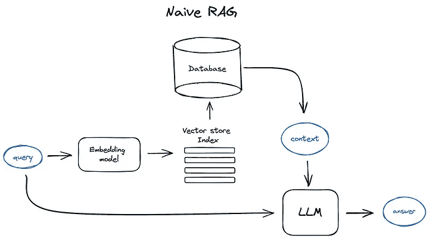
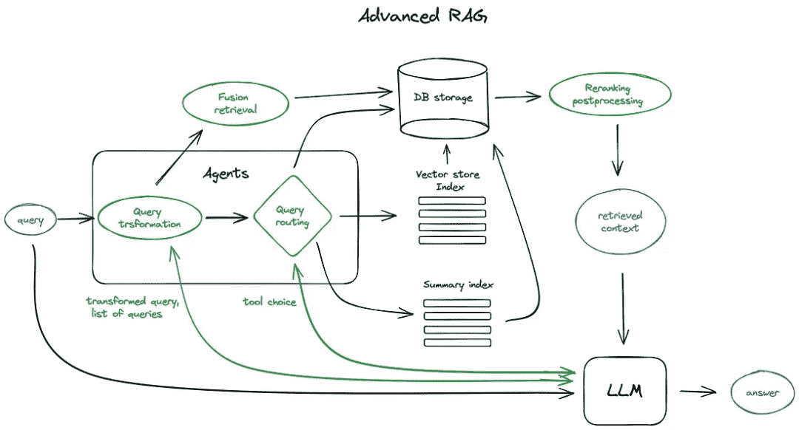
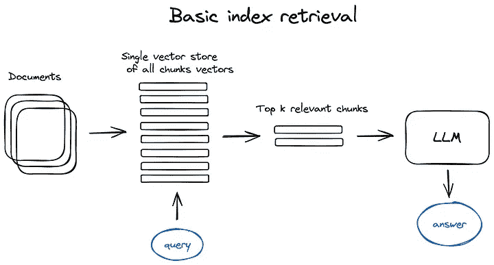
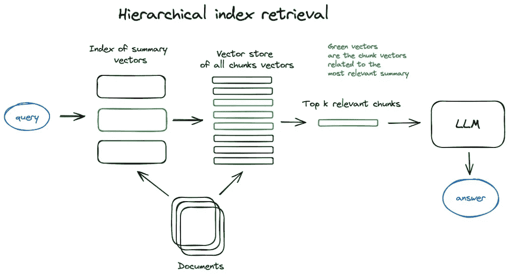
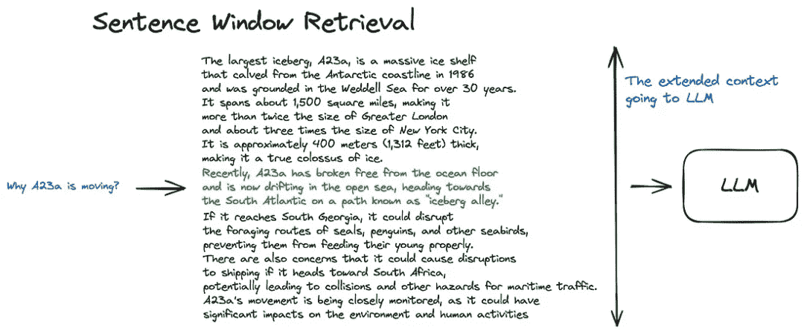
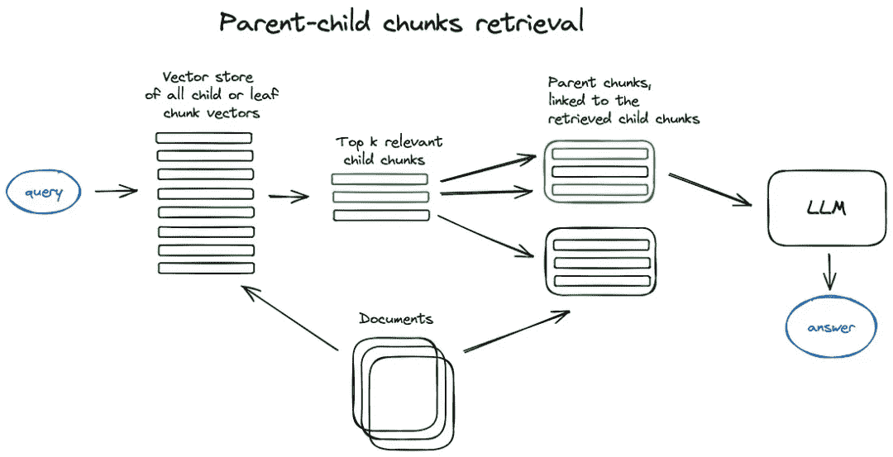
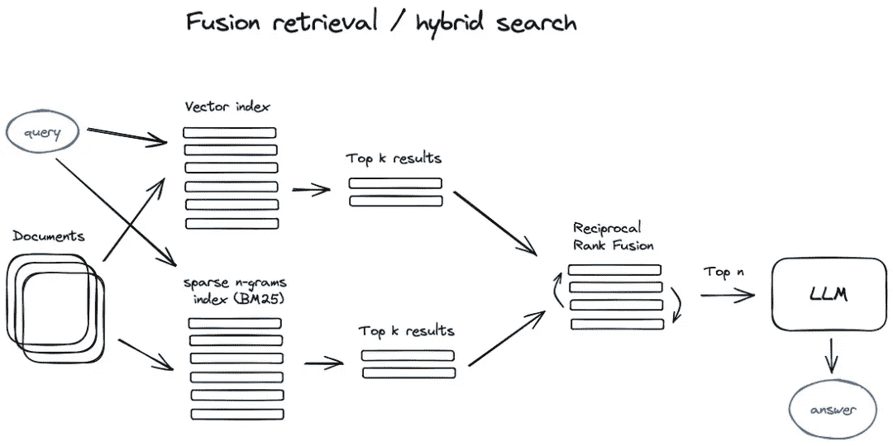
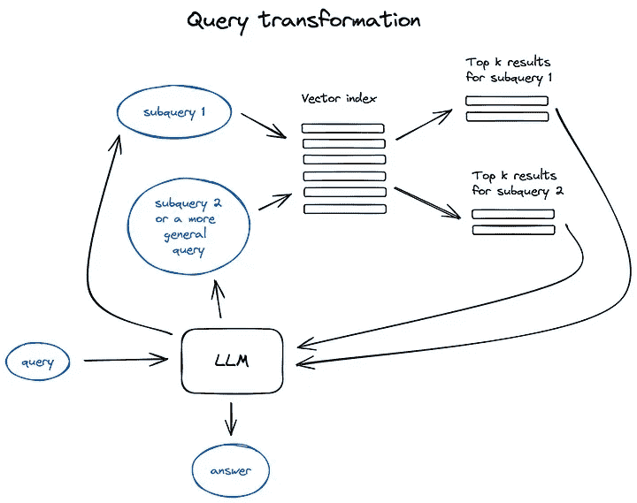
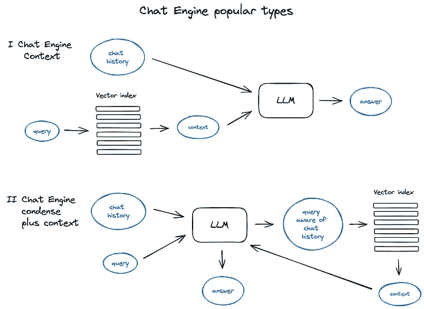
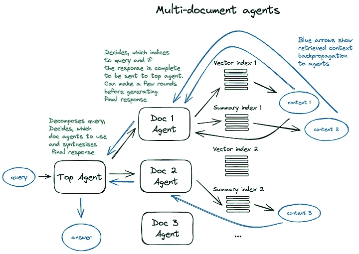

# 最全的RAG技术概览

> 来源：[https://agijuejin.feishu.cn/docx/OGncdAUrzoW3yGxmlXJcPUxinfe](https://agijuejin.feishu.cn/docx/OGncdAUrzoW3yGxmlXJcPUxinfe)

> 作者：向量检索实验室 | AI 搜索引擎

> 原文：[https://mp.weixin.](https://mp.weixin.qq.com/s/CO7hMv4RW7OE6zwUmVfp5A)qq.com/s/CO7hMv4R...

> 深度好文，作者是iki.ai的联合创始人兼CEO，本篇文章涉及了 RAG 流程中的数据拆分、向量化、查询重写、查询路由等等，在做 RAG 的小伙伴一定知道这些技巧的重要性。

> 推荐仔细阅读，建议收藏，多读几遍，好好实践。

原文链接：https://pub.towardsai.net/advanced-rag-techniques-an-illustrated-overview-04d193d8fec6

本文是对检索增强生成（Retrieval Augmented Generation, RAG）技术和算法的全面研究，对各种方法进行了系统性的梳理。文章中还包含了我知识库中提到的各种实现和研究的链接集合。 鉴于本文的目标是对现有的RAG算法和技术进行概览和解释，我不会深入代码实现的具体细节，只会提及相关内容，并推荐阅读详尽的文档和教程[1]。

# **介绍 **

如果你已经熟悉检索增强生成（Retrieval Augmented Generation, RAG）的概念，请直接跳转到高级 RAG 部分。

检索增强生成（Retrieval Augmented Generation, RAG）是一种技术，它通过从数据源中检索信息来辅助大语言模型（Large Language Model, LLM）生成答案。简而言之，RAG 结合了搜索技术和大语言模型的提示词功能，即向模型提出问题，并以搜索算法找到的信息作为背景上下文，这些查询和检索到的上下文信息都会被整合进发送给大语言模型的提示中。

到了2023年，基于大语言模型的系统中，RAG 已成为最受欢迎的架构之一。许多产品几乎完全基于 RAG 构建，范围从结合了网络搜索引擎和大语言模型的问答服务，到数以百计的“与数据对话”的应用程序。

即使是向量搜索领域也受到了这一趋势的推动，尽管早在2019年就已经有基于 faiss[2] 构建的搜索引擎。像 chroma、weavaite.io 和 pinecone 这样的向量数据库初创公司是基于现有的开源搜索索引构建的，主要是 faiss 和 nmslib，它们最近还增加了对输入文本的额外存储和一些其他工具。

在基于大语言模型的管道和应用领域，两个最著名的开源库分别是LangChain和LlamaIndex，它们分别于2022年10月和11月成立，彼此相差一个月。这两个库的创建受到了ChatGPT发布的启发，并在2023年获得了广泛的采用。

> **❝**

> 本文的宗旨在于系统整理并介绍关键的高级检索增强生成（Retrieval Augmented Generation, RAG）技术，并重点参考了 LlamaIndex 中的实现案例，以便于其他开发者更深入地掌握这项技术。

> 现存的问题是，大多数教程通常只选择介绍一两种技术的具体实现方法，而未能涵盖所有可用工具的丰富多样性。

> 另外，值得一提的是，LlamaIndex和LangChain都是极为出色的开源项目。它们发展迅速，以至于至今所累积的文档资料已比2016年的机器学习教科书还要庞大。

> ❞

# **基础RAG **

本文讨论的检索增强生成（Retrieval Augmented Generation, RAG）管道的起点是一系列文本文档。在此之前的所有内容，比如数据的获取和加载，都是由功能强大的开源数据加载工具完成的，这些工具可以连接到各种数据源，从Youtube到Notion都能涵盖。



A scheme by author, as well all the schemes further in the text

基础 RAG 的操作流程大致如下：首先，你需要将文本切分成小段，然后利用某种 Transformer 编码器模型，将这些文本段转换成向量形式。接着，把所有向量汇集到一个索引里。最后，你需要为大语言模型（Large Language Model, LLM）制定一个提示词，这个提示词会指导模型根据我们在搜索步骤中找到的上下文信息来回答用户的查询。

在实际运行过程中，我们会用同一个编码器模型把用户的查询转换成向量，然后根据这个向量在索引中进行搜索。系统会找到最相关的前k个结果，从数据库中提取相应的文本段，然后把这些文本段作为上下文信息输入到大语言模型的提示词中。

提示词的具体形式可以是这样的：

```
def question_answering(context, query):
    prompt = f&quot;&quot;&quot;
                Give the answer to the user query delimited by triple backticks ```{query}```\
                using the information given in context delimited by triple backticks ```{context}```.\
                If there is no relevant information in the provided context, try to answer yourself, 
                but tell user that you did not have any relevant context to base your answer on.
                Be concise and output the answer of size less than 80 tokens.
                &quot;&quot;&quot;

    response = get_completion(instruction, prompt, model=&quot;gpt-3.5-turbo&quot;)
    answer = response.choices[0].message[&quot;content&quot;]
    return answer
```

在改进RAG管道的方法中，优化提示词（Prompt Engineering[3]）是最具成本效益的尝试。不要忘记查阅OpenAI提供的全面的提示优化指南[4]。

虽然 OpenAI 作为大语言模型（LLM）的提供者在市场上占据领先地位，但还有许多其他选择，如 Anthropic 的 Claude，Mistral 的 Mixtral 等最近流行的小型但功能强大的模型，Microsoft 的 Phi-2，以及众多开源选择，如 Llama2、OpenLLaMA、Falcon 等，为您的 RAG 管道提供了多种“大脑”选择。

# **高级RAG **

现在，我们来深入了解高级RAG技术的概述。这里是一个展示核心步骤和相关算法的示意图。为了保持示意图的清晰易懂，一些逻辑循环和复杂的多步骤智能体行为被省略了。



高级RAG架构的一些关键组件。它更多的是一个可用工具的选择，而不是一个蓝图。

在这个方案中，绿色部分代表我们接下来将深入探讨的核心 RAG 技术，而蓝色部分则表示文本。需要注意的是，并不是所有高级 RAG 概念都能在这样一个单一的方案中被清晰展示，比如，一些用于扩展上下文的方法就没有包括在内 —— 我们会在后续的讨论中逐一探究这些话题。

## ** ****1. 分块和向量化 **

首先，我们需要创建一个向量索引，这个索引代表了我们文档的内容。然后，在程序运行时，我们会搜索这些向量与查询向量之间的最小余弦距离，以找到语义上最接近的匹配。

### ** 1.1 分块**

Transformer 模型的输入序列长度是固定的，即使输入上下文窗口很大，用一个句子或几个句子的向量来代表它们的语义含义，通常比对几页文本进行平均向量化更为有效。因此，需要对数据进行分块处理，将文档切分成合适大小的段落，同时保持其原有意义不变（例如，将文本划分为句子或段落，而不是将单个句子切割成两部分）。市面上有多种文本分割工具可用于此任务。

需要考虑的一个参数是块的大小，这取决于你使用的嵌入模型及其处理token的能力。例如，基于BERT的标准Transformer编码器模型最多处理512个token，而OpenAI ada-002能处理更长的序列，如8191个token。但这里需要权衡的是为大语言模型提供足够上下文以进行推理，与实现高效搜索所需的足够具体的文本嵌入。关于选择块大小的研究[5]，可以在LlamaIndex的NodeParser[6]类中找到，该类提供了一些高级选项，比如定义自己的文本分割器、元数据、节点/块关系等。

### ** 1.2 向量化**

接下来的步骤是选择一个模型来嵌入这些文本块。有很多种模型可以选择，我推荐使用像bge-large[7]或E5[8]嵌入系列这样的搜索优化模型。可以查看MTEB排行榜[9]来获取最新的模型信息。

要实现分块和向量化的端到端操作，可以参考LlamaIndex中一个完整的数据输入流程示例[10]。

## ** ****2.搜索索引 **

### ** 2.1向量存储索引**



在这个方案及文中后续内容中，为了保持方案的简洁性，我省略了编码器（Encoder）这一环节，直接将查询内容发送至索引。当然，查询内容在此之前已经被转换成了向量形式。这同样适用于前k个块的处理——索引实际检索的是前k个向量而非块本身，但在这里，我以块的形式呈现它们，因为从索引中提取这些块是一个简单的步骤。

在RAG管道中，至关重要的部分是搜索索引，它用来存储我们在前一步骤中生成的向量化内容。最基础的实现方式是使用flat索引，它通过暴力法计算查询向量与所有块向量之间的距离。

一个高效的搜索索引，针对超过10000个元素的大规模检索进行了优化，例如使用faiss、nmslib或annoy这样的向量索引。这些索引采用近似最近邻方法，如聚类、树状结构或HNSW算法。

还有一些像OpenSearch或ElasticSearch这样的托管解决方案和向量数据库，它们在幕后处理第1步中描述的数据摄入过程，例如Pinecone、Weaviate或Chroma。

根据您选择的索引类型、数据和搜索需求，您还可以将元数据与向量一起存储，然后使用元数据过滤器来搜索特定日期或来源的信息。

LlamaIndex支持多种向量存储索引类型，但也支持其他更简单的索引实现方式，如列表索引、树索引和关键词表索引——我们将在后面的融合检索部分进一步讨论这些索引类型。

### ** 2.2 层次索引**



如果您需要从大量文档中检索信息，高效的搜索方法非常关键，这样才能找到相关信息，并将其汇总为一个包含源引用的统一答案。在处理大型数据库时，一个有效的做法是创建两个索引——一个由摘要组成，另一个由文档块组成，然后分两步进行搜索：首先通过摘要过滤出相关文档，接着只在这个相关群体内进行搜索。

### ** 2.3 假设性问题和HyDE**

另一个方法是让LLM为每个块生成一个假设性问题，并将这些问题以向量形式嵌入。在运行时，针对这个问题向量的索引进行查询搜索（用问题向量替换我们索引中的块向量），检索后将原始文本块作为上下文发送给LLM以获取答案。这种方法由于查询和假设性问题之间的语义相似性更高，从而提高了搜索质量。

还有一种反向逻辑的方法叫做HyDE[11]——您可以让LLM根据查询生成一个假设性回答，然后将该回答的向量与查询向量一起用来提高搜索质量。

### ** 2.4 上下文增强**

这里的理念是检索较小的块以提高搜索质量，但同时增加周围的上下文以供LLM进行推理分析。

有两种方法——一是通过在检索到的较小块周围添加句子来扩展上下文，二是递归地将文档分割成多个包含较小子块的大型父块。

####  2.4.1 句子窗口检索[12]

在这种方案中，文档中的每个句子都被单独嵌入向量，这样做可以提高查询到上下文的余弦距离搜索的准确度。

为了更好地推理分析找到的上下文，我们会在检索到的关键句子前后各扩展k个句子，然后将这个扩展的上下文发送给LLM。



绿色部分代表在索引搜索中找到的句子的向量表示，而整个黑色加绿色的段落会被输入到大语言模型（LLM）中，目的是在分析提供的查询时扩大其上下文范围。

###  2.4.2 自动合并检索器（又名父文档检索器）[13]

这里的思路与句子窗口检索器十分相似——它旨在搜索更精细的信息片段，然后在将这些上下文信息提供给LLM进行推理之前，先扩展上下文窗口。文档被分割成较小的子块，这些子块又与更大的父块相对应。



文档被分割成一个层级化的块结构，随后最小的叶子块被发送至索引中。在检索过程中，我们会检索出k个叶子块。如果存在n个块都指向同一个更大的父块，那么我们就用这个父块来替换这些子块，并将其送入大语言模型（LLM）用于生成答案。

在检索过程中，首先获取较小的数据块。如果在前k个检索到的块中，有超过n个块指向同一个父节点（即更大的块），那么我们就用这个父节点来替换原先提供给大语言模型（LLM）的上下文内容。这个过程类似于自动将几个小块合并成一个更大的父块，因此得名。需要注意的是，这种搜索仅在子节点的索引中进行。想要更深入了解这个方法，可以查看LlamaIndex关于递归检索器和节点引用的教程[14]。

## ** ****2.5 融合检索或混合搜索 **

这是一个相对较旧的概念，它结合了两种不同的搜索方法：一种是基于关键词的传统搜索方法，使用稀疏检索算法（如tf-idf或行业标准BM25），另一种是现代的语义或向量搜索。这两种方法被融合在一起，以产生一个综合的检索结果。

这里的关键是正确结合具有不同相似度评分的检索结果。这个问题通常通过Reciprocal Rank Fusion算法[15]解决，该算法会对检索结果进行重新排名，以产生最终输出。



说明了查询转换原则

在LangChain中，这一功能是通过Ensemble Retriever[16]类实现的，它结合了您定义的一系列检索器，例如faiss向量索引和基于BM25的检索器，并使用逆序位融合算法（RRF）来进行结果的重新排名。

在LlamaIndex中，实现这一功能的方式非常类似。[17]

混合或融合搜索通常能提供更好的检索结果，因为它结合了两种互补的搜索算法，既考虑了查询与存储文档之间的语义相似性，也考虑了关键词的匹配。

# **3. 重新排名和过滤 **

因此，我们使用上述任何一种算法得到了检索结果，接下来需要通过过滤、重新排名或进行一些转换来进一步优化这些结果。LlamaIndex提供了多种后处理器，可以基于相似度评分、关键词、元数据等过滤结果，或者使用其他模型进行重新排名，如LLM、句子-转换器交叉编码器[18]、Cohere重新排名端点[19]，或者基于元数据如日期的新近性来进行——几乎涵盖了你能想到的所有情况。

这是在将检索到的上下文输入到大语言模型（LLM）以得到最终答案之前的最后一步。

现在，我们将介绍更高级的RAG技术，如查询转换和路由，这两者都涉及到LLM，因此代表了智能体行为——涵盖了我们RAG管道中涉及到的一些复杂的大语言模型推理逻辑。

# **4. 查询转换 **

查询转换是一组技术，它们使用LLM作为推理引擎来修改用户输入，以此提高检索质量。实现这一目标有多种不同的方法。



如果查询内容复杂，大语言模型（LLM）可以将其分解为几个子查询。例如，如果您问：

—— “在Github上，Langchain和LlamaIndex哪个框架的star更多？”我们不太可能直接在语料库中找到这样的比较，因此将这个问题分解为两个假设更简单和具体信息检索的子查询是合理的：

——“Langchain在Github上有多少star？”

——“LlamaIndex在Github上有多少star？”

这些查询将并行执行，然后检索到的上下文将组合在一个提示中，供大语言模型综合出对初始查询的最终答案。两个库都实现了这一功能——Langchain中作为多查询检索器[20]，在LlamaIndex中作为子问题查询引擎[21]。

1.  回退式提示词[22]使用大语言模型生成更一般的查询，检索我们获得的更一般或高级的上下文，有助于为我们原始查询的答案打下基础。也对原始查询进行检索，最终生成答案时将两个上下文输入大语言模型。这是LangChain的实现方式[23]。

1.  查询重写使用大语言模型重新构造初始查询以提高检索效果。LangChain[24]和LlamaIndex[25]都有实现，尽管有些不同，但我认为LlamaIndex的解决方案在这里更为强大。

# **参考引用 **

这一部分没有编号，因为它更像是一个工具而非一种检索改进技术，尽管它非常重要。

如果我们使用了多个来源来生成答案，无论是由于初始查询的复杂性（我们不得不执行多个子查询，然后将检索到的上下文合并为一个答案），还是因为我们在不同文档中找到了单个查询的相关上下文，就会出现一个问题，即我们是否能准确地反向引用我们的来源。

有几种方法可以做到这一点：

1.  将这个引用任务插入我们的提示中，并要求大语言模型提及所使用来源的ID。

1.  将生成的响应的部分与我们索引中的原始文本块匹配——llamaindex为这种情况提供了一种基于模糊匹配的高效解决方案[26]。如果你没有听说过模糊匹配，这是一种非常强大的字符串匹配技术[27]。

# **5. 对话引擎 **

在构建一个能够对单个搜索查询反复有效工作的高效 RAG 系统中，下一个关键进展是聊天逻辑的开发。这种逻辑考虑到对话上下文，其原理类似于LLM时代之前的经典聊天机器人。

这种逻辑的开发是为了支持用户提出后续问题、处理上下文中的指代或与先前对话上下文相关的任意命令。为了解决这一问题，研究者们采用了一种查询压缩技术，这种技术在处理用户的查询时同时考虑了聊天的上下文。

关于上下文的压缩，有几种不同的方法 —

+   一种受欢迎且相对简单的方法是使用 ContextChatEngine[28]。这种引擎首先检索与用户查询相关的上下文，然后将其连同聊天历史从内存缓冲区一起发送给 LLM，确保 LLM 在生成下一条回答时能够理解之前的上下文。

+   更为复杂的一个例子是 CondensePlusContextMode[29]。在这种模式下，每次互动中的聊天历史和最后一条消息会被压缩成一个新的查询。然后，这个查询被发送到索引系统，检索到的上下文连同原始用户消息一起回传。

值得注意的是，LlamaIndex 还支持基于 OpenAI 智能体的聊天引擎[30]，提供了更灵活的聊天模式，Langchain 也支持[31] OpenAI 功能性 API。



还有其他聊天引擎类型，如ReAct Agent[32]，本部分内容会在第7节中详细介绍。

# **6. 查询路由 **

查询路由是一种基于LLM的决策步骤，用于确定针对用户的查询接下来应采取的行动。通常的选项包括概括回答、针对某个数据索引执行搜索，或尝试多条不同的途径，然后将它们的结果综合成一个答案。

查询路由器还用于选择合适的索引或更广泛的数据存储位置来处理用户查询。这可能涉及多个数据来源，比如传统的向量存储、图数据库或关系型数据库，或者是一个索引层级结构。在多文档存储情况下，一个常见的设置是一个概要索引和另一个文档块向量的索引。

设置查询路由器涉及确定它能做出的选择。路由选项的选择是通过 LLM 的调用来实现的，返回的结果按照预定义的格式来引导查询到指定的索引。或者，如果涉及多智能体行为，它可以引导到子链或其他智能体，如下面的多文档智能体方案所示。

LlamaIndex[33] 和 LangChain[34] 都支持查询路由器。

# **7. RAG 中的智能体 **

智能体（Langchain[35] 和 LlamaIndex[36] 都支持）自从第一个 LLM API 发布以来就已存在。其核心理念是为具备推理能力的 LLM 提供一套工具和一个待完成的任务。这些工具可能包括确定性函数（如代码功能或外部 API）或其他智能体。正是这种 LLM 链接的思想促成了 LangChain 的命名。

智能体本身是一个非常广泛的领域，在 RAG 概述中无法深入探讨，因此我将直接继续讨论基于智能体的多文档检索案例，并简要介绍 OpenAI 助手。OpenAI 助手是在最近的 OpenAI 开发者大会上作为 GPTs 提出的相对较新的概念[37]，并在下面描述的 RAG 系统中发挥作用。

OpenAI Assistants[38]集成了许多围绕LLM必需的工具，这些工具我们以前在开源项目中已经见过 —— 包括聊天记录管理、知识库存储、文档上传界面，以及最关键的，功能调用 API[39]。这个 API 的重要功能是能够将自然语言请求转换为外部工具或数据库查询的 API 调用。

在 LlamaIndex 中，OpenAIAgent[40] 类融合了这些高级功能，并与 ChatEngine 和 QueryEngine 类结合，提供了基于知识的、具有上下文感知能力的聊天体验。此外，它还能在一次对话交互中调用多个 OpenAI 功能，从而真正实现智能代理行为。

接下来让我们来了解一下多文档代理方案[41] —— 这是一个相当复杂的设计，涉及到在每个文档上初始化一个代理（OpenAIAgent），这个代理不仅能进行文档摘要处理，还能执行经典的问答流程。还有一个顶级代理，负责将查询任务分配给各个文档代理，并合成最终答案。

每个文档代理配备了两种工具 —— 向量存储索引和摘要索引，它会根据接收到的查询决定使用哪个工具。对于顶级代理来说，所有文档代理都是其工具，可供其调度使用。

这个方案展示了一个高级的 RAG 架构，涉及每个代理做出的复杂路由决策。这种架构的优势在于它可以比较不同文档中描述的不同解决方案或实体，以及它们的摘要，同时也支持经典的单文档摘要处理和问答流程 —— 这实际上覆盖了大多数与文档集合交互的常见用例。



这是一个展示多文档代理工作方式的方案，其中包括了查询的路由处理和代理的智能行为模式。

这个复杂方案的一个缺点可以通过图像来理解 —— 由于需要在代理内部与大语言模型（LLM）进行多轮迭代，因此处理速度较慢。需要注意的是，在 RAG 架构中，调用 LLM 总是最耗时的步骤，而搜索则是出于设计考虑而优化了速度。因此，对于涉及大量文档的存储系统，我建议对这一方案进行简化，以提高其扩展性。

# **8. 响应合成器 **

这是 RAG 架构中的最后一步 —— 基于我们精心收集的所有上下文和用户的初步查询来生成答案。

最简单的方法是直接将所有相关度较高的上下文和查询串联起来，一次性输入到LLM中。

然而，还有一些更复杂的方法，这些方法涉及多次使用LLM来细化检索到的上下文，并据此生成更加准确的答案。响应合成的几种主要方法包括：

1.  将检索到的上下文分块后逐次发送给大语言模型（LLM），以此迭代地精炼答案。

1.  总结检索到的上下文，使其适应输入提示。

1.  基于不同上下文块生成多个答案，然后将这些答案连接或总结起来。

更多细节请参考响应合成器模块的文档[42]。

# **编码器和LLM微调 **

这个方法涉及对我们 RAG 架构中的两种深度学习模型之一进行精细调整。这可以是负责生成高质量嵌入从而影响上下文检索效果的 Transformer 编码器，也可以是用于最佳地利用所提供上下文以回答用户问题的LLM）— 幸运的是，后者非常擅长少样本学习。

目前一个重要的优势是我们能够使用像 GPT-4 这样的高端大语言模型来创造高质量的合成数据集。

但同时，我们也必须认识到，对一个由专业团队在大型、经过精心筛选和清洗的数据集上训练的开源模型进行快速而简单的调整（尤其是使用小型合成数据集时），可能会限制模型的整体性能和能力。

## ** ****编码器的微调 **

我曾对编码器的微调持保留态度，因为最新的为搜索优化的 Transformer 编码器已经非常高效了。

所以，我在 LlamaIndex notebook[43]环境中测试了 bge-large-en-v1.5[44]（在撰写本文时，该模型在 MTEB 排行榜上排名前四）的微调效果。测试结果表明，检索质量提高了 2%。虽然这个提升不是非常显著，但了解这一微调选项还是有益的，特别是在为特定领域的数据集构建 RAG 时。

## ** ****Ranker的微调 **

另一个传统的选择是，如果你对基础编码器的效果不完全满意，可以使用一个交叉编码器来重新评估你检索到的结果。

这个方法的工作原理是这样的 —— 你需要将查询语句和检索到的前 k 个文本块一起传递给交叉编码器，每部分之间用 SEP token 分隔，并对其进行微调，以便对相关的文本块输出 1，对不相关的输出 0。 这种调整过程的一个很好的例子可以在这里[45]找到，结果显示通过交叉编码器的微调，成对得分提升了 4%。

# **LLM的微调 **

OpenAI 最近推出了大语言模型微调 API[46]，LlamaIndex 也提供了一个教程[47]，介绍如何在 RAG 环境下微调 GPT-3.5-turbo，从而“吸收”GPT-4 的部分知识。这个过程包括使用一份文档，利用 GPT-3.5-turbo 生成问题，然后用 GPT-4 基于该文档内容回答这些问题（即构建一个由 GPT-4 驱动的 RAG 架构），接着对 GPT-3.5-turbo 进行微调，训练它处理这些问题与答案对。通过这种方式，使用 ragas[48] 框架进行的 RAG 架构评估显示，信实度指标提高了 5%，意味着经过微调的 GPT 3.5-turbo 在利用提供的上下文生成答案方面比原模型表现得更好。

Meta AI Research 最近的一篇论文《RA-DIT: Retrieval Augmented Dual Instruction Tuning》展示了一种更为复杂的方法，它提出了一种同时对LLM和检索器（原论文中的双编码器）进行微调的技术，这种微调是基于查询、上下文和答案的三元组进行的。具体实施细节请参考相关指南[49]。这种技术被用于通过微调 API 对 OpenAI 大语言模型进行微调，同时也用于开源模型 Llama2（如原论文所述），在知识密集型任务的指标上实现了约 5% 的提升（与使用 RAG 的 Llama2 65B 相比），并在常识推理任务上也有一定的提升。

# **评估 **

RAG 系统的性能评估通常涉及多个独立的指标，包括整体答案的相关性、答案的根据性、信实度以及检索到的上下文的相关性等。

之前提到的 Ragas 主要利用信实度[50]和答案相关性[51]作为评估生成答案质量的指标，并使用传统的上下文精确度[52]和召回率[53]来评估 RAG 架构的检索效果。

Andrew NG 最近推出的精彩短课程《构建和评估高级 RAG》[54]中，结合 LlamaIndex 和评估框架 Truelens，提出了 RAG 的三大评估维度：检索到的上下文与查询的相关性、答案的根据性（大语言模型的答案在多大程度上得到提供的上下文的支持）以及答案对查询的相关性。

最关键也是最容易控制的指标是检索到的上下文相关性。实际上，高级 RAG 架构的前 1-7 部分以及编码器和排名器的微调部分都是为了提高这一指标，而第 8 部分和大语言模型的微调则侧重于提高答案的相关性和根据性。

关于简单的检索器评估流程的一个很好的例子可以在这里找到[55]，它在编码器微调部分得到了应用。一个更高级的方法考虑到了不仅仅是命中率，还有平均倒数排名（一种搜索引擎常用的指标）以及生成答案的信实度和相关性指标，这在 OpenAI cookbook[56]中有展示。

LangChain 提供了一个先进的评估框架 LangSmith[57]，不仅可以实现自定义的评估方法，还可以监控在 RAG 架构内部运行的流程，从而增加系统的透明度。

如果你正在使用 LlamaIndex 进行构建，那么有一个 rag_evaluator llama[58] 包，它提供了一个快捷的工具，可以利用公共数据集来评估你的架构。

# **结论 **

我努力概述了 RAG 的核心算法方法，并通过一些示例展示它们，希望这能激发你在自己的 RAG 架构中尝试一些新思路，或者对今年推出的众多技术有更系统的理解 —— 对我而言，2023 年是迄今为止机器学习领域最令人兴奋的一年。

还有很多其他方面需要探索，如基于网络搜索的 RAG（例如 LlamaIndex、webLangChain[59] 的 RAGs[60]）、更深入地研究智能体架构[61]以及关于大语言模型长期记忆功能的一些构想[62]。

RAG 系统在生产中的主要挑战，除了答案的相关性和信实度之外，还包括速度，尤其是在采用更灵活的基于智能体的方案时更是如此，但这需要另外的讨论。ChatGPT 和许多其他助手所采用的流式特性，并不是随机的赛博朋克风格，而是为了缩短用户感知的答案生成时间。这也是我认为小型大语言模型，以及近期发布的 Mixtral 和 Phi-2 等产品，在未来将大有可为的原因。

有关更多的主要参考资料，可以在我的知识库中找到，还有一个与这些文档相关的co-pilot聊天工具：https://app.iki.ai/playlist/236。

##### **相关链接**

[1] https://app.iki.ai/playlist/236

[2] https://faiss.ai/

[3] https://docs.llamaindex.ai/en/latest/examples/prompts/prompts_rag.html

[4] https://platform.openai.com/docs/guides/prompt-engineering/strategy-write-clear-instructions

[5] https://www.pinecone.io/learn/chunking-strategies/

[6] https://docs.llamaindex.ai/en/stable/api_reference/service_context/node_parser.html

[7] https://huggingface.co/BAAI/bge-large-en-v1.5

[8] https://huggingface.co/intfloat/multilingual-e5-large

[9] https://huggingface.co/spaces/mteb/leaderboard

[10] https://docs.llamaindex.ai/en/latest/module_guides/loading/ingestion_pipeline/root.html#

[11] https://boston.lti.cs.cmu.edu/luyug/HyDE/HyDE.pdf

[12] https://docs.llamaindex.ai/en/stable/examples/node_postprocessor/MetadataReplacementDemo.html

[13] https://python.langchain.com/docs/modules/data_connection/retrievers/parent_document_retriever

[14] https://docs.llamaindex.ai/en/stable/examples/retrievers/recursive_retriever_nodes.html

[15] https://plg.uwaterloo.ca/~gvcormac/cormacksigir09-rrf.pdf

[16] https://python.langchain.com/docs/modules/data_connection/retrievers/ensemble

[17] https://docs.llamaindex.ai/en/stable/examples/retrievers/reciprocal_rerank_fusion.html

[18] https://www.sbert.net/examples/applications/cross-encoder/README.html

[19] https://txt.cohere.com/rerank/

[20] https://python.langchain.com/docs/modules/data_connection/retrievers/MultiQueryRetriever?ref=blog.langchain.dev

[21] https://docs.llamaindex.ai/en/stable/examples/query_engine/sub_question_query_engine.html

[22] https://arxiv.org/pdf/2310.06117.pdf?ref=blog.langchain.dev

[23] https://github.com/langchain-ai/langchain/blob/master/cookbook/stepback-qa.ipynb?ref=blog.langchain.dev

[24] https://github.com/langchain-ai/langchain/blob/master/cookbook/rewrite.ipynb?ref=blog.langchain.dev

[25] https://llamahub.ai/l/llama_packs-fusion_retriever-query_rewrite

[26] https://github.com/run-llama/llama-hub/tree/main/llama_hub/llama_packs/fuzzy_citation

[27] https://github.com/run-llama/llama-hub/tree/main/llama_hub/llama_packs/fuzzy_citation

[28] https://docs.llamaindex.ai/en/stable/examples/chat_engine/chat_engine_context.html

[29] https://docs.llamaindex.ai/en/stable/examples/chat_engine/chat_engine_condense_plus_context.html

[30] https://docs.llamaindex.ai/en/stable/examples/chat_engine/chat_engine_openai.html

[31] https://python.langchain.com/docs/modules/agents/agent_types/openai_multi_functions_agent

[32] https://docs.llamaindex.ai/en/stable/examples/chat_engine/chat_engine_react.html

[33] https://docs.llamaindex.ai/en/stable/module_guides/querying/router/root.html

[34] https://docs.llamaindex.ai/en/stable/module_guides/querying/router/root.html

[35] https://python.langchain.com/docs/modules/agents/

[36] https://docs.llamaindex.ai/en/latest/use_cases/agents.html#

[37] https://openai.com/blog/new-models-and-developer-products-announced-at-devday

[38] https://platform.openai.com/docs/assistants/overview

[39] https://platform.openai.com/docs/assistants/overview

[40] https://docs.llamaindex.ai/en/stable/examples/agent/openai_agent.html

[41] https://docs.llamaindex.ai/en/stable/examples/agent/multi_document_agents.html

[42] https://docs.llamaindex.ai/en/stable/module_guides/querying/response_synthesizers/root.html

[43] https://docs.llamaindex.ai/en/stable/examples/finetuning/embeddings/finetune_embedding.html

[44] https://huggingface.co/BAAI/bge-large-en-v1.5

[45] https://docs.llamaindex.ai/en/latest/examples/finetuning/cross_encoder_finetuning/cross_encoder_finetuning.html#

[46] https://platform.openai.com/docs/guides/fine-tuning

[47] https://docs.llamaindex.ai/en/stable/examples/finetuning/openai_fine_tuning.html

[48] https://docs.ragas.io/en/latest/index.html

[49] https://docs.llamaindex.ai/en/stable/examples/finetuning/knowledge/finetune_retrieval_aug.html#fine-tuning-with-retrieval-augmentation

[50] https://docs.ragas.io/en/latest/concepts/metrics/faithfulness.html

[51] https://docs.ragas.io/en/latest/concepts/metrics/answer_relevance.html

[52] https://docs.ragas.io/en/latest/concepts/metrics/context_precision.html

[53] https://docs.ragas.io/en/latest/concepts/metrics/context_recall.html

[54] https://learn.deeplearning.ai/building-evaluating-advanced-rag/

[55] https://github.com/run-llama/finetune-embedding/blob/main/evaluate.ipynb

[56] https://github.com/openai/openai-cookbook/blob/main/examples/evaluation/Evaluate_RAG_with_LlamaIndex.ipynb/

[57] https://docs.smith.langchain.com/

[58] https://github.com/run-llama/llama-hub/tree/dac193254456df699b4c73dd98cdbab3d1dc89b0/llama_hub/llama_packs/rag_evaluator

[59] https://blog.langchain.dev/weblangchain/

[60] https://github.com/run-llama/rags

[61] https://blog.langchain.dev/openais-bet-on-a-cognitive-architecture/

[62] https://blog.langchain.dev/adding-long-term-memory-to-opengpts/