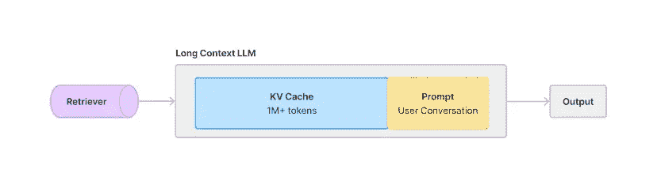
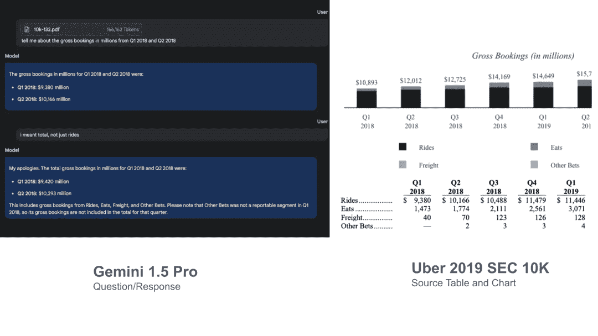
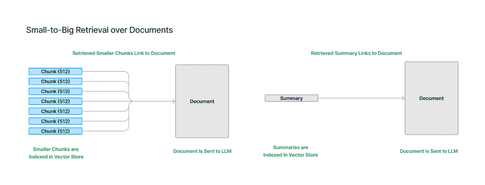
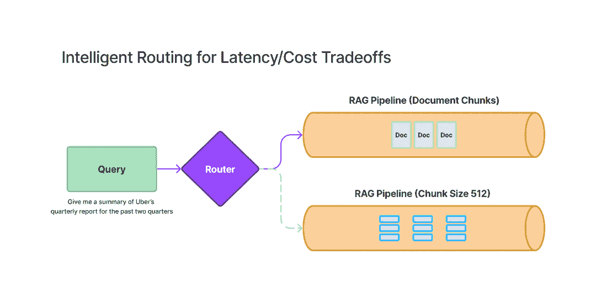
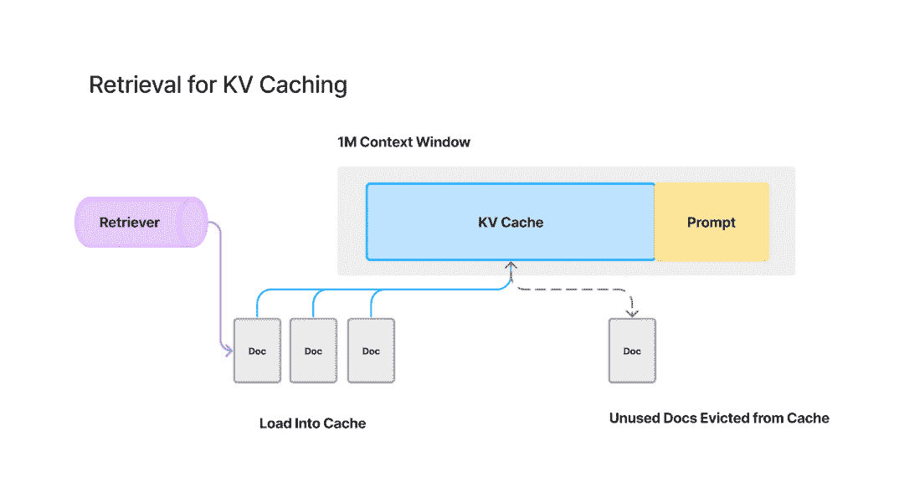

# 迈向长上下文RAG

> 来源：[https://agijuejin.feishu.cn/docx/Qzxadb6OYoscE6xor09chSRxnKb](https://agijuejin.feishu.cn/docx/Qzxadb6OYoscE6xor09chSRxnKb)

> 作者：向量检索实验室 | AI 搜索引擎

> 原文：[https://mp.weixin.](https://mp.weixin.qq.com/s/IyyLJnpH1WLI2llIck6vXA)qq.com/s/IyyLJnpH...

原文链接:https://www.llamaindex.ai/blog/towards-long-context-rag

**谷歌最近发布了具有100万上下****文窗口的 Gemini** 1.5 Pro [**1],只面向有限的开发者和**企业客户。它的表现激发了 AI** Twitte**r [2]的想象。它在 Greg Kamradt [3]推广的**"大海捞针" [4]实验中 达到99.7%的召回率** [5] 。早期用户分享了同时输入数十篇研究论文、财务报告的结果,并报告了在综合大量信息方面令人印象深刻的结果。

**自然地,这引发了一**个问题——RAG消**失了吗?** 一些人认为是这样 [6],而其他人 不同意 [7]。那些持第一种观点的人提出了有效的论点。大多数小型数据用例可以适应100万到1000万个标记的上下文窗口。随着时间的推移,标记的处理速度会变得更快、更便宜。与天真的RAG中存在的一次性检索相比,拥有原生交错检索/生成注意力层的LLM可以获得更高的响应质量。

我**们有幸预览了Gemini** 1.5 Pro的能力,并通过使用它开发了一个关于上下文增强LLM应用程序将如何发展的论点。这篇博文阐明了 我们作为数据框架的使命 以及 我们对长上下文LLM架构会是什么样子的看法 。我们的观点是,虽然长上下文LLM将简化RAG管道的某些部分(例如分块),但需要进化的RAG架构来处理长上下文LLM带来的新用例。无论出现什么新范式,我们在LlamaIndex的使命都是为这个未来构建工具。

##  **我们的使命超越RAG **

LlamaIndex的目标非常简单: 使开发人员能够在其数据之上构建LLM应用程序 。这个任务超越了单纯的RAG。迄今为止,我们已经在推进现有LLM的RAG技术方面投入了大量精力,我们这样做是因为它使开发人员能够解锁数十个新的用例,例如对半结构化数据的问答、对复杂文档的问答以及多文档设置中的代理推理。

但我们也对Gemini Pro感到兴奋,我们将继续推进LlamaIndex作为长上下文LLM未来的生产数据框架。

**LLM框架本身就有价值 **。作为开源数据框架,LlamaIndex为从原型到生产构建任何LLM用例铺平了道路。与从头开始构建相比,框架使构建这些用例变得更容易。我们使所有开发人员能够为这些用例构建,无论是使用我们的核心抽象设置适当的架构,还是利用我们生态系统中数百个集成。无论底层LLM的进步如何,以及RAG是否继续以其当前形式存在,我们都将继续使该框架准备好投入生产,包括严密的抽象、一流的文档和一致性。

我们上周还推出了LlamaCloud [8]。我们对LlamaCloud的使命仍然是构建数据基础设施,使任何企业都能使其庞大的非结构化、半结构化和结构化数据源做好生产准备,以便与LLM一起使用。

##  最初对Gemini 1.5 Pro的观察

在我们最初的测试中,我们尝试了一些PDF:SEC **10K文件、ArX**iv论文、这个庞大的 示意性设计活页夹 [9]等等。一旦API可用,我们将进行更多深入分析,但同时我们在下面分享观察结果。

Gemini的结果令人印象深刻,与我们在技术报告和社交网络上看到的一致:

+   **Gemini对特定细节有惊人的记忆力:**我们输入了10万到100万标记的上下文,并询问了有关这些文档(非结构化文本和表格数据)中非常具体的细节的问题,在所有情况下,Gemini都能够回忆起细节。请参阅上面Gemini比较2019年Uber 10K文件中的表格结果。

+   Gemini具有令人印象深刻的总结能力。 该模型可以分析跨多个文档的大量信息并综合答案。

此图显示了Gemini对2019年Uber 10K文件的一个问题-回答对。问题和答案显示在顶部,源表格显示在底部。Gemini能够返回正确的答案。

我们注意到Gemini在某些部分还有些吃力。

+   Gemini无法正确读取所有表格和图表。 Gemini Pro仍然难以正确读取图形和复杂表格。

+   Gemini可能需要很长时间。 在Uber 10K文件(约16万字)上返回一个答案需要约20秒。在LHS示意性设计活页夹(约89万字)上返回一个答案需要60多秒。

+   **Gemini可能会虚构页码。 **当被要求给出摘要但同时包含页码引用时,Gemini虚构了来源。

Gemini 1.5 Pro仍然会产生幻觉的一个例子。当被问及所有细分市场的总预订量时,该模型虚构了一个数字——该数字可见于图表中,也可以从表格中拼凑出来。

尽管定性来看，这算得上是对未来的激动人心的一瞥，值得更广泛地讨论哪些RAG范式将会消失以及新兴的架构。请见下文！

##  长上下文解决了一些痛点,但仍然存在一些挑战

Gemini 1.5 Pro只是众多长上下文LLM中的第一个,它们将不可避免地改变用户构建RAG的方式。

以下是我们认为长上下文LLM将解决的一些现有RAG痛点:

1.  开发人员将不必过多担心如何精确调整分块算法。 老实说,我们认为这对LLM开发人员来说将是一大福音。长上下文LLM使本机块大小可以更大。假设每个标记的成本和延迟也会下降,开发人员将不再需要通过调整分块分隔符、块大小和仔细注入元数据来决定如何将块拆分为精细条带。长上下文LLM使块可以达到整个文档的级别,或者至少是页面组的级别。

1.  开发人员需要花费更少的时间来调整单个文档的检索和思考链 。小块top-k RAG的一个问题是,虽然某些问题可能在文档的特定片段上得到答案,但其他问题需要在章节之间或两个文档之间进行深入分析(例如比较查询)。对于这些用例,开发人员将不再需要依赖思考链代理针对弱检索器进行两次检索;相反,他们可以一次性提示LLM以获得答案。

1.  **总结会更容易。 **这与上述陈述有关。很多关于大文档的总结策略都涉及"黑客**",例如顺序细**化或分层总结(参考我们的 响应合成模块 [10]作为参考指南)。现在可以通过单个LLM调用来缓解这个问题。

1.  **个性化记忆会更好、更容易构建 **：构建会话助手的一个关键问题是如何将足够的会话上下文加载到提示窗口中。4k标记很容易溢出这个窗口,即使是非常基本的网络搜索代理——例如,如果它决定加载Wikipedia页面,该文本将很容易溢出上下文。100万到1000万的上下文窗口将让开发人员更容易实现会话记忆,而无需太多压缩技巧(例如向量搜索或自动知识图构建)。

然而,仍然存在一些挑战:

1.  **对于大型文档语料库,1000万个标**记还不够——千文档检索仍然是一个挑战。 100万个标记大约相当于7个Uber SEC 10K文件。1000万个标记大约相当于70个文件。1000万个标记大致受限于40MB的数据。虽然这对于许多"小型"文档语料库来说已经足够,但企业中的许多知识语料库都是GB或TB级别的。为了在这些知识语料库之上构建LLM驱动的系统,开发人员仍然需要构建某种方式来检索这些数据,以使用上下文增强语言模型。

1.  嵌入模型在上下文长度方面落后。 到目前为止,我们看到嵌入的最大上下文窗口是 together.ai的32k [11]。这意味着,即使用于与长上下文LLM合成的块可以很大,但用于检索的任何文本块仍然需要小得多。

1.  **成本和延迟。 **是的,随着时间的推移,所有的成本和延迟问题都会得到缓解。然而,使用当前定价,**填充100万个**上下文窗口大约需要60秒,可能**花费从0.**50美元到20美元不等。 Yao Fu [12]提出的一个解决方案是 KV缓存 [13]可以缓存文档激活,这样任何后续生成都可以重用相同的缓存。这引出了我们下面的下一点。

1.  KV缓存占用大量GPU内存,并具有顺序依赖性 。我们与Yao聊天时,他提到目前缓存100万个标记的激活大约需要100GB的GPU内存,即2个H100。在管理缓存方面也有一些有趣的挑战,尤其是当底层语料库很大时——因为每个激活都是之前所有标记的函数,因此替换KV缓存中的任何文档都会影响文档之后的所有激活。

##  **迈向新的RAG架构 **

正确使用长上下文LLM将需要新的架构,以最大限度地利用它们的能力,同时解决其余的限制。我们在下面概述了一些建议。

###  **1.对文档进行从小到大的检索 **

在长上下文LLM需要在大型知识库(例如GB级**别)上进行检索增**强的情况下,我们将需要 从小到大的检索 :索引和检索小块,但使每个块链接到最终将在合成过程中输入LLM的大块。

**这种架构已经以不**同的形式存在**于LlamaInde**x中 句子窗口检索器 [14]和 块大小上的递归检索 [15],但可以为长上下文LLM进一步扩展——嵌入文档摘要,但将它们链接到整个文档。

我们希望嵌入和索引较小的块的一个原因是,当前的嵌入模型在上下文长度方面无法跟上LLM。另一个原因是,与文档的单个文档级嵌入相比,拥有多个精细的嵌入表示实际上可以带来检索优势。如果一个文档只有一个嵌入,那么该嵌入就承担了对整个文档中所有信息进行编码的负担。另一方面,我们发现嵌入许多较小的块并让每个小块链接到一个更大的块,将导致更好地检索相关信息。

查看上图以了解从小到大检索的两种风格的插图。一种是索引文档摘要并将它们链接到文档,另一种是索引文档内的较小块并将它们链接到文档。当然,您也可以两者兼而有之——提高检索性能的一般最佳实践是一次尝试多种技术,然后将结果融合在一起。

###  **2.智能路由以平衡延迟/成本 **

长上下文LLM的出现将不可避免地引发关于每个用例适合多少上下文的问题。为LLM注入长上下文会带来实际的成本和延迟权衡,并不适合每个用例甚至每个问题。尽管未来成本和延迟会降低,但我们预计用户在接下来的一两年内需要仔细考虑这种权衡。

询问特定细节的某些问题非常适合使用现有的top-k检索和合成RAG技术。

更复杂的问题需要来自不同文档的不同部分的更多上下文,在这些情况下,如何在优化延迟和成本的同时正确回答这些问题就不太清楚了:

+   总结问题需要查看整个文档。

+   多部分问题可以通过进行思维链并交错检索和推理来解决;它们也可以通过将所有上下文塞入提示来解决。

我们设想在知识库之上的多个RAG和LLM合成管道之上运行一个智能路由层。给定一个问题,路由器理想情况下可以在成本和延迟方面选择最佳策略,以检索上下文来回答问题。这确保单一界面可以处理不同类型的问题,同时不会变得过于昂贵。

###  **3. 检索增强的KV缓存 **

**谷歌和其他**公司肯定正在努力通过 KV缓存 来解决延迟和成本问题。在高层次上,KV缓存存储来**自注意**力层中预先存在的键和查询向量的激活,从而避免了在LLM生成期间重新计算整个文本序列的激活的需要(我们发现 这个 [16]是关于KV缓存如何工作的一个不错的入门参考)。

使用KV缓存来缓存上下文窗口内的所有文档标记可以避免在后续对话中重新计算这些标记的激活,从而显著降低延迟和成本。

但**这导致了关于如**何最好地使用缓存的有趣的检索策略,特别是对于超过上下文长度的知识语料库。我们设想会出现一种" 检索增强缓存 "范式,我们希望检索用户最想回答的最相关文档,并期望他们将继续使用缓存中的文档。

这可能涉及将检索策略与 **传统缓存算法 **[17]如LRU缓存交错。但与现有的KV缓存架构不同的是,位置很重要,因为缓存的向量是截至该位置的所有标记的函数,而不仅仅是文档本身中的标记。这意味着你不能在不影响KV缓存中位置后面的所有缓存标记的情况下交换出KV缓存中的块。

总的来说,使用KV缓存的API接口还悬而未决。缓存本身的性质是否会演变或算法会演变以最大限度地利用缓存也尚不明确。

###  **下一步 **

我们相信LLM应用程序的未来是光明的,我们很高兴能站在这个快速发展领域的最前沿。我们邀请开发人员和研究人员加入我们,探索长上下文LLM的可能性,并构建下一代智能应用程序。

###  **相关链接 **

[1]https://blog.google/technology/ai/google-gemini-next-generation-model-february-2024/#gemini-15

[2]https://x.com/alliekmiller/status/1760522046251962459?s=20

[3]https://x.com/GregKamradt/status/1722386725635580292?s=20

[4]https://storage.googleapis.com/deepmind-media/gemini/gemini_v1_5_report.pdf

[5]https://storage.googleapis.com/deepmind-media/gemini/gemini_v1_5_report.pdf

[6]https://twitter.com/francis_yao_/status/1759962812229800012?s=46&t=pfae6EnnrBq2o8ok0KpVqw

[7]https://x.com/ptsi/status/1758511307433947625?s=20

[8]https://blog.llamaindex.ai/introducing-llamacloud-and-llamaparse-af8cedf9006b

[9]https://www.lowellhsproject.com/DocumentCenter/View/236/LHS-Schematic-Design-Binder

[10]https://docs.llamaindex.ai/en/stable/module_guides/querying/response_synthesizers/root.html

[11]https://hazyresearch.stanford.edu/blog/2024-01-11-m2-bert-retrieval

[12]https://twitter.com/Francis_YAO_

[13]https://x.com/Francis_YAO_/status/1759962812229800012?s=20

[14]https://docs.llamaindex.ai/en/stable/examples/node_postprocessor/MetadataReplacementDemo.html

[15]https://docs.llamaindex.ai/en/stable/examples/retrievers/recursive_retriever_nodes.html

[16]https://medium.com/@plienhar/llm-inference-series-3-kv-caching-unveiled-048152e461c8

[17]https://www.notion.so/Long-Context-Window-Blog-Post-e2e3faaac23140eabc0e066ce2783890?pvs=21