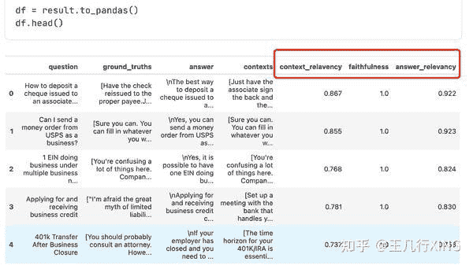
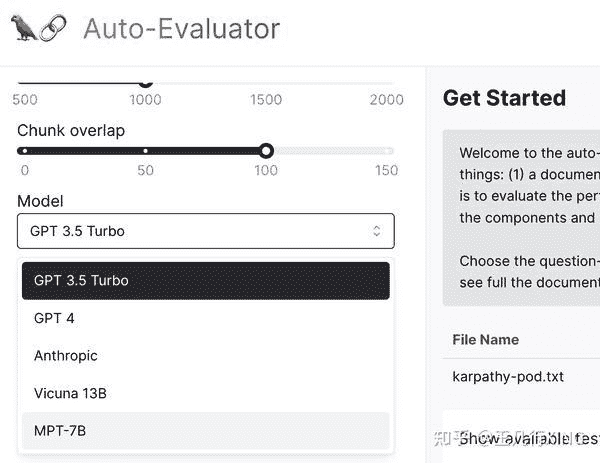
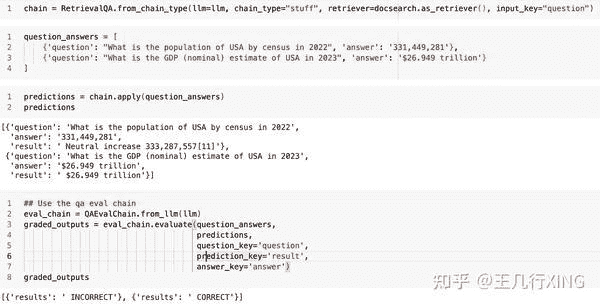

# RAG：LLMs + LangChain app 开发关键技术整理

> 来源：[https://agijuejin.feishu.cn/docx/QrvpdYmZkovRzpxtfaPcB8rXn3K](https://agijuejin.feishu.cn/docx/QrvpdYmZkovRzpxtfaPcB8rXn3K)

> 作者：王几行XING

> 原文： [https://zhuanlan.z](https://zhuanlan.zhihu.com/p/664097125)hihu.com/p/664097...

## 第零部分：文献综述

### RAG 理论介绍

+   RAG 理论论文1： [https:// arxiv.org/p](https://link.zhihu.com/?target=https%3A//arxiv.org/pdf/1906.00300.pdf)df/1906.0030 0.pdf  , Lee, K., Chang, M. W., & Toutanova, K. (2019). Latent retrieval for weakly supervised open domain question answering. arXiv preprint arXiv:1906.00300 .

+   RAG 理论论文2： [ht](https://link.zhihu.com/?target=https%3A//proceedings.neurips.cc/paper/2020/file/6b493230205f780e1bc26945df7481e5-Paper.pdf)tps:// proceedings.neurips.cc/ paper/2020/file/6b493230205f780e1bc26945df7481e5-Paper.pdf  , Lewis, P., Perez, E., Piktus, A., Petroni, F., Karpukhin, V., Goyal, N., ... & Kiela, D. (2020). Retrieval-augmented generation for knowledge-intensive nlp tasks. Advances in Neural Information Processing Systems , 33 , 9459-9474.

+   RAG 理论论文3： [h](https://link.zhihu.com/?target=http%3A//proceedings.mlr.press/v119/guu20a/guu20a.pdf)ttp:// proceedings.mlr.press/v 119/guu20a/guu20a.pdf  , Guu, K., Lee, K., Tung, Z., Pasupat, P., & Chang, M. (2020, November). Retrieval augmented language model pre-training. International conference on machine learning (pp. 3929-3938). PMLR.

### 关键案例论文

+   案例论文 1： Chen, 2023, 基于购买记录的个性化产品推荐

+   案例论文 2： Ciuca and Ting, 2023，天文知识的问答机器人

+   案例论文 3： Semnani et al., 2023，Wiki 问题回答机器人

+   案例论文 4: Siriwardhana et al., 2023，基于维基百科的知识问答机器人

+   案例论文 5: Vaghef et al., 2023，关于气候变化的知识问答

+   案例论文 6: Yue & Au, 2023，金融数据回测和问答

## 1 文本处理任务

### 1.1 长文本摘要

+   LangChain 官方说明： Summarization | ️ Langchain

+   关键函数： `load_summarize_chain`

+   选项一：`map reduce`，每一块先总结，然后拼在一起，最后总结

+   选项二：`refine`，每小结一次，加上新的文件块再次总结，相当于累计信息的做法

+   [具体可以参考（和官网说明类似）： 李祺 Varman：Azur](https://zhuanlan.zhihu.com/p/646778848)e OpenAI 入门教程 - LangChain 篇 ： 长文本内容总结

+   主要步骤：

```
- 预处理文本:先对原始长文本进行预处理,包括清理格式、分割句子、去除停用词等,得到适合输入到LangChain的纯文本。
- 载入文本，UnstructuredFileLoader
- 设置prompt:根据摘要生成的需求,设计合适的prompt,提示LangChain需要生成什么样的摘要。prompt可以指明想要生成的摘要长度、风格等特征。
- 输入文本:将预处理后的长文本输入到LangChain中。
- 生成摘要:让LangChain根据prompt去生成针对该长文本的摘要。可以生成多轮摘要,adj问不同prompt,生成不同角度的摘要。
- 后处理:获取LangChain生成的摘要后,可以进行后处理,如修正语法、重复内容等,进一步提升摘要质量。
- 评估:可以通过一定的自动评估指标或人工评估来判断生成摘要的质量,从而反馈优化prompt设计。
- 迭代优化:重复上述步骤,调整prompt,迭代生成,直到得到满意的摘要。
```

+   长文本摘要生成案例： [王几行XING：LangChain+ChatGPT 长文本摘要生成（附完整代码）](https://zhuanlan.zhihu.com/p/663903128)

```
!pip install langchain -q
!pip install openai -q
!pip install unstructured -q

from langchain.document_loaders import UnstructuredFileLoader
from langchain.chains.summarize import load_summarize_chain
from langchain.text_splitter import RecursiveCharacterTextSplitter
from langchain import OpenAI
openai_api_key = "sk-xxx"

## Load the long test
loader = UnstructuredFileLoader("/content/test.txt")

## Transform the text to document
document = loader.load()
print(f'The number of documents before cutting: {len(document)}')

## Initial the text_splitter
text_splitter = RecursiveCharacterTextSplitter(
    chunk_size = 500,
    chunk_overlap = 0
)

## Cut the documents
split_documents = text_splitter.split_documents(document)
print(f'The number of documents after cutting: {len(split_documents)}')

## Initial the LLM
llm = OpenAI(model_name="text-davinci-003", max_tokens=1500,
             openai_api_key=openai_api_key)

## Create the summerize chain 
chain = load_summarize_chain(llm, chain_type="refine", verbose=True)

## Sum the first 10 documents
chain.run(split_documents[:10])
```

## 2 LangChain 关键技术

### 2.1 Prompt Template

### 2.2 Chain

+   RAG对话Chain： `qa = ConversationalRetrievalChain.from_llm(llm, retriever=docsearch.as_retriever(), memory=memory)`

+   这里`retriever` 来自 Embedding： `docsearch = FAISS.from_documents(text_chunks, embeddings)`

+   启用了 `memory`，可以实现多轮对话

### 2.3 Memory

+   `ConversationBufferMemory` 启用聊天记录历史，`memory = ConversationBufferMemory(memory_key="chat_history", return_messages=True)`

+   `memory.chat_memory.add_user_message("Hi")`，添加用户的发言记录

+   `memory.chat_memory.add_ai_message("Hi")`，添加 AI 的发言记录

+   `memory.load_memory_variables({})`，返回所有的对话记录

+   `ConversationBufferWindowMemory(k=3)`，滑动窗口查看 `memory`

### 2.4 Agent（生产环境中变数太多，慎重使用）

+   ChatBot: Conversational Retrieval Agent

+   SQL: `create_sql_agent`

+   pandas: `create_pandas_dataframe_agent`

## 3 SQL/cvs等表格数据

### 3.1 数据导入

+   LangChain 的 `CSV Loader`

+   将每行数据导入成为一个个 `document`

+   类似于 JSON 的键值对格式

+   文件来源和行号，作为每个 `document` 的 `metadata`

### 3.2 SQL RAG

+   SQL Agent

+   [SQL Database Chain： 王几行XING：惊艳的LangChain：SQL自动生成、执行、完成回答！（附完整代码）](https://zhuanlan.zhihu.com/p/665222497)

## 4 RAG 性能评估

### 4.1 ragas，无参考答案的评估

+   论文地址： [https:// arxiv.org/p](https://link.zhihu.com/?target=https%3A//arxiv.org/pdf/2309.15217.pdf)df/2309.1521 7.pdf  ，《RAGAS: Automated Evaluation of Retrieval Augmented Generation》

+   GitHub： [Install | Ragas](https://link.zhihu.com/?target=https%3A//docs.ragas.io/en/latest/getstarted/install.html)

+   论文解释： [LinguaMind：再看大模型RAG检索增强如何评估：RAGAS开源自动化评估框架](https://zhuanlan.zhihu.com/p/664052784)

+   三个维度的评估 (Es et al., 2023)，讨论的是 context 、 answer 的质量，及两者的相关程度：

+   `Faithfulness`，答案应该基于语境， the answer should be grounded in the given context（answer 和 context 的相关程度）

+   Answer Relevance ，答案的相关性，即答案和问题应该对应。具体操作是惩罚答案的不完整和信息冗余

+   Context Relevance ，检索返回的 context 必须保持专注，不应该提供无关的信息。具体操作是惩罚信息的冗余

+   三个指标构建之后，利用 ChatGPT 生成 context 和 answer 数据，进行RAGAS判断，并与人工判断进行对比。

+   RAGAS 算是基于 LLMs 自动评估的一种方法，本质上也是在没有参考答案的情况下，依赖大模型自动完成 RAG 的评估。



### 4.2 LangChain 的 auto-evaluator：利用大模型对答案进行评估

+   LangChain 自带： [Auto-Evaluator](https://link.zhihu.com/?target=https%3A//autoevaluator.langchain.com/)



### 4.3 [LangChain 官网的评估中心](https://link.zhihu.com/?target=https%3A//js.langchain.com/docs/api/evaluation/)：Evaluation | ️ Langchain ； `langchain/evaluation APIs` | ️ Langchain

+   基于参考答案的评估， `QAEvalChain` ，将得到的回答和真实答案进行对比

+   利用 ChatGPT 来评估其它 LLMs

+   官方案例： [h](https://link.zhihu.com/?target=https%3A//blog.langchain.dev/usin g-chatgpt-api-to-evaluate-chatgpt/)ttps:// blog.langchain.dev/usin g-chatgpt-api-to-evaluate-chatgpt/



+   `PairwiseStringEvalChain` ，`PairwiseStringEvaluator` 的一种方法。利用某个大模型（比如 GPT-4 ），比较两个不同 LLMs 输出的结果。评估具体需要的三个部件：

1.  An evaluator，一个评估器，相当于裁判，比如 GPT-4

2.  A dataset of inputs，一系列的输入

3.  (2 or more) LLMs, Chains, or Agents to compare - 两个或者两个以上的被评估对象

4.  结果还可以计算 置信区间 和 p 值（这个真的挺特别！）


```python
## 以下代码来自 LangChain 官网
## https://python.langchain.com/docs/guides/evaluation/examples/comparisons#cite_note-1
import random


def predict_preferences(dataset, results) -> list:
    preferences = []

    for example, (res_a, res_b) in zip(dataset, results):
        input_ = example["inputs"]
        # Flip a coin to reduce persistent position bias
        if random.random() < 0.5:
            pred_a, pred_b = res_a, res_b
            a, b = "a", "b"
        else:
            pred_a, pred_b = res_b, res_a
            a, b = "b", "a"
        eval_res = eval_chain.evaluate_string_pairs(
            prediction=pred_a["output"] if isinstance(pred_a, dict) else str(pred_a),
            prediction_b=pred_b["output"] if isinstance(pred_b, dict) else str(pred_b),
            input=input_,
        )
        if eval_res["value"] == "A":
            preferences.append(a)
        elif eval_res["value"] == "B":
            preferences.append(b)
        else:
            preferences.append(None)  # No preference
    return preferences


## 还能计算 CI 自信区间
from math import sqrt


def wilson_score_interval(
    preferences: list, which: str = "a", z: float = 1.96
) -> tuple:
    """Estimate the confidence interval using the Wilson score.
    See: https://en.wikipedia.org/wiki/Binomial_proportion_confidence_interval#Wilson_score_interval
    for more details, including when to use it and when it should not be used.
    """
    total_preferences = preferences.count("a") + preferences.count("b")
    n_s = preferences.count(which)

    if total_preferences == 0:
        return (0, 0)

    p_hat = n_s / total_preferences

    denominator = 1 + (z**2) / total_preferences
    adjustment = (z / denominator) * sqrt(
        p_hat * (1 - p_hat) / total_preferences
        + (z**2) / (4 * total_preferences * total_preferences)
    )
    center = (p_hat + (z**2) / (2 * total_preferences)) / denominator
    lower_bound = min(max(center - adjustment, 0.0), 1.0)
    upper_bound = min(max(center + adjustment, 0.0), 1.0)

    return (lower_bound, upper_bound)


## 以及 p 值
from scipy import stats

preferred_model = max(pref_ratios, key=pref_ratios.get)
successes = preferences.count(preferred_model)
n = len(preferences) - preferences.count(None)
p_value = stats.binom_test(successes, n, p=0.5, alternative="two-sided")
print(
    f"""The p-value is {p_value:.5f}. If the null hypothesis is true (i.e., if the selected eval chain actually has no preference between the models),
then there is a {p_value:.5%} chance of observing the {name_map.get(preferred_model)} be preferred at least {successes}
times out of {n} trials."""
)
```

### 4.4 通用LLM评估

+   BLEU，机器翻译质量评估

+   GLUE，General Language Understanding Evaluation，通用语言理解评估

+   Bard的解释

```
简单来说，GLUE 是一个由 9 个自然语言处理任务组成的 benchmark，用于评估大模型的性能。这些任务涵盖了文本分类、文本匹配、句子生成等多个方面。

GLUE 的评估方法是使用人类标注的测试集来评估模型的性能。例如，在文本分类任务中，模型将被要求根据给定的文本输出文本的类别。在文本匹配任务中，模型将被要求判断两个文本是否相关。在句子生成任务中，模型将被要求生成与给定句子相似的句子。

GLUE 的评估结果通常以 F1 分数来表示。F1 分数是精度和召回率的加权平均值。精度表示模型正确预测的比例，召回率表示模型能够检测出所有正确答案的比例。

以下是 GLUE 中 9 个任务的简要介绍：

`CoLA`：文本分类任务，判断句子是否是语言规范的。
`SST-2`：文本分类任务，判断句子的情感是积极的还是消极的。
`MRPC`：文本匹配任务，判断两个句子是否是同义句。
`QQP`：文本匹配任务，判断两个句子是否是相关的。
`STS-B`：句子相似度任务，计算两个句子的相似度。
`MNLI`：文本分类任务，判断两个句子是否是蕴含关系。
`QNLI`：文本分类任务，判断句子是否是自然语言推理问题。
`RTE`：文本分类任务，判断句子是否是蕴含关系。
GLUE 是一个非常流行的 benchmark，用于评估大模型的性能。通过 GLUE 的评估，我们可以了解不同大模型在不同任务上的表现，并为大模型的开发提供指导。

以下是一个通俗的解释：

假设我们有一个大模型，它可以生成文本。我们可以使用 GLUE 的 `CoLA` 任务来评估这个模型的性能。`CoLA` 任务要求模型判断句子是否是语言规范的。如果模型在 `CoLA` 任务上的表现很好，那么我们就可以认为这个模型生成的文本是语言规范的。

同样，我们可以使用 GLUE 的其他任务来评估大模型的其他能力。例如，我们可以使用 GLUE 的 `SST-2` 任务来评估大模型识别情绪的能力，使用 GLUE 的 `MRPC` 任务来评估大模型判断句子是否是同义句的能力，等等。

通过 GLUE 的评估，我们可以全面了解大模型的性能，并为大模型的应用提供指导。
```

### 4.5 通用LLM测试数据集

## 5 LLMs Hubs

+   `Hugging Face Transformers`：基于 `Transformers` 包中关于开源大模型的使用说明

+   Chatbot Arena：加州大学伯克利分校维护的Elo积分制的 LLMs 排行榜

+   Open LLM Leaderboard：Hugging Face维护的开源大模型排名

## 6 在线视频教程

+   新手入门视频集-1：[【开发必看】AI应用开发LangChain系列课程_哔哩哔哩_bilibili（老陈打码）](https://link.zhihu.com/?target=https%3A//www.bilibili.com/video/BV1Uh4y1X76G/%3Fspm_id_from%3D333.337.search-card.all.click%26vd_source%3D7830a50943e3cd844c66dc7aca159592)

+   LLM Bootcamp：主讲者为 Charles Frye、Sergey Karayev 和 Josh Tobin，基于大模型的 app 开发：[https://fullstackdeeplearning.com/llm-bootcamp/spring-2023/prompt-engineering/](https://fullstackdeeplearning.com/llm-bootcamp/spring-2023/prompt-engineering/)

+   [`LangChain` + 吴恩达：吴恩达最新《LLM应用程序开发的LangChain》| 中英字幕_哔哩哔哩_bilibili](https://link.zhihu.com/?target=https%3A//www.bilibili.com/video/BV1zu4y1Z7mc/%3Fspm_id_from%3D333.337.search-card.all.click%26vd_source%3D7830a50943e3cd844c66dc7aca159592)

+   [`Chat with PDF` 实战案例：全网强推！2023最好的【`LangChain` 学习指南】教程！实战案例：基于上传PDF文档进行QA问答！_哔哩哔哩_bilibili](https://link.zhihu.com/?target=https%3A//www.bilibili.com/video/BV1SG411d7s6/%3Fspm_id_from%3D333.337.search-card.all.click%26vd_source%3D7830a50943e3cd844c66dc7aca159592)

## 7 文章教程

+   [`LangChain` 中文入门教程：https://github.com/liaokongVFX/LangChain-Chinese-Getting-Started-Guide](https://link.zhihu.com/?target=https%3A//github.com/liaokongVFX/LangChain-Chinese-Getting-Started-Guide)

+   `RAG` 自我反思和改进：无影寺：【LLM】`Self-RAG`：通过自我反思实现检索增强生成

+   查询重写：[骑猪兜风：借助这个开源项目，我将 `RAG` 的准确性和召回率都提高了两倍！](https://zhuanlan.zhihu.com/p/661114083) ；英文原文：[`RAG is more than just embedding search - Instructor (openai_function_call)`](https://link.zhihu.com/?target=https%3A//jxnl.github.io/instructor/blog/2023/09/17/rag-is-more-than-just-embedding-search/)
