# 如何用RAG技术提升LLM的能力

> 来源：[https://agijuejin.feishu.cn/docx/E2qUdOcZPo9OrDx8mJicbDaOnEg](https://agijuejin.feishu.cn/docx/E2qUdOcZPo9OrDx8mJicbDaOnEg)

> 作者：Meta

> 原文：[https://zhuanlan.z](https://zhuanlan.zhihu.com/p/676939361)hihu.com/p/676939...

大语言模型表现出色，但是在处理幻觉、使用过时的知识、进行不透明推理等方面存在挑战。检索增强生成（RAG）作为一个新兴的解决方案，通过整合外部知识库的数据，提高了模型在知识密集型任务中的准确性和可信度，能够实现知识持续更新和特定领域信息的集成，有效将LLM的内在知识与外部数据的巨大动态资源相结合。

本文主要是对综述论文《Retrieval-Augmented Generation for Large Language Models: A Survey》的概括和解读，同时也会整合一些其他来源的材料。后面主要探讨RAG范式（包括Naive RAG、Advanced RAG、Modular RAG）的发展，同时会详细介绍RAG的三大关键技术（检索、生成、增强），然后会介绍RAG的评估指标及应用实践。

## 大模型应用面临的挑战

大语言模型（如GPT系列、LLama系列、文心一言等），已经在自然语言领域的多项基准测试中取得突破性进展。然而，它们在处理特定领域或者一些高度专业化的场景时存在一些局限性。

+   内容不真实：幻觉问题/领域知识匮乏

+   时效性不强

+   隐私&安全性

为了应对这些挑战，主要有以下几种类型的解决方案：

+   参数化的方式：通过微调的手段将领域知识嵌入模型，更新模型参数。它的缺点是训练成本较高、灵活性较差；优势在于能够输出高质量的结果。

+   非参数化方式：通过数据库存储相关的知识，检索后直接使用。它的优势在于成本低、灵活性强、可解释性高；缺点在于少了生成的过程，检索出的内容可能不能直接回答问题，有较高的理解成本。

+   用非参数化的语料库与参数化的模型集成，也就是RAG，同时具备参数化方式和非参数化方式的优点。

## 什么是RAG

顾名思义，RAG (Retrieval-Augmented Generation), 主要包括3个关键过程（Retrieval、Augmentation和Generation），它主要通过从外部知识库中“检索”最新信息作为外挂来“增强”LLM“生成”答案的效果。在回答问题或生成文本之前查询外部数据源并合成一个内容更加丰富的Prompt，从而显著提升输出的准确性和相关性。目前，RAG已经成为LLM系统中最流行的架构之一，因其高实用性和低门槛的特点，许多对话产品都是基于RAG进行构建。

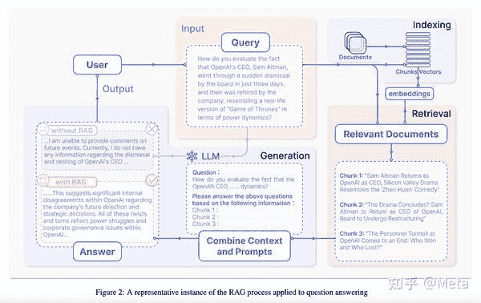

## RAG框架结构

从简单到复杂可以分为三个层次的RAG，包括Naive RAG、Advanced RAG、Modular RAG，如下图所示。

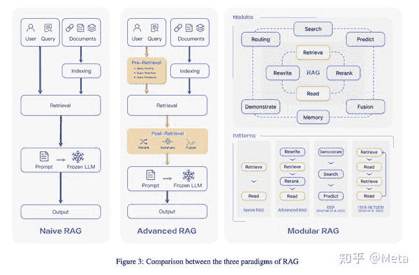

## 从Naive RAG说起

最基本的RAG方式，分为Indexing、Retrieval、Generation这3个步骤，简单而实用。

### Naive RAG的一些局限性

Naive RAG的效果在检索质量、结果生成质量和增强的过程方面都存在一定的挑战。

+   **检索质量方面**

+   准确率低，可能会导致幻觉

+   召回率低，导致信息不完整

+   过时或者冗余的信息导致检索结果不准确

+   结果生成质量方面

+   幻觉问题，如果问题的答案未能被正确检索，生成的结果仍然会产生幻觉

+   答非所问，问题和答案未能正确匹配

+   生成有害和偏见的答案

+   增强过程（整合来自检索的内容）的挑战

+   内容不连贯/脱节

+   冗余和重复

+   确定每段内容对于结果生成的重要性

+   协调来自不同写作风格/语气的内容差异，从而保证输出一致性

+   生成结果可能过渡依赖增强信息，导致和增强信息相比没有带来额外的收益

## Advanced RAG如何应对这些挑战

和Naive RAG相比，Advanced RAG加入了Pre-Retrieval 和 Post-Retrieval模块，同时对Retrieval模块也进行了一些优化，从而改进输出效果。

### Pre-Retrieval

可以通过优化数据索引的方式来改进Pre-Retrieval阶段的质量。大致有5种策略可以使用：

+   增强数据粒度：主要是对数据内容进行修订和简化，确保数据源的正确性和可读性。预索引优化的主要目的是提升文本的规范化、统一性，并确保信息的准确无误和上下文的充分性，以此来保障 RAG 系统的表现。具体的方式包括删除不相关信息、消除实体种的歧义和术语、确认事实准确性、维护上下文、更新过时文件。

+   优化索引结构：包括调整chunk的大小来捕获相关的上下文、跨多个索引路径查询、通过利用图数据索引中节点之间的关系并结合图结构中的信息来捕获相关上下文。

+   层级索引

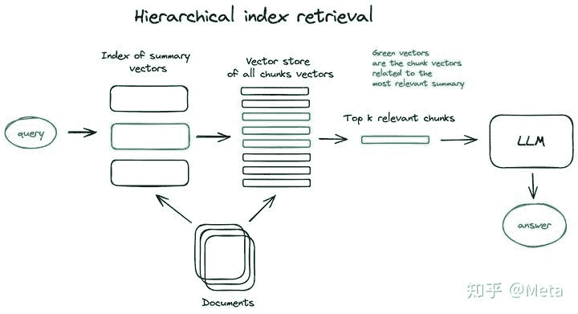

+   加入元数据信息：在RAG系统开发中，加入元数据如日期标签可以提高检索质量，特别是在处理时间敏感的数据如电子邮件查询时，强调最新信息的相关性而不仅是内容相似性。LlamaIndex通过节点后处理器支持这种以时间排序的检索策略，增强了系统的实用性和效率。

+   对齐优化： 这一策略主要针对文档间的对齐问题和差异性问题。对齐处理包括设计假设性问题，可以理解为每一个 chunk 生成一个假设性提问，然后将这个问题本身也嵌合到 chunk 中。这种方法有助于解决文档间的不一致和对齐问题。

+   混合检索

### Retrieval

这一阶段主要通过计算query和chunks的相似性来召回上下文，核心是embedding模型，Advanced RAG主要对embedding模型进行优化。

+   微调Embedding模型：利用特定场景的预料去微调embedding模型，将知识嵌入到模型中。

+   Dynamic Embedding：相比于静态嵌入（每个固定单词的的向量固定），动态嵌入会根据不同的上下文对同一个单词的嵌入进行调整。嵌入中包含上下文信息能够产生更为可靠的结果。

### Post-Retrieval

在完成chunks检索并整合上下文提交给LLM生成最终结果前，可以通过ReRank和Prompt Compression的方式对文档进行优化。

+   **ReRank **： 前文提及的检索召回阶段一[般直接对query和chunks的embedding向量进行相似性召回，无法捕捉query](https://link.zhihu.com/?target=https%3A//docs.llamaindex.ai/en/stable/examples/node_postprocessor/CohereRerank.html)和chunk的复杂语义关系。Rerank阶段可以设计更加复杂的模块对召回的结果进行精细化的排序，从而提高召回的质量。
llamaindex案例： https:// docs.llamaindex.ai/en/s table/examples/node_postprocessor/CohereRerank.html

+   Prompt Compres[sion ：研究表明，检索到的文档中的噪声会对 RAG 性能产生不利影响。在后期处理中，重点](https://link.zhihu.com/?target=https%3A//docs.llamaindex.ai/en/stable/examples/node_postprocessor/LongLLMLingua.html)在于压缩无关上下文、突出关键段落、减少整体上下文长度。 Selective Context 和 LLMLingua 等方法利用小语言模型来计算即时互信息或困惑度，估计元素重要性。 Recomp通过以不同粒度训练压缩器来解决这个问题，而 Long Context 和“Walking in the Memory Maze” 设计总结技术来增强法学硕士的关键信息感知，特别是在处理广泛的背景方面。
llamaindex案例： https:// docs.llamaindex.ai/en/s table/examples/node_postprocessor/LongLLMLingua.html

## Modular RAG

不同于Naive RAG和Advanced RAG，都有固定的一套流程，Modular RAG更多是增加了一些新的模块，并可以根据具体的需求对各个单一的模块进行组合得到新的架构模式。

### 新模块

+   搜索模块：为特定场景定制，可以在额外的语料库上进行直接搜索。

+   记忆模块：利用LLM记忆能力和增强检索的生成器指导检索过程，使用生成的输出作为数据源。

+   融合：通过LLM扩展用户查询，提高搜索的多样性和深度，优化结果并与用户意图更紧密对齐。

+   路由：RAG系统通过查询路由功能，根据用户的查询内容选择最合适的信息源和处理方式，包括总结性回应、特定数据库搜索或合并不同信息源。这涉及多种数据存储类型，如向量、图形或关系数据库，以及索引层级。查询路由根据预置逻辑通过LLM执行，确保查询高效准确地被处理。

+   预测：通过LLM生成上下文来解决检索内容中的冗余和噪声，比直接检索更有效。

+   任务适配器：适用于不同下游任务，通过LLM生成查询提示和任务特定检索器，提高模型的泛用性和精确度。

### 新模式

Modular RAG是一个高度适应性的组织结构，它允许在RAG过程中替换或重新排列模块以适应特定问题的需求。传统的朴素RAG主要由“Retrieval”和“Read”模块组成，而高级RAG在此基础上增加了“Rewrite”和“Rerank”模块。然而，模块化RAG提供了更大的多样性和灵活性。

目前的研究主要探索两种组织模式：一种是增加或替换模块，另一种是调整模块之间的流程。通过这种灵活性，可以根据不同任务的需求定制RAG过程。

增加或替换模块策略旨在保持Retrieval-Read的核心结构，同时通过集成额外的模块来增强特定功能，如RRR模型中的Rewrite-Retrieval-Read过程。另一种方法是交换模块，如将LLM生成模块替换为检索模块，或者让LLM记住特定任务信息并进行输出，以处理知识密集型任务。

在调整模块之间的流程方面，重点在于增强语言模型和检索模型之间的交互。例如，DSP框架将上下文学习系统视为一个显式程序来处理知识密集型任务，而ITER-RETGEN方法则通过生成内容指导检索，并在检索-阅读的流程中迭代实施增强功能，显示了模块之间如何相互提升功能的创新方式。

### 优化RAG的pipeline

RAG系统中的检索过程优化关注于提高信息检索的效率和质量。通过集成多种搜索技术、改进检索步骤、引入认知回溯、实现多样化查询策略和利用嵌入相似性，研究人员致力于在检索效率和上下文信息的深度之间找到平衡点。

+   混合搜索——结合关键词搜索、[语义搜索和向量搜索的技术以适应各种查询需求，并确保检索到相关且内容丰富的信息](https://link.zhihu.com/?target=https%3A//docs.llamaindex.ai/en/stable/examples/retrievers/simple_fusion.html)。
llamaindex案例： https:// docs.llamaindex.ai/en/s table/examples/retrievers/simple_fusion.html

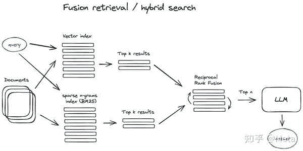

+   递归检索和查询引擎——逐步检索，捕获关键语义，在流程后期提供更多上下文信息，以提供效率和响应深度之间的平衡。

+   sentence window retrieval

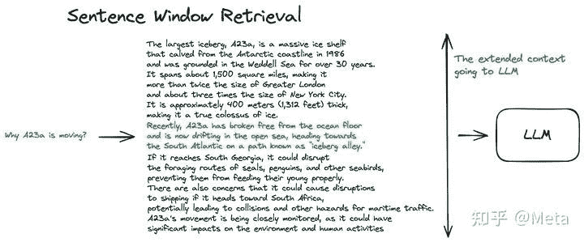

+   Parent-child chunks retrieval

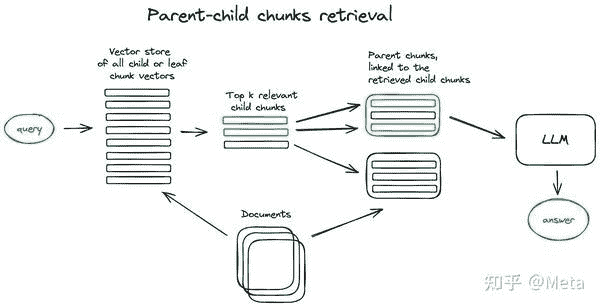

+   StepBack-prompt——通过后向提示鼓励LLM围绕更宽泛概念进行推理，以提高复杂推理任务的性能。

+   子查询——根据不同场景，采取不同的查询策略，如利用查询引擎、树查询、向量查询或顺序查询。

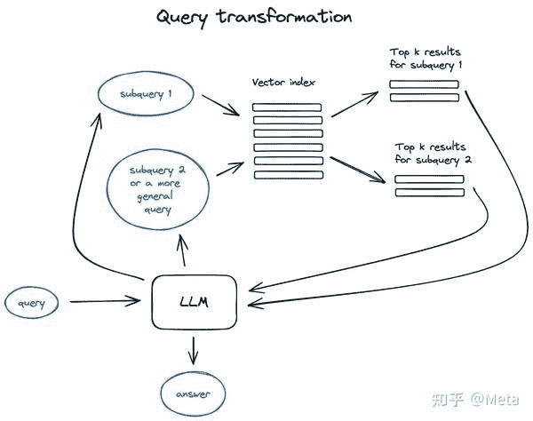

+   假设性文档嵌入（HyDE）—[—H](https://link.zhihu.com/?target=https%3A//docs.llamaindex.ai/en/stable/examples/query_transformations/HyDEQueryTransformDemo.html)yDE是一个系统，它通过使用大型语言模型来创建假设性答案，并将这些答案嵌入空间以检索类似的真实文档。这种方法更注重答案之间而非查询与答案间的嵌入相似性。尽管这种方法有其创新之处，但在处理不熟悉的主题时，可能会产生不准确的结果。
llamaindex案例： https:// docs.llamaindex.ai/en/s table/examples/query_transformations/HyDEQueryTransformDemo.html

这些方法不仅增加了系统的灵活性，也可能提高RAG系统在处理知识密集型任务时的表现，但也需要注意，这些方法可能在模型对特定主题不够熟悉时产生错误。

## Retriever模块

在 RAG 的背景下，从数据源中高效检索相关文档至关重要。然而，构建一个熟练的检索器面临着巨大的挑战。本节探讨了三个基本问题：1）我们如何实现准确的语义表示？ 2）什么方法可以对齐查询和文档的语义空间？ 3）检索器的输出如何与大语言模型的偏好保持一致？

## 如何得到准确的语义表征？

在 RAG 中，语义空间至关重要，因为它涉及查询和文档的多维映射。该语义空间中的检索准确性会显着影响 RAG 结果。本节将介绍两种构建准确语义空间的方法。

+   Chunk 优化： 优化文本块（Chunk）涉及分析文档特性（如长度和主题）、选择适合的嵌入模型、考虑用户问题的类型以及应用场景的特定需求。可以采用small2big技术针对不同查询阶段使用不同大小的文本块，通过abstract embedding进行快速检索，使用metadata filtering利用文档的额外信息来精化搜索结果，以及通过graph indexing提升多步逻辑推理能力。需要灵活运用这些策略，根据大语言模型能处理的Token数量上限来调整分块大小，实现更精确的查询结果。

+   微调Embedding模型：微调嵌入模型是必要的，因为尽管预训练模型能捕捉丰富的语义信息，但它们可能无法充分理解特定领域的专业知识。通过微调，模型能够更准确地捕捉特定任务或领域的细节，从而更好地理解用户查询并提高与相关内容的匹配度。未经微调的模型可能无法满足特定任务的精确要求。主要有两种微调的策略：

+   领域知识微调
为了使嵌入模型能精确理解特定领域的信息，需要构建专有数据集进行细致微调。微调依赖于三个数据集部分：查询、语料库和相关文档，以确保模型能根据查询匹配相关文档。LlamaIndex研究提供了关键类和函数，简化了嵌入模型微调流程，使得能够基于领域知识语料库定制模型。

+   针对下游任务进行微调
已有研究展示了使用大语言模型(LLM)进行微调的方法，如PROMPTAGATOR使用LLM生成少样本查询以创建任务特定的检索器，解决数据匮乏问题。LLM-Embedder则结合硬数据和LLM的软性奖励进行双重微调。这些方法引入领域知识进行任务特定微调，改善语义表达，但检索器改进不一定直接有助于LLM，故有研究采用从LLM获取反馈直接微调嵌入模型。

## 如何匹配query和文档的语义空间？

在检索增强型生成（RAG）应用的背景下，检索器可能使用单一的嵌入模型来同时编码查询和文档，或者为每个部分采用不同的模型。此外，用户的原始查询可能存在措辞不准确和缺乏语义信息的问题。因此，将用户查询的语义空间与文档的语义空间对齐至关重要。本节介绍了两种旨在实现这种对齐的基本技术。

+   查询改写
查询改写是一种用于对齐查询和文档的语义的基本方法。

+   例如Query2Doc和ITER-RETGEN等方法利用大语言模型（LLM）将原始查询与额外指导信息相结合，创建一个伪文档。

+   HyDE使用文本提示构造查询向量，生成捕获关键模式的“假设”文档。

+   RRR提出了一个框架，颠倒了传统的检索和阅读顺序，专注于查询改写。

+   STEP-BACKPROMPTING使LLM能够基于高层次概念进行抽象推理和检索。

+   此外，多查询检索方法利用LLM同时生成和执行多个搜索查询，这对于解决具有多个子问题的复杂问题特别有利。

这些方法的详细内容可以参考 如何利用查询改写技术改善RAG效果

+   嵌入转换
除了查询改写等宽泛策略外，还有为嵌入转换专门设计的更细粒度技术。

+   LlamaIndex通过引入一个适配器模块，该模块可以在查询编码器之后集成，以便微调，从而优化查询嵌入的表示，使之更紧密地与预定任务对齐。

+   SANTA解决了将查询与结构化外部文档对齐的挑战，特别是在处理结构化和非结构化数据之间的不一致性时。它通过两种预训练策略增强检索器对结构化信息的敏感性：首先，利用结构化与非结构化数据之间的内在对齐来指导对结构化感知的预训练方案中的对比学习；其次，采用掩码实体预测。后者采用以实体为中心的掩码策略，促使语言模型预测并填补掩码的实体，从而促进对结构化数据的更深入理解

## 如何对齐检索结果和大模型的输出偏好

在RAG（检索增强型生成）流程中，虽然通过各种技术提高检索命中率可能看起来有益，但这并不一定能改善最终结果，因为检索到的文档可能并不符合大型语言模型（LLM）的具体要求。因此，本节介绍了两种旨在将检索器输出与大型语言模型的偏好对齐的方法

+   微调检索器
多项研究利用大型语言模型（LLM）的反馈信号来精炼检索模型。例如，AAR通过使用编码器-解码器架构，通过FiD交叉注意力分数识别LM偏好的文档，为预训练的检索器引入监督信号。随后，检索器通过硬负采样和标准交叉熵损失进行微调。最终，改良后的检索器可以直接应用于提高目标LLM在目标任务中的性能。还有研究表明LLM可能更倾向于关注可读性高的文档而非信息丰富的文档。

REPLUG计算检索到的文档的概率分布，然后通过计算KL散度进行监督训练。这种简单有效的训练方法利用LM作为监督信号提高检索模型的表现，无需特定的交叉注意力机制。

UPRISE同样使用固定的LLM微调提示检索器。LLM和检索器都以提示-输入对作为输入，并利用LLM提供的分数指导检索器的训练，有效地将LLM视为数据集标注器。

此外，Atlas提出了四种监督微调嵌入模型的方法：注意力蒸馏、EMDR2、困惑度蒸馏和LOOP，它们旨在提高检索器和LLM之间的协同作用，提升检索性能，并使对用户查询的回应更加精确。

+   Adapters
微调模型可能面临挑战，比如通过API集成功能或应对有限的本地计算资源带来的限制。因此，一些方法选择引入外部适配器以帮助对齐。
PRCA通过上下文提取阶段和奖励驱动阶段来训练适配器，然后使用基于令牌的自回归策略优化检索器的输出。令牌过滤方法使用交叉注意力分数高效过滤令牌，仅选择得分最高的输入令牌。
RECOMP引入了用于生成摘要的提取式和生成式压缩器。这些压缩器要么选择相关句子，要么合成文档信息，创建针对多文档查询的定制摘要。
此外，PKG引入了一种通过指令性微调将知识整合到白盒模型中的创新方法。在这种方法中，检索器模块被直接替换以根据查询生成相关文档。这种方法有助于解决微调过程中遇到的困难，并提高模型性能。

## Generator模块

RAG的核心是生成器，它结合检索器提取的信息，生成准确、相关的连贯文本。输入不仅限于上下文信息，还包含相关文本片段，使得回答更丰富、相关。生成器确保内容与信息的连贯性，并在生成阶段对输入数据进行精细调整，以适应大型模型。后续小节将探讨检索后处理和微调生成器。

## 如何通过Post-retrieval过程增强检索结果

在大型语言模型（LLM）的应用中，研究者依赖于如GPT-4这类先进模型来综合处理不同文档的信息。但LLMs面临上下文长度限制和对冗余信息处理的挑战，为此，研究转向了检索后处理，以提升检索结果质量和更好地满足用户需求。检索后处理通常包括信息压缩和结果重排序。

+   信息压缩
信息压缩对于管理大量检索信息、减少噪音、解决上下文长度限制和提升生成效果至关重要。PRCA和RECOMP通过训练提取器和压缩器来生成更简洁的上下文。另一研究通过减少文档数量来提高模型答案的准确性，提出了结合LLM和小型语言模型(SLM)的“Filter-Reranker”范式，显示出在信息提取任务中的显著改进。

+   重排序
重排序模型通过优先排列最相关文档，降低了性能下降问题，提升了检索的效率和响应速度。重排序模型在整个检索过程中充当优化器和精炼器的双重角色，为语言模型处理提供了更有效和准确的输入，同时通过上下文压缩提供了更精确的检索信息。

## Fine-tuning LLM for RAG

在RAG模型中，生成器的优化是提高模型性能的关键。生成器负责将检索的信息转化为与用户查询相关的自然文本。RAG区别于标准LLM的地方在于，它结合了用户的查询及检索器获取的结构化/非结构化文档作为输入，这对小型模型的理解尤为重要。因此，针对查询和检索文档的输入微调模型至关重要，通常会在微调前对检索到的文档进行后处理。RAG的生成器微调方法与LLM的通用微调方法保持一致。接下来的部分将介绍涉及不同数据类型和优化功能的研究工作。

+   General Optimization Process
作为一般优化过程的一部分，训练数据通常由输入输出对构成，目的是训练模型根据输入x产生输出y。Self-Mem研究中，传统的训练方法被采用，在此方法中，模型给定输入x并检索相关文档z（选择最相关的一个），然后整合(x, z)生成输出y。该研究采用了两种微调范式：联合编码器和双编码器。联合编码器使用标准的编码器-解码器模型，编码器编码输入，而解码器通过注意力机制生成令牌。双编码器则设立两个独立编码器分别编码输入和文档，解码器使用双向交叉注意力处理这些输出。这两种架构都基于Transformer，并使用负对数似然损失来进行优化。

+   利用对比学习
在语言模型训练阶段，通常创建输入和输出对，但这可能导致模型仅训练于正确的输出示例，即“曝光偏差”，限制其输出范围并可能过度拟合，影响泛化能力。为减少此偏差，SURGE使用图文对比学习法以促使模型产生多样化响应，减少过拟合并提升泛化。结构化数据检索任务中的SANTA框架采用三阶段训练，通过对比学习精炼查询和文档嵌入，并强调实体语义在文本数据表示中的重要性，训练模型重建掩码实体，以增强对实体语义的理解。

## Augmentation模块

本节内容围绕三个关键方面展开：增强阶段、增强数据来源和增强过程。这些方面阐明了对RAG发展至关重要的关键技术。下图展示了RAG核心组件的分类体系。

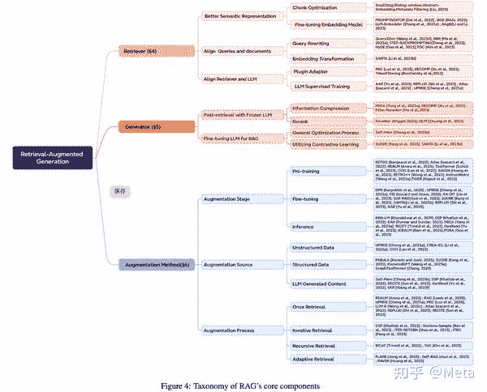

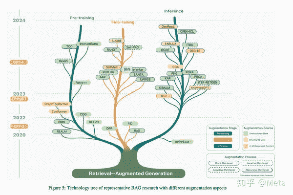

## 在哪些阶段进行增强？

### 预训练阶段

在预训练阶段加强开放领域问答的预训练模型（PTM），研究者们探索了结合检索策略的方法。例如，REALM模型在遮蔽语言模型（MLM）框架中实施了知识嵌入和检索-预测流程。RETRO模型从零开始利用检索增强进行大规模预训练，减少了参数数量并在困惑度上超越了GPT模型。Atlas模型将检索机制融合到T5架构的预训练和微调阶段，而COG模型通过模拟复制现有文本片段，展现了在问答和领域适应方面的出色性能。随着模型参数的增长定律，研究者们正在预训练更大的模型，如RETRO++模型。这些模型在文本生成质量、事实准确性、降低毒性以及下游任务熟练度方面取得了显著进步，特别是在知识密集型任务如开放领域问答中。增强预训练的模型在困惑度、文本生成质量和任务特定性能方面优于标准GPT模型，且使用的参数更少。这种方法还面临一些挑战，如大量预训练数据集和资源的需求以及模型大小增加时更新频率的下降。然而，这种方法提供了模型弹性方面的显著优势，训练完成的增强检索模型可以脱离外部库独立运行，提高了生成速度和运营效率，这使得它成为人工智能和机器学习领域持续研究和创新的热门话题。

### Fine-tuning阶段

RAG和微调是提升大型语言模型（LLMs）性能的重要手段，可以针对具体场景进行优化。微调有助于检索特定风格的文档，改善语义表达，并协调查询和文档之间的差异。此外，微调还可用于调整生成器产出具有特定风格和目标的文本，并可优化检索器与生成器间的协同作用。

微调检索器旨在提升语义表征的质量，通过使用专门的语料库直接微调嵌入模型来完成。此外，微调使检索器的能力与LLMs的偏好更好地协调，并针对特定任务提高适应性，同时增强多任务场景中的通用性。

微调生成器可以产出更加风格化和定制的文本，使模型能够适应不同的输入数据格式，并通过指令性数据集生成特定格式的内容。例如，在自适应或迭代检索场景中，LLMs可以被微调以产生推动下一步操作的内容。

协同微调检索器和生成器可以增强模型的泛化能力并避免过拟合，但这也会增加资源消耗。RA-DIT提出了一个轻量级的双指令调整框架，可有效地为LLMs增加检索能力并避免不必要的信息。

尽管微调存在专门数据集和计算资源的需求局限性，但它允许模型针对特定需求和数据格式进行定制，潜在地减少资源使用量。因此，微调是RAG模型适应特定任务的关键环节，尽管面临挑战，但能够提高模型的多功能性和适应性，是构建高效、有效检索增强系统的重要组成部分。

### 推理阶段

在RAG模型中，推理阶段是整合大型语言模型的关键环节。传统的Naive RAG在这个阶段整合检索内容指导生成过程。为克服其局限性，采用了在推理中引入更丰富上下文信息的高级技术。如DSP框架通过冻结的LMs与检索模型交换自然语言文本，丰富上下文提升生成结果；PKG为LLMs加入知识引导模块，使其检索相关信息而不改变LM参数；CREAICL通过同步检索跨语言知识增强上下文；而RECITE直接从LLMs采样段落生成上下文。

针对需要多步推理的任务，ITRG迭代检索信息以确定正确推理路径，ITERRETGEN采用迭代策略循环合并检索与生成，PGRA提出任务不可知检索器和提示引导重排器的两阶段框架。IRCOT结合RAG和思维链方法，在问答任务中提高GPT-3性能。

这些推理阶段优化提供了轻量且经济的选择，利用预训练模型的能力，无需额外训练。它们的主要优势是在不变更LLM参数的同时提供任务相关的上下文信息。不过，此方法需细致的数据处理优化，并受限于基础模型的固有能力。为有效应对多任务需求，通常与分步推理、迭代检索和自适应检索等程序优化技术结合使用。

## 增强数据源

RAG模型的效果显著受到数据源选择的影响，这些数据源根据不同知识和维度的需求可分为非结构化数据、结构化数据和由大型语言模型生成的内容。技术树展示了利用这些不同类型数据进行增强的代表性RAG研究，其中三种颜色的树叶分别代表不同数据类型的应用。最初，RAG模型的增强主要依赖非结构化数据如文本，随后演变为包括结构化数据如知识图谱进行优化。近期研究动向更倾向于使用LLMs自我生成的内容来进行检索和增强。

### 非结构化数据的增强

RAG模型在处理非结构化文本时，涵盖了从单个词汇到短语乃至文档段落的不同检索单元，以不同的粒度来平衡精确性与检索复杂性。一些研究如FLARE采用主动检索方法，由语言模型触发，以生成低概率词的句子为基础进行文档检索，并结合检索上下文优化生成结果。RETRO则利用块级检索逻辑，通过前一个块的最近邻居来指导下一个块的生成，注意到为保持因果逻辑，生成过程需要确保仅使用前一个块的信息。

### 结构化数据的增强

结构化数据，如知识图谱（KGs），提供高质量的上下文并减少模型产生错误幻象。RET-LLMs 利用过去的对话构建知识图谱记忆以供未来参考。SUGRE 采用图神经网络（GNNs）来编码相关KG子图，通过多模态对比学习确保检索到的事实与生成文本之间的一致性。KnowledGPT 生成知识库（KB）搜索查询，并将知识存储在个性化的基础上，从而增强了RAG模型的知识丰富性和上下文性。

### 在RAG中利用LLMs生成的内容

在RAG模型的发展中，研究人员探索了从LLMs内部知识中获取增强信息的方法，以克服外部辅助信息的局限。通过对问题进行分类和选择性地应用检索增强（SKR），替换传统检索器为LLM生成器以产生更准确上下文（GenRead），以及迭代建立无界记忆池以自我增强生成模型（Selfmem），这些创新做法极大地拓宽了数据源在RAG中的使用，目的是为了提升模型的整体性能和解决任务的有效性。

## 增强过程

在RAG领域的实践中，一个单一的检索步骤后接生成步骤可能导致“中间迷失”现象，即单次检索可能带来与关键信息不符的冗余内容，影响生成质量。对于需要多步推理的复杂问题，这样的单一检索往往信息有限。为此，研究提出了迭代检索、递归检索和自适应检索等方法来优化检索过程，使其能够获取更深入、更相关的信息，特别是在处理复杂或多步查询时。自适应检索则可以根据任务和上下文的特定需求动态调整检索过程，提升了检索的灵活性和有效性。

### 迭代检索

在RAG模型的迭代检索过程中[，为](https://link.zhihu.com/?target=https%3A//docs.llamaindex.ai/en/stable/examples/evaluation/RetryQuery.html%23retry-query-engine)了为LLMs提供更全面的知识库，系统会根据初始查询和已生成的文本多次收集文档。这种方法能够增强答案生成的稳固性，但它可能会因为依赖特定的词汇序列来界定生成文本与检索文档的边界而导致语义不连贯和不相关信息的积累。针对特定数据场景，研究者们采用了递归检索和多跳检索技术，递归检索依赖于结构化索引来层次化处理数据，多跳检索则深入图结构化数据源提取关联信息。此外，ITER-RETGEN等方法将检索和生成融合在一起，通过检索增强的生成和生成增强的检索来处理特定任务，从而在后续的迭代中生成更好的回应。这些创新方法都在努力提升模型的性能和任务的有效性。

llamaindex案例： https:// docs.llamaindex.ai/en/s table/examples/evaluation/RetryQuery.html#retry-query-engine

### 递归检索

递归检索常用于信息检索和NLP中，旨在通过迭代优化搜索查询来加深搜索结果的相关性和深度。这一过程通过反馈循环逐步精确至最关键的信息，从而增强搜索体验。例如，IRCoT利用思维链条来指导检索，ToC创建澄清树来优化查询中的模糊部分。递归检索对于初始用户需求不明确或信息需求专业化、细致的复杂搜索场景特别有效。这种方法的递归本质促使其持续学习和适应用户需求，经常能够显著提升用户对搜索结果的满意度。

### 自适应检索

自适应检索方法例如Flare[和SelfRAG通过允许LLMs主动决定最佳的检索时机和内容来改进RAG框架，增强了检索信](https://link.zhihu.com/?target=https%3A//docs.llamaindex.ai/en/stable/examples/query_engine/flare_query_engine.html)息的效率和相关性。这些方法都是LLMs在操作中主动判断的更广泛趋势的一部分，如AutoGPT、Toolformer和Graph-Toolformer等模型代理所展示的。例如，Graph-Toolformer主动地使用检索器、应用Self-Ask技术以及借助少量提示来启动搜索查询。WebGPT集成了强化学习框架以训练GPT-3模型在文本生成时自主使用搜索引擎。Flare通过监控生成过程中生成术语的概率来自动化检索时机。Self-RAG引入了“反思符号”，允许模型反思其输出，并自主决定何时激活检索，或由预定义阈值触发。Self-RAG通过使用批评分数来更新分数，使模型的行为更加定制化，并优化了检索决策过程。

LLM的优化因其日益增长的重要性而受到关注，提示工程、Fine-Tuning和RAG都有各自的特点，选择使用哪种方法应基于特定场景的需求和每种方法的固有属性。

llamaindex案例： https:// docs.llamaindex.ai/en/s table/examples/query_engine/flare_query_engine.html

## RAG和Fine-Tuning的对比

RAG 类似于给模型一本教科书用于特定信息的检索，非常适合处理具体的查询。而 FT 类似于学生随时间学习并内化知识，更适合重现特定的结构、风格或格式。FT 通过加强模型的基础知识、调整输出和传授复杂指令来提高模型的表现和效率，但在融入新知识或快速迭代新使用场景方面相对较弱。

RAG 和 FT 并不互斥，实际上可以互补，有助于在不同层次上提升模型的能力。在某些案例中，结合使用 RAG 和 FT 可能能够实现最优性能。然而，涉及 RAG 和 FT 的优化过程可能需要经过多次迭代才能取得满意的成效。

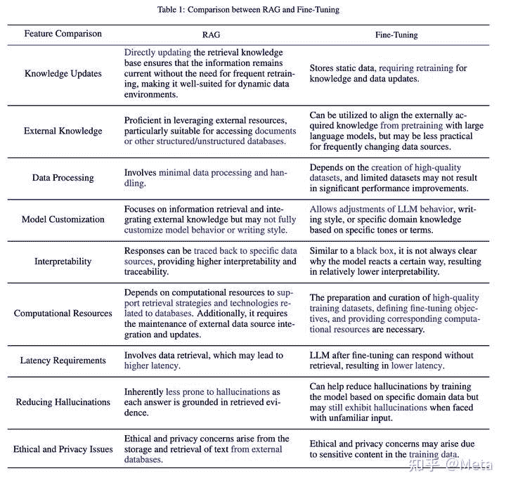

## RAG效果评估

RAG的快速进步和在自然语言处理领域的广泛应用使得RAG模型评估成为大型语言模型社区研究的一个重要领域。评估的核心目的是理解和优化RAG模型在各种应用场景中的性能。

过去，RAG模型的评估通常集中在它们在特定下游任务中的表现，并使用与任务相关的已建立评价指标，比如问答任务的EM和F1分数，事实核查任务的准确性指标。像RALLE这样的工具也是基于这些特定任务的度量标准进行自动评估的。

然而，目前缺少专门评估RAG模型独特特性的研究。接下来的部分将从特定任务的评估方法转向基于RAG独特属性的文献综合。这包括探讨RAG评估的目标、评估模型的不同方面，以及可用于这些评估的基准和工具。目标是提供一个关于RAG模型评估的全面概览，并概述那些专门针对这些高级生成系统独特方面的方法论。

## 评估对象

RAG模型的评估主要围绕两个关键组成部分展开：检索模块和生成模块。这种划分确保了对提供的上下文质量和产生的内容质量的彻底评价。

+   检索质量
评估检索质量对于确定检索组件获取上下文的有效性至关重要。标准的来自搜索引擎、推荐系统和信息检索系统领域的度量标准被用来衡量RAG检索模块的性能。常用的度量指标包括命中率（Hit Rate）、平均倒数排名（MRR）、归一化折扣累积增益（NDCG）等。

+   生成质量
生成质量的评估侧重于生成器从检索上下文中合成连贯且相关答案的能力。这种评估可以根据内容的目标分为两类：未标记内容和标记内容。对于未标记内容，评估范围包括生成答案的忠实度、相关性和无害性。相反，对于标记内容，重点是模型产生的信息的准确性。此外，检索和生成质量评估都可以通过手动或自动评估方法进行。

## Evaluation Aspects

现代RAG模型的评估实践强调三个主要质量得分和四个基本能力，这些综合信息共同构成了对RAG模型两个主要目标——检索和生成的评估。

### Quality Scores

RAG模型的评估实践关注三个主要的质量评分：上下文相关性、答案忠实度和答案相关性。这些评分标准从多个角度评价RAG模型在信息检索和生成过程中的性能：

+   **上下文相关性 **评估检索到的上下文的准确性和具体性，确保它与问题相关，从而减少处理不相关内容的开销。

+   **答案忠实度 **确保生成的答案忠于检索到的上下文，保持与原始信息的一致性，防止产生矛盾。

+   **答案相关性 **确保生成的答案直接关联到提出的问题，有效地解答核心询问。
这些质量评分共同为评估RAG模型在处理和生成信息方面的有效性提供了全面的视角

### 需要的能力

RAG模型的评估覆盖了指示其适应性和效率的四个重要能力：噪声鲁棒性、负面拒绝、信息整合和反事实鲁棒性。这些能力对于评价模型在多样化挑战和复杂情境下的表现至关重要。

+   噪声鲁棒性关注模型处理噪声文档的能力。

+   负面拒绝评估模型在检索文档无法提供必要知识时拒绝回应的能力。

+   信息整合考察模型综合多个文档信息以回答复杂问题的技能。

+   反事实鲁棒性测试模型识别并忽视文档中已知错误的能力。

上下文相关性和噪声鲁棒性是评估检索质量的重要指标，而答案忠实度、答案相关性、负面拒绝、信息整合和反事实鲁棒性则是评估生成质量的关键。这些评估方面的具体度量标准在文献中进行了总结，但目前这些度量还不是成熟或标准化的评估方法。尽管如此，一些研究也已经开发出针对RAG模型特性的定制度量指标。

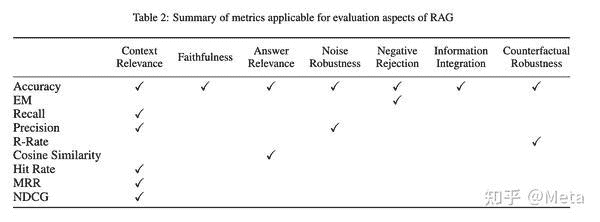

## 评估的Benchmarks和工具

这一部分介绍了RAG模型的评估框架，该框架包含基准测试和自动评估工具。这些工具提供用于衡量RAG模型性能的定量指标，并且帮助更好地理解模型在各个评估方面的能力。知名的基准测试如RGB和RECALL专注于评价RAG模型的关键能力，而最新的自动化工具如RAGAS、ARES和TruLens则利用大型语言模型来评定质量得分。这些工具和基准测试共同形成了一个为RAG模型提供系统评估的坚实框架，相关细节在下表中有所总结。

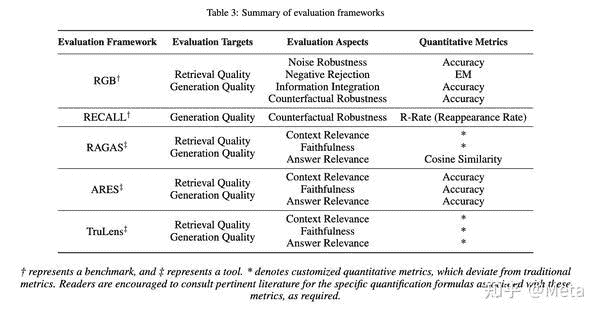

## 展望

## RAG面临的挑战

尽管RAG技术已经取得了重大进展，但仍有若干挑战需要深入研究。其中包括如何处理LLMs的上下文窗口大小限制、提升RAG的鲁棒性、探索结合RAG和微调（RAG+FT）的混合方法、扩展LLMs在RAG框架中的角色、研究规模法则在RAG中的适用性，以及实现生产就绪的RAG。特别地，需要在RAG模型中找到平衡上下文长度的方法，提高对抗性或反事实输入的抵抗力，并确定RAG与微调的最佳整合方式。同时，需要确保RAG在生产环境中的实用性和数据安全，解决检索效率和文档召回率的问题。这些挑战的探索和解决将推动RAG技术向前发展。

### RAG的模态扩展

RAG技术已经发展到不仅限于文本问答，而是包含图像、音频、视频和代码等多种数据模态。这一扩展催生了在各个领域整合RAG概念的创新多模态模型。例如，RA-CM3作为一个多模态模型，能够检索和生成文本与图像；BLIP-2利用图像编码器和LLMs进行视觉语言预训练，实现图像到文本的转换；而"Visualize Before You Write"方法则展示了在开放式文本生成任务中的潜力。音频和视频方面的GSS方法和UEOP实现了数据的音频翻译和自动语音识别，而Vid2Seq通过引入时间标记帮助语言模型预测事件边界和文本描述。在代码领域，RBPS通过检索与开发者目标一致的代码示例擅长处理小规模学习任务，而CoK方法则通过整合知识图谱中的事实来提高问答任务的性能。这些进展表明，RAG技术在多模态数据处理和应用方面具有巨大的潜力和研究价值。

## RAG的生态

### 下游任务和评估

RAG技术在丰富语言模型处理复杂查询和生成详尽回答方面表现出极大潜力，它已经在开放式问题回答和事实验证等多种下游任务中展现了优异的性能。RAG不但提升了回答的精准度和关联性，还增强了回答的多样性和深度。特别在医学、法律和教育等专业领域，RAG可能会减少培训成本，提升与传统微调方法相比的性能。为了最大化RAG在各种任务中的效用，完善其评估框架至关重要，包括开发更加细致的评估指标和工具。同时，增强RAG模型的可解释性是一个关键目标，以便用户能更好理解模型生成回答的逻辑，促进RAG应用的信任度和透明度。

### 技术栈

RAG生态系统的发展显著受到其技术栈进化的影响。随着ChatGPT的兴起，LangChain和LLamaIndex等关键工具因其提供的丰富RAG相关API而快速流行，成为LLMs领域的核心工具。即便新兴技术栈在功能上不如它们，也通过专业化的服务来突显差异化，例如Flowise AI通过低代码途径使用户能够轻松部署AI应用。同样，HayStack、Meltano和Cohere Coral等技术因其独到的贡献而备受瞩目。

传统软件和云服务提供商也在拓展服务以提供RAG为中心的解决方案，如Weaviate的Verba和亚马逊的Kendra。RAG技术的演变呈现出不同的专业化方向，包括定制化、简化和专业化，以更好地适应生产环境。

RAG模型及其技术栈的共同成长表现在技术进步为基础设施设定了新的标准，技术栈的增强又推动了RAG能力的进一步演化。RAG工具包正在成为企业应用的基础技术栈，但一个完全集成的综合平台仍需要进一步创新和发展。

## 实践

## LlamaIndex实践

本文[中](https://link.zhihu.com/?target=https%3A//blog.llamaindex.ai/a-cheat-sheet-and-some-recipes-for-building-advanced-rag-803a9d94c41b)所提到的很多RAG的优化方案，都可以在LlamaIndex中找到对应的实现，LlamaIndex官方也出了一份官方的指南，详细介绍了一些模块的最佳实践经验。更多详情可以参考 A Cheat Sheet and Some Recipes For Building Advanced RAG 。

下图列举了一些RAG技术在llamaindex中对应的代码模块，可以参考llamaindex文档进一步尝试。

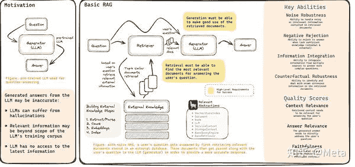

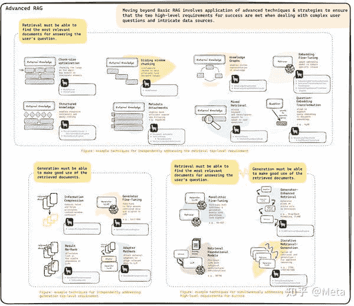

## 业界实践

### 百川智能的RAG方案

百川智能的RAG方案流程包括以下几个关键步骤：

1.  **提升上下文窗口容量 **：百川智能推出了Baichuan2-192K模型，它具有业界领先的192K超长上下文窗口，能一次处理高达35万汉字的文本。

1.  **搜索增强知识库 **：将向量数据库升级为搜索增强知识库，使得大模型在响应用户查询时能够访问到互联网实时信息和企业的完整知识库。

1.  **用户意图理解和搜索查询优化 **：在用户提出的Prompt（查询）基础上，使用自研大模型进行微调，将连续多轮、口语化的用户查询转换为搜索引擎更容易理解的关键词或语义结构。

1.  复杂Prompt拆分与并行检索 ：借鉴Meta的CoVe技术，将复杂的Prompt拆分为多个可以并行检索的查询，使大模型能针对每个查询进行定向知识库搜索。

1.  **进一步理解用户意图 **：使用TSF（Think Step-Further）技术来推断用户输入背后的更深层问题，从而更全面地理解用户意图并引导模型提供更有价值的答案。

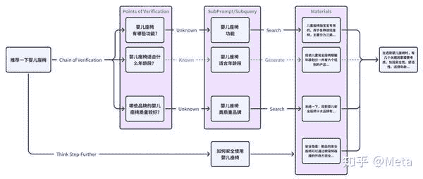

1.  向量检索、稀疏检索、Rerank的结合 ：为了提高知识获取效率和准确性，百川智能结合使用了向量检索与稀疏检索，形成了一种混合检索方式，以提高目标文档的召回率。

1.  **大模型自省技术 **：在通用RAG基础上，百川智能创新性地提出了Self-Critique技术，让大模型能够根据Prompt，对搜索回来的内容进行自省和筛选，以确保提供与用户查询最匹配、最优质的答案。

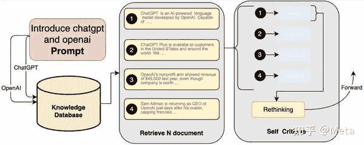

1.  **模型与搜索的深度融合 **：通过这些步骤，百川智能实现了大模型与搜索的紧密结合，为用户提供定制化解决方案，有效降低成本、提升性能，并持续增值企业专有知识库。

百川智能的RAG方案显著地改善了大模型在行业垂直场景中的应用，通过提供一种更低成本、更高效的定制化大模型解决方案，提升了大模型技术的落地潜力，并有望引领大模型产业走向一个全新的阶段。

### OpenAI案例

[https:// blog.langchain.dev/ap](https://link.zhihu.com/?target=https%3A//blog.langchain.dev/applying-openai-rag/)pl ying-openai-rag/

[https://www. youtube.com/w](https://link.zhihu.com/?target=https%3A//www.youtube.com/watch%3Fv%3DahnGLM-RC1Y)atch? v=ahnGLM-RC1Y

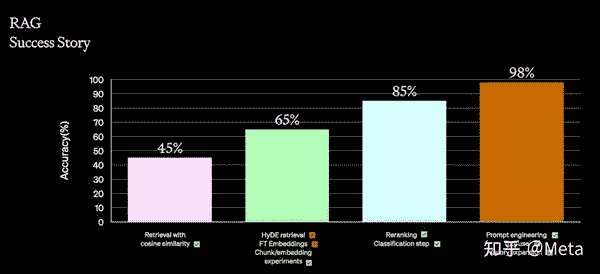

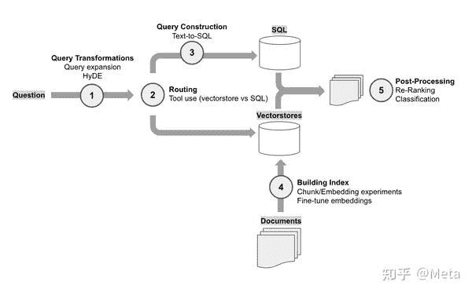

OpenAI展示了一个使用检索增强生成（RAG）技术来优化问题解答系统的案例。起初，系统仅仅通过基于余弦相似度的检索方案达到45%的准确率。为了提高性能，尝试了多种策略，如HyDE检索，它通过生成虚拟答案并用其检索相关段落，以及微调嵌入模型来调整嵌入空间。虽然这些方法提高了准确性，但由于成本和速度的问题，最终并未被采用。通过调整数据分片和嵌入，准确率提升至65%；进一步通过Rerank和分类不同类型的问题，准确率提升至85%。最后，通过prompt工程、引入工具使用和查询扩展等方法，将准确率提高到了98%。在整个过程中，他们并没有进行大模型的微调，并强调了解决问题的关键在于检索系统能够提供正确的上下文信息。

## 总结

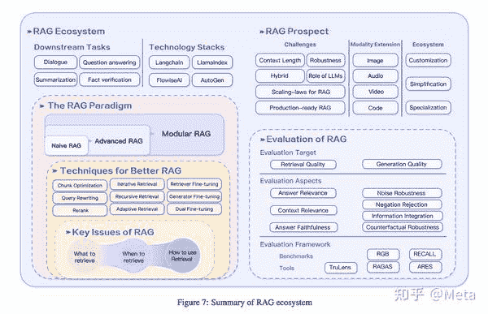

RAG技术通过结合语言模型中的参数化知识和外部知识库中的非参数化数据，显著提升了大型语言模型（LLMs）的能力，特别是在处理复杂查询和生成详细响应方面。RAG技术经历了从初级到高级再到模块化的演进，其中高级RAG通过引入查询重写和块重新排序等复杂架构元素，提升了性能和可解释性。RAG与微调和强化学习等其他AI方法的整合，进一步扩展了其功能。在内容检索方面，采用结构化和非结构化数据源的混合方法正成为趋势。RAG的应用范围正在扩展到多模态数据，如图像、视频和代码，突出了其在AI部署方面的实际意义。

RAG生态系统的增长表现在以RAG为中心的AI应用的增加和支持工具的发展。随着RAG应用领域的扩张，提炼评估方法以跟上其进化变得迫切必要，确保性能评估的准确性和代表性对于充分捕捉RAG在AI研究和开发中的贡献至关重要。

## 参考资料

1.  [Gao](https://link.zhihu.com/?target=https%3A//arxiv.org/abs/2312.10997) Y, Xiong Y, Gao X, et al. Retrieval-augmented generation for large language models: A survey[J]. arXiv preprint arXiv:2312.10997, 2023.

1.  [Advanced RAG Techniques: an ](https://link.zhihu.com/?target=https%3A//pub.towardsai.net/advanced-rag-techniques-an-illustrated-overview-04d193d8fec6)Illustrated Overview

1.  [A](https://link.zhihu.com/?target=https%3A//blog.llamaindex.ai/a-cheat-sheet-and-some-recipes-for-building-advanced-rag-803a9d94c41b) Cheat Sheet and Some Recipes For Building Advanced RAG

1.  [10 Ways to Improve the Performance o](https://link.zhihu.com/?target=https%3A//towardsdatascience.com/10-ways-to-improve-the-performance-of-retrieval-augmented-generation-systems-5fa2cee7cd5c)f Retrieval Augmented Generation Systems

1.  [大模型+搜索构建完整技术栈，百川智](https://link.zhihu.com/?target=https%3A//www.jiqizhixin.com/articles/2023-12-20-10)能用搜索增强给企业定制化下了一剂「猛药」