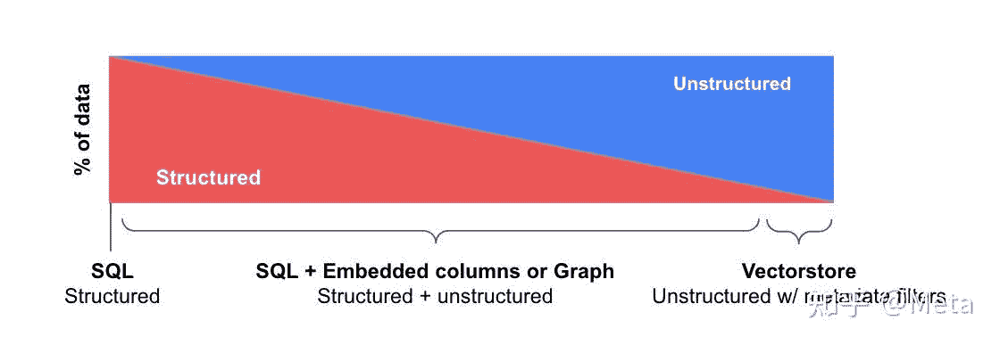
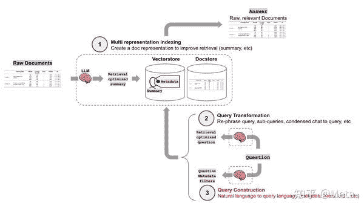
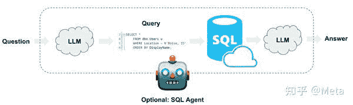
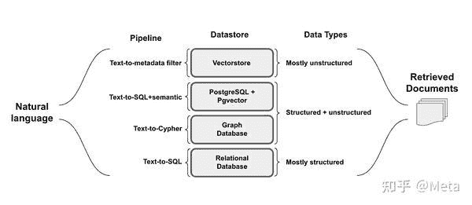

# RAG系统如何高效检索不同类型的数据

> 来源：[https://agijuejin.feishu.cn/docx/YVkvdFdVwou0wTxOhZNcwTcKnLh](https://agijuejin.feishu.cn/docx/YVkvdFdVwou0wTxOhZNcwTcKnLh)

> 作者：Meta

> 原文：[https://zhuanlan.z](https://zhuanlan.zhihu.com/p/678189285)hihu.com/p/678189...

大家都非常希望能用自然语言对各种数据（包括结构化、非结构化和半结构化）进行查询。然而这种新的“语言用户界面”（LUI）在面对不同类型的数据时，会遇到各自特有的挑战和需要特别考虑的因素。

+   结构化数据：主要存储在SQL或Graph数据库中，结构化数据的特点是预定义的模式，以表或关系组织，使其易于进行精确的查询操作。

+   半结构化数据：半结构化数据将结构化元素（例如文档或关系数据库中的表）与非结构化元素（例如关系数据库中的文本或嵌入列）混合在一起。

+   非结构化数据：通常存储在向量数据库中，非结构化数据由没有预定义模型的信息组成，通常伴有支持过滤的结构化metadata。



可以利用LLM，针对不同的数据类型的特点，采用合适的NL-To-X方法，将自然语言转换为每种数据类型的特定查询语法。



## 什么是Query Construction?

在典型的检索增强生成（RAG）系统中，用户query被转换为向量表示，然后将该向量与源文档的向量表示进行比较，从而找到最相似的向量。这对于非结构化数据非常有效，但是对于结构化数据就不一定了。

然而很多数据都有一定的结构。这些数据中的大部分存在于关系型（如SQL）或图形数据库中。即使是非结构化数据，也通常与结构化meta相关联（如作者、类型、发布时间等数据）。

例如，考虑查询 “1980 年有关外星人的电影是什么”这个问题。我们可能希望从语义上查找“外星人”关键词，但我们也希望以精确的方式查找“year == 1980”这个条件。

后续将会重点介绍如何针对不同的数据类型，采用合适的查询方式：

| 查询构造方式 | 数据源 | 参考 |
| --- | --- | --- |
| Text-to-metadata-filter | 向量库 | Docs |
| Text-to-SQL | 关系型数据库 | Docs, blog, blog |
| Text-to-SQL+ Semantic | 支持SQL的PGVecvtor | Cookbook |
| Text-to-Cypher | 图数据库 | Blog, Blog, Docs |

## Text-to-metadata-filter

具备metadata过滤功能的向量库使结构化查询能够过滤嵌入式非结构化文档。self-query-retriever可以使用以下的几个步骤将自然语言查询转换为这些结构化查询：

+   数据源定义：self-query-retriever的核心是相关metadata文件的明确规范（例如，在歌曲检索的背景下，相关的metadata可能是歌手、长度和流派）。

+   用户查询解释：给定一个自然语言问题，self-query-retriever将隔离查询（用于语义检索）和metadata过滤的过滤器。例如，针对以下问题的查询“songs by Taylor Swift or Katy Perry about teenage romance under 3 minutes long in the dance pop genre”会被分解为过滤器和语义查询。

+   逻辑条件提取：过滤器本身是由向量库定义的比较器和运算符（如“eq”表示“等于”，“lt” 表示“小于”条件）构成。

+   生成结构化请求：最后，self-query-retriever将语义搜索词（查询）从逻辑条件（过滤器）中分离出来，简化文档的检索过程。

以下是一个langchain的例子，我们可以定义一个chain来执行上述步骤，它接受用户问题并返回一个封装了必要过滤器的 StructuredQuery 对象

```
# Generate a prompt and parse output
prompt = get_query_constructor_prompt(document_content_description, metadata_field_info)
output_parser = StructuredQueryOutputParser.from_components()
query_constructor = prompt | llm | output_parser

# Invoke the query constructor with a sample query
query_constructor.invoke({
 &quot;query&quot;: &quot;Songs by Taylor Swift or Katy Perry about teenage romance under 3 minutes long in the dance pop genre&quot;
})
```

生成的结构化请求如下：

```
{
 &quot;query&quot;: &quot;teenager love&quot;,
 &quot;filter&quot;: &quot;and(or(eq(\&quot;artist\&quot;, \&quot;Taylor Swift\&quot;), eq(\&quot;artist\&quot;, \&quot;Katy Perry\&quot;)), lt(\&quot;length\&quot;, 180), eq(\&quot;genre\&quot;, \&quot;pop\&quot;))&quot;
}
```

在与向量数据库交互时，这种方法可以显著提高RAG答案的质量，因为直接从用户问题中推断出的逻辑过滤条件可以筛选传递给LLM并进行最终的答案生成。

## **Text-to-SQL**

此外，SQL/关系数据库是大量结构化数据的重要来源。人们已经将大量精力集中在将自然语言转换为SQL请求上，其中存在一些挑战和困难，例如：

+   **幻觉问题 **：LLM 容易对虚构的表或字段产生“幻觉”，从而创建无效的查询。必须要确保LLM在数据库真实字段的基础上进行有效的SQL生成。

+   **用户错误 **：NL2SQL的方法应该对用户拼写错误或用户输入中的其他不规则情况具有鲁棒性，这些错误可能导致无效查询。

以下的一些技巧可以缓解这些问题的发生：

+   数据库描述：为了使SQL查询真实，必须为LLM提供数据库的准确描述。一个常见的NL2SQL-prompt大致如下：为LLM提供每个表的CREATE TABLE描述，其中包括列名、列类型等，然后紧跟几个数据样例。

+   Few-Shot：在Prompt提供几条匹配的“用户问题-SQL”对示例可以提高查询生成准确性。

+   [错误处理：当遇到错误时](https://link.zhihu.com/?target=https%3A//python.langchain.com/docs/use_cases/qa_structured/sql%3Fref%3Dblog.langchain.dev%23case-3-sql-agents)，可以retry几次。我们可以使用 SQL agents 工具来处理错误。

+   查找专有名词中的拼写错误：当查询像名字这样的专有名词时，用户可能会无意中拼写错误。我们可以允许代理在向量库中搜索专有名词，向量库中包含SQL数据库中相关专有名词的正确拼写。



## Text-To-SQL+semantic

混合类型（结构化和非结构化）的数据存储同样越来越常见。混合检索方式的推广需要有向关系数据库添加向量支持的能力。例如，PostgreSQL的开源pgvector扩展将SQL的表达能力与语义搜索提供的对语义的细微理解相结合。相对于Pinecone等向量库，Pgvector具备良好的性能和成本。

Pgvector使得在嵌入向量列上执行相似性搜索（例如，余弦相似度、L2距离、内积）成为可能，使用<->运算符：

```
SELECT * FROM tracks ORDER BY &quot;name_embedding&quot; &lt;-&gt; {sadness_embedding}
```

从上面的查询中，我们可以使用 LIMIT 3 来获取前 3 个最悲伤的曲目（类似于标准 kNN 中的 top_k 值），但也可以进行更复杂的操作：例如选择最悲伤的一个，或者选择90分位数/50分位数的数据。这解锁了两个重要的新功能：

+   我们可以进行在向量库中无法实现的语义搜索。

+   我们可以利用语义运算符的知识来增强text-to-SQL的能力。例如，它能够将文本到语义搜索（例如，查找标题传达特定情感的歌曲）和SQL查询（例如，按流派过滤）相结合。

根据专辑歌曲的例子，通过这种方法，我们可以找到包含最多符合某种情绪的歌曲的专辑（使用语义相似性作为过滤器或对表格数据进行计数），或者从“可爱风”的专辑中找到悲伤的歌曲（在一个查询中组合两个语义搜索条件，这在使用具有metadata过滤的向量数据库是不可能实现的）。

## **Text-to-Cypher**

虽然向量库可以轻松处理非结构化数据，但它无法理解矢量之间的关系；虽然SQL数据库可以建模关系，但模式更改可能会造成破坏性和高成本。而知识图谱可以通过建模数据之间的关系并在不进行重大修改的情况下扩展关系类型来解决这些挑战。它们对于具有多对多关系或难以以表格形式表示的层次结构的数据是更好的选择。

与关系数据库经常使用SQL一样，图数据库经常使用一种名为Cypher的特定查询语言，该语言旨在提供一种匹配模式和关系的可视化方式。它依赖于以下风格的语法：

```
(:Person {name:&quot;Tomaz&quot;})-[:LIVES_IN]-&gt;(:Country {name:&quot;Slovenia&quot;})
```

此模式描述了一个节点，其标签为 Person，名称属性为 Tomaz，与斯洛文尼亚的 Country 节点具有 LIVES_IN 关系。与之前的text-to-SQL等例子一样，text-to-Cypher 可以将自然语言翻译成 Cypher 查询

```
from langchain.chains import GraphCypherQAChain

graph.refresh_schema()

cypher_chain = GraphCypherQAChain.from_llm(
    cypher_llm = ChatOpenAI(temperature=0, model_name=&#x27;gpt-4&#x27;),
    qa_llm = ChatOpenAI(temperature=0), graph=graph, verbose=True,
)
```

不过由于生成有效的 Cypher语法 是一个复杂的任务，建议使用高性能的 LLMs（例如 GPT-4）来生成 Cypher 语句。这样，我们就可以用自然语言对图数据库进行提问。

```
cypher_chain.run(
    &quot;How many open tickets there are?&quot;
)
```

## 总结

无缝检索各种数据源中的结构化和非结构化数据对于释放LLM的潜力至关重要。本文总结了四种流行的“text-to-XXX”的pipeline，并提供了一些实例供大家学习和入门。



## 参考

1.  [Langchain Blog原文见： https:// b](https://link.zhihu.com/?target=https%3A//blog.langchain.dev/query-construction/)log.langchain.dev/quer y-construction/