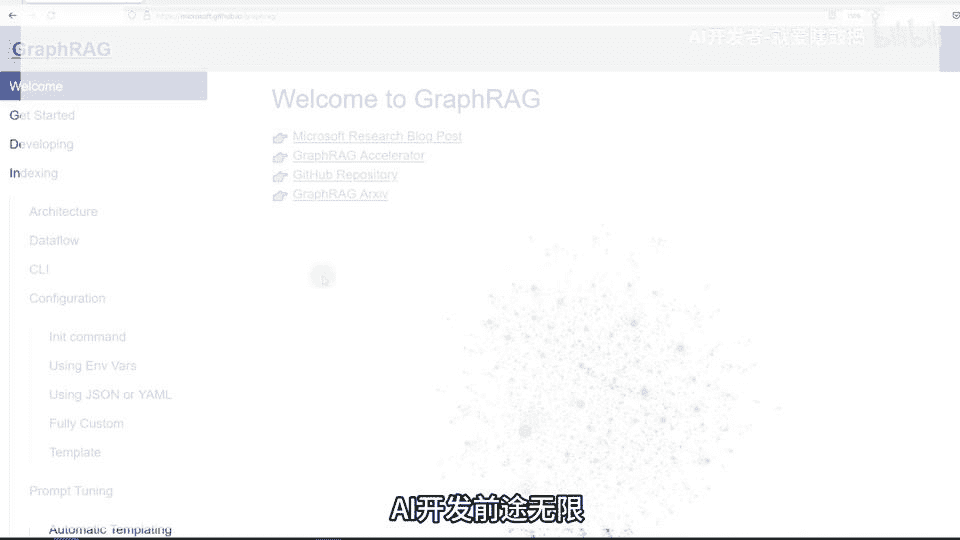

# GraphRAG与普通RAG比较，效果，速度，费用

> 来源：[https://agijuejin.feishu.cn/docx/HRZmdQ04LoIxLdxCJ7lc3Gh1nlg](https://agijuejin.feishu.cn/docx/HRZmdQ04LoIxLdxCJ7lc3Gh1nlg)

# 👀快看👀

> **作者：**[**AI开发者-就爱瞎鼓捣**](https://space.bilibili.com/3546604218878676)

> **原文链接：**GraphRAG与普通RAG比较，效果，速度，费用

---

# ⚡️摘要⚡️

> 主要对 GraphRAG（图模式的可编程知识库增强生成器）与普通 RAG（可编程知识库增强生成器）进行了比较，讨论了它们在效果、速度和费用上的差异。

---

# 🤖分集🤖

### GraphRAG与普通RAG比较，效果，速度，费用

介绍了 GraphRAG 的定义、特点及工作原理，阐述普通 RAG 工作机制及局限性，对比两者在生成内容质量、速度及费用方面的差异，并提供实际应用案例以展示各自优势和适用场景。

[GraphRAG与普通RAG比较，效果，速度，费用.mp4](https://internal-api-drive-stream.feishu.cn/space/api/box/stream/download/all/DIUobgW28ok5PIxnSveccgAZn8b)

---

# ✏️课代表✏️

+   GraphRAG 在处理复杂查询和大规模知识库时，能够提供更加准确和相关的信息。

>

+   与普通 RAG 相比，GraphRAG 在响应速度上具有显著优势，特别是在需要快速检索和处理大量数据时。

>

+   尽管 GraphRAG 可能在初期投资和技术难度上较高，但从长远来看，其在成本效益上可能更具优势。

>

+   GraphRAG 的图模式结构能够更好地理解和处理实体之间的关系，从而提供更高质量的增强生成内容。

>

+   普通 RAG 在某些简单或规模较小的应用场景中可能仍然具有成本效益，但随着数据量的增长，GraphRAG 的优势将更加明显。