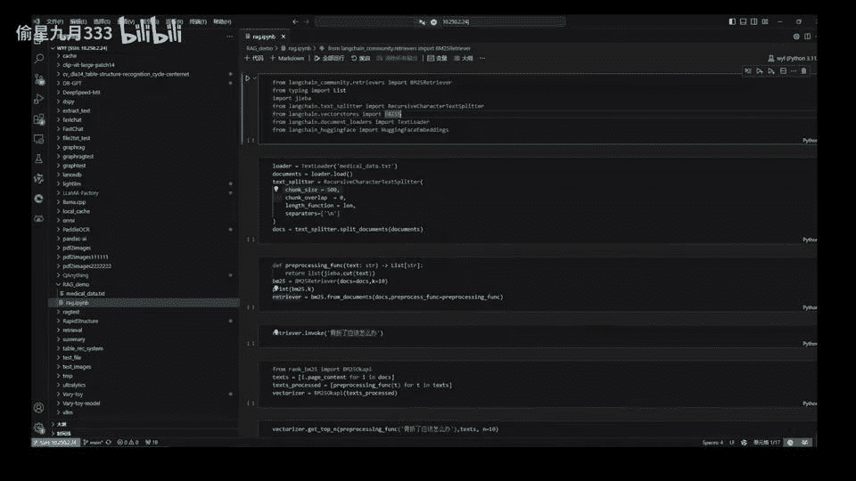

# RAG实战系列（医疗知识问答），从零开始实现多路召回检索，带你了解检索流程和算法原理

> 来源：[https://agijuejin.feishu.cn/docx/CXnxd2ZCkoCTE5x9hqkcHB2unuf](https://agijuejin.feishu.cn/docx/CXnxd2ZCkoCTE5x9hqkcHB2unuf)

# 👀快看👀

> **作者：**[**偷星九月333**](https://space.bilibili.com/349950942)

> **原文链接：**[**RAG实战系列（医疗知识问答），从零开始实现**](https://www.bilibili.com/video/BV1oMYje7EHU/?spm_id_from=333.999.0.0&vd_source=5a54577a6bc7d876f6e5df88640c8e9f)多路召回检索，带你了解检索流程和算法原理

---

# ⚡️摘要⚡️

> 关于 RAG（Retrieval-Augmented Generation）在医疗知识问答领域应用的实战系列教程，旨在从零开始指导如何实现多路召回检索系统，并深入讲解检索流程和算法原理。

---

# 🤖分集🤖

### RAG实战系列（医疗知识问答），从零开始实现多路召回检索，带你了解检索流程和算法原理

RAG 实战系列教程聚焦医疗知识问答领域，介绍 RAG 模型概念与应用价值，详细讲解多路召回检索系统构建步骤，包括检索流程各环节及关键算法原理，助观众掌握高效医疗知识问答系统构建技术与方法。

[RAG实战系列（医疗知识问答），从零开始实现多路召回检索，带你了解检索流程和算法原理.mp4](https://internal-api-drive-stream.feishu.cn/space/api/box/stream/download/all/KQ3Yb6pkUorNNnxUdhacrLZtncf)

---

# ✏️课代表✏️

+   RAG 模型在医疗知识问答领域具有重要的应用潜力，能够帮助用户从大量的医疗数据中快速准确地检索到所需信息。

>

+   多路召回检索是提高检索效率和准确性的关键技术，它通过结合多种检索策略和算法，优化检索结果。

>

+   教程强调从零开始的实战学习方式，通过实际操作和案例分析，让观众更好地理解和掌握 RAG 模型的实现过程。

>

+   检索流程的详细阐述，帮助观众理解如何进行数据预处理、索引构建、检索策略的选择和效果评估。

>

+   算法原理的深入讲解，使观众能够深入理解 RAG 模型背后的技术原理，为进一步的研究和应用打下坚实的基础。