# 小白学RAG：从零开始的RAG最佳实践

> 来源：[https://agijuejin.feishu.cn/docx/A4kAdcaneoNEZDxYHqCcldeinvc](https://agijuejin.feishu.cn/docx/A4kAdcaneoNEZDxYHqCcldeinvc)

> 作者：Coggle数据科学

> 原文：[https://mp.weixin.](https://mp.weixin.qq.com/s/NC8QnK-gZdsPPvMtadBZdQ)qq.com/s/NC8QnK-g...

检索增强生成 （Retrieval Augmented Generation，简称RAG） 已成为一种流行的范式，它使大型语言模型（LLMs）能够访问外部数据，并作为一种机制来减轻幻觉现象。

实现RAG时，可能会面临有效集成检索模型、高效表示学习、数据多样性、计算效率优化、评估和文本生成质量等挑战。鉴于这些挑战，每天都会出现新的技术来改进RAG，使得为特定问题尝试所有组合变得不可行。

**在**这种情况下，本文提出了实现、优化和评估RAG的最佳实践，特别是针对巴西葡萄牙语，重点在于建立一个简单的推理和实验流程。

> https://arxiv.org/pdf/2401.07883

###  **步骤1：数据集准备 **

作者们选择了巴西葡萄牙语版本的《哈利·波特》第一本书作为数据集。选择这本书的原因是它广为人知，并且 Gemini Pro 和 OpenAI 模型都能够回答有关这本书的一般性问题。

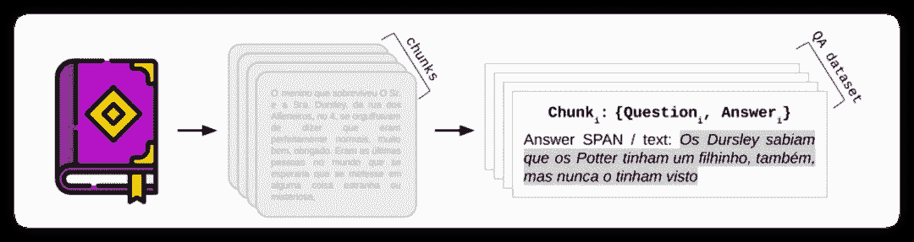

+   数据集大小：使用标准的 ChatGPT 分词器cl100k_base，作者们观察到整本书大约有140,000个token，这使得可以创建包含整本书内容的提示。

+   数据集构建：基于上述数据集，作者们开发了一个包含问题和对应答案的数据集。问题和答案都是由gpt-4模型生成的，并且基于一个参考块（chunk）。

数据准备过程：如图1所示，数据准备过程包括以下步骤：

+   首先，将数据集分割成每个包含1000个token的块，没有重叠，总共得到140个块。

+   然后，使用附录A中描述的提示，为每个块创建了一个问题和答案对，风格类似于SQuAD数据集，这意味着问题的答案存在于参考文本（块）中。

###  **步骤2：定义评价指标 **

传统评估指标如BLEU和ROUGE可能无法准确捕捉句子之间的相似性。例如，尽管两个句子在翻译成英文后表达相同的意思，但它们的BLEU和ROUGE得分可能很低。

为了解决这个问题，作者们采用了一种在文献中广泛使用的方法，即利用gpt-4根据给定的提示为文本提供评分。作者们设计了一个分为5个类别的评分系统，用于比较两段文本，每个类别都有相应的分数定义。

**评分类别 **：

+   分数1：答案与参考无关。

+   分数3：答案有很少的相关性，但与参考不一致。

+   分数5：答案有中等相关性，但包含不准确之处。

+   分数7：答案与参考一致，但有小遗漏。

+   分数10：答案完全准确，与参考完全一致。

###  步骤3：初步实验（无背景信息）

作者们首先定义了一个基线，即在没有任何上下文的情况下，使用大型语言模型（LLMs）回答关于《哈利·波特》的问题。由于LLMs训练于包含几乎整个网络内容的大型数据集上，加之《哈利·波特》宇宙的普及，这为在OpenAI模型上测试独立问题提供了一个强有力的假设。

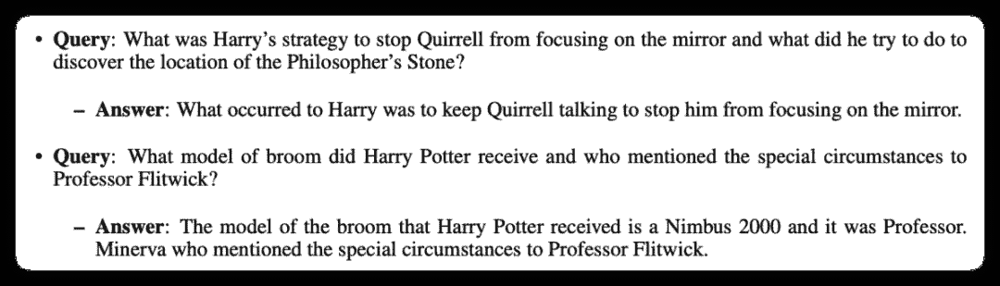

作者们观察到，对于基本问题，如“哈利·波特是谁？”、“谁杀了邓布利多？”以及“哈利·波特的主要朋友是谁？”，ChatGPT能够准确回答。然而，对于更详细的问题，性能仅是合理的。文中提供了两个详细问题的例子及其答案。

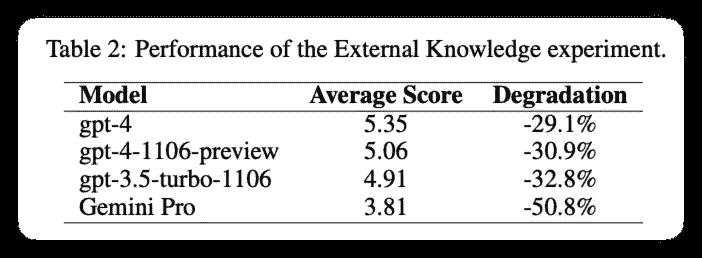

表2显示了不同模型的平均得分和与相对最大得分相比的退化百分比。所有模型的得分都低于相对最大得分，表明在没有检索到的上下文的情况下，模型的性能有所下降。

###  **步骤4：长文本问答实验 **

与GPT 1和2模型相比，gpt-4-1106-preview模型能够处理高达128k的输入token，这在模型发展的四年内代表了大约128倍的输入容量增加。

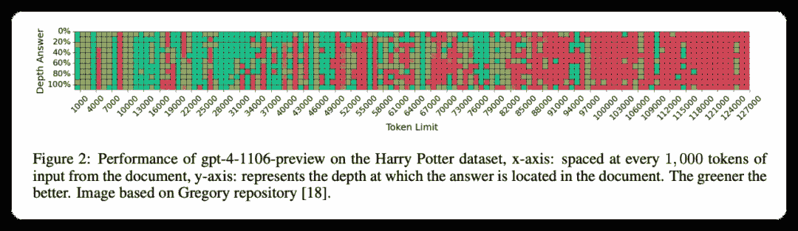

作者们进行了类似于"Lost in The Middle"的分析，探索了在提示中改变答案位置时模型的输出。实验通过改变包含问题答案的块的深度（以上下文提示中token总数的百分比增量）来进行。

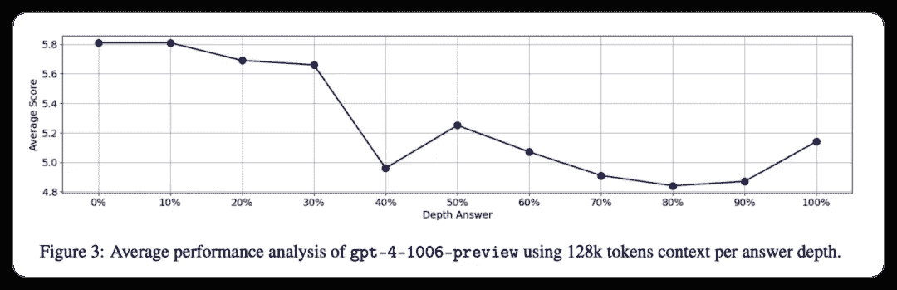

###  **步骤5：朴素RAG **

朴素的RAG方法使用llama-index，采用所有默认的超参数，并使用ADA-002嵌入通过余弦相似度进行块检索。图4展示了问题处理的基本流程：

+   步骤1：将查询传递给嵌入模型，将其语义表示为嵌入查询向量。

+   步骤2：将嵌入的查询向量传输到向量数据库或稀疏索引（BM25）。

+   步骤3：根据检索器算法获取前k个相关块。

+   步骤4：将查询文本和检索到的块转发到大型语言模型（LLM）。

+   步骤5：使用LLM根据检索内容填充的提示生成响应。

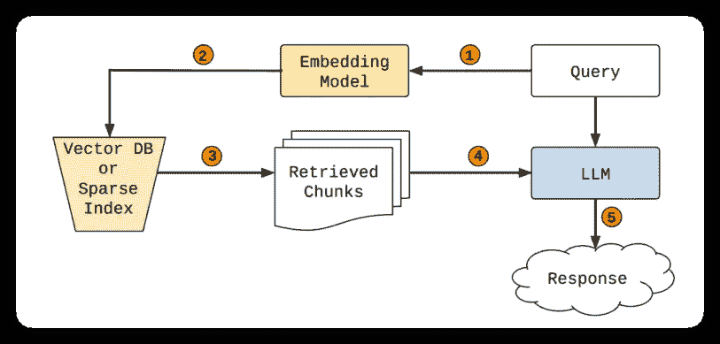

**性能比较 **：

+   gpt-4模型的平均得分为6.04，与相对最大得分相比退化了20%。

+   gpt-4-1106-preview模型的平均得分为5.74，退化了21.6%。

+   gpt-3.5-turbo-1106模型的平均得分为5.80，退化了21.0%。

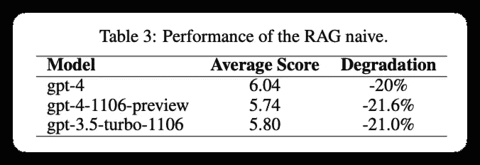

从表3可以看出，尽管朴素的RAG方法在没有检索上下文的情况下相比基线有所提高，但与相对最大得分相比仍有性能退化。这表明还有改进空间，尤其是在检索策略和模型集成方面。

实验中，答案深度的变化以10%的增量表示，从0%到100%，共11个变化。输入上下文的token数量在x轴上以每1,000个token为间隔变化，如图2所示。

从图2可以看出，随着输入长度的增加，得分显著下降。此外，图3显示，位于(40%, 80%)区间内的答案表现最差，这与"Lost In The Middle"文章中的记录一致。

###  **步骤6：对比检索器 **

本节探索了RAG的多种检索方法，认识到检索器的质量是提高这类问题性能的关键因素。

**在部署检索系统时，需要在“有效性”（返回的结果有多好？）和“效率”（返**回结果需要多长时间？或在磁盘/RAM/GPU方面使用了多少资源？）之间取得平衡。

**评估指标 **：召回率和倒数排名在特定截止点进行评估，表示为R@k和MRR@k。

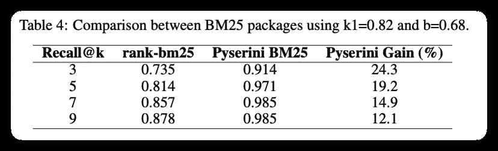

**检索器类别 **：

+   **稀疏检索器 **：强调BM25，这是一种基于统计权重评估搜索词和文档之间相关性的技术。

+   **密集检索器 **：通常基于双编码器（bi-encoder）设计，独立编码查询和文档，然后计算相似度。

+   **混合搜索技术 **：利用稀疏和密集搜索方法的优势，生成两个候选文档列表，然后以最佳方式组合这两个结果。

+   **多阶段搜索架构 **：基于检索和重排管道，第一阶段使用具有良好召回率的检索器进行初步筛选，然后在第二阶段使用更高计算复杂度的方法重新排序这些候选文档。

+   稀疏检索方法

表4展示了使用不同BM25包的比较，包括使用Pyserini和rank-bm25的结果，以及使用这些实现的增益百分比。这表明Pyserini的实现在召回率方面优于rank-bm25，尤其是在较低的召回率k值下。

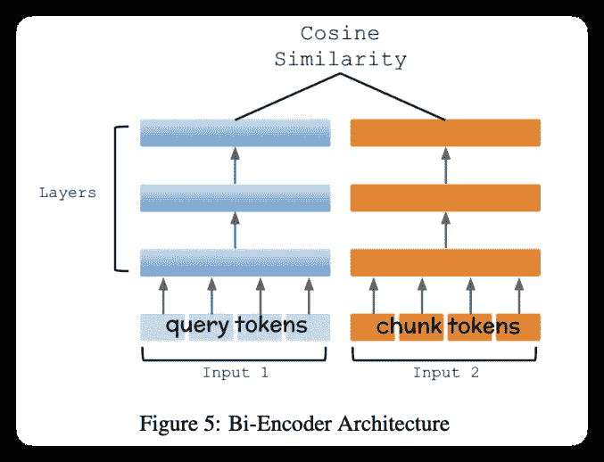

+   定义化嵌入模型

嵌入定制对于提高表示的整体性能至关重要，且不仅适用于OpenAI的嵌入，也适用于其他同类嵌入。通过自定义ADA-002方法，作者们展示了如何通过微调过程来改善检索器的性能，特别是在准确性和表示质量方面。

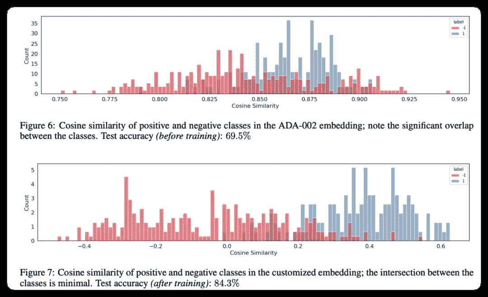

+   多路召回

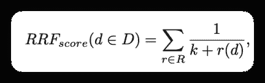

RRF是一个广泛使用的算法，用于解决结合不同方法搜索结果的问题。对于文档集D和来自不同方法r的搜索结果R，对于D中的每个文档d，可以按照公式(2)计算RRF得分。从表5可以看出，混合使用BM25和自定义ADA-002的组合在所有召回率指标上都优于单独使用BM25或ADA-002的组合。

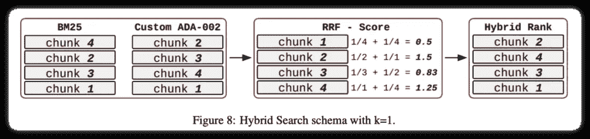

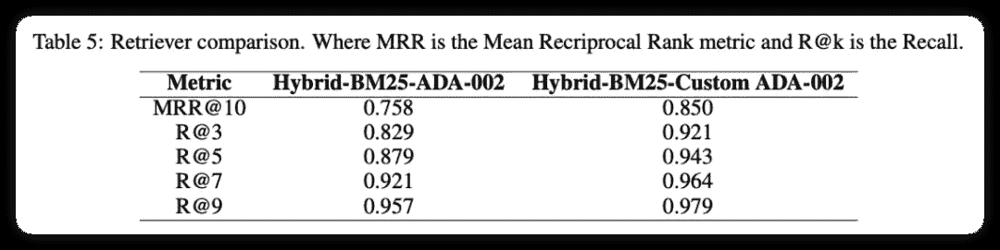

+   重排序

多阶段排名将文档排名分为多个阶段。初始检索通常涉及稀疏检索器或密集检索器，每个后续阶段重新评估并重新排列从前一阶段转发的候选集。

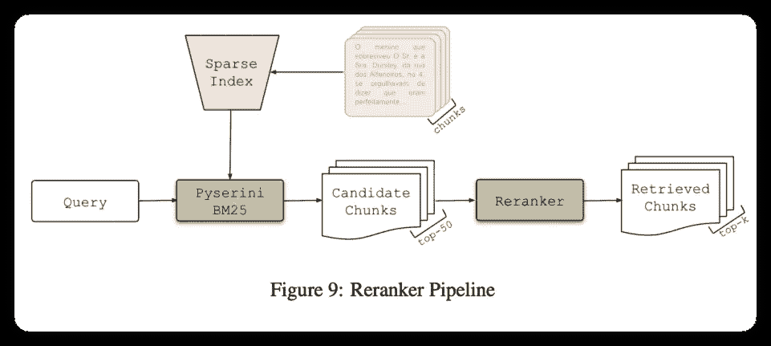

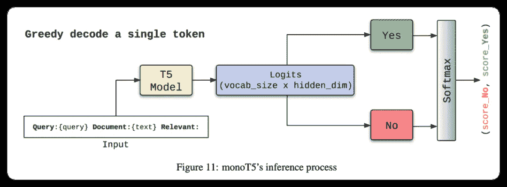

+   检索结果

表6展示了不同检索器的性能比较，包括ADA-002、自定义ADA-002、混合BM25-ADA-002、混合BM25-自定义ADA-002、BM25以及BM25加重排器。

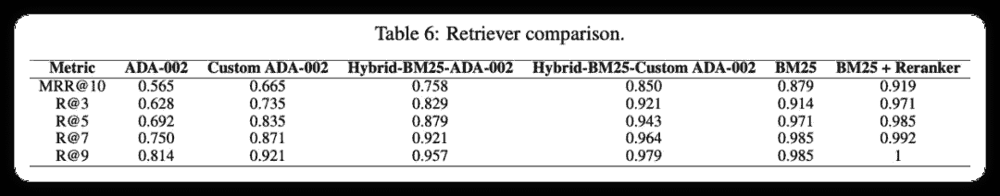

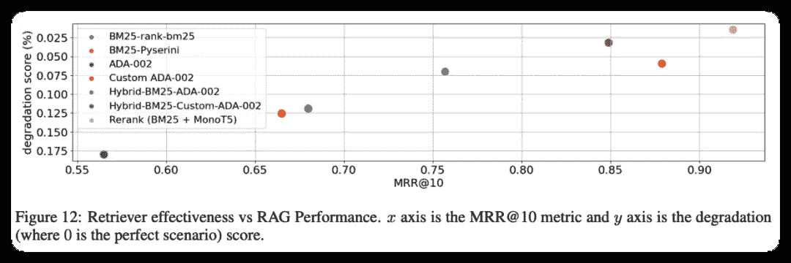

###  **步骤7：输入大小与性能 **

尽管在表6中对9个块实现了完美的召回率，并且使用了9000个token的输入，比最佳情况（3个块）多6000个token，但并未达到最佳性能。这与第4.2节中讨论的RAG质量直接与输入大小和答案所在位置有关的观点一致。

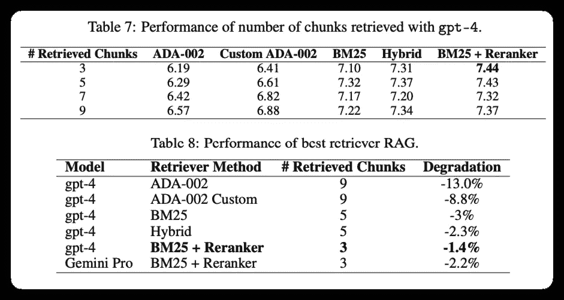