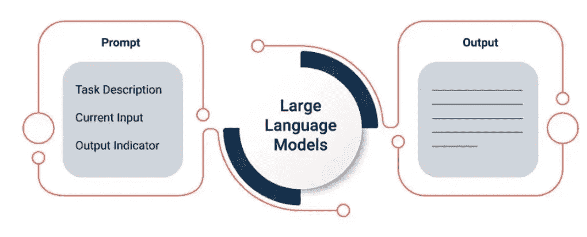
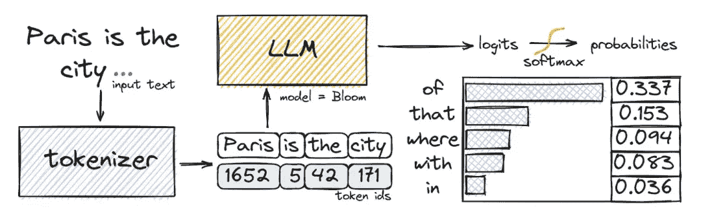

# 小白学大模型：提示词优化指南

> 来源：[https://agijuejin.feishu.cn/docx/PwbCdKsuYoijFwxw3wIcQu0Bnlg](https://agijuejin.feishu.cn/docx/PwbCdKsuYoijFwxw3wIcQu0Bnlg)

> 作者：Coggle数据科学

> 原文：[https://mp.weixin.](https://mp.weixin.qq.com/s/GzbKaKQspYjDSVWoYQaD9g)qq.com/s/GzbKaKQs...

大型语言模型（LLMs）在各个行业中解锁了变革性的能力，使用户能够利用尖端的自然语言处理技术进行多样化的应用。然而，这些强大的AI系统的便利性是有代价的——字面意义上的。随着LLMs变得更加普及，它们的计算成本和延迟可能会迅速上升，给预算带来压力并影响性能。

**但是**，如果你能在不牺牲结果的情况下减少LLM的支出和延迟呢？解决方案在于简化你的提示，这些文本输入用于指导语言模型。通过优化提示词的使用并制作简洁而有效的提示，我们可以在不牺牲准确性的情况下最大化效率。

## **unset ** u**nset **大模型基础：令牌（tokens） unset  unset

令牌是语言模型的输入和输出的基本单位。它们代表单个单词、标点符号，甚至是模型识别和处理的子词单元（如前缀或后缀）。当你向LLM提供输入提示时，它会被分词化——分解成单独的令牌——然后由模型处理。

你的提示中的令牌数量直接影响LLM所需的计算资源，进而影响成本和延迟。更多的令牌意味着更高的处理需求，导致费用增加和响应时间延长。

此外，许多LLM提供商采用基于令牌的定价模型，根据处理的令牌数量收费。因此，优化令牌使用可以带来显著的成本节省，特别是对于具有高容量或实时需求的应用。

## **unset ** u**nset **提示词工程 unset  unset

提示工程是简化LLM提示的核心艺术。通过仔细设计你的提示，你可以在最小化令牌使用的同时有效地传达你的意图。以下是一些值得考虑的策略：

1.  追求简洁：在提示中力求清晰和简洁。避免不必要的冗长或重复信息，这些信息增加了令牌的开销，而没有对核心意图做出贡献。将复杂任务分解成多个专注的提示，而不是将所有内容塞进一个单一的、复杂的输入中。

1.  利用上下文和示例：提供相关的上下文和说明性示例，引导LLM达到你期望的输出。精心挑选的示例可以比冗长的解释更有效地传达复杂的要求，减少令牌数量，同时保持准确性。

1.  使用提示模板：为常见任务或领域开发可重用的提示模板。这些模板可以封装最佳实践，减少每次从头开始制作提示的需要，并确保一致的令牌优化。

1.  尝试不同的提示格式：探索不同的提示格式，如少量学习（提供几个示例）、基于前缀的提示（提供特定任务的前缀）或思维链提示（引导模型的推理过程）。不同的格式可能对特定用例具有更好的令牌效率。

1.  迭代和完善：根据经验结果和性能指标不断迭代和完善你的提示。分析令牌使用、成本和延迟，并进行数据驱动的调整以进一步优化。

## **unset ** u**nset **上下文优化 unset  unset

上下文优化是确保LLMs能够提供准确和相关输出的关键，同时不牺牲简洁的提示。幸运的是，LLMs提供了强大的技术来在不增加令牌数量的情况下整合相关上下文。

1.  少量学习（Few-Shot Learning）：与其提供冗长的解释，少量学习涉及向LLM展示少量经过精心策划的示例。这些示例作为演示，使模型能够更有效地推断所需的任务和输出格式。

1.  上下文检索（Contextual Retrieval）：利用外部知识源或数据库动态检索相关上下文。通过选择性地将专注的上下文片段整合到你的提示中，你可以在确保LLM能够访问必要的背景信息的同时减少令牌开销。

1.  微调和个性化嵌入（Fine-Tuning and Persona Embeddings）：在特定领域的数据上对LLM进行微调，或将个性化的提示或角色嵌入到模型的权重中。这种方法允许你在推理过程中“内置”上下文和偏好，减少了对冗长提示的需求。

1.  提示链（Prompt Chaining）：将复杂任务分解为一系列较小的提示，每个提示都建立在前一个输出的基础上。这种技术允许你在保持上下文的同时，最小化单个提示的令牌使用。

## **unset ** u**nset **令牌管理 unset  unset

在LLM的输入和输出生命周期中，有效管理令牌使用同样重要。以下是一些高级技术，你可以考虑：

1.  截断和窗口化（Truncation and Windowing）：如果你的输入或输出超出了令牌限制，有策略地截断或窗口化数据，以专注于最相关的部分。实施滑动窗口、摘要或智能截断等技术，在令牌限制内最大化信息密度。

1.  批处理和分块（Batching and Chunking）：对于高容量或实时应用，批量或分块输入以在多个请求中分摊令牌开销。仔细平衡批量大小，以优化吞吐量和延迟的权衡。

1.  令牌化策略（Tokenization Strategies）：探索高级令牌化策略，如字节级字节对编码（BPE）或句子片段令牌化，这些策略可以为特定领域或语言提供更有效的令牌表示。

1.  令牌回收（Token Recycling）：实施令牌回收机制，在多个请求中重用令牌，减少对冗余输入段的重复标记和处理需求。

1.  缓存和记忆化（Caching and Memoization）：缓存和记忆化提示、响应和中间结果，以避免对重复输入或子任务进行冗余计算和令牌处理。

1.  压缩和量化（Compression and Quantization）：探索压缩和量化技术，以减少LLM权重和激活的内存占用和计算开销，间接优化令牌处理效率。