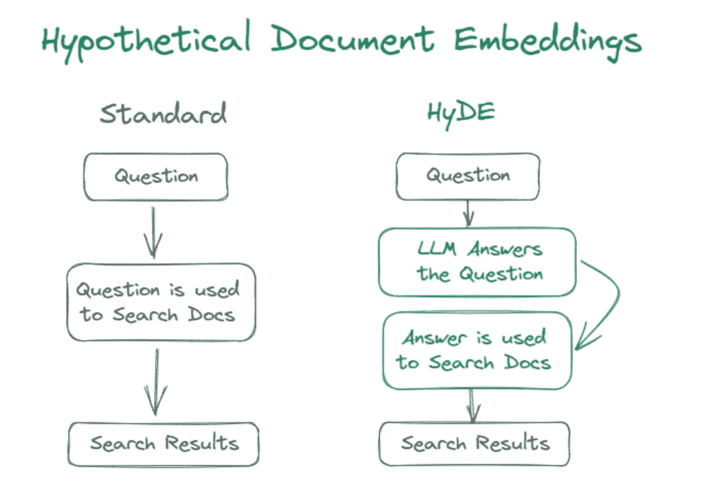
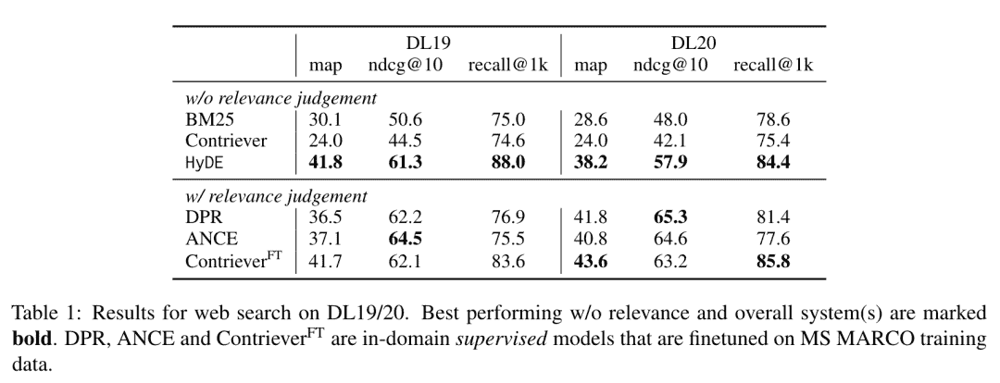
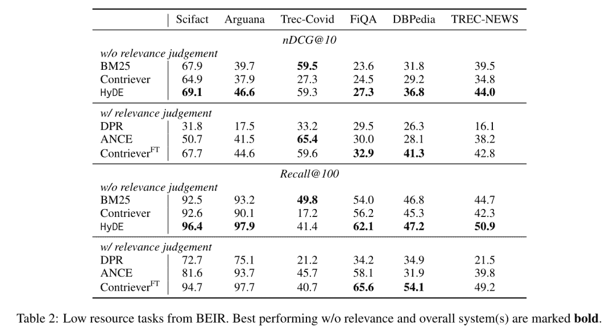

# 小白学RAG：假设文档嵌入 HyDE

> 来源：[https://agijuejin.feishu.cn/docx/UamZdrxh8oTK5ex3jwscw9vQnBe](https://agijuejin.feishu.cn/docx/UamZdrxh8oTK5ex3jwscw9vQnBe)

> 作者：Coggle数据科学

> 原文：[https://mp.weixin.](https://mp.weixin.qq.com/s/8mRmupQ78co3Y_Wpvyb0ug)qq.com/s/8mRmupQ7...

在没有相关性标签的情况下，创建有效的完全零样本稠密检索系统仍然是一个难题。通过假设文档嵌入（Hypothetical Document Embeddings, HyDE）可以缓解上述问题。

> https://arxiv.org/pdf/2212.10496

## **unset ** u**nset **HyDE 实现步骤 unset  unset



+   步骤1：用户输入提问；

+   步骤2：大模型生成提问的回答。这个回答并不是真实的，可能包含错误的细节。

+   步骤3：通过编码器将生成的文档检索出相似的真实文档。

## **unset ** u**nset **HyDE 优点 unset  unset

+   零样本检索：HyDE 可以“开箱即用”，无需依赖大量标注示例的数据集。

+   跨语言：它在各种语言中表现良好，适用于多语言搜索应用。

+   灵活性：HyDE 的方法使其能够适应不同的任务，而无需进行大量的微调。

## **unset ** u**nset **HyDE 实验 unset  unset

HyDE在各个方面都对Contriever带来了显著提升，无论是精度还是召回率指标。虽然无监督的Contriever在性能上可能不及经典的BM25方法，但HyDE大幅超越了BM25。





## **unset ** u**nset **HyDE LangChain实现 unset  unset

```
from langchain_core.output_parsers.openai_tools import PydanticToolsParser
from langchain_core.pydantic_v1 import BaseModel, Field


class Query(BaseModel):
    answer: str = Field(
        ...,
        description=&quot;Answer the user question as best you can. Answer as though you were writing a tutorial that addressed the user question.&quot;,
    )


system = &quot;&quot;&quot;You are an expert about a set of software for building LLM-powered applications called LangChain, LangGraph, LangServe, and LangSmith.

LangChain is a Python framework that provides a large set of integrations that can easily be composed to build LLM applications.
LangGraph is a Python package built on top of LangChain that makes it easy to build stateful, multi-actor LLM applications.
LangServe is a Python package built on top of LangChain that makes it easy to deploy a LangChain application as a REST API.
LangSmith is a platform that makes it easy to trace and test LLM applications.&quot;&quot;&quot;

prompt = ChatPromptTemplate.from_messages(
    [
        (&quot;system&quot;, system),
        (&quot;human&quot;, &quot;{question}&quot;),
    ]
)
llm_with_tools = llm.bind_tools([Query])
hyde_chain = prompt | llm_with_tools | PydanticToolsParser(tools=[Query])
hyde_chain.invoke(
    {
        &quot;question&quot;: &quot;how to use multi-modal models in a chain and turn chain into a rest api&quot;
    }
)
```