# 小白学RAG：智谱RAG技术实践总结

> 来源：[https://agijuejin.feishu.cn/docx/AQ2MdsOefocK0dxOzhQc7iZpnfe](https://agijuejin.feishu.cn/docx/AQ2MdsOefocK0dxOzhQc7iZpnfe)

> 编辑：Coggle数据科学

> 原文：[https://mp.weixin.](https://mp.weixin.qq.com/s/sg9i63lYZgDQ3S9VJ0TZxg)qq.com/s/sg9i63lY...

### **智谱RAG技术的探索与实践**

作者：柴思远

大模型商业技术中心 / 高级技术总监

RAG (Retrieval-Augmented Generation) 是一种结合信息检索与生成模型的技术。其主要目标是通过检索大量信息并使用生成模型进行处理，从而提供更加准确和丰富的回答。RAG技术在处理大规模文本数据时表现尤为出色，能够从海量信息中迅速找到相关内容并生成合适的响应。

智谱RAG方案具体设计了如何将RAG技术应用到智能客服领域。方案包括以下几个关键环节：

+   信息检索模块：从预先构建的知识库中快速找到与用户问题相关的内容。

+   生成模块：利用先进的生成模型对检索到的信息进行加工和处理，生成符合上下文的答案。

+   集成与优化：将检索和生成模块无缝集成，并通过持续的训练和优化提高系统的准确性和效率。

## unset unset RAG 综述 unset unset

RAG技术在大模型（LLM, Large Language Models）中的应用非常广泛，是大模型落地最多的场景之一。通过RAG，客户可以咨询车辆功能、维护、最新技术或政策法规相关信息，从而提升客户服务与支持的效率。具体应用场景包括外部客服，结合RAG的LLM提供24/7客户服务，快速检索产品信息；文档撰写，通过RAG检索相关资料，生成高质量文档；图像生成与数据处理和分析，以及内部知识库的建立和维护。

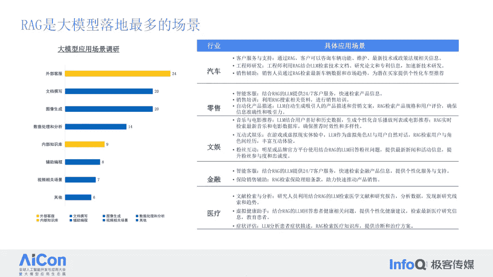

RAG是一种将信息检索（Retrieval）与生成模型（Generation）结合的技术，通过先检索相关信息，再生成准确和上下文相关的回答或内容，来增强语言模型的性能。RAG技术通常包含以下三个关键步骤：

#### 1. 索引 (Indexing)

在索引阶段，系统会对大量的文档、数据或知识库进行预处理和索引，以便于快速检索。索引的过程包括将文本数据转换为易于搜索的格式，并构建高效的数据结构，使得在需要时可以快速找到相关信息。

#### 2. 检索 (Retrieval)

检索阶段是RAG技术的核心之一。当用户提出问题或请求时，系统会从预先索引的文档或知识库中快速检索出最相关的信息。检索模块通常使用高级搜索算法和相似度计算来找到与用户输入最匹配的内容。

#### 3. 生成 (Generation)

在生成阶段，系统会使用先进的生成模型（如GPT等）对检索到的信息进行处理和整合，生成连贯且上下文相关的回答或内容。生成模型利用检索到的信息作为背景知识，确保生成的结果更加准确和有针对性。

### **RAG的优势**

RAG（Retrieval-Augmented Generation）技术结合了信息检索和生成模型的优势，解决了许多传统语言模型的局限性，具体优势如下：

#### **1. 减少模型的生成幻觉**

生成幻觉（Hallucination）是指语言模型在生成内容时，有时会产生不准确或虚假的信息。RAG通过首先检索相关的真实信息，然后生成基于这些信息的回答，从而显著减少生成幻觉的发生，提高回答的准确性和可信度。

#### **2. 知识及时更新**

由于RAG依赖于外部知识库或文档的检索，系统可以更容易地通过更新这些外部资源来保持最新的知识。这意味着即使模型本身没有重新训练，也能通过更新检索数据库来反映最新的信息和变化。

#### **3. 避免人工整理FAQ**

传统的FAQ系统需要人工整理和维护，而RAG技术能够自动从大量的文档和知识库中检索和生成答案，减少了人工整理和更新FAQ的负担，提高了效率。

#### **4. 增加了答案推理**

RAG技术不仅能够检索相关信息，还可以利用生成模型进行复杂的答案推理。这使得系统不仅能够提供直接的事实性回答，还能对复杂问题进行更深层次的分析和解答。

#### **5. 增加内容生成的可追溯性**

由于RAG在生成答案时依赖于检索到的真实文档和数据，生成的内容具有可追溯性。用户可以追溯到答案来源，验证信息的准确性和可靠性，增强了系统的透明度和用户信任。

#### 6. 增加问答知识范围的管理权限

通过使用RAG技术，系统管理员可以更好地管理和控制问答知识的范围。管理员可以通过更新和管理检索数据库，确保系统回答的内容在预期的知识范围内，避免提供不相关或不准确的信息。

### RAG vs Long Context

RAG和长文本（Long Context）技术在处理大量文本时，针对成本因素有着不同的优势。

以GPT-4为例，对于一篇20万字的小说提问：

+   长文本（Long Context）：如果将整个20万字的文本输入给模型，大约需要9元。

+   RAG：而对于RAG，只需召回约6*600个字（即3,600字），然后再输入给模型，这大约只需要0.25元。

这里的关键点在于RAG技术的使用，它不需要将所有20万字的文本都输入给模型，而是根据需要从文本中召回并选择性地输入给模型，从而大大降低了成本。相比之下，长文本的处理需要更高的成本，因为它要求模型处理更大量的文本。

## unset unset 智谱RAG方案 unset unset

智谱RAG方案是一套完整的技术解决方案，旨在实现基于RAG（Retrieval-Augmented Generation）技术的智能问答系统。以下是该方案的技术方案全景：

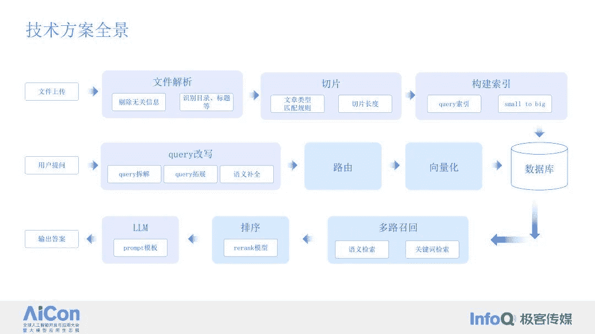

#### **文件上传与解析**

+   文件上传：用户上传需要检索的文档或知识库。

+   文件解析：对上传的文件进行解析，提取其中的文本内容。

#### **切片与索引**

+   切片：将文档内容按照设定的切片长度进行分割。

+   路由：根据切片内容构建索引，以便快速检索。

#### **数据库构建与优化**

+   Small to Big：从小规模数据构建起，逐步扩展至大规模数据库。

+   剔除无关信息：在构建数据库时，剔除无关信息，提高检索效率。

+   识别目录、标题等：识别文档中的目录结构、标题等元信息，方便用户检索。

#### **查询处理与优化**

+   Query改写：对用户提出的查询进行改写，以提高召回率和准确性。

+   Query拓展：对查询进行语义补全，以丰富搜索结果。

+   排序：使用rerank模型对搜索结果进行排序，提高结果的相关性。

#### **文章类型匹配与索引**

+   文章类型匹配规则：根据文章类型制定不同的匹配规则，以确保搜索结果的准确性。

+   Query索引：将用户提问进行向量化，并建立查询索引，加速检索过程。

#### **多路召回与语义检索**

+   多路召回：使用多种召回方法，如关键词检索等，以增加召回率。

+   语义检索：利用语义相似度算法，提高检索结果的相关性。

#### **用户提问与答案输出**

+   用户提问：用户通过系统提出问题。

+   输出答案：根据用户提问，系统从数据库中检索相关内容，并生成准确的回答。

#### Query拆解与LLM prompt模板

+   Query拆解：将用户提问进行拆解，以识别关键信息。

+   LLM prompt模板：根据拆解的信息，构建LLM（Large Language Models）的输入模板，以便于生成回答。

在文档解析与切片过程中，首先对文章内容进行解析，将图片转换成特定标识符以便后续处理，将表格改写成模型易于理解的HTML格式，并过滤掉页眉页脚等无关信息，以确保保留主要内容。

同时，还需要提取文档的结构信息，包括目录和标题，以便于后续检索和理解文档的结构，并确保知识的连续和完整性。在原始文档切片的基础上，扩展更多粒度更小的文档切片，当检索到粒度细致的切片时，会递归检索到其原始大切片，然后将原始节点作为检索结果提交给LLM（Large Language Models）进行处理。

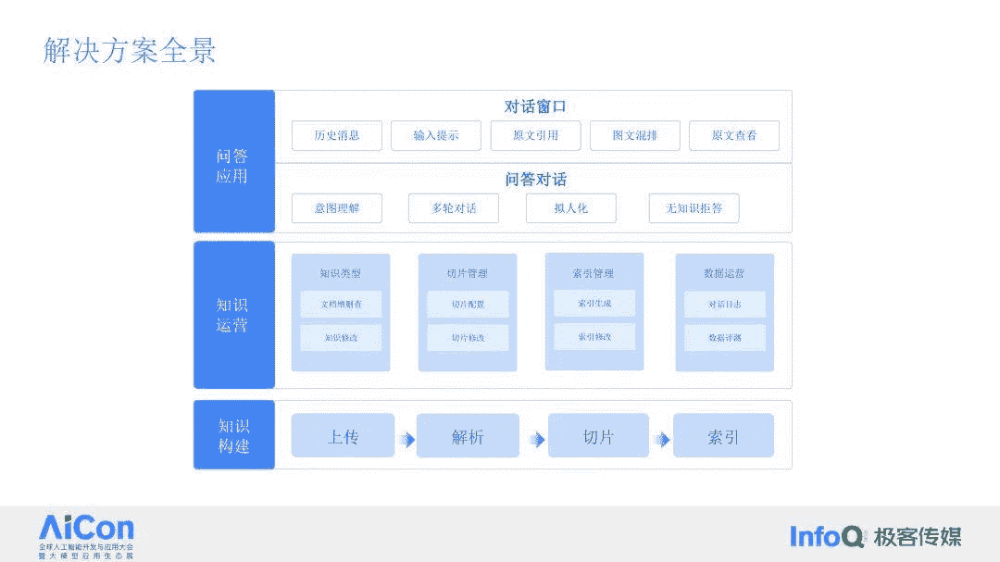

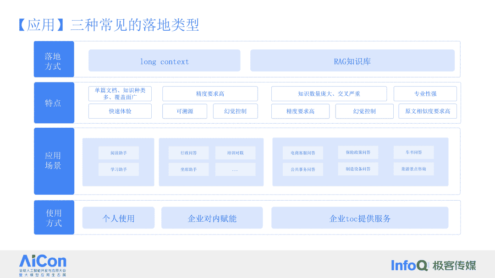

## unset unset RAG实践 unset unset

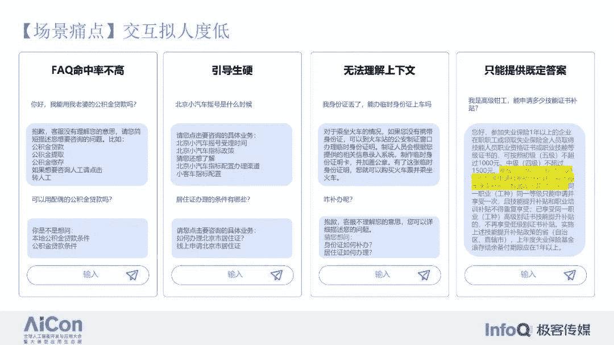

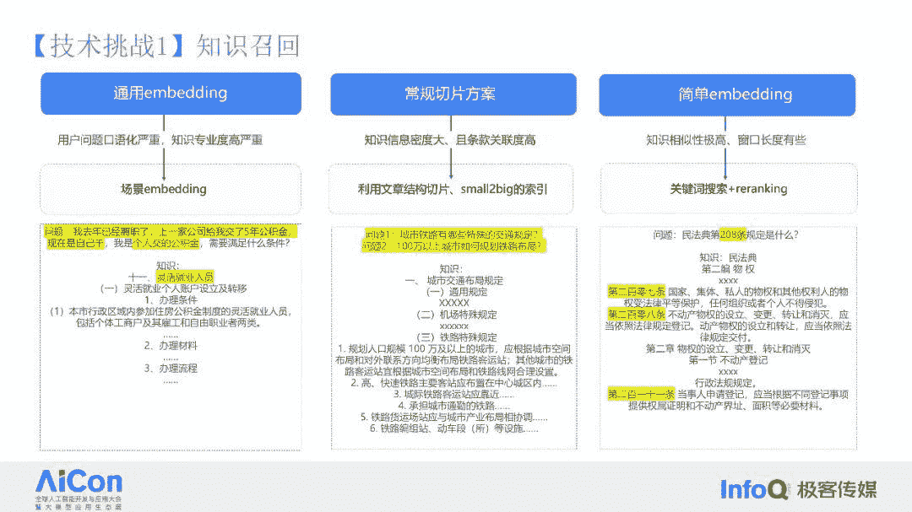

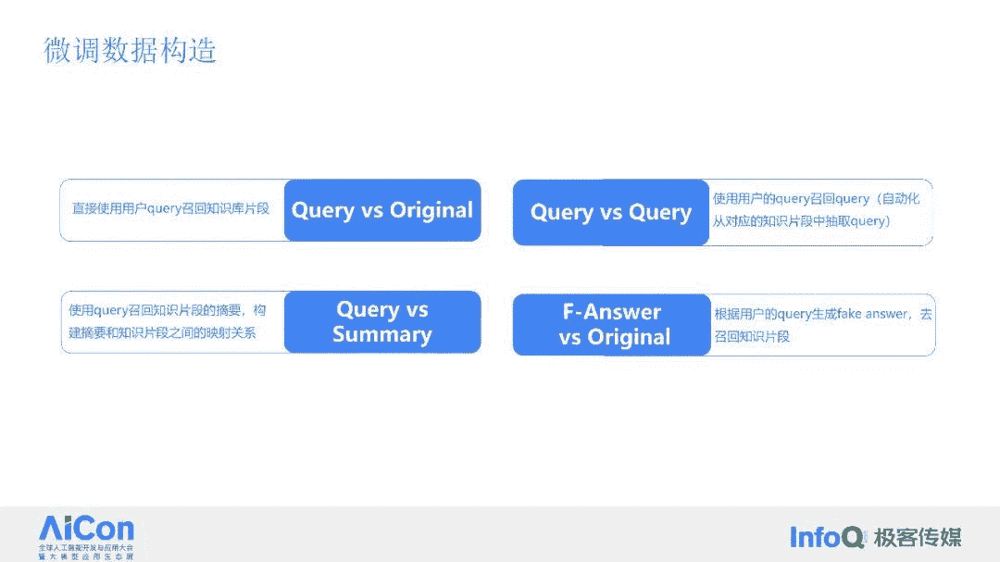

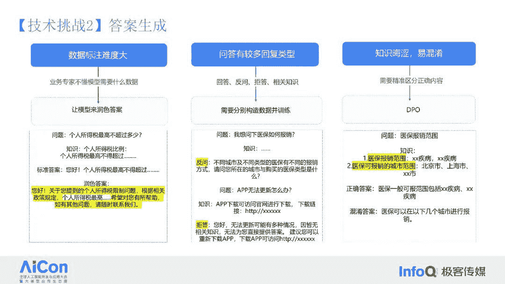

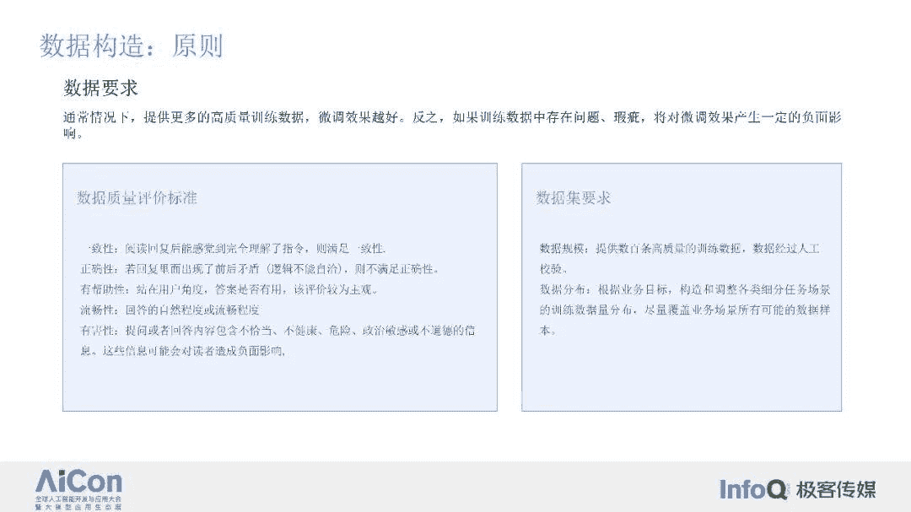

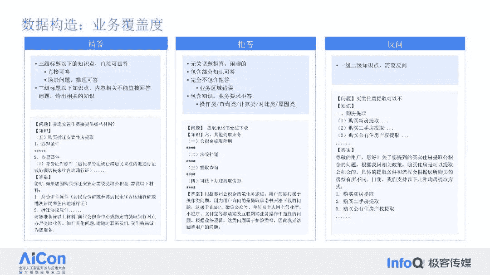

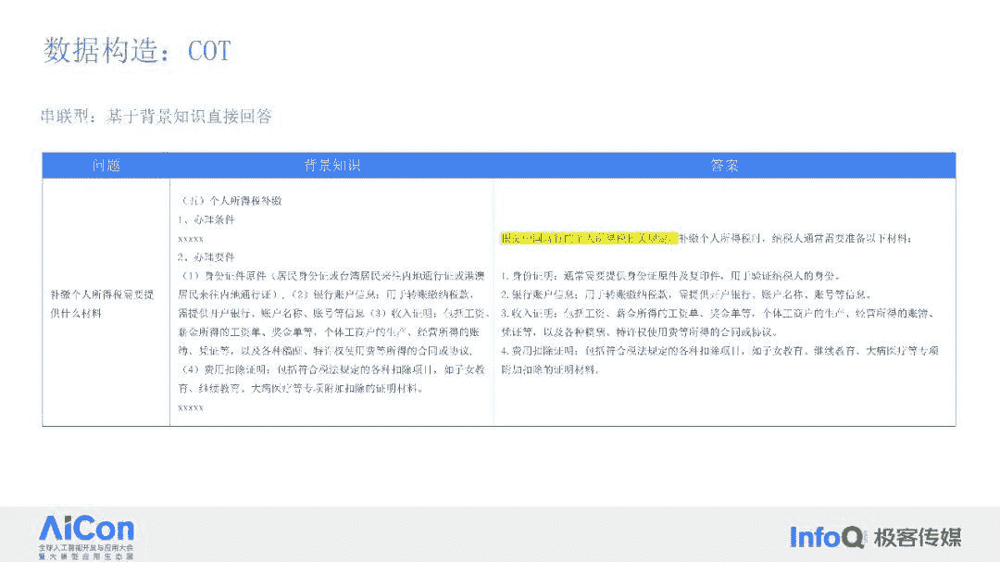

## unset unset 未来展望 unset unset

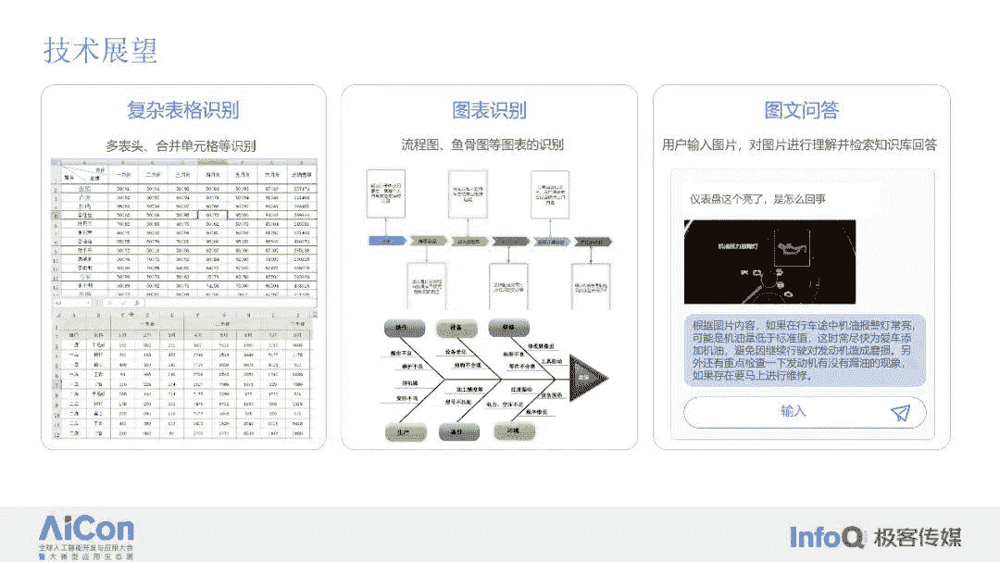

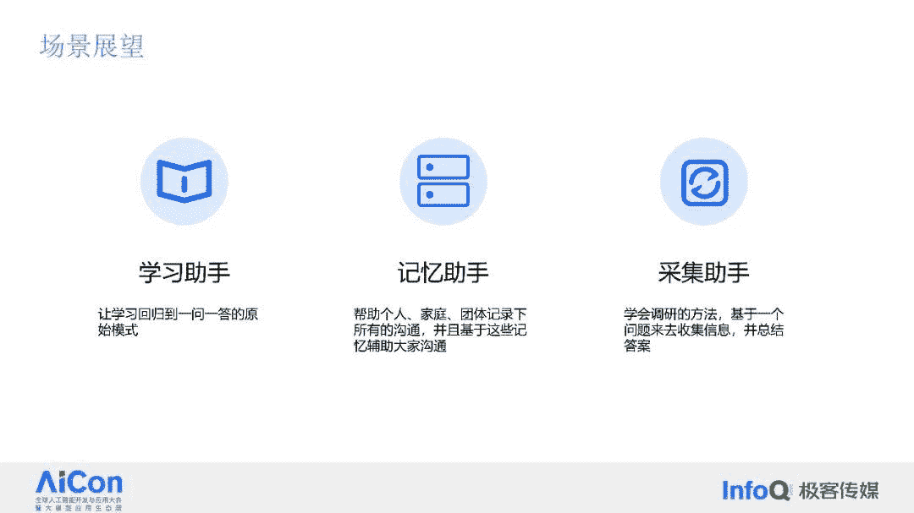

**添加下面微信领取原始PDF**

添加👇微信拉你进群

