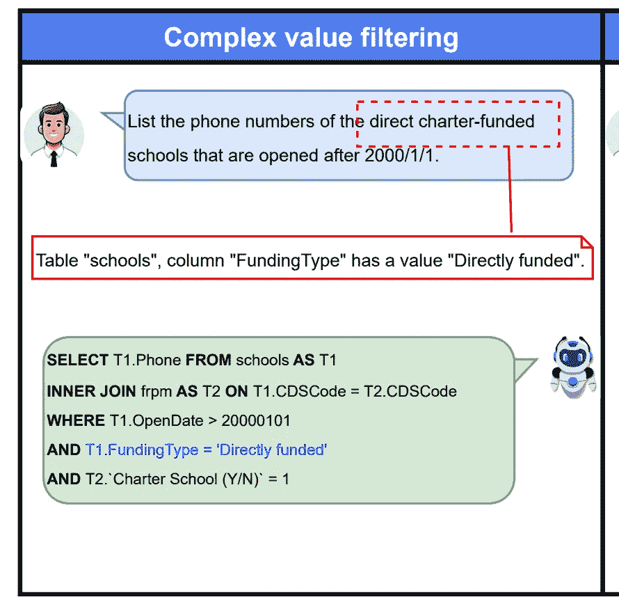
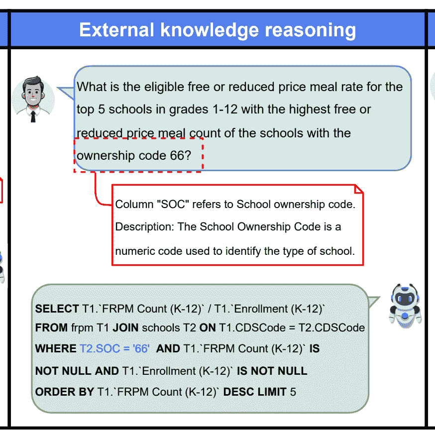
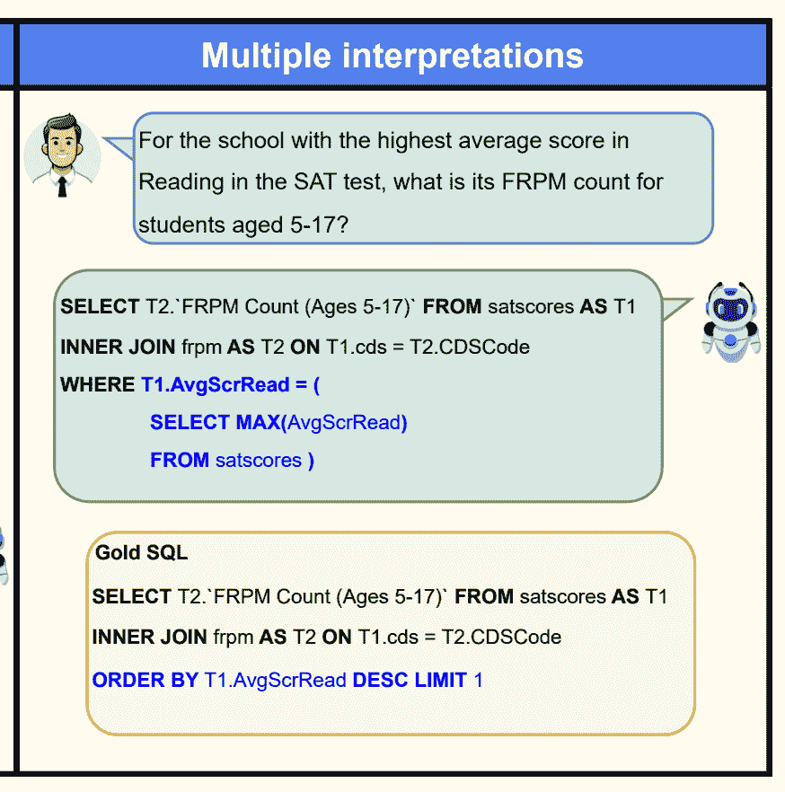
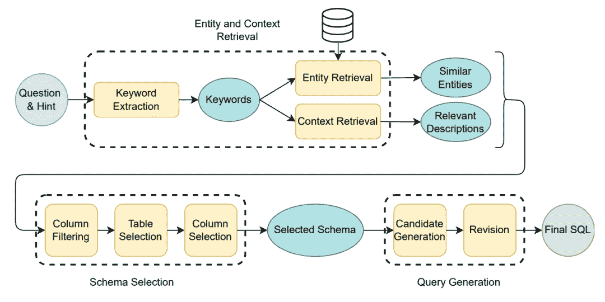
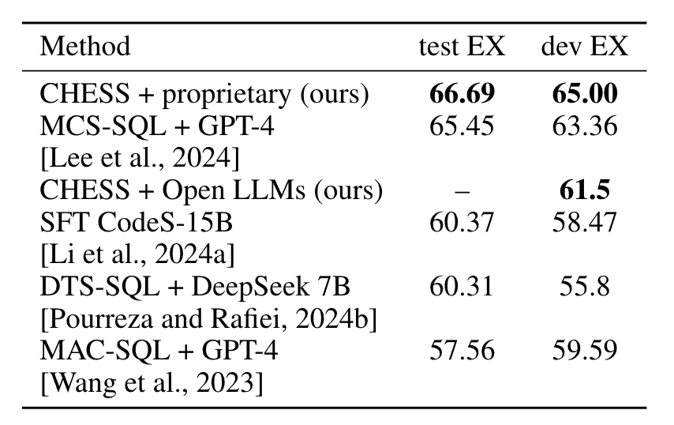
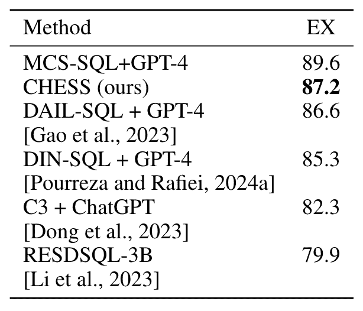
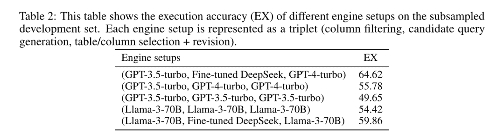
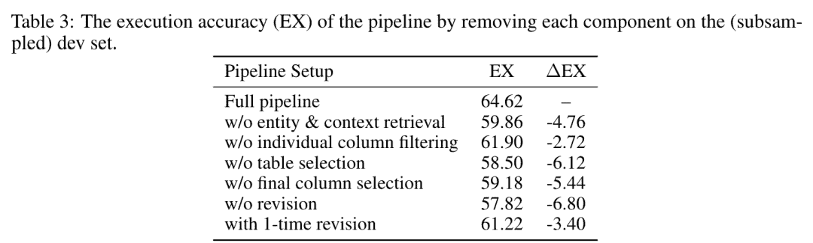

# 小白学RAG：斯坦福Text2SQL框架CHESS

> 来源：[https://agijuejin.feishu.cn/docx/PkTLd6OD1op3VAxh23lcxHc1nYd](https://agijuejin.feishu.cn/docx/PkTLd6OD1op3VAxh23lcxHc1nYd)

> 作者：Coggle数据科学

> 原文：[https://mp.weixin.](https://mp.weixin.qq.com/s/f0tokAEYZX6M9K6qpofeog)qq.com/s/f0tokAEY...

利用大型语言模型（LLMs）将自然语言问题转化为SQL查询（text-to-SQL）是一种有前途但具有挑战性的方法，特别是在应用于具有复杂和广泛模式的真实世界数据库时。

在SQL生成过程中有效地结合数据目录和数据库值仍然是一个障碍，导致次优解决方案。我们通过提出一个新的管道来解决这个问题，该管道有效地检索相关数据和上下文，选择高效的模式，并合成正确且高效的SQL查询。为了提高检索精度。

> https://arxiv.org/pdf/2405.16755

> CHESS: Contextual Harnessing for Efficient SQL Synthesis

## **unset ** u**nset **Text2SQL 现存挑战 unset  unset

将自然语言问题转换为数据库查询，或称text-to-SQL，是一个长期存在的研究问题。近年来，随着数据库复杂性的增加，这一问题变得更加严重。

**数据库的复杂性增加，主要是由于模式（列和表的集合）、值（内容）和目录（描述模式和值的元数据）规模的不断扩大**。即使是最大的专有模型，如GPT-4，在text-to-SQL基准测试中的表现也显著落后于人类，准确率差距高达30% 。

> 除了编写SQL查询的复杂性，这一显著差距主要是由于需要有效检索和整合多种信息源，包括数据库值、目录和模式，每种信息源的格式各不相同，从而使过程复杂化。

在图1中，我们展示了现代text-to-SQL系统面临的一些挑战。例如，用户的问题可能与数据库中存储的值不直接匹配，因此准确识别值的格式对于有效的SQL查询生成至关重要。此外，现实世界的数据库模式通常包含模糊的列名、表名和杂乱的数据，这使得SQL翻译过程变得复杂，需要一个强大的检索系统来识别相关信息。

此外，通常有多种有效的SQL查询可以回答同一个问题。例如，对于图1右侧所示的问题，一种方法可能使用'ORDER BY'和'LIMIT 1'来查找最高平均分，而另一种方法可能涉及使用'MAX()'函数的子查询，从而可能导致不同的输出。

## **unset ** u**nset **CHESS 框架介绍 unset  unset

###  **方法概述 **

对于实体和上下文检索，我们提出了可扩展且高效的方法，使用局部敏感哈希（LSH）从数百万行中检索数据库值，利用关键词检测和向量数据库从数据库目录中提取上下文信息。

我们的方法利用数据库内容和用户查询之间的语义和语法相似性来提高SQL预测的准确性。在模式选择阶段，我们利用检索到的信息将初始模式（可能包含数百列）缩小到一个高效的列集，通常少于十列。

在此步骤中，我们提取了一个最小但足够的数据库模式子集。最后，提取的数据库模式被传递到查询生成模块，该模块使用我们微调的SQL生成器模型结合修订步骤来有效生成SQL查询。

###  **实体和上下文检索 **

管道的第一个模块是识别输入中的相关信息，包括问题中提到的实体以及数据库模式中提供的关于它们的上下文信息。这一过程分为三个步骤。

+   关键词提取

我们通过给模型提供一些示例任务和问题，提示它识别和提取关键词、关键短语和命名实体来解决这个问题。

+   实体检索

我们在数据库中搜索相似的值，并为每个关键词返回最相关的值及其对应的列。

如图1所示，精确匹配关键词的搜索无法处理变体或拼写错误，因此需要一种更灵活的搜索方法。为了衡量关键词和数据库值之间的语法相似性，我们使用编辑距离相似性度量。

此外，为了提高检索过程的效率，我们提出了一种基于局部敏感哈希（LSH）和语义（嵌入）相似性度量的分层检索策略。

+   上下文检索

除了值，数据库目录中可能还有解释模式的信息。例如，每个列可能有一个描述、一个扩展列名（在缩写的情况下）和一个值描述。

如果不提供给模型，可能会导致性能不佳。如前所述，在检索这些上下文时，我们旨在识别最小但足够或最相关的信息。

###  **数据库解析 **

在此步骤中，我们的目标是缩小模式范围，只包括生成SQL查询所需的表和列。我们将这个优化后的必要表和列集称为高效模式。通过排除无关信息，实现高效模式可以提高SQL查询生成的性能。我们使用召回率和精确率指标来确定是否选择了正确的表和列，并以正确的SQL查询作为标准答案。

+   单列过滤

一个数据库可以包含数百个列，其中许多可能在语义上与问题无关。为了寻找高效模式，我们的目标是过滤掉无关的列，仅将最相关的列传递到表选择步骤。

为此，我们将每个列与问题的相关性视为模型的二元分类任务，基本上是询问LLM该列是否可能与问题相关。此步骤仅对去除明显的无关列有用，但孤立地评估列的相关性并不总是可行的。我们在随后的步骤中解决了这一限制，即表选择和列选择，在这些步骤中，我们为模型提供了模式的更全局视图。

+   表选择

过滤掉无关的列后，我们继续选择生成SQL查询所必需的表。在此步骤中，我们向模型展示前一步过滤后的模式，并要求它评估每个表的相关性，仅选择生成SQL查询所必需的表。

+   最终列选择

在模式选择的最后一步，我们的目标是将模式缩减到生成SQL查询所需的最小列集。我们提示模型评估过滤表中每列的必要性。此步骤包括对每列为何需要的链式思维解释，随后选择所需的列。

###  **查询生成 **

我们已经选择了一个包含所有必要信息的高效模式，并增强了相关上下文，能够生成回答问题的SQL查询。在接下来的步骤中，我们首先编写一个候选SQL查询，然后对其进行修订以修正可能的语义和语法错误。

+   候选生成

在将模式缩减到最小的表和列集之后，我们提示模型生成一个回答问题的SQL查询。在提示中，我们提供了从前几步获得的最小模式，以及在管道第一步检索到的相关值和描述。利用这些信息，模型生成一个候选SQL查询。

+   改写

在管道的最后一步，我们旨在修正候选SQL查询中的潜在逻辑和语法错误。我们向模型提供数据库模式、问题、生成的候选SQL查询及其执行结果。然后要求模型评估SQL查询的正确性，并在必要时进行修订。

###  **预处理步骤 **

对于数据库值，我们通过创建一个局部敏感哈希（LSH）索引进行语法搜索，如实体检索中所述。对于包含需要语义理解的较长文本的数据库目录，我们使用向量数据库检索方法来衡量语义相似性。

+   值的局部敏感哈希索引

为了优化实体检索步骤，我们采用一种能够有效搜索大型数据库的方法，这些数据库可能包含数百万行，以检索最相似的值。这一步不需要完美的准确性，但应该检索出一组合理数量的相似值，比如一百个元素。局部敏感哈希（LSH）是一种用于近似最近邻搜索的有效技术。它允许我们检索与给定关键词最相似的数据库值。

在预处理过程中，我们使用LSH索引唯一的数据库值。然后，在实体检索步骤中，我们查询这个索引，快速找到一个关键词的前几个相似值。

+   描述的向量数据库

从数据库目录中提取最具语义相关性的信息对于编写SQL查询至关重要。这些文档可能非常庞大，有数百页解释数据库中的实体及其关系，因此需要一种高效的检索方法。为了进行高效的语义相似性搜索，我们将数据库目录预处理成一个向量数据库。

在上下文检索步骤中，我们查询这个向量数据库，找到与当前问题最相关的信息片段。对于我们管道和预处理阶段的更详细描述，

## **unset ** u**nset **评测实验 unset  unset

###  **数据集： **

1.  **Spider 数据集 **：包括 200 个数据库模式，其中有 160 个模式用于训练和开发，另外 40 个模式用于测试。值得注意的是，用于训练、开发和测试集的数据库不重叠，彼此独立。

1.  **BIRD 数据集 **：包含 12,751 个唯一的问题-SQL 查询对，覆盖了 95 个大型数据库，总大小为 33.4 GB。该数据集涵盖了37个专业领域，包括区块链、曲棍球、医疗保健和教育等领域。BIRD 数据集通过引入外部知识并提供详细的数据库目录来增强 SQL 查询生成，其中包括列和数据库描述，从而消除潜在的歧义。BIRD 数据集中的 SQL 查询通常比 Spider 数据集中的查询更复杂。

1.  **子抽样开发集（SDS） **：为了进行消融研究，降低成本并保持 BIRD 开发集的分布，我们对开发集中的每个数据库进行了 10% 的子抽样，得到了子抽样开发集（SDS）。SDS 包括 147 个样本：81 个简单问题，54 个中等问题和 12 个具有挑战性的问题。

###  **指标： **

1.  **精确集匹配准确率（EM） **：这是 Spider 数据集使用的主要指标之一。它独立评估每个子句，要求与参考 SQL 查询中对应子句完全匹配。

1.  **执行准确率（EX） **：也是 Spider 数据集使用的指标之一。它评估生成的 SQL 查询在真实数据库上的执行准确性。

###  **BIRD 结果 **

在第一种情景中，我们使用了我们经过优化的 DeepSeek Coder 模型来生成候选SQL查询，使用 GPT-3.5-turbo 进行列过滤，剩余的 LLM 调用使用 GPT-4-turbo。我们将这称为我们的默认引擎设置。

在第二种情景中，我们使用了我们经过优化的 DeepSeek Coder 模型来生成候选 SQL 查询，其他所有 LLM 调用都由 Llama-3-70B 处理。

如表1a所示，我们的方法使用专有模型在 BIRD 的开发集和测试集上都实现了最先进的执行准确率。我们使用开源 LLM 的方法在所有开源方法中实现了最佳性能。在提交本文时，BIRD 排行榜上性能最好的方法是 ExSL + granite-20b-code，在测试集上的准确率为 67.86%。我们的方法在测试集上的准确率为 66.69%，排名第二。

###  **Spider 结果 **

我们的方法在来自测试集的 2,147 个样本上实现了 87.2% 的执行准确率，在已发表的方法中排名第二。这突显了我们的方法在不同数据库上的稳健性，没有任何修改。值得注意的是，Spider 测试集排行榜上最好的专有（未公开）方法是 Miniseek，准确率为 91.2%。

###  **消融研究 **

####  **模型消融 **

我们可以利用具有较小上下文窗口大小的开源 LLM，特别是只有 8K 令牌 AI 的 Llama-3。这与以往主要使用 GPT-4 作为基础模型的研究不同。在表2中，我们展示了我们提出的管道在子抽样开发集数据集上使用不同系列的各种 LLM 的结果。

####  **模块消融 **

表3展示了执行准确率（EX），其中省略了不同的模块或组件。在没有实体和上下文检索的配置中，我们检索了一个随机示例，并为所有列包含了列描述。这种方法突显了我们选择性检索的重要影响，其在执行准确率上优于朴素的上下文增强 4.76%。此外，我们评估了删除模式选择模块中的每个子模块的影响，发现表选择是最关键的，增加了 6.12% 的性能。表还展示了修订节点的显著影响，性能提高了 6.80%。

# **竞赛交流群 邀请函 **#

