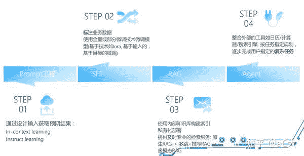
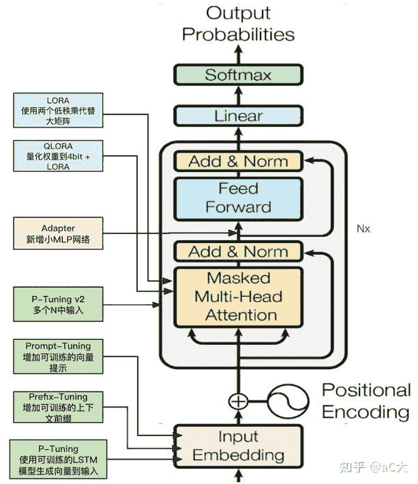
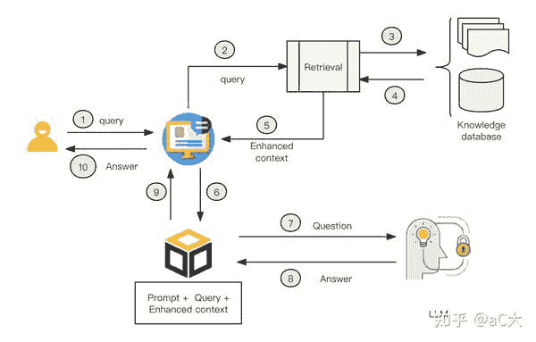
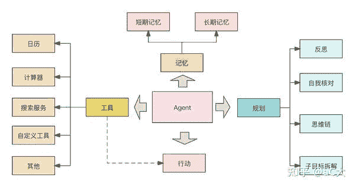

# 手把手教你实现大模型RAG[1]-大模型应用技术介绍

> 来源：[https://agijuejin.feishu.cn/docx/IgDjdoEmsoadUWxVAoecFTlDn5f](https://agijuejin.feishu.cn/docx/IgDjdoEmsoadUWxVAoecFTlDn5f)

> 作者：aC大

> 原文： [https://zhuanlan.z](https://zhuanlan.zhihu.com/p/692304256)hihu.com/p/692304...

## 前言：

《手把手教你实现大模型RAG》系列文章分享的是从0到1基于langchain实现大模型结合本地知识库的问答系统。主要内容包括：

+   1. 大模型应用技术介绍

+   2. RAG原理及流程的系统介绍

+   3. 基于langchain手把手教你实现大模型RAG的整个流程

+   4. 使用第三方的大模型服务实现RAG

+   5. 使用开源大模型实现标准的模型服务部署，并基于部署的大模型实现RAG

+   6. 使用 [gradio ](https://www.zhihu.com/search?q=gradio&search_source=Entity&hybrid_search_source=Entity&hybrid_search_extra=%7B%22sourceType%22%3A%22article%22%2C%22sourceId%22%3A692304256%7D)教你快速实现RAG的体验UI，能够快速测试RAG的效果

+   7. 支持多种本地文档格式的上传和切割，并实现文本向量化

+   [8. 实现](https://www.zhihu.com/search?q=%E6%96%87%E6%9C%AC%E5%90%91%E9%87%8F&search_source=Entity&hybrid_search_source=Entity&hybrid_search_extra=%7B%22sourceType%22%3A%22article%22%2C%22sourceId%22%3A692304256%7D)基于langchain的 文本向量 的检索服务手把手教你实现大模型RAG

本系列 [文章会 ](https://www.zhihu.com/search?q=%E6%96%87%E7%AB%A0%E4%BC%9A&search_source=Entity&hybrid_search_source=Entity&hybrid_search_extra=%7B%22sourceType%22%3A%22article%22%2C%22sourceId%22%3A692304256%7D)逐一分享上述内容，同时作者也出了该系列的视频课程，见 B站《手把手教你实现大模型RAG-acedar讲师》 , 文章和视频结合学习效果更佳。

### 大模型应用技术介绍

自[chatGPT问世](https://www.zhihu.com/search?q=prompt%E5%B7%A5%E7%A8%8B&search_source=Entity&hybrid_search_source=Entity&hybrid_search_extra=%7B%22sourceType%22%3A%22article%22%2C%22sourceId%22%3A692304256%7D)以来，基于大模型的应用如雨后春笋，从技术层面划分，可以将大模型的应用分为四个技术类型，包括：基于 prompt工程 的、基于微调的、基于检索增强生成的及agent四个机制。

### prompt工程

基于prompt工程的主要是直接使用大模型，为了让大模型的输出更符合人类预期，主要的研究重点在如何设计prompt。在介绍设计prompt原则前，先介绍几个容易混淆的概念：

+   [zero shot ](https://www.zhihu.com/search?q=zero%20shot&search_source=Entity&hybrid_search_source=Entity&hybrid_search_extra=%7B%22sourceType%22%3A%22article%22%2C%22sourceId%22%3A692304256%7D)：zero shot指的向大模型提问时，不给出示例，比如将中文翻译成英文，直接给出的一段话或段落让大模型翻译，如："""请将下面的中文翻译成英文：中国是我的故乡"""

+   [few shot ](https://www.zhihu.com/search?q=few%20shot&search_source=Entity&hybrid_search_source=Entity&hybrid_search_extra=%7B%22sourceType%22%3A%22article%22%2C%22sourceId%22%3A692304256%7D)：与few shot对应的是zero shot，这种情况是在让大模型输出结果时，给出1个或多个例子，如："""请参考例子将下面的中文翻译成英文，中国->china, 漂亮->beauty, 中国是我的故乡->""", 这里给出了两个"中国"和"漂亮"的翻译例子。

+   in-context learning ：in-context learning更多强调的是上下文信息，包括但不局限于示例，一般而言，in-context learning含义与few shot含义接近。

+   instruct learning：instruct learning 是更广义的提示，强调的是任务的要求和说明，其中可以包括例子，也可能只有说明和要求，比如"""你是一位资深的地理学者，请告诉我地球包括几大洋？""""

在很多场景下，in-context learning 、instruct learning是一期谈论的，zero shot、few shot会一期谈论，可以理解为他们是不同场景下的表达。

纯使用大模型，围绕设计prompt通常需要遵循以下几个原则：

+   确定谈话的目的和重点。在编写提示之前，必须清楚地了解您希望通过对话实现的目标。您是想提供信息、回答问题还是进行随意的交谈？通过确定对话的目的和重点，您可以制作一个具体且相关的提示。

+   使用具体和相关的语言。为确保大模型理解您的提示并提供适当的响应，使用特定且相关的语言至关重要。避免使用可能引起混淆或误解的行话或模棱两可的语言。相反，使用与当前主题相关的语言，力求尽可能清晰和简洁。

+   避免使用开放式或过于宽泛的提示。虽然为了获得更全面的答复而提出开放式或过于宽泛的问题可能很诱人，但这些类型的提示通常会导致与大模型的对话脱节或没有重点。相反，目标是在您的提示中尽可能具体，为对话定义明确的目的和重点。

+   查看并修改您的提示。在将您的提示发送到大模型之前，请花点时间查看和修改它以确保它清晰易懂。考虑语言是否具体、相关，提示是否突出重点，避免歧义。

设计prompt的完整说明见 ChatGPT提示(prompt)的艺术: 制作清晰有效的提示的指南

### 微调使用(SFT)

我[们在使用大模型](https://www.zhihu.com/search?q=%E4%B8%AD%E5%9B%BD%E6%B3%95%E5%BE%8B%E6%B3%95%E8%A7%84&search_source=Entity&hybrid_search_source=Entity&hybrid_search_extra=%7B%22sourceType%22%3A%22article%22%2C%22sourceId%22%3A692304256%7D)解决[实际问题时会发现](https://www.zhihu.com/search?q=adapter&search_source=Entity&hybrid_search_source=Entity&hybrid_search_extra=%7B%22sourceType%22%3A%22article%22%2C%22sourceId%22%3A692304256%7D)，在有[些情况下大](https://www.zhihu.com/search?q=%E6%B3%9B%E5%8C%96%E8%83%BD%E5%8A%9B&search_source=Entity&hybrid_search_source=Entity&hybrid_search_extra=%7B%22sourceType%22%3A%22article%22%2C%22sourceId%22%3A692304256%7D)模型无法解决某些特定领域的问题，比如使用ChatGPT无法很好的回答 中国法律法规 相关的问题。为了解决这类问题，可以在以后的开源大模型上使用专业领域的数据做一些微调，让大模型更好的在特定领域发挥作用。 微调的方法有很多，包括p-tuning、prefix-tuning、 adapter 及比较常用的lora等方式，从业务上来包括基于输入的、基于目标的微调等等。在很多的场景下，经过微调的模型在特定场景下都能取得不错的提升。 然而，微调也有其资深的弊端，要对模型进行微调就需要标注有标签的数据，这会大大增加大模型落地的成本，同时使用特定场景的标注数据微调会导致 泛化能力 不强， 对新的任务新的场景需要重新微调，这个过程是耗时耗力的。

### [检索增强生成 ](https://www.zhihu.com/search?q=%E6%A3%80%E7%B4%A2%E5%A2%9E%E5%BC%BA%E7%94%9F%E6%88%90&search_source=Entity&hybrid_search_source=Entity&hybrid_search_extra=%7B%22sourceType%22%3A%22article%22%2C%22sourceId%22%3A692304256%7D)(RAG)

企业自己训练[大模型成](https://www.zhihu.com/search?q=%E7%9F%A5%E8%AF%86%E5%BA%93&search_source=Entity&hybrid_search_source=Entity&hybrid_search_extra=%7B%22sourceType%22%3A%22article%22%2C%22sourceId%22%3A692304256%7D)本是高昂的，对很多中小型公司来说，直接通过接口访问第三方大模型是经济效益比较好的方案，为了满足特定场景和特定领域的需求，检索增强生成技术应运而生。 检索增强生成是在不修改大模型的基础上，将特定的领域数据一同喂给大模型，大模型结合给定的领域数据回答用户的问题。在提供特定的领域数据一般有两个方案：一是公司特有的数据先本地构建索引然后检索出若干相关信息，让大模型结合检索的信息回答问题，每次提问只会给相关的信息一个发给大模型。 另一种方案是用户直接给大模型提供方上传本地 知识库 ，由大模型提供方去管理这些用户上传的本地知识。 方案一更加注重隐私，也可以根据自身需要优化检索的方案。方案二更加便利，因为是专门的第三方提供服务，服务的稳定性也更有保障。 另外在大模型部署侧也可以公司内部自己部署开源的大模型而非使用第三方的大模型服务。

### 代理模式(agent)

agent模式是解决复杂问题多任务场景的最优解[决方案或是](https://www.zhihu.com/search?q=%E6%8A%80%E6%9C%AF%E6%96%B9%E6%A1%88&search_source=Entity&hybrid_search_source=Entity&hybrid_search_extra=%7B%22sourceType%22%3A%22article%22%2C%22sourceId%22%3A692304256%7D)[目前阶段](https://www.zhihu.com/search?q=%E8%AE%A1%E7%AE%97%E5%99%A8&search_source=Entity&hybrid_search_source=Entity&hybrid_search_extra=%7B%22sourceType%22%3A%22article%22%2C%22sourceId%22%3A692304256%7D)逼近AGI的最有效的 技术方案 。agent可以自定义函数和工具如 计算器[ /日历/搜](https://www.zhihu.com/search?q=%E5%A4%9A%E8%A7%92%E8%89%B2%E5%8D%8F%E4%BD%9C&search_source=Entity&hybrid_search_source=Entity&hybrid_search_extra=%7B%22sourceType%22%3A%22article%22%2C%22sourceId%22%3A692304256%7D)索服务等、执行逻辑，优充分利用大模型的任务拆解、规划和自定义函数和工具选择的能力，将其结合起来，达到1+1>2的效果。 agent的主要应用为 多角色协作 处理复杂的多任务场景，agent的劣势是需要整合的工具较多，从性价比来看单个任务使用agent未必是最优解。

### 其他

使用大模型的技术中，上述介绍的几种不是觉得割裂的，是可以综合在一起的，比如既设计好的prompt，也可以使用微调的模型。使用RAG技术也可以使用微调的模型等等。 需要强调的是在大模型技术的演进中，还有一类是强化学习技术，强化学习技术对数据和奖励函数/模型的设计要求非常高，一般情况下是不会使用这类技术去微调模型提升特定场景下应用的效果的，性价比极低，所以这里不展开介绍。

更多相关内容，感兴趣的朋友可以同步关注B站(视频)：acedar-C大，知乎&公众号：aC大，也可加v进群交流：aa836304831