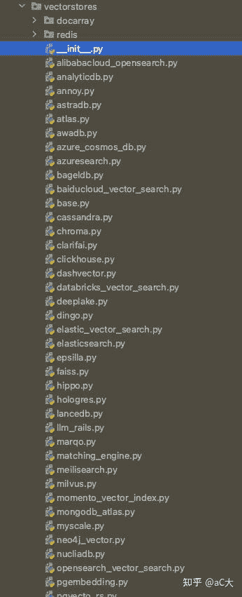

# 手把手教你实现大模型RAG[6]-基于langchain的文本向量化

> 来源：[https://agijuejin.feishu.cn/docx/OmvtdoKncoHiGwxxLA4cKkdincd](https://agijuejin.feishu.cn/docx/OmvtdoKncoHiGwxxLA4cKkdincd)

> 作者：aC大

> 原文：[https://zhuanlan.z](https://zhuanlan.zhihu.com/p/695644383)hihu.com/p/695644...

### 前言：

《手把手教你实现大模型RAG》系列文章分享的是从0到1基[于lan](https://www.zhihu.com/search?q=%E7%9F%A5%E8%AF%86%E5%BA%93&search_source=Entity&hybrid_search_source=Entity&hybrid_search_extra=%7B%22sourceType%22%3A%22article%22%2C%22sourceId%22%3A695644383%7D)gchain实现大模型结合本地 知识库 的问答系统。主要内容包括：

+   [1]-手把手教你实现大模型RAG-大模型应用技术介绍

+   [2]-手把手教你实现大模型RAG-RAG流程的系统介绍

+   [3]-手把手教你实现大模型RAG-UI实现

+   [4]-手把手教你实现大模型RAG-RAG类的实现

+   [5]-手把手教你实现大模型RAG-基于langchain的文本切割

+   [6]-手把手教你实现大模型RAG-基于langchain的文本向量化

+   [7]-手把手教你实现大模型RAG-第三方大模型接口接入

+   [8]-手把手教你实现大模型RAG-chatglm3本地部署openai标准接口及接入

+   [9]-手把手教你实现大模型RAG-环境变量的配置和加载

本系列 [文章会 ](https://www.zhihu.com/search?q=%E6%96%87%E7%AB%A0%E4%BC%9A&search_source=Entity&hybrid_search_source=Entity&hybrid_search_extra=%7B%22sourceType%22%3A%22article%22%2C%22sourceId%22%3A695644383%7D)逐一分享上述内容，同时作者也出了该系列的视频课程，见 B站《手把手教你实现大模型RAG-acedar讲师》 , 文章和视频结合学习效果更佳。

### 基于langchain的文本向量化

在[上一篇基于l](https://www.zhihu.com/search?q=%E5%90%91%E9%87%8F%E5%8C%96%E6%A8%A1%E5%9E%8B&search_source=Entity&hybrid_search_source=Entity&hybrid_search_extra=%7B%22sourceType%22%3A%22article%22%2C%22sourceId%22%3A695644383%7D)angchain的文本切割中，实现了文本的加载和切割，接下来在其基础上实现文本的向量化。文本的向量化包括 向量化模型 、向量存储和文本转向量三个核心功能。 - 向量化模型：本项目是本地加载向量化模型，常用的开源向量化模型包括text[2vec和](https://www.zhihu.com/search?q=%E5%90%91%E9%87%8F%E6%A8%A1%E5%9E%8B&search_source=Entity&hybrid_search_source=Entity&hybrid_search_extra=%7B%22sourceType%22%3A%22article%22%2C%22sourceId%22%3A695644383%7D)BGE等，这些开源模型可以在huggingface或modelscope上找到并下载，模型的加载采用langchain提供的HuggingFaceEmbeddings加载即可，因为这些开源的模型都适配huggingface的transformers包。 - 文本转向量：将切割的文本转为向量，只需要将文本调用向量化模型即可，本项目使用langchain提供的向量存储，内部实现了文本调用 向量模型 转为向量的功能，不需要显示调用。 - 向量存储：文本转为向量，需要支持后续的检索和文本元数据的获取，因此需要将文本和向量存储起来。向量存储的方式有很多，本项目使用langchain封装的chroa.

其他的db存储，每个文件就是一种存储，或是第三方提供的存储方式，或是独立的存储配置。



文本向量化代码实现如下：

```
import os
from langchain.text_splitter import CharacterTextSplitter
from langchain.embeddings.huggingface import HuggingFaceEmbeddings
from langchain.document_loaders.pdf import PyPDFLoader
from langchain.document_loaders.csv_loader import CSVLoader
from langchain.document_loaders.json_loader import JSONLoader

from langchain.vectorstores import Chroma

embed_model_map = {
    &quot;text2vec-base&quot;: &quot;E:\\py_workspace\\models\\text2vec-base-chinese&quot;,
}

class Text2embedStore(object):

    def __init__(self, model_name):
        self.model_name = model_name
        file_path = os.environ.get(&quot;FILE_PATH&quot;)

        self.text_split = None
        self.text_split_init()
        self.embed_model_init()
        if file_path:
            self.load_dir(file_path)

    def text_split_init(self):
        text_split_name = os.environ.get(&quot;TEXT_SPLIT_METHOD&quot;)
        chunk_size = int(os.environ.get(&quot;CHUNK_SIZE&quot;, 256))
        chunk_overlap = int(os.environ.get(&quot;CHUNK_OVERLAP&quot;, 128))
        if text_split_name == &#x27;char&#x27;:
            self.text_split = CharacterTextSplitter(chunk_size=chunk_size, chunk_overlap=chunk_overlap)
        else:
            self.text_split = CharacterTextSplitter(chunk_size=chunk_size, chunk_overlap=chunk_overlap)

    def embed_model_init(self):
        persist_directory = os.environ.get(&quot;PERSIST_DIRECTORT&quot;, &#x27;./data/vector_store&#x27;)
        self.embed_model = self.load_embedding_model(self.model_name)

        db_name = os.environ.get(&quot;VECTOR_DB_NAME&quot;, &#x27;chroma&#x27;)
        if db_name == &#x27;chroma&#x27;:
            self.db = Chroma(persist_directory=persist_directory, embedding_function=self.embed_model)
        else:
            self.db = Chroma(persist_directory=persist_directory, embedding_function=self.embed_model)


    def load_embedding_model(self, model_name):

        if model_name not in embed_model_map:
            raise ValueError(&quot;embed model not set right, you can select from {}&quot;.format(list(embed_model_map.keys())))
        embed_model = HuggingFaceEmbeddings(model_name=embed_model_map[model_name])
        return embed_model

    def load_dir(self, file_path):
        if os.path.isdir(file_path):
            for root, ds, fs in os.walk(file_path):
                for f in fs:
                    self.load_file(file_name=f)
        else:
            self.load_file(file_path)

    def load_file(self, file_name):
        print(&quot;file_name&quot;, file_name)
        if file_name.endswith(&#x27;.pdf&#x27;) or file_name.endswith(&#x27;.PDF&#x27;):
            loader = PyPDFLoader(file_name)
        elif file_name.endswith(&#x27;.csv&#x27;) or file_name.endswith(&#x27;.CSV&#x27;):
            loader = CSVLoader(file_name)
        elif file_name.endswith(&#x27;.json&#x27;):
            # [{&quot;text&quot;: ...}, {&quot;text&quot;: ...}, {&quot;text&quot;: ...}] -&gt; schema =.[].text
            # {&quot;key&quot;: [{&quot;text&quot;: ...}, {&quot;text&quot;: ...}, {&quot;text&quot;: ...}]} -&gt; schema =.key[].text
            # [&quot;&quot;, &quot;&quot;, &quot;&quot;] -&gt; schema =.[]
            # todo: 提前读取json文件，解析schema
            loader = JSONLoader(file_name, &#x27;.key[].text&#x27;)
        else:
            raise ValueError(&#x27;not support this type file, {}, you can upload file type: {}&#x27;.format(
                file_name, [&#x27;pdf&#x27;, &#x27;csv&#x27;, &#x27;json&#x27;]))

        documents = loader.load()
        docs = self.text_split.split_documents(documents)
        if docs:
            self.db.add_documents(docs)

    def as_retriever(self):
        return self.db.as_retriever()

    def as_db(self):
        return self.db
```

更多相关内容，感兴趣的朋友可以同步关注B站(视频)：acedar-C大，知乎&👸号：aC大，也可加v进群交流：aa836304831

发布于 2024-05-04 17:39 ・IP 属地广东