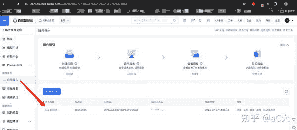

# 手把手教你实现大模型RAG[7]-第三方大模型接口接入

> 来源：[https://agijuejin.feishu.cn/docx/K9ccdUNmPoruNOxE7LycMoOen8b](https://agijuejin.feishu.cn/docx/K9ccdUNmPoruNOxE7LycMoOen8b)

> 作者：aC大

> 原文： [https://zhuanlan.z](https://zhuanlan.zhihu.com/p/695644527)hihu.com/p/695644...

### 前言：

《手把手教你实现大模型RAG》系列文章分享的是从0到1基[于lan](https://www.zhihu.com/search?q=%E7%9F%A5%E8%AF%86%E5%BA%93&search_source=Entity&hybrid_search_source=Entity&hybrid_search_extra=%7B%22sourceType%22%3A%22article%22%2C%22sourceId%22%3A695644527%7D)gchain实现大模型结合本地 知识库 的问答系统。主要内容包括：

+   [1]-手把手教你实现大模型RAG-大模型应用技术介绍

+   [2]-手把手教你实现大模型RAG-RAG流程的系统介绍

+   [3]-手把手教你实现大模型RAG-UI实现

+   [4]-手把手教你实现大模型RAG-RAG类的实现

+   [5]-手把手教你实现大模型RAG-基于langchain的文本切割

+   [6]-手把手教你实现大模型RAG-基于langchain的文本向量化

+   [7]-手把手教你实现大模型RAG-第三方大模型接口接入

+   [8]-手把手教你实现大模型RAG-chatglm3本地部署openai标准接口及接入

+   [9]-手把手教你实现大模型RAG-环境变量的配置和加载

本系列 [文章会 ](https://www.zhihu.com/search?q=%E6%96%87%E7%AB%A0%E4%BC%9A&search_source=Entity&hybrid_search_source=Entity&hybrid_search_extra=%7B%22sourceType%22%3A%22article%22%2C%22sourceId%22%3A695644527%7D)逐一分享上述内容，同时作者也出了该系列的视频课程，见 B站《手把手教你实现大模型RAG-acedar讲师》 , 文章和视频结合学习效果更佳。

### 第三方大模型接口接入

使用第三方的大模型，往往都是通过云服务提供的，每个平台的接口[稍有不同](https://www.zhihu.com/search?q=%E6%9D%8E%E5%BC%80%E5%A4%8D&search_source=Entity&hybrid_search_source=Entity&hybrid_search_extra=%7B%22sourceType%22%3A%22article%22%2C%22sourceId%22%3A695644527%7D)[，本项目接入百度大模](https://link.zhihu.com/?target=https%3A//console.bce.baidu.com/qianfan/ais/console/applicationConsole/application)型平台，以 李开复 的零一万物34B大模型为例，接入本项目的RAG。 首先登陆 "百度智能云"平台 ,接着在左侧菜单栏中选择"应用接入"，然后通过"创建应用"常见应用，创建成功后就可以看到API key和secret key, 这个在接口调用的时候需要填写。



### 百度大模型接口调试

创建好应用后，可以通过API文档查看调用的示例。将示例代码在本项目中测试，是否能成功调用百度大模型， 代码如下：

```
import os
impor[t re](https://www.zhihu.com/search?q=%E9%89%B4%E6%9D%83%E7%AD%BE%E5%90%8D&amp;search_source=Entity&amp;hybrid_search_source=Entity&amp;hybrid_search_extra=%7B%22sourceType%22%3A%22article%22%2C%22sourceId%22%3A695644527%7D)quests
import json

from dotenv import load_dotenv

load_dotenv()

API_KEY = os.environ.get(&quot;API_KEY&quot;)
SECRET_KEY = os.environ.get(&quot;SECRET_KEY&quot;)


def main():
    url = &quot;https://aip.baidubce.com/rpc/2.0/ai_custom/v1/wenxinworkshop/chat/yi_34b_chat?access_token=&quot; + get_access_token()

    request_data = {
        &quot;messages&quot;: [
            {&quot;role&quot;: &quot;user&quot;, &quot;content&quot;: &quot;如何保持好的睡眠？&quot;}
        ],
        &quot;top_p&quot;: 0.9,
        &quot;temperature&quot;: 0.1,
        &quot;stream&quot;: False
    }
    payload = json.dumps(request_data)
    headers = {
        &#x27;Content-Type&#x27;: &#x27;application/json&#x27;
    }

    response = requests.request(&quot;POST&quot;, url, headers=headers, data=payload)
    print(response.json()[&#x27;result&#x27;])

def get_access_token():
    &quot;&quot;&quot;
    使用 AK，SK 生成鉴权签名（Access Token）
    :return: access_token，或是None(如果错误)
    &quot;&quot;&quot;
    url = &quot;https://aip.baidubce.com/oauth/2.0/token&quot;
    params = {&quot;grant_type&quot;: &quot;client_credentials&quot;, &quot;client_id&quot;: API_KEY, &quot;client_secret&quot;: SECRET_KEY}
    return str(requests.post(url, params=params).json().get(&quot;access_token&quot;))


if __name__ == &#x27;__main__&#x27;:
    main()
```

调用百度平台的API Key和Secret Key通过环境变量获取，这便于在结成到本项目中也可以按该方式使用。百度大模型接口需要先请求权限验证，并将验证结果拼接到大模型的访问url中，保证访问的合法性。

### RAG百度模型接入封装

[本项目基于](https://www.zhihu.com/search?q=%E6%A8%A1%E5%9E%8B%E9%9B%86%E6%88%90&search_source=Entity&hybrid_search_source=Entity&hybrid_search_extra=%7B%22sourceType%22%3A%22article%22%2C%22sourceId%22%3A695644527%7D)langchain实现RAG，百度平台的大 模型集[成 到本项目](https://www.zhihu.com/search?q=%E5%A4%A7%E8%AF%AD%E8%A8%80%E6%A8%A1%E5%9E%8B&search_source=Entity&hybrid_search_source=Entity&hybrid_search_extra=%7B%22sourceType%22%3A%22article%22%2C%22sourceId%22%3A695644527%7D)中，也要符合langchain调用大模型的规则，也就需要继承langchain的 大语言模型 基类。 - 继承langchain的LLM基本，该基类最核心的也是需要根据具体模型实现的是_call方法。 - 为了区分不同平台的大模型调用，百度的API Key和Secret key的环境变量使用加上前缀"Baidu"区分，便于后续接入其他模型时Key的统一管理。 - 这里实现的百度接口调用的temperature， top_p等参数直接写在代码中，但实际项目中，可以配置到环境变量中，便于统一的管理这些参数。 继承到本项目中的百度大模型调用实现如下：

```
import os
import json
import requests
from typing import Optional, List, Any, Mapping
from langchain_core.language_models.llms import LLM
from langchain_core.pydantic_v1 import Field
from langchain_core.callbacks import CallbackManagerForLLMRun


class BaiduLlm(LLM):

    model_name: str = Field(default=&#x27;&#x27;)

    @property
    def _llm_type(self) -&gt; str:
        return &#x27;baidu-&#x27; + self.model_name

    @property
    def _identifying_params(self) -&gt; Mapping[str, Any]:
        &quot;&quot;&quot;Get the identifying parameters.&quot;&quot;&quot;
        return {}

    def get_access_token(self):
        &quot;&quot;&quot;
        使用 AK，SK 生成鉴权签名（Access Token）
        :return: access_token，或是None(如果错误)
        &quot;&quot;&quot;
        API_KEY = os.environ.get(&quot;BAIDU_API_KEY&quot;)
        SECRET_KEY = os.environ.get(&quot;BAIDU_SECRET_KEY&quot;)
        url = &quot;https://aip.baidubce.com/oauth/2.0/token&quot;
        params = {&quot;grant_type&quot;: &quot;client_credentials&quot;, &quot;client_id&quot;: API_KEY, &quot;client_secret&quot;: SECRET_KEY}
        return str(requests.post(url, params=params).json().get(&quot;access_token&quot;))

    def _call(self,
        prompt: str,
        stop: Optional[List[str]] = None,
        run_manager: Optional[CallbackManagerForLLMRun] = None,
        **kwargs: Any):

        url = &quot;https://aip.baidubce.com/rpc/2.0/ai_custom/v1/wenxinworkshop/chat/{}?access_token={}&quot;.format(self.model_name, self.get_access_token())

        print(&#x27;prompt:&#x27;, prompt)
        request_data = {
            &quot;messages&quot;: [
                {&quot;role&quot;: &quot;user&quot;, &quot;content&quot;: prompt}
            ],
            &quot;top_p&quot;: 0.9,
            &quot;temperature&quot;: 0.1,
            &quot;stream&quot;: False
        }
        payload = json.dumps(request_data)
        headers = {
            &#x27;Content-Type&#x27;: &#x27;application/json&#x27;
        }
        response = requests.request(&quot;POST&quot;, url, headers=headers, data=payload)

        try:
            ans = response.json()[&#x27;result&#x27;]
        except Exception as err:
            ans = &#x27;调用百度接口错误&#x27; + response.json()[&#x27;error_msg&#x27;]
            print(&quot;ans: {} , err: {}&quot;.format(ans, err))
        return ans
```

更多相关内容，感兴趣的朋友可以同步关注B站(视频)：acedar-C大，知乎&公众号：aC大，也可加v进群交流：aa836304831