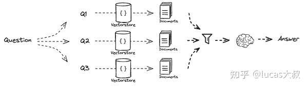
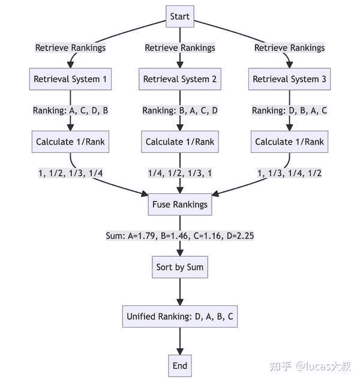

# 从0开始学RAG之RAG-Fusion

> 来源：https://agijuejin.feishu.cn/docx/Mbaxd3QUQogC2axlIc5ciWFqnxb
>
> ji
>
> 原文：https://zhuanlan.zhihu.com/p/684994205

## 基本原理

RAG-Fusion可以认为是 `MultiQueryRetriever` 的进化版，如下图所示，RAG-Fusion首先根据原始 `question` 从不同角度生成多个版本的新 `question`，用以提升 `question` 的质量；然后针对每个 `question` 进行向量检索，到此步为止都是 `MultiQueryRetriever` 的功能；与之不同的是，RAG-Fusion在喂给 LLM 生成答案之前增加了一个排序的步骤。



排序包含两个动作，一是独立对每个 `question` 检索返回的内容根据相似度排序，确定每个返回 `chunk` 在各自候选集中的位置，相似度越高排名越靠前。二是对所有 `question` 返回的内容利用 RRF（Reciprocal Rank Fusion）综合排序，RRF 排序原理如下图所示。



RRF score 的计算公式非常简单：

`score = 1 / (rank + k)`

其中，`rank` 是按照距离排序的文档在各自集合中的排名，`k` 是常数（平滑因子），一般取 `k=60`。RRF 将不同检索器的结果综合评估得到每个 `chunk` 的统一得分。

## 代码实践

首先，导入必要的 packages：

```
import torch
from langchain.load import dumps, loads
from langchain.document_loaders import PyPDFLoader
from langchain.text_splitter import RecursiveCharacterTextSplitter
from langchain_community.vectorstores import Chroma
from langchain import PromptTemplate
from langchain import HuggingFacePipeline
from transformers import AutoTokenizer, pipeline, AutoModelForCausalLM
from langchain.embeddings import HuggingFaceEmbeddings
from langchain.chains.llm import LLMChain
from langchain_core.output_parsers import StrOutputParser
```

然后做一些准备工作，编写加载 `embedding` 模型、LLM 和文件的函数。

```
def load_embedding(embed_path):
    embeddings = HuggingFaceEmbeddings(
        model_name=embed_path,
        model_kwargs={"device": "cuda"},
        encode_kwargs={"normalize_embeddings": True},
    )
    return embeddings


def load_llm(model_path):
    tokenizer = AutoTokenizer.from_pretrained(
        model_path,
        device_map="auto",
        trust_remote_code=True,
        torch_dtype=torch.float16
    )

    model = AutoModelForCausalLM.from_pretrained(
        model_path,
        torch_dtype=torch.float16,
        trust_remote_code=True,
        device_map="auto",
    )

    model_pipeline = pipeline(
        "text-generation",
        model=model,
        tokenizer=tokenizer,
        return_full_text=True,
    )

    llm = HuggingFacePipeline(pipeline=model_pipeline)
    return llm


def load_data(data_file):
    loader = PyPDFLoader(data_file)
    documents = loader.load_and_split()
    text_splitter = RecursiveCharacterTextSplitter(separators=["。"], chunk_size=512, chunk_overlap=32)
    texts_chunks = text_splitter.split_documents(documents)
    return texts_chunks
```

编写 `retrieval_and_rank()` 函数，对 `query` 利用 `similarity_search_with_score()` 在向量库中检索，返回候选 `chunk` 和相应的 `score`。对每个 `query` 返回的内容，根据 `score` 降序排列，最终得到 `list[list]` 结构的候选答案集。

```
def retrieval_and_rank(queries):
    all_results = {}
    for query in queries:
        if query:
            search_results = vectorstore.similarity_search_with_score(query)
            results = []
            for res in search_results:
                content = res[0].page_content
                score = res[1]
                results.append((content, score))
            all_results[query] = results

    document_ranks = []
    for query, doc_score_list in all_results.items():
        ranking_list = [doc for doc, _ in sorted(doc_score_list, key=lambda x: x[1], reverse=True)]
        document_ranks.append(ranking_list)
    return document_ranks
```

编写 `reciprocal_rank_fusion()` 函数，利用上面的 RRF score 计算公式计算每个候选 `chunk` 的融合得分。

```
def reciprocal_rank_fusion(document_ranks, k=60):
    fused_scores = {}
    for docs in document_ranks:
        for rank, doc in enumerate(docs):
            doc_str = dumps(doc)
            if doc_str not in fused_scores:
                fused_scores[doc_str] = 0
            fused_scores[doc_str] += 1 / (rank + k)
    reranked_results = [
        (loads(doc), score)
        for doc, score in sorted(fused_scores.items(), key=lambda x: x[1], reverse=True)
    ]
    return reranked_results
```

编写 `main()` 函数。指定模型和文件路径，依次加载 `embedding` 模型、LLM 和文件。创建向量库 `vectorstore`，用于后续检索。

基于 `prompt` 模板，利用 LLM 为 `query` 生成 3 个相关问题。典型实现是把生成的相关问题作为输入调用 `retrieval_and_rank()` 函数，也可以连同原始 `query` 一起扔给 `retrieval_and_rank()` 函数，视实际场景效果验证是否增加原始 `query`。内部排序过的结果用 RRF 算法再统一计算得分排序。

接下来是常规操作，将 RRF 排序后的内容作为上下文，调用 `LLMChain` 验证回答的效果。

```
if __name__ == "__main__":
    data_file = "../data/中华人民共和国证券法(2019修订).pdf"
    model_path = "/data/models/Baichuan2-13B-Chat"
    embed_path = "/data/models/bge-large-zh-v1.5"

    embeddings = load_embedding(embed_path)
    llm = load_llm(model_path)

    docs = load_data(data_file)
    vectorstore = Chroma.from_documents(docs, embeddings)

    template = """You are a helpful assistant that generates multiple search queries based on a single input query. \n
        Generate multiple search queries related to: {question} \n
        Output (3 queries):"""

    prompt_rag_fusion = PromptTemplate.from_template(template)

    generate_query_chain = (
            prompt_rag_fusion
            | llm
            | StrOutputParser()
            | (lambda x: x.split("\n"))
    )

    query = "公司首次公开发行新股，应当符合哪些条件？"
    queries = generate_query_chain.invoke({"question": query})
    all_results = retrieval_and_rank(queries)
    reranked_results = reciprocal_rank_fusion(all_results)

    # ----------------- 构造提示模板 ----------------- #
    template = """你是一名智能助手，根据上下文回答用户的问题，不需要回答额外的信息或捏造事实。

        已知内容：
        {context}

        问题：
        {question}
        """
    prompt = PromptTemplate(template=template, input_variables=["context", "question"])
    # ----------------- 验证效果 ----------------- #
    chain = LLMChain(llm=llm, prompt=prompt)
    result = chain.run(context=reranked_results, question=query)
    print(result)
```

## 写在最后


# RAG-Fusion 与 RAG 技巧简介

## RAG-Fusion 分析

RAG-Fusion虽然可以通过生成多个相关query改善qu[ery质量](https://www.zhihu.com/search?q=%E5%85%B3%E9%94%AE%E5%85%83%E7%B4%A0&search_source=Entity&hybrid_search_source=Entity&hybrid_search_extra=%7B%22sourceType%22%3A%22article%22%2C%22sourceId%22%3A684994205%7D)，个人理解对缺少上下文信息或 关键元素 的短query作用比较大，对表述相对完整的query实[属鸡肋。反而可能](https://www.zhihu.com/search?q=%E5%8E%9F%E5%A7%8Bquery&search_source=Entity&hybrid_search_source=Entity&hybrid_search_extra=%7B%22sourceType%22%3A%22article%22%2C%22sourceId%22%3A684994205%7D)会因为改写query检索到其他角度的信息，造成答案无效信息增多显得冗长，甚至得出错误的答案。此时，加入 原始query 会对生成答案的正确性有一定改善。

## RAG 技巧选择

RAG各种技巧、方法层出不穷，每种技巧有其适用的场景，需要根据实际应用场景灵活选择、大胆魔改！☺

## 参考资料

+   https://github.com/Raudaschl/rag-fusion

+   https://github.com/langchain-ai/langchain/blob/master/cookbook/rag_fusion.ipynb?ref=blog.langchain.dev

+   https://github.com/langchain-ai/rag-from-scratch/blob/main/rag_from_scratch_5_to_9.ipynb

+   https://arxiv.org/html/2402.03367v2

+   https://safjan.com/rag-fusion-enhancing-information-retrieval-in-large-language-models/
