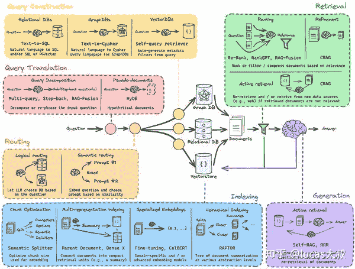
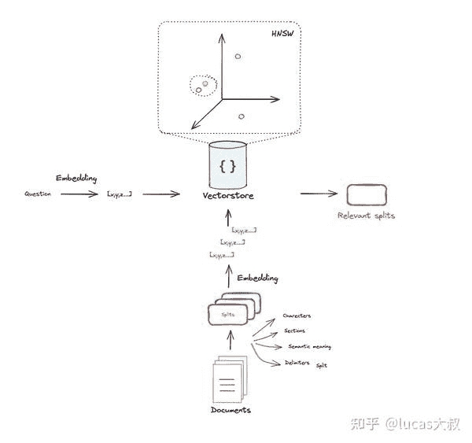
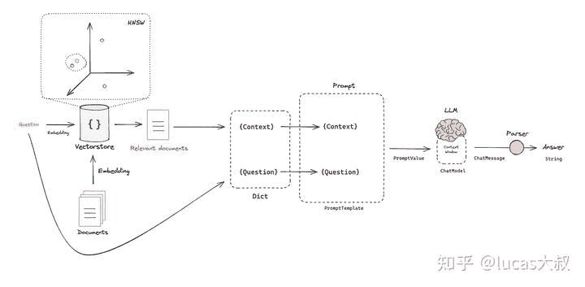

# 从0开始学RAG之快速入门

> 来源：[https://agijuejin.feishu.cn/docx/Pdjtd57vCo6L5zxWdjFcU3pCnZK](https://agijuejin.feishu.cn/docx/Pdjtd57vCo6L5zxWdjFcU3pCnZK)

> 作者：lucas大叔

> 原文：[https://zhuanlan.z](https://zhuanlan.zhihu.com/p/685411934)hihu.com/p/685411...

[检索增强生成 ](https://www.zhihu.com/search?q=%E6%A3%80%E7%B4%A2%E5%A2%9E%E5%BC%BA%E7%94%9F%E6%88%90&search_source=Entity&hybrid_search_source=Entity&hybrid_search_extra=%7B%22sourceType%22%3A%22article%22%2C%22sourceId%22%3A685411934%7D)（[RAG）作为一种将L](https://www.zhihu.com/search?q=retrieval&search_source=Entity&hybrid_search_source=Entity&hybrid_search_extra=%7B%22sourceType%22%3A%22article%22%2C%22sourceId%22%3A685411934%7D)LM与外部数据源打通的方法，可以有效弥补LLM的实时性和幻觉等短板。常规的RAG流程包括indexing、 retrieval 和generation三部分，但当面对真实使用场景时，还需要采用更先进的技术和方案来解决现实中的挑战。

下图汇总了RAG [全链路 ](https://www.zhihu.com/search?q=%E5%85%A8%E9%93%BE%E8%B7%AF&search_source=Entity&hybrid_search_source=Entity&hybrid_search_extra=%7B%22sourceType%22%3A%22article%22%2C%22sourceId%22%3A685411934%7D)上[各个环节可](https://link.zhihu.com/?target=https%3A//www.youtube.com/watch%3Fv%3Dwd7TZ4w1mSw%26feature%3Dyoutu.be)应用的技术，可以看到林林总总的还不少，接下来我们会用一个系列对图中的每项技术进行讲解和代码实践。有条件的同学可以follow 视频教程 。



本节首先讲解如何利用ChatGPT快速构建RAG应用，大家可以根据自己的使用需求将代码中embedding模型和LLM替换成开源大模型。

---

以下是RAG应用的快速实现示例，初学者可以运行体验一下。

```
import bs4
from langchain import hub
from langchain.text_splitter import RecursiveCharacterTextSplitter
from langchain_community.document_loaders import WebBaseLoader
from langchain_community.vectorstores import Chroma
from langchain_core.output_parsers import StrOutputParser
from langchain_core.runnables import RunnablePassthrough
from langchain_openai import ChatOpenAI, OpenAIEmbeddings

#### INDEXING ####

# Load Documents
loader = WebBaseLoader(
    web_paths=(&quot;https://lilianweng.github.io/posts/2023-06-23-agent/&quot;,),
    bs_kwargs=dict(
        parse_only=bs4.SoupStrainer(
            class_=(&quot;post-content&quot;, &quot;post-title&quot;, &quot;post-header&quot;)
        )
    ),
)
docs = loader.load()

# Split
text_splitter = RecursiveCharacterTextSplitter(chunk_size=1000, chunk_overlap=200)
splits = text_splitter.split_documents(docs)

# Embed
vectorstore = Chroma.from_documents(documents=splits, 
                                    embedding=OpenAIEmbeddings())

retriever = vectorstore.as_retriever()

#### RETRIEVAL and GENERATION ####

# Prompt
prompt = hub.pull(&quot;rlm/rag-prompt&quot;)

# LLM
llm = ChatOpenAI(model_name=&quot;gpt-3.5-turbo&quot;, temperature=0)

# Post-processing
def format_docs(docs):
    return &quot;\n\n&quot;.join(doc.page_content for doc in docs)

# Chain
rag_chain = (
    {&quot;context&quot;: retriever | format_docs, &quot;question&quot;: RunnablePassthrough()}
    | prompt
    | llm
    | StrOutputParser()
)

# Question
rag_chain.invoke(&quot;What is Task Decomposition?&quot;)
```

## Indexing

构建RAG应用首先要通过相应的loader加载数据，不论是pdf、word、markdown，亦或是网页。加载完成后再选择TextSplitter将文档切割为chunk用于embedding和向量存储。



## Retrieval

最简单的retrieval是将向量存储作为检索器，检索获取相似文档。此外，还有各种类型的retriever，后面我们会一一介绍。

## Generation

将retriever检索到的候选文档和query与prompt一并扔给LL[M，让它根](https://www.zhihu.com/search?q=%E6%96%B9%E4%BE%BF%E9%98%85%E8%AF%BB&search_source=Entity&hybrid_search_source=Entity&hybrid_search_extra=%7B%22sourceType%22%3A%22article%22%2C%22sourceId%22%3A685411934%7D)据prompt中的指令生成答案，生成的答案再用parser解析成人类 方便阅读 的格式。



通过上面的示例代码，可以快速构建一个简单的RAG demo，体验LLM的乐趣。若想打造能够工程落地的RAG应用，需要针[对具体数据](https://www.zhihu.com/search?q=%E8%81%94%E5%90%88%E4%BC%98%E5%8C%96&search_source=Entity&hybrid_search_source=Entity&hybrid_search_extra=%7B%22sourceType%22%3A%22article%22%2C%22sourceId%22%3A685411934%7D)和bad case确定总的解决方案，在indexing、retriever和generation等环节上进行 联合优化 。