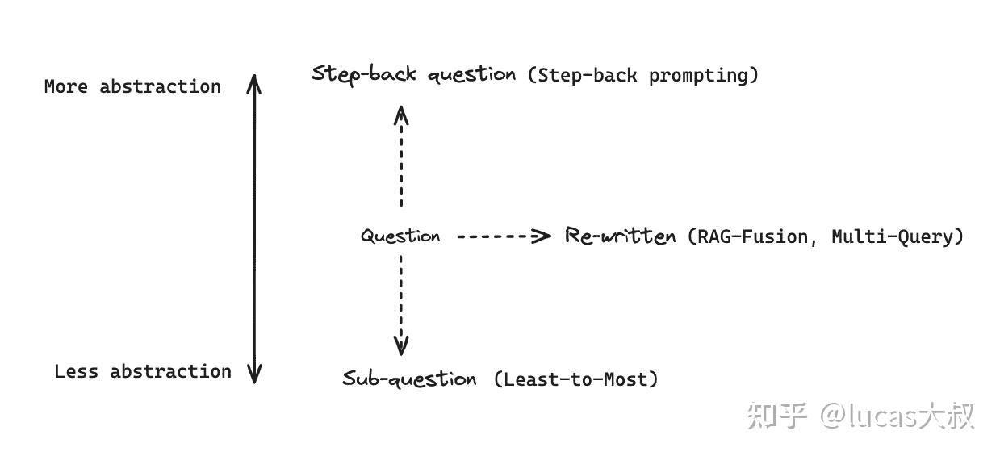
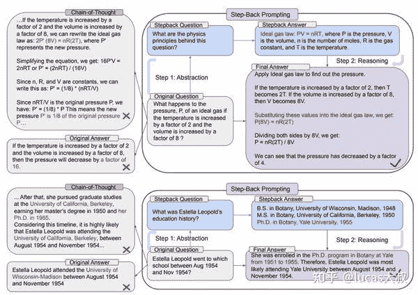

# 从0开始学RAG之Step Back

> 来源：[https://agijuejin.feishu.cn/docx/PjUwd24lYo66FIx7aHicdBljnff](https://agijuejin.feishu.cn/docx/PjUwd24lYo66FIx7aHicdBljnff)

> 作者：lucas大叔

> 原文链接： [https://zhuanlan.z](https://zhuanlan.zhihu.com/p/685902986)hihu.com/p/685902...

下面这张图清晰地说明了三种query translation技术的应用场景。一般情况下，可以利用RAG-Fusion和Multi-Query对question进行重写；此外，为了得到更具体的问题表述，可以利用 Least-to-Most prompting ，也就是前面介绍的 query decomposition两种方法 秉承分而治之的思想将问题分解为子问题，一步步地回答问题。

Step-bac[k p](https://www.zhihu.com/search?q=%E8%B0%B7%E6%AD%8C&search_source=Entity&hybrid_search_source=Entity&hybrid_search_extra=%7B%22sourceType%22%3A%22article%22%2C%22sourceId%22%3A685902986%7D)rompting （又是一篇来自 谷歌 的paper，正着玩、反着玩，不给别人留点活路的玩~），顾名思义就是后退一步，让question向更抽象靠拢。咋一看有点不思其解，为什么要让问题变得更抽象？作者引用了Edsger W. Dijkstra大佬的一句话：“The purpose of abstraction is not to be vague, but to create a new semantic level in which one can be absolutely precise.”抽象的目的不是为了让你更迷糊，而是创建了绝对精确的新的语义层次。



当然， Step-back prompting 的提出还是基于LLM面对复杂的多步推理时所面临的挑战。有研究表明逐步验证的过程监督是提高推理中间过程正确性的有效补救措施，比如CoT提示生成一系列连贯的中间推理步骤以增加遵循正确解决路径的成功率。当面对具有挑战性的问题时，人类经常会后退一步，抽象到更高层面的概念和原则上指导过程，受此启发作者提出 step-back prompting ，基于抽象的事实推理以减少中间推理步骤出错的机会。



从上图的两个例子可以看出，原始回[答和CoT](https://www.zhihu.com/search?q=%E5%8E%9F%E5%A7%8B%E9%97%AE%E9%A2%98&search_source=Entity&hybrid_search_source=Entity&hybrid_search_extra=%7B%22sourceType%22%3A%22article%22%2C%22sourceId%22%3A685902986%7D)提示都没有得到正确答案。通过 原始问题 生成更抽象的Stepback问题，检索得到的Stepback Answer包含了原理和背景信息，基于Stepback Answer推理得到了正确答案。

Step-back prompting 作为一种建立在CoT推理基础上的改进检索的方法，它基于问题生成一个Step-back（更高级别、更抽象）的问题，该问题可以作为正确回答原始问题的先决条件。在背景知识或更基本的理解有助于回答特定问题的情况下， Step-back prompting策略 尤其有用。

---

代码实现时，先提供几个example作为few shot example放在prompt模板里。

```
# Few Shot Examples
from langchain_core.prompts import ChatPromptTemplate, FewShotChatMessagePromptTemplate
examples = [
    {
        &quot;input&quot;: &quot;Could the members of The Police perform lawful arrests?&quot;,
        &quot;output&quot;: &quot;what can the members of The Police do?&quot;,
    },
    {
        &quot;input&quot;: &quot;Jan Sindel’s was born in what country?&quot;,
        &quot;output&quot;: &quot;what is Jan Sindel’s personal history?&quot;,
    },
]
# We now transform these to example messages
example_prompt = ChatPromptTemplate.from_messages(
    [
        (&quot;human&quot;, &quot;{input}&quot;),
        (&quot;ai&quot;, &quot;{output}&quot;),
    ]
)
few_shot_prompt = FewShotChatMessagePromptTemplate(
    example_prompt=example_prompt,
    examples=examples,
)
prompt = ChatPromptTemplate.from_messages(
    [
        (
            &quot;system&quot;,
            &quot;&quot;&quot;You are an expert at world knowledge. Your task is to step back and paraphrase a question to a more generic step-back question, which is easier to answer. Here are a few examples:&quot;&quot;&quot;,
        ),
        # Few shot examples
        few_shot_prompt,
        # New question
        (&quot;user&quot;, &quot;{question}&quot;),
    ]
)
```

构造生成 [stepback问题 ](https://www.zhihu.com/search?q=stepback%E9%97%AE%E9%A2%98&search_source=Entity&hybrid_search_source=Entity&hybrid_search_extra=%7B%22sourceType%22%3A%22article%22%2C%22sourceId%22%3A685902986%7D)的chain，基于原始问题生成stepback问题。

```
generate_queries_step_back = prompt | ChatOpenAI(temperature=0) | StrOutputParser()
question = &quot;What is task decomposition for LLM agents?&quot;
generate_queries_step_back.invoke({&quot;question&quot;: question})
```

构建chain用于验证问答效果。可以看到提示模板中既包含原始question检索得到的context，也包含 stepback question 检索得到的step_back_context。Stepback Prompting通过“抽象”和“推理”两步提升了复杂推理场景的问答效果。

```
# Response prompt 
response_prompt_template = &quot;&quot;&quot;You are an expert of world knowledge. I am going to ask you a question. Your response should be comprehensive and not contradicted with the following context if they are relevant. Otherwise, ignore them if they are not relevant.

# {normal_context}
# {step_back_context}

# Original Question: {question}
# Answer:&quot;&quot;&quot;
response_prompt = ChatPromptTemplate.from_template(response_prompt_template)

chain = (
    {
        # Retrieve context using the normal question
        &quot;normal_context&quot;: RunnableLambda(lambda x: x[&quot;question&quot;]) | retriever,
        # Retrieve context using the step-back question
        &quot;step_back_context&quot;: generate_queries_step_back | retriever,
        # Pass on the question
        &quot;question&quot;: lambda x: x[&quot;question&quot;],
    }
    | response_prompt
    | ChatOpenAI(temperature=0)
    | StrOutputParser()
)

chain.invoke({&quot;question&quot;: question})
```