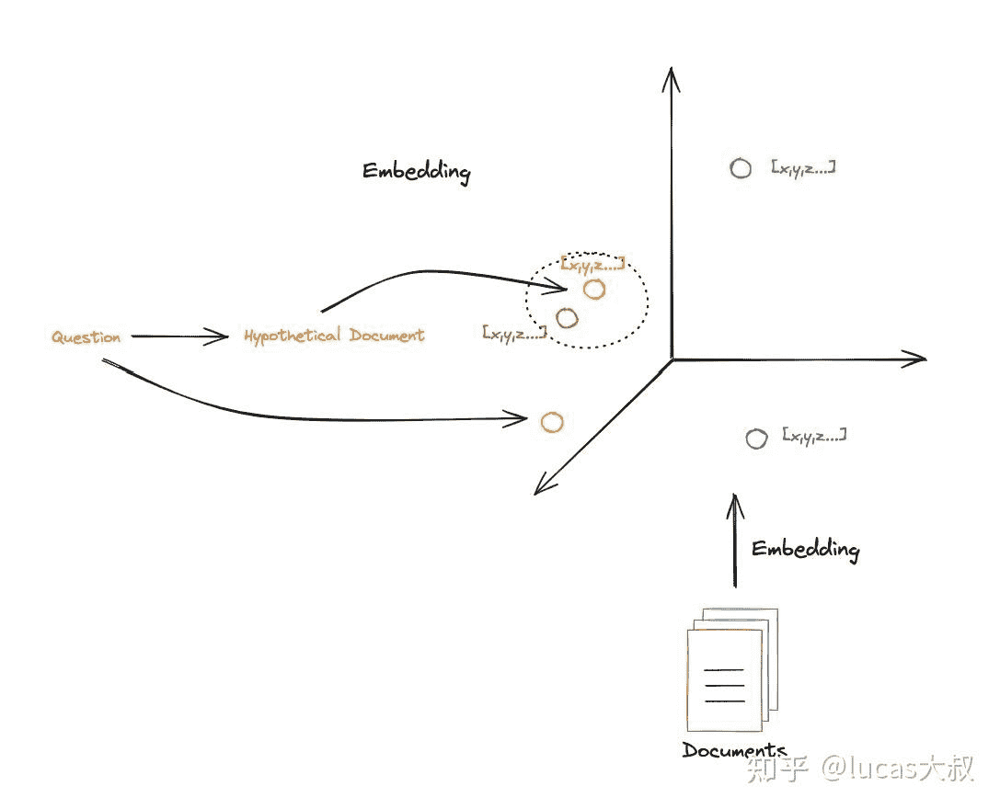

# 从0开始学RAG之HyDE

> 来源：[https://agijuejin.feishu.cn/docx/V2N5do2T7oEG3GxsgR5cKIhAnog](https://agijuejin.feishu.cn/docx/V2N5do2T7oEG3GxsgR5cKIhAnog)

> 作者：lucas大叔

> 原文：[https://zhuanlan.z](https://zhuanlan.zhihu.com/p/685943610)hihu.com/p/685943...

[HyDE ](https://link.zhihu.com/?target=https%3A//arxiv.org/pdf/2212.10496.pdf)（Hypothetical Document Embeddings）是一种改进检索的方法[，它生成](https://www.zhihu.com/search?q=%E5%90%91%E9%87%8F%E5%8C%96&search_source=Entity&hybrid_search_source=Entity&hybrid_search_extra=%7B%22sourceType%22%3A%22article%22%2C%22sourceId%22%3A685943610%7D)可用于回答用户输入问题的假设文档。这些文档来自LLM自[身学习到的](https://www.zhihu.com/search?q=%E7%B4%A2%E5%BC%95%E6%96%87%E6%A1%A3&search_source=Entity&hybrid_search_source=Entity&hybrid_search_extra=%7B%22sourceType%22%3A%22article%22%2C%22sourceId%22%3A685943610%7D)知识， 向量化 后用于从索引中检索文档。HyDE方法认为原始问题一般都比较短，而生成的假设文档可能会更好地与 索引文档 对齐。



---

HyDE方法思想很简单，不做过多解释，直接上代码。先构造chain，让LLM直接生成一段话回答问题。

```
from langchain.prompts import ChatPromptTemplate

# HyDE document genration
template = &quot;&quot;&quot;Please write a scientific paper passage to answer the question
Question: {question}
Passage:&quot;&quot;&quot;
prompt_hyde = ChatPromptTemplate.from_template(template)

from langchain_core.output_parsers import StrOutputParser
from langchain_openai import ChatOpenAI

generate_docs_for_retrieval = (
    prompt_hyde | ChatOpenAI(temperature=0) | StrOutputParser() 
)

# Run
question = &quot;What is task decomposition for LLM agents?&quot;
generate_docs_for_retrieval.invoke({&quot;question&quot;:question})
```

把LLM回答的一段话作为输入再去向量库检索。

```
# Retrieve
retrieval_chain = generate_docs_for_retrieval | retriever 
retireved_docs = retrieval_chain.invoke({&quot;question&quot;:question})
```

基于向量库检索得到的context回答原始问题。

```
# RAG
template = &quot;&quot;&quot;Answer the following question based on this context:

{context}

Question: {question}
&quot;&quot;&quot;

prompt = ChatPromptTemplate.from_template(template)

final_rag_chain = (
    prompt
    | llm
    | StrOutputParser()
)

final_rag_chain.invoke({&quot;context&quot;:retireved_docs,&quot;question&quot;:question})
```