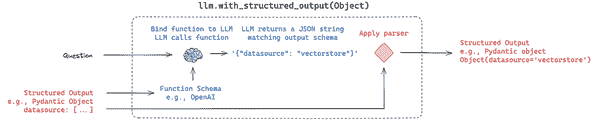
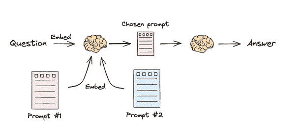

# 从0开始学RAG之Routing

> 来源：[https://agijuejin.feishu.cn/docx/Gf4HdW6ymoe3MZxdmrHcyKi3n9f](https://agijuejin.feishu.cn/docx/Gf4HdW6ymoe3MZxdmrHcyKi3n9f)

> 作者：lucas大叔

> 原文：[https://zhuanlan.z](https://zhuanlan.zhihu.com/p/687808755)hihu.com/p/687808...

当面对多个可能的数据存储（例如，不同的向量数据库、关系型数据库等）或prompt，我们希望可以根据用户query进行选择。

Logical routing可以使用LLM对query进行推理，并选择更合适的数据存储。Semantic routing将query和一组prompt向量化表示，并基于相似性选择合适的prompt。

---

## Logical routing


对于具有function-calling功能的model来说，logical routing就是用model来做分类。

```
from typing import Literal

from langchain_core.prompts import ChatPromptTemplate
from langchain_core.pydantic_v1 import BaseModel, Field
from langchain_openai import ChatOpenAI

# Data model
class RouteQuery(BaseModel):
    &quot;&quot;&quot;Route a user query to the most relevant datasource.&quot;&quot;&quot;

    datasource: Literal[&quot;python_docs&quot;, &quot;js_docs&quot;, &quot;golang_docs&quot;] = Field(
        ...,
        description=&quot;Given a user question choose which datasource would be most relevant for answering their question&quot;,
    )

# LLM with function call 
llm = ChatOpenAI(model=&quot;gpt-3.5-turbo-0125&quot;, temperature=0)
structured_llm = llm.with_structured_output(RouteQuery)

# Prompt 
system = &quot;&quot;&quot;You are an expert at routing a user question to the appropriate data source.
Based on the programming language the question is referring to, route it to the relevant data source.&quot;&quot;&quot;

prompt = ChatPromptTemplate.from_messages(
    [
        (&quot;system&quot;, system),
        (&quot;human&quot;, &quot;{question}&quot;),
    ]
)

# Define router 
router = prompt | structured_llm
```

利用function calling生成结构化输出。



```
[question = &quot;&quot;](https://www.zhihu.com/search?q=prompt.invoke&amp;search_source=Entity&amp;hybrid_search_source=Entity&amp;hybrid_search_extra=%7B%22sourceType%22%3A%22article%22%2C%22sourceId%22%3A687808755%7D)&quot;Why doesn&#x27;t the following code work:

from langchain_core.prompts import ChatPromptTemplate

prompt = ChatPromptTemplate.from_messages([&quot;human&quot;, &quot;speak in {language}&quot;])
prompt.invoke(&quot;french&quot;)
&quot;&quot;&quot;

result = router.invoke({&quot;question&quot;: question})
```

result为

```
RouteQuery(datasource=&#x27;python_docs&#x27;)
```

result.datasource为

```
&#x27;python_docs&#x27;
```

获取到 [数据源 ](https://www.zhihu.com/search?q=%E6%95%B0%E6%8D%AE%E6%BA%90&search_source=Entity&hybrid_search_source=Entity&hybrid_search_extra=%7B%22sourceType%22%3A%22article%22%2C%22sourceId%22%3A687808755%7D)信息后，定义选择函数使用datasource

```
def choose_route(result):
    if &quot;python_docs&quot; in result.datasource.lower():
        ### Logic here 
        return &quot;chain for python_docs&quot;
    elif &quot;js_docs&quot; in result.datasource.lower():
        ### Logic here 
        return &quot;chain for js_docs&quot;
    else:
        ### Logic here 
        return &quot;golang_docs&quot;

from langchain_core.runnables import RunnableLambda

full_chain = router | RunnableLambda(choose_route)

full_chain.invoke({&quot;question&quot;: question})
```

结果为

```
&#x27;chain for python_docs&#x27;
```

[如果想同时查询](https://www.zhihu.com/search?q=schema&search_source=Entity&hybrid_search_source=Entity&hybrid_search_extra=%7B%22sourceType%22%3A%22article%22%2C%22sourceId%22%3A687808755%7D)多个数据源，可以更新 schema 以接受数据源列表。可以看到与之前的RouteQuery类相比，doc_string描述没有变化，属性名和description中的datasource变为datasources。

```
from typing import List


class RouteQuery(BaseModel):
    &quot;&quot;&quot;Route a user query to the most relevant datasource.&quot;&quot;&quot;

    datasources: List[Literal[&quot;python_docs&quot;, &quot;js_docs&quot;, &quot;golang_docs&quot;]] = Field(
        ...,
        description=&quot;Given a user question choose which datasources would be most relevant for answering their question&quot;,
    )


llm = ChatOpenAI(model=&quot;gpt-3.5-turbo-0125&quot;, temperature=0)
structured_llm = llm.with_structured_output(RouteQuery)
router = prompt | structured_llm
router.invoke(
    {
        &quot;question&quot;: &quot;is there feature parity between the Python and JS implementations of OpenAI chat models&quot;
    }
)
```

结果为

```
RouteQuery(datasources=[&#x27;python_docs&#x27;, &#x27;js_docs&#x27;])
```

## Semantic routing



[使用LCE](https://www.zhihu.com/search?q=%E8%B7%AF%E7%94%B1%E9%80%BB%E8%BE%91&search_source=Entity&hybrid_search_source=Entity&hybrid_search_extra=%7B%22sourceType%22%3A%22article%22%2C%22sourceId%22%3A687808755%7D)[L可以轻](https://www.zhihu.com/search?q=%E9%93%BE%E9%80%BB%E8%BE%91&search_source=Entity&hybrid_search_source=Entity&hybrid_search_extra=%7B%22sourceType%22%3A%22article%22%2C%22sourceId%22%3A687808755%7D)松地将自定义 路由逻辑 添加到链中，以根据用户输入动态确定 链逻辑 。你所需要做的就是定义一个函数，该函数在给定输入的情况下返回Runnable。

一种特别有用的技术是使用embedding将query路由到最相关的prompt，此处里举一个非常简单的例子。

```
from lan[gchain.u](https://www.zhihu.com/search?q=template&amp;search_source=Entity&amp;hybrid_search_source=Entity&amp;hybrid_search_extra=%7B%22sourceType%22%3A%22article%22%2C%22sourceId%22%3A687808755%7D)tils.ma[th import ](https://www.zhihu.com/search?q=embeddings&amp;search_source=Entity&amp;hybrid_search_source=Entity&amp;hybrid_search_extra=%7B%22sourceType%22%3A%22article%22%2C%22sourceId%22%3A687808755%7D)cosine_similarity
from langchain_core.output_parsers import StrOutputParser
from langchain_core.prompts import PromptTemplate
from langchain_core.runnables import RunnableLambda, RunnablePassthrough
from langchain_openai import ChatOpenAI, OpenAIEmbeddings

# Two prompts
physics_template = &quot;&quot;&quot;You are a very smart physics professor. \
You are great at answering questions about physics in a concise and easy to understand manner. \
When you don&#x27;t know the answer to a question you admit that you don&#x27;t know.

Here is a question:
{query}&quot;&quot;&quot;

math_template = &quot;&quot;&quot;You are a very good mathematician. You are great at answering math questions. \
You are so good because you are able to break down hard problems into their component parts, \
answer the component parts, and then put them together to answer the broader question.

Here is a question:
{query}&quot;&quot;&quot;

# Embed prompts
embeddings = OpenAIEmbeddings()
prompt_templates = [physics_template, math_template]
prompt_embeddings = embeddings.embed_documents(prompt_templates)

# Route question to prompt 
def prompt_router(input):
    # Embed question
    query_embedding = embeddings.embed_query(input[&quot;query&quot;])
    # Compute similarity
    similarity = cosine_similarity([query_embedding], prompt_embeddings)[0]
    most_similar = prompt_templates[similarity.argmax()]
    # Chosen prompt 
    print(&quot;Using MATH&quot; if most_similar == math_template else &quot;Using PHYSICS&quot;)
    return PromptTemplate.from_template(most_similar)

chain = (
    {&quot;query&quot;: RunnablePassthrough()}
    | RunnableLambda(prompt_router)
    | ChatOpenAI()
    | StrOutputParser()
)

print(chain.invoke(&quot;What&#x27;s a black hole&quot;))
```

结果为

```
Using PHYSICS
A black hole is a region in space where the gravitational pu[ll is so stron](https://www.zhihu.com/search?q=star%20collapses&amp;search_source=Entity&amp;hybrid_search_source=Entity&amp;hybrid_search_extra=%7B%22sourceType%22%3A%22article%22%2C%22sourceId%22%3A687808755%7D)g[ that nothi](https://www.zhihu.com/search?q=singularity&amp;search_source=Entity&amp;hybrid_search_source=Entity&amp;hybrid_search_extra=%7B%22sourceType%22%3A%22article%22%2C%22sourceId%22%3A687808755%7D)ng, not even light, can escape from it. It is formed when a massive star collapses in on itself. The center of a black hole is called a singularity, where the laws of physics as we know them break down. Black holes can vary in size, with the smallest ones being just a few times the mass of our sun, while the largest ones can be billions of times more massive.
```

## 参考资料

[https://github.com/langchain-](https://link.zhihu.com/?target=https%3A//github.com/langchain-ai/rag-from-scratch/blob/main/rag_from_scratch_10_and_11.ipynb)ai/rag-from-scratch/

Routing | ️ Langchain

[https:// python.langchain.com/do cs/expres](https://link.zhihu.com/?target=https%3A//python.langchain.com/docs/expression_language/cookbook/embedding_router)sion_language/cookbook/embedding_router