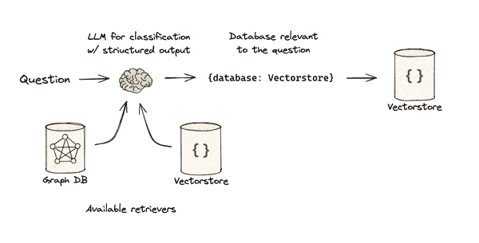

# 从0开始学RAG之Routing

> 来源：[https://agijuejin.feishu.cn/docx/Gf4HdW6ymoe3MZxdmrHcyKi3n9f](https://agijuejin.feishu.cn/docx/Gf4HdW6ymoe3MZxdmrHcyKi3n9f)
> 作者：lucas大叔
> 原文：[https://zhuanlan.zhihu.com/p/687808755](https://zhuanlan.zhihu.com/p/687808755)

当面对多个可能的数据存储（例如，不同的向量数据库、关系型数据库等）或`prompt`，我们希望可以根据用户`query`进行选择。

`Logical routing`可以使用`LLM`对`query`进行推理，并选择更合适的数据存储。`Semantic routing`将`query`和一组`prompt`向量化表示，并基于相似性选择合适的`prompt`。

---

## Logical routing



对于具有function-calling功能的model来说，logical routing就是用model来做分类。

```
from typing import Literal

from langchain_core.prompts import ChatPromptTemplate
from langchain_core.pydantic_v1 import BaseModel, Field
from langchain_openai import ChatOpenAI

# Data model
class RouteQuery(BaseModel):
    """Route a user query to the most relevant datasource."""

    datasource: Literal["python_docs", "js_docs", "golang_docs"] = Field(
        ...,
        description="Given a user question choose which datasource would be most relevant for answering their question",
    )

# LLM with function call 
llm = ChatOpenAI(model="gpt-3.5-turbo-0125", temperature=0)
structured_llm = llm.with_structured_output(RouteQuery)

# Prompt 
system = """You are an expert at routing a user question to the appropriate data source.
Based on the programming language the question is referring to, route it to the relevant data source."""

prompt = ChatPromptTemplate.from_messages(
    [
        ("system", system),
        ("human", "{question}"),
    ]
)

# Define router 
router = prompt | structured_llm
```

利用function calling生成结构化输出。


```
question = """Why doesn't the following code work:

from langchain_core.prompts import ChatPromptTemplate

prompt = ChatPromptTemplate.from_messages(["human", "speak in {language}"])
prompt.invoke("french")
"""

result = router.invoke({"question": question})
```

`result`为

```
RouteQuery(datasource='python_docs')
```

`result.datasource`为

```
'python_docs'
```

获取到数据源信息后，定义选择函数使用`datasource`

```
def choose_route(result):
    if "python_docs" in result.datasource.lower():
        ### Logic here 
        return "chain for python_docs"
    elif "js_docs" in result.datasource.lower():
        ### Logic here 
        return "chain for js_docs"
    else:
        ### Logic here 
        return "golang_docs"

from langchain_core.runnables import RunnableLambda

full_chain = router | RunnableLambda(choose_route)

full_chain.invoke({"question": question})
```

结果为

```
'chain for python_docs'
```

如果想同时查询多个数据源，可以更新`schema`以接受数据源列表。可以看到与之前的`RouteQuery`类相比，`doc_string`描述没有变化，属性名和`description`中的`datasource`变为`datasources`。

```
from typing import List


class RouteQuery(BaseModel):
    """Route a user query to the most relevant datasource."""

    datasources: List[Literal["python_docs", "js_docs", "golang_docs"]] = Field(
        ...,
        description="Given a user question choose which datasources would be most relevant for answering their question",
    )


llm = ChatOpenAI(model="gpt-3.5-turbo-0125", temperature=0)
structured_llm = llm.with_structured_output(RouteQuery)
router = prompt | structured_llm
router.invoke(
    {
        "question": "is there feature parity between the Python and JS implementations of OpenAI chat models"
    }
)
```

结果为

```
RouteQuery(datasources=['python_docs', 'js_docs'])
```

## Semantic routing


使用`LCEL`可以轻松地将自定义路由逻辑添加到链中，以根据用户输入动态确定链逻辑。你所需要做的就是定义一个函数，该函数在给定输入的情况下返回`Runnable`。

一种特别有用的技术是使用`embedding`将`query`路由到最相关的`prompt`，此处里举一个非常简单的例子。

```
from langchain.utils.math import cosine_similarity
from langchain_core.output_parsers import StrOutputParser
from langchain_core.prompts import PromptTemplate
from langchain_core.runnables import RunnableLambda, RunnablePassthrough
from langchain_openai import ChatOpenAI, OpenAIEmbeddings

# Two prompts
physics_template = """You are a very smart physics professor. \
You are great at answering questions about physics in a concise and easy to understand manner. \
When you don't know the answer to a question you admit that you don't know.

Here is a question:
{query}"""

math_template = """You are a very good mathematician. You are great at answering math questions. \
You are so good because you are able to break down hard problems into their component parts, \
answer the component parts, and then put them together to answer the broader question.

Here is a question:
{query}"""

# Embed prompts
embeddings = OpenAIEmbeddings()
prompt_templates = [physics_template, math_template]
prompt_embeddings = embeddings.embed_documents(prompt_templates)

# Route question to prompt 
def prompt_router(input):
    # Embed question
    query_embedding = embeddings.embed_query(input["query"])
    # Compute similarity
    similarity = cosine_similarity([query_embedding], prompt_embeddings)[0]
    most_similar = prompt_templates[similarity.argmax()]
    # Chosen prompt 
    print("Using MATH" if most_similar == math_template else "Using PHYSICS")
    return PromptTemplate.from_template(most_similar)

chain = (
    {"query": RunnablePassthrough()}
    | RunnableLambda(prompt_router)
    | ChatOpenAI()
    | StrOutputParser()
)

print(chain.invoke("What's a black hole"))
```

结果为


# Using `PHYSICS`

A black hole is a region in space where the gravitational pull is so strong that nothing, not even light, can escape from it. It is formed when a massive star collapses in on itself. The center of a black hole is called a singularity, where the laws of physics as we know them break down. Black holes can vary in size, with the smallest ones being just a few times the mass of our sun, while the largest ones can be billions of times more massive.

## 参考资料

- [`https://github.com/langchain-ai/rag-from-scratch/blob/main/rag_from_scratch_10_and_11.ipynb`](https://github.com/langchain-ai/rag-from-scratch/blob/main/rag_from_scratch_10_and_11.ipynb)

Routing | ️ Langchain

- [`https://python.langchain.com/docs/expression_language/cookbook/embedding_router`](https://python.langchain.com/docs/expression_language/cookbook/embedding_router)
