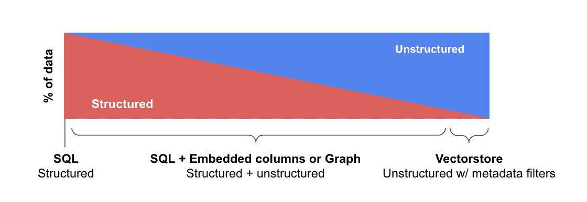

# 从0开始学RAG之Query Construction

> 来源：[https://agijuejin.feishu.cn/docx/RHSQdtEploYR0gx24uPcWoLfnSb](https://agijuejin.feishu.cn/docx/RHSQdtEploYR0gx24uPcWoLfnSb)

> 作者：lucas大叔

> 原文：[https://zhuanlan.z](https://zhuanlan.zhihu.com/p/687874199)hihu.com/p/687874...

[人们对将自](https://www.zhihu.com/search?q=%E5%8D%8A%E7%BB%93%E6%9E%84%E5%8C%96&search_source=Entity&hybrid_search_source=Entity&hybrid_search_extra=%7B%22sourceType%22%3A%22article%22%2C%22sourceId%22%3A687874199%7D)然语言与各种类型的数据（结构化、非结构化和 半结构化 ）无缝连接具有非常浓厚的兴趣。但是，对每种数据类型而言，这种新兴的“LUI”（ language user interface ）方式都有特定的挑战和考虑：

+   [结构化数据 ](https://www.zhihu.com/search?q=%E7%BB%93%E6%9E%84%E5%8C%96%E6%95%B0%E6%8D%AE&search_source=Entity&hybrid_search_source=Entity&hybrid_search_extra=%7B%22sourceType%22%3A%22article%22%2C%22sourceId%22%3A687874199%7D)：主要存储在SQL或 [图数据库 ](https://www.zhihu.com/search?q=%E5%9B%BE%E6%95%B0%E6%8D%AE%E5%BA%93&search_source=Entity&hybrid_search_source=Entity&hybrid_search_extra=%7B%22sourceType%22%3A%22article%22%2C%22sourceId%22%3A687874199%7D)中，其特征是预定义的schema，并以表或关系的形式组织，使其易于进行精确的查询操作。

+   [半结构化数据 ](https://www.zhihu.com/search?q=%E5%8D%8A%E7%BB%93%E6%9E%84%E5%8C%96%E6%95%B0%E6%8D%AE&search_source=Entity&hybrid_search_source=Entity&hybrid_search_extra=%7B%22sourceType%22%3A%22article%22%2C%22sourceId%22%3A687874199%7D)：将结构化元素（例如文档或 [关系数据库 ](https://www.zhihu.com/search?q=%E5%85%B3%E7%B3%BB%E6%95%B0%E6%8D%AE%E5%BA%93&search_source=Entity&hybrid_search_source=Entity&hybrid_search_extra=%7B%22sourceType%22%3A%22article%22%2C%22sourceId%22%3A687874199%7D)中的表）与非结构化元素（例如关系数据库中文本或嵌入列）混合在一起。

+   [非结构化数据 ](https://www.zhihu.com/search?q=%E9%9D%9E%E7%BB%93%E6%9E%84%E5%8C%96%E6%95%B0%E6%8D%AE&search_source=Entity&hybrid_search_source=Entity&hybrid_search_extra=%7B%22sourceType%22%3A%22article%22%2C%22sourceId%22%3A687874199%7D)：通常存储在向量数据库中，由没有预定义模[型的信息组成，](https://www.zhihu.com/search?q=%E7%BB%93%E6%9E%84%E5%8C%96%E5%85%83%E6%95%B0%E6%8D%AE&search_source=Entity&hybrid_search_source=Entity&hybrid_search_extra=%7B%22sourceType%22%3A%22article%22%2C%22sourceId%22%3A687874199%7D)通常伴随着能够进行过滤的 结构化元数据 。



LLM具有强大的query construction能力，可以[将自然语言](https://www.zhihu.com/search?q=%E6%9F%A5%E8%AF%A2%E8%AF%AD%E6%B3%95&search_source=Entity&hybrid_search_source=Entity&hybrid_search_extra=%7B%22sourceType%22%3A%22article%22%2C%22sourceId%22%3A687874199%7D)转换为适合每种数据类型的特定 查询语法 。

---

## 什么是 Query Construction

典型的RAG方法将用户query转换为向量表示，然后将该向量与源文档的向量表示进行比较，找到具有最相似的向量表示的源文档。这种方式对非结构化数据相当有效，但对结构化数据呢？

世界上大部分数据都有一定的结构，这些数[据大多存储在](https://www.zhihu.com/search?q=%E5%9B%BE%E5%BD%A2%E6%95%B0%E6%8D%AE%E5%BA%93&search_source=Entity&hybrid_search_source=Entity&hybrid_search_extra=%7B%22sourceType%22%3A%22article%22%2C%22sourceId%22%3A687874199%7D)关系数据库（例如SQL）或 图形数据库 中，甚至非结构化数据也经常与结构化元数据（例如，作者、流派、发布时间等）相关联。

> 许多用户query的最佳答案不仅是通过在embedding空间中找到相似的文档或数据，而且还利用数据中固有的以及在用户query中表达的结构。

例如，对于“what are mov[ies about alie](https://www.zhihu.com/search?q=the%20year%201980&search_source=Entity&hybrid_search_source=Entity&hybrid_search_extra=%7B%22sourceType%22%3A%22article%22%2C%22sourceId%22%3A687874199%7D)ns in the year 1980 ”这个查询，一部分（aliens ）可能要从语义上查找，但也有一部分（"year == 1980"）我们想以精确的方式查找。

> [Query c](https://www.zhihu.com/search?q=%E8%87%AA%E7%84%B6%E8%AF%AD%E8%A8%80%E6%9F%A5%E8%AF%A2&search_source=Entity&hybrid_search_source=Entity&hybrid_search_extra=%7B%22sourceType%22%3A%22article%22%2C%22sourceId%22%3A687874199%7D)onstruction就是[将 自然语](https://www.zhihu.com/search?q=%E6%9F%A5%E8%AF%A2%E8%AF%AD%E8%A8%80&search_source=Entity&hybrid_search_source=Entity&hybrid_search_extra=%7B%22sourceType%22%3A%22article%22%2C%22sourceId%22%3A687874199%7D)言查询 转换为与之交互的数据库的 查询语言 。

下面我们将介绍三种典型的 Query Construction 的示例。

---

## Text-to-metadata-filter


检索中最重要的步骤之一是将 [输入文本 ](https://www.zhihu.com/search?q=%E8%BE%93%E5%85%A5%E6%96%87%E6%9C%AC&search_source=Entity&hybrid_search_source=Entity&hybrid_search_extra=%7B%22sourceType%22%3A%22article%22%2C%22sourceId%22%3A687874199%7D)[转化为正确的](https://www.zhihu.com/search?q=%E7%BB%93%E6%9E%84%E5%8C%96%E5%8F%82%E6%95%B0&search_source=Entity&hybrid_search_source=Entity&hybrid_search_extra=%7B%22sourceType%22%3A%22article%22%2C%22sourceId%22%3A687874199%7D)查询和filter参数，即提取query中的 结构化参数 。当前许多向量库都包含元数据字段，这使得基于元数据过滤特定的chunk成为可能。

下面以YouTube [转录脚本数据库 ](https://www.zhihu.com/search?q=%E8%BD%AC%E5%BD%95%E8%84%9A%E6%9C%AC%E6%95%B0%E6%8D%AE%E5%BA%93&search_source=Entity&hybrid_search_source=Entity&hybrid_search_extra=%7B%22sourceType%22%3A%22article%22%2C%22sourceId%22%3A687874199%7D)为例展示元数据过滤的应用，首先加载样例文档

```
from langchain_community.document_loaders import YoutubeLoader

docs = YoutubeLoader.from_youtube_url(
    &quot;https://www.youtube.com/watch?v=pbAd8O1Lvm4&quot;, add_video_info=True
).load()

docs[0].metadata
```

查看video的元数据

```
{&#x27;source&#x27;: &#x27;pbAd8O1Lvm4&#x27;,
 &#x27;title&#x27;: &#x27;Self-reflective RAG with LangGraph: Self-RAG and CRAG&#x27;,
 &#x27;description&#x27;: &#x27;Unknown&#x27;,
 &#x27;view_count&#x27;: 9006,
 &#x27;thumbnail_url&#x27;: &#x27;https://i.ytimg.com/vi/pbAd8O1Lvm4/hq720.jpg&#x27;,
 &#x27;publish_date&#x27;: &#x27;2024-02-07 00:00:00&#x27;,
 &#x27;length&#x27;: 1058,
 &#x27;author&#x27;: &#x27;LangChain&#x27;}
```

[为了生成结构化的query](https://www.zhihu.com/search?q=query%20schema&search_source=Entity&hybrid_search_source=Entity&hybrid_search_extra=%7B%22sourceType%22%3A%22article%22%2C%22sourceId%22%3A687874199%7D)，首先需要定义 query schema 。可以看到每个文档都有标题、浏览次数、发布日期和长度（以秒为单位）。假设已经构建了一个索引，该索引允许我们对每个文档的内容和标题执行非结构化搜索，并对浏览次数、发布日期和长度等维度使用区间过滤。

首先，创建 schema定义浏览次数、发布日期和视频长度的最小和最大属性，以便后续可以基于这些属性过滤。此外，还将添加单独的属性用于针对内容和视频标题的检索。

```
[import date](https://www.zhihu.com/search?q=pydantic_v1&amp;search_source=Entity&amp;hybrid_search_source=Entity&amp;hybrid_search_extra=%7B%22sourceType%22%3A%22article%22%2C%22sourceId%22%3A687874199%7D)[time
from typi](https://www.zhihu.com/search?q=fields__%5Bfield&amp;search_source=Entity&amp;hybrid_search_source=Entity&amp;hybrid_search_extra=%7B%22sourceType%22%3A%22article%22%2C%22sourceId%22%3A687874199%7D)ng import Literal, Optional, Tuple

from langchain_core.pydantic_v1 import BaseModel, Field


class TutorialSearch(BaseModel):
    &quot;&quot;&quot;Search over a database of tutorial videos about a software library.&quot;&quot;&quot;

    content_search: str = Field(
        ...,
        description=&quot;Similarity search query applied to video transcripts.&quot;,
    )
    title_search: str = Field(
        ...,
        description=(
            &quot;Alternate version of the content search query to apply to video titles. &quot;
            &quot;Should be succinct and only include key words that could be in a video &quot;
            &quot;title.&quot;
        ),
    )
    min_view_count: Optional[int] = Field(
        None,
        description=&quot;Minimum view count filter, inclusive. Only use if explicitly specified.&quot;,
    )
    max_view_count: Optional[int] = Field(
        None,
        description=&quot;Maximum view count filter, exclusive. Only use if explicitly specified.&quot;,
    )
    earliest_publish_date: Optional[datetime.date] = Field(
        None,
        description=&quot;Earliest publish date filter, inclusive. Only use if explicitly specified.&quot;,
    )
    latest_publish_date: Optional[datetime.date] = Field(
        None,
        description=&quot;Latest publish date filter, exclusive. Only use if explicitly specified.&quot;,
    )
    min_length_sec: Optional[int] = Field(
        None,
        description=&quot;Minimum video length in seconds, inclusive. Only use if explicitly specified.&quot;,
    )
    max_length_sec: Optional[int] = Field(
        None,
        description=&quot;Maximum video length in seconds, exclusive. Only use if explicitly specified.&quot;,
    )

    def pretty_print(self) -&gt; None:
        for field in self.__fields__:
            if getattr(self, field) is not None and getattr(self, field) != getattr(
                self.__fields__[field], &quot;default&quot;, None
            ):
                print(f&quot;{field}: {getattr(self, field)}&quot;)
```

为了将用户问题转换为 [结构化查询 ](https://www.zhihu.com/search?q=%E7%BB%93%E6%9E%84%E5%8C%96%E6%9F%A5%E8%AF%A2&search_source=Entity&hybrid_search_source=Entity&hybrid_search_extra=%7B%22sourceType%22%3A%22article%22%2C%22sourceId%22%3A687874199%7D)，将使用 function-calling 模型，如ChatO[penAI。Lang](https://www.zhihu.com/search?q=Pydantic%E7%B1%BB&search_source=Entity&hybrid_search_source=Entity&hybrid_search_extra=%7B%22sourceType%22%3A%22article%22%2C%22sourceId%22%3A687874199%7D)Chain可以通过 Pydantic类 轻松指定所需的function call schema：

```
[from langchain](https://www.zhihu.com/search?q=structured_llm&amp;search_source=Entity&amp;hybrid_search_source=Entity&amp;hybrid_search_extra=%7B%22sourceType%22%3A%22article%22%2C%22sourceId%22%3A687874199%7D)_core.prompts import ChatPromptTemplate
from langchain_openai import ChatOpenAI

system = &quot;&quot;&quot;You are an expert at converting user questions into database queries. \
You have access to a database of tutorial videos about a software library for building LLM-powered applications. \
Given a question, return a database query optimized to retrieve the most relevant results.

If there are acronyms or words you are not familiar with, do not try to rephrase them.&quot;&quot;&quot;
prompt = ChatPromptTemplate.from_messages(
    [
        (&quot;system&quot;, system),
        (&quot;human&quot;, &quot;{question}&quot;),
    ]
)
llm = ChatOpenAI(model=&quot;gpt-3.5-turbo-0125&quot;, temperature=0)
structured_llm = llm.with_structured_output(TutorialSearch)
query_analyzer = prompt | structured_llm
```

看一下效果

```
query_analyzer.invoke({&quot;question&quot;: &quot;rag from scratch&quot;}).pretty_print()
```

content_search: rag from scratch

title_search: rag from scratch

```
query_analyzer.invoke(
    {&quot;question&quot;: &quot;videos on chat langchain published in 2023&quot;}
).pretty_print()
```

content_se[arch: ch](https://www.zhihu.com/search?q=publish&search_source=Entity&hybrid_search_source=Entity&hybrid_search_extra=%7B%22sourceType%22%3A%22article%22%2C%22sourceId%22%3A687874199%7D)at langchain

title_search: chat langchain

earliest_ publish _date: 2023-01-01

latest_publish_date: 2024-01-01

```
query_analyzer.invoke(
    {
        &quot;question&quot;: &quot;how to use multi-modal models in an agent, only videos under 5 minutes&quot;
    }
).pretty_print()
```

content_search: multi-modal models agent

title_search: multi-modal models agent

max_length_sec: 300

进一步了解该方法， [请移步 ](https://www.zhihu.com/search?q=%E8%AF%B7%E7%A7%BB%E6%AD%A5&search_source=Entity&hybrid_search_source=Entity&hybrid_search_extra=%7B%22sourceType%22%3A%22article%22%2C%22sourceId%22%3A687874199%7D)[这里 ](https://link.zhihu.com/?target=https%3A//python.langchain.com/docs/use_cases/query_analysis/techniques/structuring)。

## **Text-to-SQL**

关系型数据库是结构化数据的重要来源，将自然语言转化为SQL请求存在以下挑战：

+   幻觉：LLM容易对虚构的表或字段产生“幻觉”，从而创建无效的查询。需要确保LLM生成与实际数据库schema一致的有效SQL。

+   用户错误：Text-to-SQL方法应该对用户拼写错误或用户输[入中可能](https://www.zhihu.com/search?q=%E9%B2%81%E6%A3%92%E6%80%A7&search_source=Entity&hybrid_search_source=Entity&hybrid_search_extra=%7B%22sourceType%22%3A%22article%22%2C%22sourceId%22%3A687874199%7D)导致无效查询的其他不规则性具有 鲁棒性 。

为了应对这些挑战，下面是一些实用的技巧：

+   数[据库描述：要生](https://www.zhihu.com/search?q=prompt&search_source=Entity&hybrid_search_source=Entity&hybrid_search_extra=%7B%22sourceType%22%3A%22article%22%2C%22sourceId%22%3A687874199%7D)成SQL查询，必须向LLM提供数据库的准确描述。有几篇论文提到了一种常见的text-to-SQL prompt 采用的方法：为LLM提供每张表的CREATE TABLE描述，包括列名、类型等，然后再给出三个SELECT语句的示例。

+   Few-shot样例：在prompt中添加question-query的几个样例可以提高query生成的准确性。在prompt中简单的添加标准的静态示例指导agent如何基于question创建query。

+   错误处理：当遇到错误时，利用工具（例如SQL agent）修复错误。


+   查找专有名词中的拼写错误：当查询名称等专有名词时，用户可能会不小心写错。我们允许agent根据向量库搜索正确的名称，向量库在SQL数据库中存储相关专有名词的正确拼写。

[下面让](https://www.zhihu.com/search?q=%E6%9F%A5%E8%AF%A2&search_source=Entity&hybrid_search_source=Entity&hybrid_search_extra=%7B%22sourceType%22%3A%22article%22%2C%22sourceId%22%3A687874199%7D)我们创建一个简单的chain，将自然语言表述的问题转换为SQL 查询 ，执行查询并使用结果来回答原始问题。

### Chain方法

**将问题转化为SQL查询**

SQL chain或agent的第一步是接受用户输入并将其转换为SQL查询。LangChain为此提供了一个内置链：create_sql_query_chain。

```
from langchain_community.utilities import SQLDatabase

db = SQLDatabase.from_uri(&quot;sqlite:///Chinook.db&quot;)

from langchain.chains import create_sql_query_chain
from langchain_openai import ChatOpenAI

llm = ChatOpenAI(model=&quot;gpt-3.5-turbo&quot;, temperature=0)
chain = create_sql_query_chain(llm, db)
response = chain.invoke({&quot;question&quot;: &quot;How many employees are there&quot;})
response
```

转换的SQL为：

```
&#x27;SELECT COUNT(*) FROM Employee&#x27;
```

执行验证SQL是否有效

```
db.run(response)
```

'[(8,)]'

**执行SQL查询**

使用QuerySQLDatabaseTool可以方便地将query执行添加到chain中：

```
[from langchain_](https://www.zhihu.com/search?q=sql_query_chain&amp;search_source=Entity&amp;hybrid_search_source=Entity&amp;hybrid_search_extra=%7B%22sourceType%22%3A%22article%22%2C%22sourceId%22%3A687874199%7D)community.tools.sql_database.tool import QuerySQLDataBaseTool

execute_query = QuerySQLDataBaseTool(db=db)
write_query = create_sql_query_chain(llm, db)
chain = write_query | execute_query
chain.invoke({&quot;question&quot;: &quot;How many employees are there&quot;})
```

**回答问题**

现在我们已经实现了自动生成和执行query，只需要将原始问题和SQL query结果结合起来生成最终答案。我们可以将问题和结果再次传给LLM实现：

```
from operator import itemgetter

from langchain_core.output_parsers import StrOutputParser
from langchain_core.prompts import PromptTemplate
from langchain_core.runnables import RunnablePassthrough

answer_prompt = PromptTemplate.from_template(
    &quot;&quot;&quot;Given the following user question, corresponding SQL query, and SQL result, answer the user question.

Question: {question}
SQL Query: {query}
SQL Result: {result}
Answer: &quot;&quot;&quot;
)

answer = answer_prompt | llm | StrOutputParser()
chain = (
    RunnablePassthrough.assign(query=write_query).assign(
        result=itemgetter(&quot;query&quot;) | execute_query
    )
    | answer
)

chain.invoke({&quot;question&quot;: &quot;How many employees are there&quot;})
```

最终回复的答案为

```
&#x27;There are 8 employees.&#x27;
```

以上只是简单的示例，对于更加复杂的query生成，需要创建few-shot prompt或者增加query-checking环节。

### Agent方法

LangChain提供了SQL Agent，一种更灵活的与SQL数据库交互的方式。使用SQL Agent的主要优点是：

+   它可以根据数据库的 [schema ](https://www.zhihu.com/search?q=schema&search_source=Entity&hybrid_search_source=Entity&hybrid_search_extra=%7B%22sourceType%22%3A%22article%22%2C%22sourceId%22%3A687874199%7D)以及数据库的内容（如描述特定的表）回答问题。

+   [它可以通过运行生成的](https://www.zhihu.com/search?q=traceback&search_source=Entity&hybrid_search_source=Entity&hybrid_search_extra=%7B%22sourceType%22%3A%22article%22%2C%22sourceId%22%3A687874199%7D)query、捕获 traceback 并重新正确生成以便于从修正错误。

+   它可以回答需要多个相关查询的问题。

+   它只考虑相关表的schema，以此来节省token。

我们使用create_sql_agent函数初始化agent，此agent包含SQLDatabaseToolkit，其中包含用于执行以下操作的工具：

+   创建和执行query

+   query语法检查

+   [检索表 ](https://www.zhihu.com/search?q=%E6%A3%80%E7%B4%A2%E8%A1%A8&search_source=Entity&hybrid_search_source=Entity&hybrid_search_extra=%7B%22sourceType%22%3A%22article%22%2C%22sourceId%22%3A687874199%7D)描述

+   其他的一些工具

初始化agent

```
f[rom langc](https://www.zhihu.com/search?q=customers&amp;search_source=Entity&amp;hybrid_search_source=Entity&amp;hybrid_search_extra=%7B%22sourceType%22%3A%22article%22%2C%22sourceId%22%3A687874199%7D)hain_community.agent_toolkits import create_sql_agent

agent_executor = create_sql_agent(llm, db=db, agent_type=&quot;openai-tools&quot;, verbose=True)

agent_executor.invoke(
    {
        &quot;input&quot;: &quot;List the total sales per country. Which country&#x27;s customers spent the most?&quot;
    }
)
```

执行过程

```
&gt; Entering [new AgentExec](https://www.zhihu.com/search?q=sql_db_schema&amp;search_source=Entity&amp;hybrid_search_source=Entity&amp;hybrid_search_extra=%7B%22sourceType%22%3A%22article%22%2C%22sourceId%22%3A687874199%7D)uto[r chai](https://www.zhihu.com/search?q=surfeu&amp;search_source=Entity&amp;hybrid_search_source=Entity&amp;hybrid_search_extra=%7B%22sourceType%22%3A%22article%22%2C%22sourceId%22%3A687874199%7D)[n...

I](https://www.zhihu.com/search?q=lsveien&amp;search_source=Entity&amp;hybrid_search_source=Entity&amp;hybrid_search_extra=%7B%22sourceType%22%3A%22article%22%2C%22sourceId%22%3A687874199%7D)nvoking: `sql_db_list_tables` with `{}`


Album, Artist, Customer, Employee, Genre, Invoice, In[voiceL](https://www.zhihu.com/search?q=column&amp;search_source=Entity&amp;hybrid_search_source=Entity&amp;hybrid_search_extra=%7B%22sourceType%22%3A%22article%22%2C%22sourceId%22%3A687874199%7D)ine, MediaType, Playlist, PlaylistTrack, Track
Invoking: `sql_db_schema` with `Invoice,Customer`


CREATE TABLE &quot;Customer&quot; (
    &quot;CustomerId&quot; INTEGER NOT NULL, 
    &quot;FirstName&quot; NVARCHAR(40) NOT NULL, 
    &quot;LastName&quot; NVARCHAR(20) NOT NULL, 
    &quot;Company&quot; NVARCHAR(80), 
    &quot;Address&quot; NVARCHAR(70), 
    &quot;City&quot; NVARCHAR(40), 
    &quot;State&quot; NVARCHAR(40), 
    &quot;Country&quot; NVARCHAR(40), 
    &quot;PostalCode&quot; NVARCHAR(10), 
    &quot;Phone&quot; NVARCHAR(24), 
    &quot;Fax&quot; NVARCHAR(24), 
    &quot;Email&quot; NVARCHAR(60) NOT NULL, 
    &quot;SupportRepId&quot; INTEGER, 
    PRIMARY KEY (&quot;CustomerId&quot;), 
    FOREIGN KEY(&quot;SupportRepId&quot;) REFERENCES &quot;Employee&quot; (&quot;EmployeeId&quot;)
)

/*
3 rows from Customer table:
CustomerId  FirstName   LastName    Company Address City    State   Country PostalCode  Phone   Fax Email   SupportRepId
1   Luís    Gonçalves   Embraer - Empresa Brasileira de Aeronáutica S.A.    Av. Brigadeiro Faria Lima, 2170 São José dos Campos SP  Brazil  12227-000   +55 (12) 3923-5555  +55 (12) 3923-5566  luisg@embraer.com.br    3
2   Leonie  Köhler  None    Theodor-Heuss-Straße 34 Stuttgart   None    Germany 70174   +49 0711 2842222    None    leonekohler@surfeu.de   5
3   François    Tremblay    None    1498 rue Bélanger   Montréal    QC  Canada  H2G 1A7 +1 (514) 721-4711   None    ftremblay@gmail.com 3
*/


CREATE TABLE &quot;Invoice&quot; (
    &quot;InvoiceId&quot; INTEGER NOT NULL, 
    &quot;CustomerId&quot; INTEGER NOT NULL, 
    &quot;InvoiceDate&quot; DATETIME NOT NULL, 
    &quot;BillingAddress&quot; NVARCHAR(70), 
    &quot;BillingCity&quot; NVARCHAR(40), 
    &quot;BillingState&quot; NVARCHAR(40), 
    &quot;BillingCountry&quot; NVARCHAR(40), 
    &quot;BillingPostalCode&quot; NVARCHAR(10), 
    &quot;Total&quot; NUMERIC(10, 2) NOT NULL, 
    PRIMARY KEY (&quot;InvoiceId&quot;), 
    FOREIGN KEY(&quot;CustomerId&quot;) REFERENCES &quot;Customer&quot; (&quot;CustomerId&quot;)
)

/*
3 rows from Invoice table:
InvoiceId   CustomerId  InvoiceDate BillingAddress  BillingCity BillingState    BillingCountry  BillingPostalCode   Total
1   2   2009-01-01 00:00:00 Theodor-Heuss-Straße 34 Stuttgart   None    Germany 70174   1.98
2   4   2009-01-02 00:00:00 Ullevålsveien 14    Oslo    None    Norway  0171    3.96
3   8   2009-01-03 00:00:00 Grétrystraat 63 Brussels    None    Belgium 1000    5.94
*/
Invoking: `sql_db_query` with `SELECT c.Country, SUM(i.Total) AS TotalSales FROM Invoice i JOIN Customer c ON i.CustomerId = c.CustomerId GROUP BY c.Country ORDER BY TotalSales DESC LIMIT 10;`
responded: To list the total sales per country, I can query the &quot;Invoice&quot; and &quot;Customer&quot; tables. I will join these tables on the &quot;CustomerId&quot; column and group the results by the &quot;BillingCountry&quot; column. Then, I will calculate the sum of the &quot;Total&quot; column to get the total sales per country. Finally, I will order the results in descending order of the total sales.

Here is the SQL query:

```sql
SELECT c.Country, SUM(i.Total) AS TotalSales
FROM Invoice i
JOIN Customer c ON i.CustomerId = c.CustomerId
GROUP BY c.Country
ORDER BY TotalSales DESC
LIMIT 10;
```

Now, I will execute this query to get the total sales per country.

[(&#x27;USA&#x27;, 523.0600000000003), (&#x27;Canada&#x27;, 303.9599999999999), (&#x27;France&#x27;, 195.09999999999994), (&#x27;Brazil&#x27;, 190.09999999999997), (&#x27;Germany&#x27;, 156.48), (&#x27;United Kingdom&#x27;, 112.85999999999999), (&#x27;Czech Republic&#x27;, 90.24000000000001), (&#x27;Portugal&#x27;, 77.23999999999998), (&#x27;India&#x27;, 75.25999999999999), (&#x27;Chile&#x27;, 46.62)]The total sales per country are as follows:

1. USA: $523.06
2. Canada: $303.96
3. France: $195.10
4. Brazil: $190.10
5. Germany: $156.48
6. United Kingdom: $112.86
7. Czech Republic: $90.24
8. Portugal: $77.24
9. India: $75.26
10. Chile: $46.62

To answer the second question, the country whose customers spent the most is the USA, with a total sales of $523.06.

&gt; Finished chain.
```

得到的答案

```
{&#x27;input&#x27;: &quot;List the total sales per country. Which country&#x27;s customers spent the most?&quot;,
 &#x27;output&#x27;: &#x27;The total sales per country are as follows:\n\n1. USA: $523.06\n2. Canada: $303.96\n3. France: $195.10\n4. Brazil: $190.10\n5. Germany: $156.48\n6. United Kingdom: $112.86\n7. Czech Republic: $90.24\n8. Portugal: $77.24\n9. India: $75.26\n10. Chile: $46.62\n\nTo answer the second question, the country whose customers spent the most is the USA, with a total sales of $523.06.&#x27;}
```

## **Text-to-Cypher**

虽[然向量存储](https://www.zhihu.com/search?q=%E7%9F%A5%E8%AF%86%E5%9B%BE%E8%B0%B1&search_source=Entity&hybrid_search_source=Entity&hybrid_search_extra=%7B%22sourceType%22%3A%22article%22%2C%22sourceId%22%3A687874199%7D)很容易处理非结构化数据，但[它们不了解](https://www.zhihu.com/search?q=%E6%89%A9%E5%B1%95%E5%85%B3%E7%B3%BB&search_source=Entity&hybrid_search_source=Entity&hybrid_search_extra=%7B%22sourceType%22%3A%22article%22%2C%22sourceId%22%3A687874199%7D)向量之间的关系。而SQL数据库可以建模关系[，但更改sc](https://www.zhihu.com/search?q=%E5%A4%9A%E5%AF%B9%E5%A4%9A%E5%85%B3%E7%B3%BB&search_source=Entity&hybrid_search_source=Entity&hybrid_search_extra=%7B%22sourceType%22%3A%22article%22%2C%22sourceId%22%3A687874199%7D)hema可能会造成破坏而且代价巨大。 知识图谱 通过建模数据之间的关系， 扩展关系 类型可以解决这些问题，而无需进行重大修改。知识图谱适用于具有难以用表格形式表示的 多对多关系 或层次结构的数据。

与关系型数据库通常使用SQL一样，图数据库通常使用Cypher进行查询。T ext-to-Cypher 可以将自然语言转化为 Cypher查询：

```
from langchain.chains i[mport](https://www.zhihu.com/search?q=neo4j&amp;search_source=Entity&amp;hybrid_search_source=Entity&amp;hybrid_search_extra=%7B%22sourceType%22%3A%22article%22%2C%22sourceId%22%3A687874199%7D) GraphCypherQAChain
from langchain_community.graphs import Neo4jGraph
from langchain_openai import ChatOpenAI

graph = Neo4jGraph(
    url=&quot;bolt://localhost:7687&quot;, username=&quot;neo4j&quot;, password=&quot;pleaseletmein&quot;
)

graph.refresh_schema()

chain = GraphCypherQAChain.from_llm(
    ChatOpenAI(temperature=0), graph=graph, verbose=True
)
```

[由于生成有效](https://www.zhihu.com/search?q=GPT-4&search_source=Entity&hybrid_search_source=Entity&hybrid_search_extra=%7B%22sourceType%22%3A%22article%22%2C%22sourceId%22%3A687874199%7D)的Cypher是一项非常复杂的任务，因此建议使用 GPT-4 等高性能LLM生成Cypher语句。

```
chain.run(&quot;Who played in Top Gun?&quot;)
```

## 总结

跨 [数据源 ](https://www.zhihu.com/search?q=%E6%95%B0%E6%8D%AE%E6%BA%90&search_source=Entity&hybrid_search_source=Entity&hybrid_search_extra=%7B%22sourceType%22%3A%22article%22%2C%22sourceId%22%3A687874199%7D)无缝检索结构化和非结构化数据对于释放LLM的潜力至关重要，本文总结了三种“自然语言到结构化查询”的pipeline，为用户进一步探索提供了模板和参考。


## 参考资料

[https:// blog.langchain.dev/q](https://link.zhihu.com/?target=https%3A//blog.langchain.dev/query-construction/)uer y-construction/

[https:// python.langchain.com/do cs/use_case](https://link.zhihu.com/?target=https%3A//python.langchain.com/docs/use_cases/query_analysis/techniques/structuring)s/query_analysis/techniques/structuring

[https:// blog.langchain.dev/enha ncing-rag-based-application](https://link.zhihu.com/?target=https%3A//blog.langchain.dev/enhancing-rag-based-applications-accuracy-by-constructing-and-leveraging-knowledge-graphs/)s-accuracy-by-constructing-and-leveraging-knowledge-graphs/

Quickstart | ️ Langchain