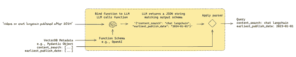
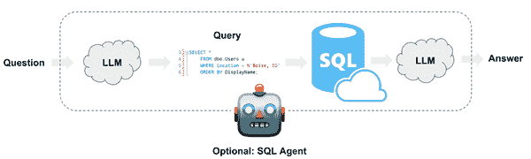
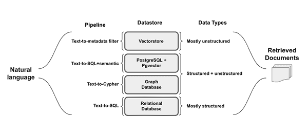

# 从0开始学RAG之Query Construction

> 来源：[https://agijuejin.feishu.cn/docx/RHSQdtEploYR0gx24uPcWoLfnSb](https://agijuejin.feishu.cn/docx/RHSQdtEploYR0gx24uPcWoLfnSb)
> 作者：lucas大叔
> 原文：[https://zhuanlan.zhihu.com/p/687874199](https://zhuanlan.zhihu.com/p/687874199)

人们对将自然语言与各种类型的数据（结构化、非结构化和 半结构化 ）无缝连接具有非常浓厚的兴趣。但是，对每种数据类型而言，这种新兴的“LUI”（ language user interface ）方式都有特定的挑战和考虑：

+   结构化数据：主要存储在`SQL`或图数据库中，其特征是预定义的`schema`，并以表或关系的形式组织，使其易于进行精确的查询操作。
+   半结构化数据：将结构化元素（例如文档或关系数据库中的表）与非结构化元素（例如关系数据库中文本或嵌入列）混合在一起。
+   非结构化数据：通常存储在向量数据库中，由没有预定义模型的信息组成，通常伴随着能够进行过滤的结构化元数据。


LLM具有强大的`query construction`能力，可以将自然语言转换为适合每种数据类型的特定查询语法。

---

## 什么是 Query Construction

典型的RAG方法将用户`query`转换为向量表示，然后将该向量与源文档的向量表示进行比较，找到具有最相似的向量表示的源文档。这种方式对非结构化数据相当有效，但对结构化数据呢？

世界上大部分数据都有一定的结构，这些数据大多存储在关系数据库（例如`SQL`）或图形数据库中，甚至非结构化数据也经常与结构化元数据（例如，作者、流派、发布时间等）相关联。

> 许多用户`query`的最佳答案不仅是通过在`embedding`空间中找到相似的文档或数据，而且还利用数据中固有的以及在用户`query`中表达的结构。

例如，对于“what are movies about aliens in the year 1980 ”这个查询，一部分（`aliens` ）可能要从语义上查找，但也有一部分（`year == 1980`）我们想以精确的方式查找。

> `Query construction`就是将`自然语言查询`转换为与之交互的数据库的`查询语言`。

下面我们将介绍三种典型的`Query Construction`的示例。

---

## Text-to-metadata-filter



检索中最重要的步骤之一是将输入文本转化为正确的查询和`filter`参数，即提取`query`中的`结构化参数`。当前许多向量库都包含元数据字段，这使得基于元数据过滤特定的`chunk`成为可能。

下面以YouTube转录脚本数据库为例展示元数据过滤的应用，首先加载样例文档

```
from langchain_community.document_loaders import YoutubeLoader

docs = YoutubeLoader.from_youtube_url(
    "https://www.youtube.com/watch?v=pbAd8O1Lvm4", add_video_info=True
).load()

docs[0].metadata
```

`thumbnail_url`: 'https://i.ytimg.com/vi/pbAd8O1Lvm4/hq720.jpg',

```
{'source': 'pbAd8O1Lvm4',
 'title': 'Self-reflective RAG with LangGraph: Self-RAG and CRAG',
 'description': 'Unknown',
 'view_count': 9006,
 'publish_date': '2024-02-07 00:00:00',
 'length': 1058,
 'author': 'LangChain'}
```

为了生成结构化的`query`，首先需要定义`query schema`。可以看到每个文档都有标题、浏览次数、发布日期和长度（以秒为单位）。假设已经构建了一个索引，该索引允许我们对每个文档的内容和标题执行非结构化搜索，并对浏览次数、发布日期和长度等维度使用区间过滤。

首先，创建`schema`定义浏览次数、发布日期和视频长度的最小和最大属性，以便后续可以基于这些属性过滤。此外，还将添加单独的属性用于针对内容和视频标题的检索。


## 结构化查询与函数调用

```
import datetime
from typing import Literal, Optional, Tuple

from langchain_core.pydantic_v1 import BaseModel, Field


class TutorialSearch(BaseModel):
    """Search over a database of tutorial videos about a software library."""

    content_search: str = Field(
        ...,
        description="Similarity search query applied to video transcripts.",
    )
    title_search: str = Field(
        ...,
        description=(
            "Alternate version of the content search query to apply to video titles. "
            "Should be succinct and only include key words that could be in a video "
            "title."
        ),
    )
    min_view_count: Optional[int] = Field(
        None,
        description="Minimum view count filter, inclusive. Only use if explicitly specified.",
    )
    max_view_count: Optional[int] = Field(
        None,
        description="Maximum view count filter, exclusive. Only use if explicitly specified.",
    )
    earliest_publish_date: Optional[datetime.date] = Field(
        None,
        description="Earliest publish date filter, inclusive. Only use if explicitly specified.",
    )
    latest_publish_date: Optional[datetime.date] = Field(
        None,
        description="Latest publish date filter, exclusive. Only use if explicitly specified.",
    )
    min_length_sec: Optional[int] = Field(
        None,
        description="Minimum video length in seconds, inclusive. Only use if explicitly specified.",
    )
    max_length_sec: Optional[int] = Field(
        None,
        description="Maximum video length in seconds, exclusive. Only use if explicitly specified.",
    )

    def pretty_print(self) -> None:
        for field in self.__fields__:
            if getattr(self, field) is not None and getattr(self, field) != getattr(
                self.__fields__[field], "default", None
            ):
                print(f"{field}: {getattr(self, field)}")
```

为了将用户问题转换为结构化查询，将使用 `function-calling` 模型，如 `ChatOpenAI`。`LangChain` 可以通过 `Pydantic` 类 轻松指定所需的 `function call` `schema`：

```
from langchain_core.prompts import ChatPromptTemplate
from langchain_openai import ChatOpenAI

system = """You are an expert at converting user questions into database queries. \
You have access to a database of tutorial videos about a software library for building LLM-powered applications. \
Given a question, return a database query optimized to retrieve the most relevant results.

If there are acronyms or words you are not familiar with, do not try to rephrase them."""
prompt = ChatPromptTemplate.from_messages(
    [
        ("system", system),
        ("human", "{question}"),
    ]
)
llm = ChatOpenAI(model="gpt-3.5-turbo-0125", temperature=0)
structured_llm = llm.with_structured_output(TutorialSearch)
query_analyzer = prompt | structured_llm
```

看一下效果

```
query_analyzer.invoke({"question": "rag from scratch"}).pretty_print()
```

content_search: rag from scratch

title_search: rag from scratch

```
query_analyzer.invoke(
    {"question": "videos on chat langchain published in 2023"}
).pretty_print()
```

content_search: chat langchain

title_search: chat langchain

earliest_publish_date: 2023-01-01

latest_publish_date: 2024-01-01

```
query_analyzer.invoke(
    {
        "question": "how to use multi-modal models in an agent, only videos under 5 minutes"
    }
).pretty_print()
```

content_search: multi-modal models agent

title_search: multi-modal models agent

max_length_sec: 300

进一步了解该方法，请移步这里。

## Text-to-SQL

关系型数据库是结构化数据的重要来源，将自然语言转化为 `SQL` 请求存在以下挑战：

+ 幻觉：`LLM` 容易对虚构的表或字段产生“幻觉”，从而创建无效的查询。需要确保 `LLM` 生成与实际数据库 `schema` 一致的有效 `SQL`。
+ 用户错误：`Text-to-SQL` 方法应该对用户拼写错误或用户输入中可能导致无效查询的其他不规则性具有 鲁棒性。

为了应对这些挑战，下面是一些实用的技巧：

+ 数据库描述：要生成 `SQL` 查询，必须向 `LLM` 提供数据库的准确描述。有几篇论文提到了一种常见的 text-to-SQL `prompt` 采用的方法：为 `LLM` 提供每张表的 `CREATE TABLE` 描述，包括列名、类型等，然后再给出三个 `SELECT` 语句的示例。
+ Few-shot 样例：在 `prompt` 中添加 `question-query` 的几个样例可以提高 `query` 生成的准确性。在 `prompt` 中简单的添加标准的静态示例指导 `agent` 如何基于 `question` 创建 `query`。
+ 错误处理：当遇到错误时，利用工具（例如 `SQL agent`）修复错误。



+ 查找专有名词中的拼写错误：当查询名称等专有名词时，用户可能会不小心写错。我们允许 `agent` 根据向量库搜索正确的名称，向量库在 `SQL` 数据库中存储相关专有名词的正确拼写。

下面让我们创建一个简单的 `chain`，将自然语言表述的问题转换为 `SQL` 查询，执行查询并使用结果来回答原始问题。

### Chain方法

#### 将问题转化为SQL查询

`SQL` `chain` 或 `agent` 的第一步是接受用户输入并将其转换为 `SQL` 查询。`LangChain` 为此提供了一个内置链：`create_sql_query_chain`。

```
from langchain_community.utilities import SQLDatabase

db = SQLDatabase.from_uri("sqlite:///Chinook.db")

from langchain.chains import create_sql_query_chain
from langchain_openai import ChatOpenAI

llm = ChatOpenAI(model="gpt-3.5-turbo", temperature=0)
chain = create_sql_query_chain(llm, db)
response = chain.invoke({"question": "How many employees are there"})
response
```

转换的 `SQL` 为：

```
'SELECT COUNT(*) FROM Employee'
```

执行验证 `SQL` 是否有效

```
db.run(response)
```

'[(8,)]'

#### 执行SQL查询

使用 `QuerySQLDatabaseTool` 可以方便地将 `query` 执行添加到 `chain` 中：

```
from langchain_community.tools.sql_database.tool import QuerySQLDataBaseTool

execute_query = QuerySQLDataBaseTool(db=db)
write_query = create_sql_query_chain(llm, db)
chain = write_query | execute_query
chain.invoke({"question": "How many employees are there"})
```

#### 回答问题

现在我们已经实现了自动生成和执行 `query`，只需要将原始问题和 `SQL` `query` 结果结合起来生成最终答案。我们可以将问题和结果再次传给 `LLM` 实现：


# SQL 数据库交互示例

## 基础链示例

```
from operator import itemgetter

from langchain_core.output_parsers import StrOutputParser
from langchain_core.prompts import PromptTemplate
from langchain_core.runnables import RunnablePassthrough

answer_prompt = PromptTemplate.from_template(
    """Given the following user question, corresponding SQL query, and SQL result, answer the user question.

Question: {question}
SQL Query: {query}
SQL Result: {result}
Answer: """
)

answer = answer_prompt | llm | StrOutputParser()
chain = (
    RunnablePassthrough.assign(query=write_query).assign(
        result=itemgetter("query") | execute_query
    )
    | answer
)

chain.invoke({"question": "How many employees are there"})
```

最终回复的答案为

```
'There are 8 employees.'
```

以上只是简单的示例，对于更加复杂的 `query` 生成，需要创建 `few-shot prompt` 或者增加 `query-checking` 环节。

## Agent 方法

LangChain 提供了 SQL Agent，一种更灵活的与 SQL 数据库交互的方式。使用 SQL Agent 的主要优点是：

+ 它可以根据数据库的 [`schema`](https://www.zhihu.com/search?q=schema&search_source=Entity&hybrid_search_source=Entity&hybrid_search_extra=%7B%22sourceType%22%3A%22article%22%2C%22sourceId%22%3A687874199%7D) 以及数据库的内容（如描述特定的表）回答问题。

+ [`它可以通过运行生成的`](https://www.zhihu.com/search?q=traceback&search_source=Entity&hybrid_search_source=Entity&hybrid_search_extra=%7B%22sourceType%22%3A%22article%22%2C%22sourceId%22%3A687874199%7D) `query`、捕获 `traceback` 并重新正确生成以便于从修正错误。

+ 它可以回答需要多个相关查询的问题。

+ 它只考虑相关表的 `schema`，以此来节省 `token`。

我们使用 `create_sql_agent` 函数初始化 agent，此 agent 包含 `SQLDatabaseToolkit`，其中包含用于执行以下操作的工具：

+ 创建和执行 `query`

+ `query` 语法检查

+ [`检索表`](https://www.zhihu.com/search?q=%E6%A3%80%E7%B4%A2%E8%A1%A8&search_source=Entity&hybrid_search_source=Entity&hybrid_search_extra=%7B%22sourceType%22%3A%22article%22%2C%22sourceId%22%3A687874199%7D) 描述

+ 其他的一些工具

初始化 agent

```
from langchain_community.agent_toolkits import create_sql_agent

agent_executor = create_sql_agent(llm, db=db, agent_type="openai-tools", verbose=True)

agent_executor.invoke(
    {
        "input": "List the total sales per country. Which country's customers spent the most?"
    }
)
```

执行过程

```
> Entering new AgentExecutor chain...

Invoking: `sql_db_list_tables` with `{}`


Album, Artist, Customer, Employee, Genre, Invoice, InvoiceLine, MediaType, Playlist, PlaylistTrack, Track
Invoking: `sql_db_schema` with `Invoice,Customer`


CREATE TABLE "Customer" (
    "CustomerId" INTEGER NOT NULL, 
    "FirstName" NVARCHAR(40) NOT NULL, 
    "LastName" NVARCHAR(20) NOT NULL, 
    "Company" NVARCHAR(80), 
    "Address" NVARCHAR(70), 
    "City" NVARCHAR(40), 
    "State" NVARCHAR(40), 
    "Country" NVARCHAR(40), 
    "PostalCode" NVARCHAR(10), 
    "Phone" NVARCHAR(24), 
    "Fax" NVARCHAR(24), 
    "Email" NVARCHAR(60) NOT NULL, 
    "SupportRepId" INTEGER, 
    PRIMARY KEY ("CustomerId"), 
    FOREIGN KEY("SupportRepId") REFERENCES "Employee" ("EmployeeId")
)

/*
3 rows from Customer table:
CustomerId  FirstName   LastName    Company Address City    State   Country PostalCode  Phone   Fax Email   SupportRepId
1   Luís    Gonçalves   Embraer - Empresa Brasileira de Aeronáutica S.A.    Av. Brigadeiro Faria Lima, 2170 São José dos Campos SP  Brazil  12227-000   +55 (12) 3923-5555  +55 (12) 3923-5566  luisg@embraer.com.br    3
2   Leonie  Köhler  None    Theodor-Heuss-Straße 34 Stuttgart   None    Germany 70174   +49 0711 2842222    None    leonekohler@surfeu.de   5
3   François    Tremblay    None    1498 rue Bélanger   Montréal    QC  Canada  H2G 1A7 +1 (514) 721-4711   None    ftremblay@gmail.com 3
*/


CREATE TABLE "Invoice" (
    "InvoiceId" INTEGER NOT NULL, 
    "CustomerId" INTEGER NOT NULL, 
    "InvoiceDate" DATETIME NOT NULL, 
    "BillingAddress" NVARCHAR(70), 
    "BillingCity" NVARCHAR(40), 
    "BillingState" NVARCHAR(40), 
    "BillingCountry" NVARCHAR(40), 
    "BillingPostalCode" NVARCHAR(10), 
    "Total" NUMERIC(10, 2) NOT NULL, 
    PRIMARY KEY ("InvoiceId"), 
    FOREIGN KEY("CustomerId") REFERENCES "Customer" ("CustomerId")
)

/*
3 rows from Invoice table:
InvoiceId   CustomerId  InvoiceDate BillingAddress  BillingCity BillingState    BillingCountry  BillingPostalCode   Total
1   2   2009-01-01 00:00:00 Theodor-Heuss-Straße 34 Stuttgart   None    Germany 70174   1.98
2   4   2009-01-02 00:00:00 Ullevålsveien 14    Oslo    None    Norway  0171    3.96
3   8   2009-01-03 00:00:00 Grétrystraat 63 Brussels    None    Belgium 1000    5.94
*/
Invoking: `sql_db_query` with `SELECT c.Country, SUM(i.Total) AS TotalSales FROM Invoice i JOIN Customer c ON i.CustomerId = c.CustomerId GROUP BY c.Country ORDER BY TotalSales DESC LIMIT 10;`
responded: To list the total sales per country, I can query the "Invoice" and "Customer" tables. I will join these tables on the "CustomerId" column and group the results by the "BillingCountry" column. Then, I will calculate the sum of the "Total" column to get the total sales per country. Finally, I will order the results in descending order of the total sales.

Here is the SQL query:

SELECT c.Country, SUM(i.Total) AS TotalSales

FROM Invoice i

JOIN Customer c ON i.CustomerId = c.CustomerId

GROUP BY c.Country

ORDER BY TotalSales DESC

LIMIT 10;

Now, I will execute this query to get the total sales per country.

[('USA', 523.0600000000003), ('Canada', 303.9599999999999), ('France', 195.09999999999994), ('Brazil', 190.09999999999997), ('Germany', 156.48), ('United Kingdom', 112.85999999999999), ('Czech Republic', 90.24000000000001), ('Portugal', 77.23999999999998), ('India', 75.25999999999999), ('Chile', 46.62)]The total sales per country are as follows:

1. USA: $523.06
2. Canada: $303.96
3. France: $195.10
4. Brazil: $190.10
5. Germany: $156.48
6. United Kingdom: $112.86
7. Czech Republic: $90.24
8. Portugal: $77.24
9. India: $75.26
10. Chile: $46.62

To answer the second question, the country whose customers spent the most is the USA, with a total sales of $523.06.

> Finished chain.
```

得到的答案

```
{'input': "List the total sales per country. Which country's customers spent the most?",
 'output': 'The total sales per country are as follows:\n\n1. USA: $523.06\n2. Canada: $303.96\n3. France: $195.10\n4. Brazil: $190.10\n5. Germany: $156.48\n6. United Kingdom: $112.86\n7. Czech Republic: $90.24\n8. Portugal: $77.24\n9. India: $75.26\n10. Chile: $46.62\n\nTo answer the second question, the country whose customers spent the most is the USA, with a total sales of $523.06.'}
```

## Text-to-Cypher


虽然向量存储很容易处理非结构化数据，但它们不了解向量之间的关系。而`SQL`数据库可以建模关系，但更改`schema`可能会造成破坏而且代价巨大。知识图谱通过建模数据之间的关系，扩展关系类型可以解决这些问题，而无需进行重大修改。知识图谱适用于具有难以用表格形式表示的多对多关系或层次结构的数据。

与关系型数据库通常使用`SQL`一样，图数据库通常使用`Cypher`进行查询。`Text-to-Cypher`可以将自然语言转化为`Cypher`查询：

```
from langchain.chains import GraphCypherQAChain
from langchain_community.graphs import Neo4jGraph
from langchain_openai import ChatOpenAI

graph = Neo4jGraph(
    url="bolt://localhost:7687", username="neo4j", password="pleaseletmein"
)

graph.refresh_schema()

chain = GraphCypherQAChain.from_llm(
    ChatOpenAI(temperature=0), graph=graph, verbose=True
)
```

由于生成有效的`Cypher`是一项非常复杂的任务，因此建议使用`GPT-4`等高性能`LLM`生成`Cypher`语句。

```
chain.run("Who played in Top Gun?")
```

## 总结

跨数据源无缝检索结构化和非结构化数据对于释放`LLM`的潜力至关重要，本文总结了三种“自然语言到结构化查询”的`pipeline`，为用户进一步探索提供了模板和参考。



## 参考资料

- [query-construction](https://blog.langchain.dev/query-construction/)
- [query_analysis/techniques/structuring](https://python.langchain.com/docs/use_cases/query_analysis/techniques/structuring)
- [enhancing-rag-based-applications-accuracy-by-constructing-and-leveraging-knowledge-graphs](https://blog.langchain.dev/enhancing-rag-based-applications-accuracy-by-constructing-and-leveraging-knowledge-graphs/)
- Quickstart | ️ Langchain
