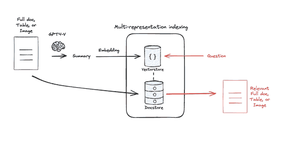
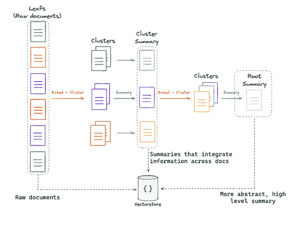

# 从0开始学RAG之Indexing

> 来源：[https://agijuejin.feishu.cn/docx/FHlwdIh26oq3ePxVeg7chjsmnbg](https://agijuejin.feishu.cn/docx/FHlwdIh26oq3ePxVeg7chjsmnbg)

> 作者：lucas大叔

> 原文：[https://zhuanlan.z](https://zhuanlan.zhihu.com/p/689703503)hihu.com/p/689703...

本期重点介绍文档索引的一些实用技巧。

存在问题：许多RAG方法侧重于将文档分割成块，并在[LLM检](https://www.zhihu.com/search?q=%E5%9D%97%E5%A4%A7%E5%B0%8F&search_source=Entity&hybrid_search_source=Entity&hybrid_search_extra=%7B%22sourceType%22%3A%22article%22%2C%22sourceId%22%3A689703503%7D)索时返回相关的一部分块。然而， 块大小 和块数量是很难设置好的参数；如果返回的块不包含回答问题的所有上下文，则两者都会显著地影响结果。

解决思路：针对 [检索优化 ](https://www.zhihu.com/search?q=%E6%A3%80%E7%B4%A2%E4%BC%98%E5%8C%96&search_source=Entity&hybrid_search_source=Entity&hybrid_search_extra=%7B%22sourceType%22%3A%22article%22%2C%22sourceId%22%3A689703503%7D)，使用LLM生成文档摘要。在此基础上，我们创建了两种检索器：（1） multi-vector retriever 将摘要向量化，但将完整文档返给LLM。（2） parent-doc retriever将块向量化，但将完整文档返给LLM。核心思想是使用较小/简洁的表示（摘要或块）进行检索，但将它们链接到完整的文档/上下文中进行生成。

这[是一种通用的方法，可以应用](https://www.zhihu.com/search?q=%E5%A4%9A%E6%A8%A1%E6%80%81embedding&search_source=Entity&hybrid_search_source=Entity&hybrid_search_extra=%7B%22sourceType%22%3A%22article%22%2C%22sourceId%22%3A689703503%7D)于表格或图像：在这两种情况下，对摘要进行索引，但返回原始表格或图像进行推理。这绕过了直接嵌入表格或图像（ 多模态embedding ）的挑战，使用摘要作为基于文本的相似性搜索的表示。

## Multi-representation Indexing

检索有两大技术实现路径：一是稀疏检索(Sparse R[etrieve](https://www.zhihu.com/search?q=tf-idf&search_source=Entity&hybrid_search_source=Entity&hybrid_search_extra=%7B%22sourceType%22%3A%22article%22%2C%22sourceId%22%3A689703503%7D)r)，基于统计方法(例如 tf-idf 、BM25)[比较每一篇](https://www.zhihu.com/search?q=%E7%A8%A0%E5%AF%86%E6%A3%80%E7%B4%A2&search_source=Entity&hybrid_search_source=Entity&hybrid_search_extra=%7B%22sourceType%22%3A%22article%22%2C%22sourceId%22%3A689703503%7D)[文档与问题](https://www.zhihu.com/search?q=%E7%A8%A0%E5%AF%86%E5%90%91%E9%87%8F&search_source=Entity&hybrid_search_source=Entity&hybrid_search_extra=%7B%22sourceType%22%3A%22article%22%2C%22sourceId%22%3A689703503%7D)的相似程度，胜在计算简单，但无法包含更丰富的语义信息；二是 稠密检索 (Dense Retriever)，使用 稠密向量 进行文本匹配，与稀疏检索相辅相成，可以配合使用。

尽管稠密检索在开放域NLP任务中日益重要，但人们往[往忽略对语](https://www.zhihu.com/search?q=%E6%A3%80%E7%B4%A2%E5%8D%95%E5%85%83&search_source=Entity&hybrid_search_source=Entity&hybrid_search_extra=%7B%22sourceType%22%3A%22article%22%2C%22sourceId%22%3A689703503%7D)[料进行索引](https://www.zhihu.com/search?q=%E6%A3%80%E7%B4%A2%E7%B3%BB%E7%BB%9F&search_source=Entity&hybrid_search_source=Entity&hybrid_search_extra=%7B%22sourceType%22%3A%22article%22%2C%22sourceId%22%3A689703503%7D)的检索单元的设计。 [检](https://link.zhihu.com/?target=https%3A//arxiv.org/pdf/2312.06648.pdf)索[单元 显著影](https://www.zhihu.com/search?q=%E5%8E%9F%E5%AD%90%E8%A1%A8%E8%BE%BE%E5%BC%8F&search_source=Entity&hybrid_search_source=Entity&hybrid_search_extra=%7B%22sourceType%22%3A%22article%22%2C%22sourceId%22%3A689703503%7D)[响检索和下](https://www.zhihu.com/search?q=%E8%87%AA%E7%84%B6%E8%AF%AD%E8%A8%80&search_source=Entity&hybrid_search_source=Entity&hybrid_search_extra=%7B%22sourceType%22%3A%22article%22%2C%22sourceId%22%3A689703503%7D)游任务的性能，决定了 检索系统 的上限。研究人员在 《Dense X Retrieva[l: What ](https://www.zhihu.com/search?q=%E5%86%97%E9%95%BFtoken&search_source=Entity&hybrid_search_source=Entity&hybrid_search_extra=%7B%22sourceType%22%3A%22article%22%2C%22sourceId%22%3A689703503%7D)Retrieval Granularity Should We Use?》 中针对稠密检索提出了一种新颖的检索单元-Proposition。Proposition被定义为文本中的 原子表达式 ，每个Proposition都概括了一个不同的事实，并以简洁、独立的 自然语言 格式呈现。实验结果表明，在稠密检索中基于proposition的检索明显优于传统基于段落或句子的方法。此外，由于检索到的文本更多地浓缩了与问题相关的信息，因此减少了 冗长token 的输入，最大限度地减少了无关信息，增强了下游QA任务的表现。



基于以上思想，我们举一个摘要索引的例子。

首先加载两篇网上的文章

```
from langchain_community.document_loaders import WebBaseLoader
from langchain_text_splitters import RecursiveCharacterTextSplitter

loader = WebBaseLoader(&quot;https://lilianweng.github.io/posts/2023-06-23-agent/&quot;)
docs = loader.load()

loader = WebBaseLoader(&quot;https://lilianweng.github.io/posts/2024-02-05-human-data-quality/&quot;)
docs.extend(loader.load())
```

创建生成摘要的chain

```
import uuid

from langchain_core.documents import Document
from langchain_core.output_parsers import StrOutputParser
from langchain_core.prompts import ChatPromptTemplate
from langchain_openai import ChatOpenAI

chain = (
    {&quot;doc&quot;: lambda x: x.page_content}
    | ChatPromptTemplate.from_template(&quot;Summarize the following document:\n\n{doc}&quot;)
    | ChatOpenAI(model=&quot;gpt-3.5-turbo&quot;,max_retries=0)
    | StrOutputParser()
)

summaries = chain.batch(docs, {&quot;max_concurrency&quot;: 5})
```

构建MultiVectorRetriever，将摘要作为子chunk存储在向量库，原始文档作为父chunk存储在InMemoryByteStore。

```
from langchain.storage import InMemoryByteStore
from langchain_openai import OpenAIEmbeddings
from langchain_community.vectorstores import Chroma
from langchain.retrievers.multi_vector import MultiVectorRetriever

# The vectorstore to use to index the child chunks
vectorstore = Chroma(collection_name=&quot;summaries&quot;,
                     embedding_function=OpenAIEmbeddings())

# The storage layer for the parent documents
store = InMemoryByteStore()
id_key = &quot;doc_id&quot;

# The retriever
retriever = MultiVectorRetriever(
    vectorstore=vectorstore,
    byte_store=store,
    id_key=id_key,
)
doc_ids = [str(uuid.uuid4()) for _ in docs]

# Docs linked to summaries
summary_docs = [
    Document(page_content=s, metadata={id_key: doc_ids[i]})
    for i, s in enumerate(summaries)
]

# Add
retriever.vectorstore.add_documents(summary_docs)
retriever.docstore.mset(list(zip(doc_ids, docs)))
```

根据摘要检索

```
query = &quot;Memory in agents&quot;
sub_docs = vectorstore.similarity_search(query,k=1)
sub_docs[0]
```

检索结果为

```
Document(page_content=&#x27;The document discusses the concept of building autonomous agents powered by Large Language Models (LLMs) as their core controllers. It covers components such as planning, memory, and tool use, along with case studies and proof-of-concept examples like AutoGPT and GPT-Engineer. Challenges like finite context length, planning difficulties, and reliability of natural language interfaces are also highlighted. The document provides references to related research papers and offers a comprehensive overview of LLM-powered autonomous agents.&#x27;, metadata={&#x27;doc_id&#x27;: &#x27;cf31524b-fe6a-4b28-a980-f5687c9460ea&#x27;})
```

retriever检索

```
retrieved_docs = retriever.get_relevant_documents(query,n_results=1)
retrieved_docs[0].page_content[0:500]
```

返回的检索结果为

```
[Numb](https://www.zhihu.com/search?q=Inne&amp;search_source=Entity&amp;hybrid_search_source=Entity&amp;hybrid_search_extra=%7B%22sourceType%22%3A%22article%22%2C%22sourceId%22%3A689703503%7D)er of requested results 4 is greater than number of elements in index 2, updating n_results = 2
&quot;\n\n\n\n\n\nLLM Powered Autonomous Agents | Lil&#x27;Log\n\n\n\n\n\n\n\n\n\n\n\n\n\n\n\n\n\n\n\n\n\n\n\n\n\n\n\n\n\n\n\n\n\n\n\n\n\n\n\nLil&#x27;Log\n\n\n\n\n\n\n\n\n\n\n\n\n\n\n\n\n\n\n\n\n\n\nPosts\n\n\n\n\nArchive\n\n\n\n\nSearch\n\n\n\n\nTags\n\n\n\n\nFAQ\n\n\n\n\nemojisearch.app\n\n\n\n\n\n\n\n\n\n      LLM Powered Autonomous Agents\n    \nDate: June 23, 2023  |  Estimated Reading Time: 31 min  |  Author: Lilian Weng\n\n\n \n\n\nTable of Contents\n\n\n\nAgent System Overview\n\nComponent One: Planning\n\nTask Decomposition\n\nSelf-Reflection\n\n\nComponent Two: Memory\n\nTypes of Memory\n\nMaximum Inner Product Search (MIPS)\n\n&quot;
```

可以看到retriever返回的是原始文档。该方法的开源LLM实现可参考我前面的文章《 lucas大叔：langchain常用retriever实战（二） 》。

## RAPTOR

随着LLM的上下文窗口越来越大，RAG[管道的设计也](https://www.zhihu.com/search?q=%E7%B4%A2%E5%BC%95%E6%96%87%E6%A1%A3%E5%9D%97&search_source=Entity&hybrid_search_source=Entity&hybrid_search_extra=%7B%22sourceType%22%3A%22article%22%2C%22sourceId%22%3A689703503%7D)[面临着改变。作为拆分文档](https://www.zhihu.com/search?q=lower-level&search_source=Entity&hybrid_search_source=Entity&hybrid_search_extra=%7B%22sourceType%22%3A%22article%22%2C%22sourceId%22%3A689703503%7D)[和 索引文档块 的替代方案](https://www.zhihu.com/search?q=higher-level&search_source=Entity&hybrid_search_source=Entity&hybrid_search_extra=%7B%22sourceType%22%3A%22article%22%2C%22sourceId%22%3A689703503%7D)，索引整篇文档将变得可行。RAG方法需要灵活回答单篇文档的 lower-level 问题，或者需要跨多个文档提供信息的 higher-level 问题。

RAPTOR方法通过构建 [文档摘要树 ](https://www.zhihu.com/search?q=%E6%96%87%E6%A1%A3%E6%91%98%E8%A6%81%E6%A0%91&search_source=Entity&hybrid_search_source=Entity&hybrid_search_extra=%7B%22sourceType%22%3A%22article%22%2C%22sourceId%22%3A689703503%7D)来解决这个问题：对文档进行 [聚类 ](https://www.zhihu.com/search?q=%E8%81%9A%E7%B1%BB&search_source=Entity&hybrid_search_source=Entity&hybrid_search_extra=%7B%22sourceType%22%3A%22article%22%2C%22sourceId%22%3A689703503%7D)，并对类簇进行总结以获取相似文档中higher-level的信息。递归重复这个过程直到[生成一颗摘要树，从单篇](https://www.zhihu.com/search?q=high-level&search_source=Entity&hybrid_search_source=Entity&hybrid_search_extra=%7B%22sourceType%22%3A%22article%22%2C%22sourceId%22%3A689703503%7D)文档作为树的叶子到相关文档的中间摘要，再到整个文档集合的 high-level 摘要。

[我们可](https://www.zhihu.com/search?q=%E5%8F%B6%E5%AD%90&search_source=Entity&hybrid_search_source=Entity&hybrid_search_extra=%7B%22sourceType%22%3A%22article%22%2C%22sourceId%22%3A689703503%7D)以在不同尺度上应用该思想， 叶子 可以是：

+   单篇文档的文本块

+   整篇文档

对于上下文窗口比较大的LLM，可以在整篇文档上执行该方法。



完整实现代码：

[https:// github.com/langchain-ai /lang](https://link.zhihu.com/?target=https%3A//github.com/langchain-ai/langchain/blob/master/cookbook/RAPTOR.ipynb)chain/blob/master/cookbook/RAPTOR.ipynb

## ColBERT

ColBERT是一种快速精准的检索模型，能够在数十毫秒内对海量文本集合进行可扩展的基于BERT的搜索。

常规的embedding模型为每个文档存储一个向量，并返回一个分数显示该文档与query的匹配程度。ColBERT的原理略有不同：它为段落中的每个token生成一个受上下文影响的向量，同样地也对query中的每个token生成向量，每个文档的得分是每个query嵌入与任意文档嵌入的最大相似度的总和。

[研究表明在新的或复杂领域](https://www.zhihu.com/search?q=%E7%A8%A0%E5%AF%86embedding&search_source=Entity&hybrid_search_source=Entity&hybrid_search_extra=%7B%22sourceType%22%3A%22article%22%2C%22sourceId%22%3A689703503%7D)，ColBERT比 稠密embedding 更高效、更适用，甚至更适合在非英语的小语种上进行高效的训练。但是它的知名度并不高，而且使用起来也不方便。RAGatouille应运而生，通过它可以简单方便地使用ColBERT。

下面就让我们一起探寻ColBERT的魅力。

安装ragatouille

```
pip install -U ragatouille
```

利用ragatouille加载colbert模型

```
from ragatouille import RAGPretrainedModel
RAG = RAGPretrainedModel.from_pretrained(&quot;colbert-ir/colbertv2.0&quot;)
```

从wikipedia获取数据

```
[import r](https://www.zhihu.com/search?q=extracts&amp;search_source=Entity&amp;hybrid_search_source=Entity&amp;hybrid_search_extra=%7B%22sourceType%22%3A%22article%22%2C%22sourceId%22%3A689703503%7D)equests

def get_wikipedia_page(title: str):
    &quot;&quot;&quot;
    Retrieve the full text content of a Wikipedia page.

    :param title: str - Title of the Wikipedia page.
    :return: str - Full text content of the page as raw string.
    &quot;&quot;&quot;
    # Wikipedia API endpoint
    URL = &quot;https://en.wikipedia.org/w/api.php&quot;

    # Parameters for the API request
    params = {
        &quot;action&quot;: &quot;query&quot;,
        &quot;format&quot;: &quot;json&quot;,
        &quot;titles&quot;: title,
        &quot;prop&quot;: &quot;extracts&quot;,
        &quot;explaintext&quot;: True,
    }

    # Custom User-Agent header to comply with Wikipedia&#x27;s best practices
    headers = {&quot;User-Agent&quot;: &quot;RAGatouille_tutorial/0.0.1 (ben@clavie.eu)&quot;}

    response = requests.get(URL, params=params, headers=headers)
    data = response.json()

    # Extracting page content
    page = next(iter(data[&quot;query&quot;][&quot;pages&quot;].values()))
    return page[&quot;extract&quot;] if &quot;extract&quot; in page else None

full_document = get_wikipedia_page(&quot;Hayao_Miyazaki&quot;)
```

创建索引

```
RAG.index(
    collection=[full_document],
    index_name=&quot;Miyazaki-123&quot;,
    max_document_length=180,
    split_documents=True,
)
```

验证搜索效果

```
results = RAG.search(query=&quot;What animation studio did Miyazaki found?&quot;, k=3)
```

可以很容易的转换为Langchain的retriever，在创建时可以传递任何参数，例如k

```
retriever = RAG.as_langchain_retriever(k=3)
retriever.invoke(&quot;What animation studio did Miyazaki found?&quot;)
```

## 参考文献

[ra](https://link.zhihu.com/?target=https%3A//github.com/langchain-ai/rag-from-scratch/blob/main/rag_from_scratch_12_to_14.ipynb)g-from-scratch/rag_from_scratch_12_to_14.ipynb at main · langchain-ai/rag-from-scratch

MultiVector Retriever | ️ Langchain

Exploring ColBERT with RAGatouille

RAGatouille | ️ Langchain