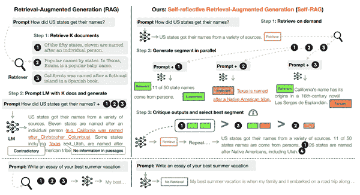
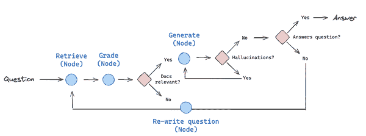
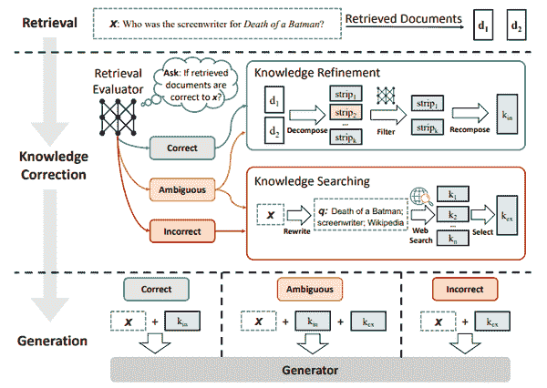
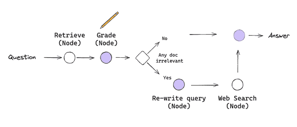

# 从0开始学RAG之Feedback + self-reflection

> 来源：[https://agijuejin.feishu.cn/docx/FJIRd8DkfoVUBOxTRVqcY3lTnYe](https://agijuejin.feishu.cn/docx/FJIRd8DkfoVUBOxTRVqcY3lTnYe)

> 作者：lucas大叔

> 原文：[https://zhuanlan.z](https://zhuanlan.zhihu.com/p/691080401)hihu.com/p/691080...

作为《从0开始学RAG》系列的最后一篇，本文探讨如何利用自我反思(self-reflection)和反馈(feedback)改善RAG性能。

存在问题：RAG系统可能会受到低质量检索（例如，用户问题不在索引的域内）和生成幻觉的困扰。原始的检索-生成管道无法检测或自我纠正这些错误。

解决思路：通过 [单元测试 ](https://www.zhihu.com/search?q=%E5%8D%95%E5%85%83%E6%B5%8B%E8%AF%95&search_source=Entity&hybrid_search_source=Entity&hybrid_search_extra=%7B%22sourceType%22%3A%22article%22%2C%22sourceId%22%3A691080401%7D)反复构建代码问题的答案，以检查并自我更正错误。一些工作已经应用了这种RAG，例[如 Se](https://www.zhihu.com/search?q=%E5%9B%9E%E7%AD%94%E6%B5%81&search_source=Entity&hybrid_search_source=Entity&hybrid_search_extra=%7B%22sourceType%22%3A%22article%22%2C%22sourceId%22%3A691080401%7D)[lf-](https://www.zhihu.com/search?q=%E7%BC%96%E6%8E%92&search_source=Entity&hybrid_search_source=Entity&hybrid_search_extra=%7B%22sourceType%22%3A%22article%22%2C%22sourceId%22%3A691080401%7D)RAG 和 Corrective RAG。这两种情况都会在RAG 回答流 中检查文档相关性、幻觉或者回答质量。使用LangGraph 编排 检查和反馈，从而实现检索内容的评估和修正。

---

## Self-RAG

常规的[RAG流程将检索](https://www.zhihu.com/search?q=%E5%8F%8D%E6%80%9Dtoken&search_source=Entity&hybrid_search_source=Entity&hybrid_search_extra=%7B%22sourceType%22%3A%22article%22%2C%22sourceId%22%3A691080401%7D)到的文档作为LLM回答用户问题的背景知识，但并没有考虑检索是否是必要的，检索到的文档是否与问题相关，因此可能会生成低质量的答案。Self-RAG通过检索-->自我反思提高LM的质量和真实性，该框架训练单个任意LM自适应按需检索段落，对检索到的段落和用 反思token 生成的内容进行生成和反思。生成反思token使得LM在推理阶段可控，使其能够调整行为适应不同的任务需求。

如上左图所示，RAG用检索到的相关段落作为LLM的增强输入，以减少知识密集型任务中的事实错误。然而，常规的RAG方法可能会阻碍LLM生成的多样性。另外由于没有考虑检索到的段落事实上是否对回答问题有用，引入非必要或偏离主题的段落会导致低质量的生成。此外，模型没有经过明确的训练去利用和遵循所提供段落中的事实，不能保证输出与检索到的段落一致。

Self-RAG通过按需检索(on[-dema](https://www.zhihu.com/search?q=%E8%87%AA%E6%88%91%E5%8F%8D%E6%80%9D&search_source=Entity&hybrid_search_source=Entity&hybrid_search_extra=%7B%22sourceType%22%3A%22article%22%2C%22sourceId%22%3A691080401%7D)nd retrieval)和 自我反思 (self-reflection)，在不损害生成多样性的同时保证事实的准确性，从而改善LLM的生成质量。以端到端的方式训练任意LM学习反思给定任务输入的自我生成过程，生成任务输出和特殊的token(即反思token)。反思token分为检索token(retrieval token)和评判token(critique token)，分别表示是否需要检索和生成质量。如右上图，给[定个输入提](https://www.zhihu.com/search?q=%E8%87%AA%E6%88%91%E8%AF%84%E4%BC%B0&search_source=Entity&hybrid_search_source=Entity&hybrid_search_extra=%7B%22sourceType%22%3A%22article%22%2C%22sourceId%22%3A691080401%7D)示和之前的生成内容，Self-RAG首先确定用检索到的段落增强接下来的生成是否有帮助。如果有帮助，它将输出检索token按需调用检索器模型(step 1)。接下来，Self-RAG同时处理多个检索段落，评估它们的相关性，然后生成相应的任务输出(step 2)。然后生成评判token来评估自己的输出，根据真实性和总体质量选择最佳输出(step 3)。Self-RAG的处理流程与常规RAG不同，常规RAG返回固定数量的文档用于生成，并不考虑检索的必要性(例如上图底部的例子并不需要事实性的知识)。它也不会二次评估生成质量。另外，Self-RAG通过 自我评估 段落是否支持生成结果为每个段落片段提供引证，从而更容易进行事实验证。

我们利用langgraph实现self-RAG的思想，整体流程如下图所示：

[基于C](https://link.zhihu.com/?target=https%3A//github.com/langchain-ai/langgraph/blob/main/examples/rag/langgraph_self_rag.ipynb)hatGPT的实现代码详见 这里 。

[基于O](https://link.zhihu.com/?target=https%3A//github.com/langchain-ai/langgraph/blob/main/examples/rag/langgraph_self_rag_local.ipynb)llama和开源模型Mistral的实现代码详见 这里 。

---

## CRAG

CRAG聚焦在改善生成过程的 [鲁棒性 ](https://www.zhihu.com/search?q=%E9%B2%81%E6%A3%92%E6%80%A7&search_source=Entity&hybrid_search_source=Entity&hybrid_search_extra=%7B%22sourceType%22%3A%22article%22%2C%22sourceId%22%3A691080401%7D)，具体来说，它设计了一个轻量级的检索评估器，评估检索到的文档[对查询的](https://www.zhihu.com/search?q=%E7%BD%AE%E4%BF%A1%E5%BA%A6&search_source=Entity&hybrid_search_source=Entity&hybrid_search_extra=%7B%22sourceType%22%3A%22article%22%2C%22sourceId%22%3A691080401%7D)[总体质量](https://www.zhihu.com/search?q=%E8%AF%AD%E6%96%99%E5%BA%93&search_source=Entity&hybrid_search_source=Entity&hybrid_search_extra=%7B%22sourceType%22%3A%22article%22%2C%22sourceId%22%3A691080401%7D)[，然后返回](https://www.zhihu.com/search?q=%E7%BD%91%E7%BB%9C%E6%90%9C%E7%B4%A2&search_source=Entity&hybrid_search_source=Entity&hybrid_search_extra=%7B%22sourceType%22%3A%22article%22%2C%22sourceId%22%3A691080401%7D)[置信度，基](https://www.zhihu.com/search?q=%E6%A3%80%E7%B4%A2%E6%96%B9%E6%B3%95&search_source=Entity&hybrid_search_source=Entity&hybrid_search_extra=%7B%22sourceType%22%3A%22article%22%2C%22sourceId%22%3A691080401%7D)于 置信度 触发不同的知识检索动作。由于从静态的和有限的 语料库 中检索，因此只能得到次优的文档。大规模 网络搜索 可以作为检索结果增强的扩展。此外，CRAG还设计了先分解-后重组的 检索方法 ，选择性地关注检索到文档的关键信息，过滤掉不相关的信息。CRAG可与任何基于RAG的方法无缝耦合，即插即用。

[从上图可以看到，在C](https://www.zhihu.com/search?q=retriever&search_source=Entity&hybrid_search_source=Entity&hybrid_search_extra=%7B%22sourceType%22%3A%22article%22%2C%22sourceId%22%3A691080401%7D)RAG框架中，给定输入que[ry和任意一](https://www.zhihu.com/search?q=%E6%A3%80%E7%B4%A2%E8%AF%84%E4%BC%B0%E5%99%A8&search_source=Entity&hybrid_search_source=Entity&hybrid_search_extra=%7B%22sourceType%22%3A%22article%22%2C%22sourceId%22%3A691080401%7D)种 retriever 检索到的文档，构建轻量级的 检索评估器 评估检索到的文档与输入query之间的相关性。通过设置两个门限，将相关性得分量化为三个置信度，然后触发相应的动作：{Correct, Incorrect, Ambiguous}。

+   Correct：当检索到的文档中至少有一个文档置信度得分高于上门限时，则认为检索是correct的，在检索[结果中存](https://www.zhihu.com/search?q=%E7%BB%86%E7%B2%92%E5%BA%A6&search_source=Entity&hybrid_search_source=Entity&hybrid_search_extra=%7B%22sourceType%22%3A%22article%22%2C%22sourceId%22%3A691080401%7D)在相关文档。但即使找到了相关文档，也不可避免掺杂一些噪声知识。为了提取文档中的重要知识点，还需要“知识提纯”( knowledge refinement )。"知识提纯"就是把每篇检索到的文档根据启发式规则切割成更 细粒度 的知识片段，然后用检索评估器计算每个知识片段的得分，基于得分把不相关的知识过滤掉，相关的知识再按顺序拼接在一起。

+   Inco[rrect](https://www.zhihu.com/search?q=%E6%90%9C%E7%B4%A2%E5%BC%95%E6%93%8E&search_source=Entity&hybrid_search_source=Entity&hybrid_search_extra=%7B%22sourceType%22%3A%22article%22%2C%22sourceId%22%3A691080401%7D)：如果所有检索到的文档置信度得分都低于下门限，则认为检索时incorrect的，表明所有检索到的文档都认为是不相关的，对生成没有帮助。因此就要寻求新的知识源来修正，此处引入网页搜索从互联网搜索相关知识，避免了生成过程没有可信知识参考的尴尬。这里网页搜索利用ChatGPT把输入query重写为关键字的形式，模拟 搜索引擎 的日常使用状态。

+   [Ambiguous：](https://www.zhihu.com/search?q=ambiguous&search_source=Entity&hybrid_search_source=Entity&hybrid_search_extra=%7B%22sourceType%22%3A%22article%22%2C%22sourceId%22%3A691080401%7D)[除了以上两种情况](https://www.zhihu.com/search?q=correct&search_source=Entity&hybrid_search_source=Entity&hybrid_search_extra=%7B%22sourceType%22%3A%22article%22%2C%22sourceId%22%3A691080401%7D)，其余的情形都归于 ambiguous 。由于检索评估器对它自己的判断并不确信，那就联合 correct 和incorrect两种情况处理，从而达到互补的目的。即一方面把检索到的文档走Correct处理流程，进行知识提纯；另一方面走网页搜索检索互联网上的相关知识，然后把两种方式得到的知识一起用于生成。

同样的，利用langgraph实现CRAG，整体流程如下图所示：

[基于C](https://link.zhihu.com/?target=https%3A//github.com/langchain-ai/langgraph/blob/main/examples/rag/langgraph_crag.ipynb)hatGPT的实现代码详见 这里 。

[基于T](https://link.zhihu.com/?target=https%3A//github.com/langchain-ai/langgraph/blob/main/examples/rag/langgraph_crag_local.ipynb)avily Search和开源模型Mistral的实现代码详见 这里 。

## 参考资料

https:// arxiv.org/abs/2310.1151 1

[https:// arxiv.org/](https://link.zhihu.com/?target=https%3A//arxiv.org/pdf/2401.15884.pdf)pdf/2401.1588 4.pdf