# 一文讲透RAG在垂直领域大模型的应用

> 来源：[https://agijuejin.feishu.cn/docx/ArKJdNSSLoyTbCxylHycaMS9njc](https://agijuejin.feishu.cn/docx/ArKJdNSSLoyTbCxylHycaMS9njc)

> 作者：王大锤

> 原文： [https://zhuanlan.z](https://zhuanlan.zhihu.com/p/680709198)hihu.com/p/680709...

## 一. 背景

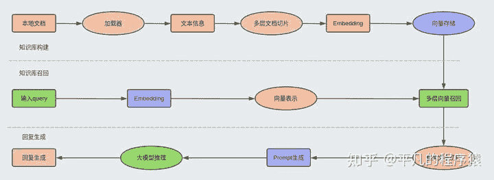

[检索增强生成 ](https://www.zhihu.com/search?q=%E6%A3%80%E7%B4%A2%E5%A2%9E%E5%BC%BA%E7%94%9F%E6%88%90&search_source=Entity&hybrid_search_source=Entity&hybrid_search_extra=%7B%22sourceType%22%3A%22article%22%2C%22sourceId%22%3A680709198%7D)(Retrieval-Augmented Generation, RAG), 是一个为大模型提供外部知识源的策略，使得大模型具备从指定的知识库中进行检索，并结合上下文信息，生成相对高质量的回复内容，减少模型幻觉问题。

**示例场景 **:

参考我们做的 [智能座舱 ](https://www.zhihu.com/search?q=%E6%99%BA%E8%83%BD%E5%BA%A7%E8%88%B1&search_source=Entity&hybrid_search_source=Entity&hybrid_search_extra=%7B%22sourceType%22%3A%22article%22%2C%22sourceId%22%3A680709198%7D)中的一个示例场景，比如我们希望大模型能回答关于车机系统的相[关问题。大](https://www.zhihu.com/search?q=%E4%BD%BF%E7%94%A8%E6%89%8B%E5%86%8C&search_source=Entity&hybrid_search_source=Entity&hybrid_search_extra=%7B%22sourceType%22%3A%22article%22%2C%22sourceId%22%3A680709198%7D)模型在没有见过我们公司《车机 使用手册 》的情况下（事实上，企业私有数据一般不会被大模型的参数所覆盖），几乎回答不正确，可能会出现以下情况:


但是通过RAG的能力，能够让大模型结合企业私有数据，完成特定领域的知识问答，实现对以下业务目标的支持：


## 二. 功能定义

### 2.1 常用方法

2020年 [lewis ](https://www.zhihu.com/search?q=lewis&search_source=Entity&hybrid_search_source=Entity&hybrid_search_extra=%7B%22sourceType%22%3A%22article%22%2C%22sourceId%22%3A680709198%7D)等人，针对知识密集型的NLP任务，提出了一种相对灵活的技术，[成为检索增](https://www.zhihu.com/search?q=%E7%94%9F%E6%88%90%E6%A8%A1%E5%9E%8B&search_source=Entity&hybrid_search_source=Entity&hybrid_search_extra=%7B%22sourceType%22%3A%22article%22%2C%22sourceId%22%3A680709198%7D)强生成(RAG)。研究人员将 生成模型 与检索器模块相结合，以提供外部知识源的附加信息，并且这些信息可以高效的实现更新和维护。

RAG在垂直大模型问答场景下，类似于一场开卷考试，如果将大模型比喻为一个学生，在开卷考试的场景下，学生是可以携带笔记和学习资料，用来查找相关信息来回答问题。这种考试的重点是考察 检索到相关信息后的推理能力，而不是检索特定信息的能力。

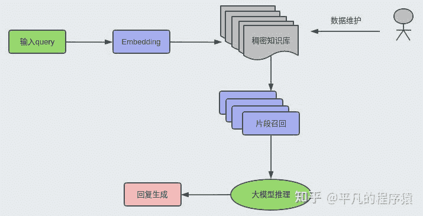

### 2.2 RAG流程

RAG的整体流程可以参考以下 [流程图 ](https://www.zhihu.com/search?q=%E6%B5%81%E7%A8%8B%E5%9B%BE&search_source=Entity&hybrid_search_source=Entity&hybrid_search_extra=%7B%22sourceType%22%3A%22article%22%2C%22sourceId%22%3A680709198%7D):

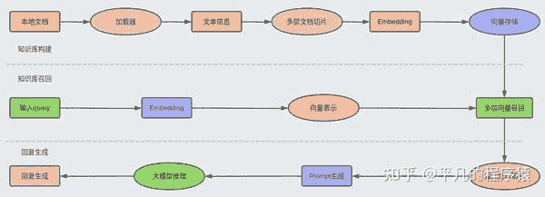

**知识库构建:**

参考[上述流程图](https://www.zhihu.com/search?q=%E5%90%91%E9%87%8F%E6%A8%A1%E5%9E%8B&search_source=Entity&hybrid_search_source=Entity&hybrid_search_extra=%7B%22sourceType%22%3A%22article%22%2C%22sourceId%22%3A680709198%7D)[，知识库构建主要包括数据](https://www.zhihu.com/search?q=max_seq%3D512&search_source=Entity&hybrid_search_source=Entity&hybrid_search_extra=%7B%22sourceType%22%3A%22article%22%2C%22sourceId%22%3A680709198%7D)加载，文本切片和内容向量化三个部分，其中核心处理模块是文本切片。目前主要有2类切分方法，一种是基于策略规则，一种是基于算法模型。同时，文本切分的策略也和 向量模型 息息相关。如: BERT模型的 max_seq=512 , 但实际上切分的维度并不一定按512tokens去进行切分。

基于策略规则的切分方法,可以参考:

1.截[断 截取前](https://www.zhihu.com/search?q=%E6%BB%91%E5%8A%A8%E7%AA%97%E5%8F%A3&search_source=Entity&hybrid_search_source=Entity&hybrid_search_extra=%7B%22sourceType%22%3A%22article%22%2C%22sourceId%22%3A680709198%7D)510个或后510个或前128+后382；

2.分段 分段k=L/510,然后各段可以求平均、求max

3. 滑动窗口 （Sliding window），即把文档分成有重叠的若干段，然后每一段都当作独立的文档送入BERT进行处理。最后再对于这些独立文档得到的结果进行整合；

基于算法模型的切分方法: 主要是使用类似BERT结构的语义段落分割模型，能够较好的对段落进行切割，并获取尽量完整的上下文语义。

问题: 一般需要结合具体的数据集进行适配和微调，缺乏低成本高质量的解决方案，基于模型算法的切分方法上手难度较高。

内容向量化: 将切片后的文本信息转成响应的语义向量。

这[里可以利用langch](https://www.zhihu.com/search?q=text2vec%E6%A8%A1%E5%9E%8B&search_source=Entity&hybrid_search_source=Entity&hybrid_search_extra=%7B%22sourceType%22%3A%22article%22%2C%22sourceId%22%3A680709198%7D)ain的Weaviate矢量数据库，或者可以自己搭建Milvus数据库。当然如果你想要做自己的 text2vec模型 ，可以参考以下内容:

目前[主流的t](https://www.zhihu.com/search?q=bge&search_source=Entity&hybrid_search_source=Entity&hybrid_search_extra=%7B%22sourceType%22%3A%22article%22%2C%22sourceId%22%3A680709198%7D)[ext2vec模型主](https://www.zhihu.com/search?q=bge-large&search_source=Entity&hybrid_search_source=Entity&hybrid_search_extra=%7B%22sourceType%22%3A%22article%22%2C%22sourceId%22%3A680709198%7D)要还是基于BERT[基座模型](https://www.zhihu.com/search?q=%E5%8F%AC%E5%9B%9E%E7%8E%87&search_source=Entity&hybrid_search_source=Entity&hybrid_search_extra=%7B%22sourceType%22%3A%22article%22%2C%22sourceId%22%3A680709198%7D)进行fine-turning的，但是BERT的最大长度仅支持到512；如果切片的长度超过512,性能会急剧下降。目前主流的text2vec模型， bge 和m3c等语义模型支持的长度均为512。从使用效果来看，可以优先选择 bge-large ,在有数据集的情况下，参考官方文档，对bge进行fine-turning。

问题: 长文本的 召回率 和相关性相对一般。

**知识检索召回:**

通过对用户输入query进行向量化表示，然后和知识库中切片的语义向量进行相似度计算，召回Top K的片段。采用Embedding的方式进行检索具备以下优点:

+   复杂语义的文本查找（基于文本相似度）

+   [相近语](https://www.zhihu.com/search?q=%E5%BF%85%E5%BA%94&search_source=Entity&hybrid_search_source=Entity&hybrid_search_extra=%7B%22sourceType%22%3A%22article%22%2C%22sourceId%22%3A680709198%7D)义理解（如老鼠/捕鼠器/奶酪，谷歌/ 必应 /搜索引擎）

+   多语言理解（跨语言理解，如输入中文匹配英文）

+   [多模态理解 ](https://www.zhihu.com/search?q=%E5%A4%9A%E6%A8%A1%E6%80%81%E7%90%86%E8%A7%A3&search_source=Entity&hybrid_search_source=Entity&hybrid_search_extra=%7B%22sourceType%22%3A%22article%22%2C%22sourceId%22%3A680709198%7D)（支持文本、图像、音视频等的相似匹配）

+   容错性（处理拼写错误、模糊的描述）

但是，可能在以下场景下，体验可能会不大好，如:

+   [搜索一个人或物](https://www.zhihu.com/search?q=%E4%BC%8A%E9%9A%86%C2%B7%E9%A9%AC%E6%96%AF%E5%85%8B&search_source=Entity&hybrid_search_source=Entity&hybrid_search_extra=%7B%22sourceType%22%3A%22article%22%2C%22sourceId%22%3A680709198%7D)体的名字（例如， 伊隆·马斯克 ，iPhone 15）

+   搜索缩写词或短语（例如，RAG，RLHF）

+   搜索 ID（例如，gpt-3.5-turbo，titan-xlarge-v1.01）

这里具备较大的优化空间，可以后续展开来阐述。

**增强回复生成:**

这一块比较依赖于大模型的推理能力，即选择一个靠谱的大模型底座模型是关键。如果是不考虑成本和信息安全等因素，GPT4还是yyds。如果考虑上述因素，需要实现大模型的本地化部署，那其实和业务场景是比较强相关的，我们利用6个不同的细分领域数据集，测试了国内头部的10几个大模型，得到的结论是: 在不同的细分领域，没有哪个大模型是一家独大的！

### 2.3 适用场景

RAG的特点是使得大模型能更好地利用自身的逻辑推理能力，去理解企业化的私有[数据，实现问答能力的拓展。](https://www.zhihu.com/search?q=fine-turning&search_source=Entity&hybrid_search_source=Entity&hybrid_search_extra=%7B%22sourceType%22%3A%22article%22%2C%22sourceId%22%3A680709198%7D)这时会有一个问题：如果我们用这类私有数据对大模型进行 fine-turning ，也能实现同样的效果，那为什么还需要RAG呢?

其实针对这类问题，可以从以下几个角度去分析：

1.  这类私有数据是否需要以一定频率进行动态更新?

1.  在回复这类问题时，是否需要给出引用原文的?

1.  硬件资源(GPU)资源是否充足，利用RAG进行fine-truning的成本和针对每个私有库进行fine-turning的成本低？

## 三.LangChain实现

### 3.1 基础环境准备

```
pip install langchain openai weaviate-client
```

### 3.2 申请OpenAI账户

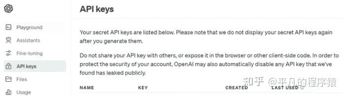

### 3.3 [配置文件](https://www.zhihu.com/search?q=%E9%85%8D%E7%BD%AE%E6%96%87%E4%BB%B6&search_source=Entity&hybrid_search_source=Entity&hybrid_search_extra=%7B%22sourceType%22%3A%22article%22%2C%22sourceId%22%3A680709198%7D)

项目跟目录配置. [env文件 ](https://www.zhihu.com/search?q=env%E6%96%87%E4%BB%B6&search_source=Entity&hybrid_search_source=Entity&hybrid_search_extra=%7B%22sourceType%22%3A%22article%22%2C%22sourceId%22%3A680709198%7D)，配置OPENAI_KEY_KEY参数信息。

### 3.4 参考代码

langchain集成了Weaviate矢量库，整体实现比较简单，可以简单分为2个部分。

**知识库构建:**

```
#包括三个子模块，1.加载数据, 2.数据切片， 3.数据块存储

#1. 数据加载
from langchain.document_loaders import TextLoader
loader = TextLoader(&#x27;./ai_law_demo.txt&#x27;) //AI 法律下的测试文档
documents = loader.load()

#2. 数据切片
from langchain.text_splitter import CharacterTextSplitter
#chunk_size表示切片打小，chunk_overlap表示重合部分，保证文本连续性。
text_splitter = CharacterTextSplitter(chunk_size=1024, chunk_overlap=128)
chunks = text_splitter.split_documents(documents)

#3.数据存储
from langchain.embeddings import OpenAIEmbeddings
from langchain.vectorstores import Weaviate
import weaviate
from weaviate.embedded import EmbeddedOptions

client = weaviate.Client(
  embedded_options = EmbeddedOptions()
)

vectorstore = Weaviate.from_documents(
    client = client,    
    documents = chunks,
    embedding = OpenAIEmbeddings(),
    by_text = False
)
```

**RAG问答:**

```
# 1.数据检索， 2.提示增强, 3.答案生成

#1.数据检索
retriever = vectorstore.as_retriever()

#2. 提示增强
from langchain.prompts import ChatPromptTemplate
template = &quot;&quot;&quot;你是一个法律专家，请使用以下检索到的上下文来回答问题，如果问题合文档不相关，就回答不知道。
问题：{question},
上下文: {context},
答案:
&quot;&quot;&quot;
prompt = ChatPromptTemplate.from_template(template)

#3. 答案生成

from langchain.chat_models import ChatOpenAI
from langchain.schema.runnable import RunnablePassthrough
from langchain.schema.output_parser import StrOutputParser
llm = ChatOpenAI(model_name=&quot;gpt-4&quot;, temperature=0)

rag_chain = (
    {&quot;context&quot;: retriever,  &quot;question&quot;: RunnablePassthrough()} 
    | prompt 
    | llm
    | StrOutputParser() 
)

query = &quot;公司违法裁员如何赔偿?&quot;
res=rag_chain.invoke(query)
print(f&#x27;Answer：{res}&#x27;)
```

## 四.RAG优化

### 4.1 优化方向

**数据清洗 **：不针对 [全文检索 ](https://www.zhihu.com/search?q=%E5%85%A8%E6%96%87%E6%A3%80%E7%B4%A2&search_source=Entity&hybrid_search_source=Entity&hybrid_search_extra=%7B%22sourceType%22%3A%22article%22%2C%22sourceId%22%3A680709198%7D)，而且根据查询需求，先做一遍数据的过滤，如时间和内容源头维度等。

**召回优化 **：针对向量召回任务的优化，如融合BM25+向量HNSW融合各召回通路等。

**全局处理 **：解决由于切割带来的信息损耗，需要从离线、在线两部分同时考虑。

**数值计算 **：弥补大模型在做数学题上的缺陷，需提供相关的计算公式。

**数据查询 **：这里主要是指NL2Sql，有些信息查询需要走数据库。NL2SQL可以参考作者相关的文章。

**意图澄清 **：处理用户需求不明确的业务场景。

### 4.2 相关研究

1.  REPLUG

| 文章名 | REPLUG |
| --- | --- |
| 年份 | 2023.05 |
| 刊物 | Archive |
| 定位 | 聚焦于检索适配大模型(插件) |

**创新点 **：

1.  用大模型针对每个检索段落的token概率分布去集成next token概率分布

1.  [用大模型根据conte](https://www.zhihu.com/search?q=retrieval%E6%A6%82%E7%8E%87&search_source=Entity&hybrid_search_source=Entity&hybrid_search_extra=%7B%22sourceType%22%3A%22article%22%2C%22sourceId%22%3A680709198%7D)xt和query输出y的概率来去蒸馏 retrieval概率

**架构图 **：

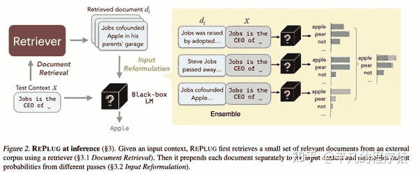

2. Questions Are All You Need to Train a Dense Passage Retrieve

| 文章名 | Questions Are All You Need to Train a Dense Passage Retrieve |
| --- | --- |
| 年份 | 2023.04 |
| 刊物 | TACL |
| 定位 | 专注无监督Retrieval |

**创新点:**

[由LM的q](https://www.zhihu.com/search?q=%E6%95%A3%E5%BA%A6%E8%92%B8%E9%A6%8F&search_source=Entity&hybrid_search_source=Entity&hybrid_search_extra=%7B%22sourceType%22%3A%22article%22%2C%22sourceId%22%3A680709198%7D)uestion reconstruction任务去KL 散度蒸馏 检索器检索Loss.

**加构图:**

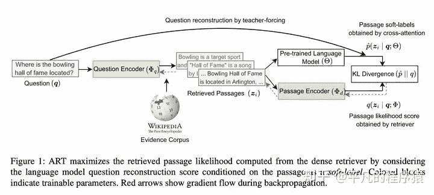

3.atlas

| 文章名 | atlas |
| --- | --- |
| 年份 | 2022.11 |
| 刊物 | archive |
| 定位 | [专注重头训练LLM适配](https://www.zhihu.com/search?q=retrieval%E6%A8%A1%E5%9E%8B&amp;search_source=Entity&amp;hybrid_search_source=Entity&amp;hybrid_search_extra=%7B%22sourceType%22%3A%22article%22%2C%22sourceId%22%3A680709198%7D)预训练好的 retrieval模型 |

**创新点:**

LM不需要参数存储知识，记忆解藕出来

**加构图: 无**

4. longformer

| 文章 | longformer |
| --- | --- |
| 年份 | 2020 |
| 刊物 |  |
| 定位 | 针对 [长文档编码](https://www.zhihu.com/search?q=%E9%95%BF%E6%96%87%E6%A1%A3%E7%BC%96%E7%A0%81&amp;search_source=Entity&amp;hybrid_search_source=Entity&amp;hybrid_search_extra=%7B%22sourceType%22%3A%22article%22%2C%22sourceId%22%3A680709198%7D) |

**架构图 **:

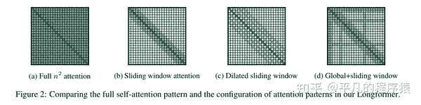

5.REALM

| 文章 | REALM |
| --- | --- |
| 年份 | 2020 |
| 刊物 | ICML |
| 定位 | 联合训练 [抽取式阅读器 ](https://www.zhihu.com/search?q=%E6%8A%BD%E5%8F%96%E5%BC%8F%E9%98%85%E8%AF%BB%E5%99%A8&amp;search_source=Entity&amp;hybrid_search_source=Entity&amp;hybrid_search_extra=%7B%22sourceType%22%3A%22article%22%2C%22sourceId%22%3A680709198%7D)和检索器 |

**创新点 **：

无监督预训练（构造完形填空任务）+ODQA微调

**架构图：**

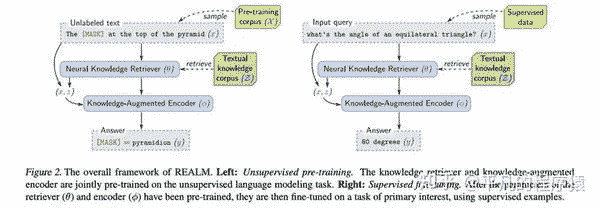

6. In-Context RALM: In-Context Retrieval-Augmented Language Models

| 年份 | 2023.08 |
| --- | --- |
| 刊物 | Archive |
| 定位 | 不改变，不训练语言模型架构 |

**创新点 **：

1.  LM生成的时候，检索是每 [stride步 ](https://www.zhihu.com/search?q=stride%E6%AD%A5&search_source=Entity&hybrid_search_source=Entity&hybrid_search_extra=%7B%22sourceType%22%3A%22article%22%2C%22sourceId%22%3A680709198%7D)检索一次

1.  检索时使用last l个 tokens作为query

1.  检索结果拼接到LM prefix中

1.  ODQA实验很差

**架构图：**

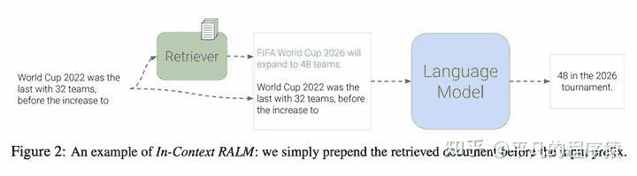

7. FID：Leveraging Passage Retrieval with Generative Models for Open Domain Question Answering

| 年份 | 2020 |
| --- | --- |
| 刊物 | EACL |
| 定位 | 如何用线性的时间复杂度增加文章数量 |

**创新点 **：

**模型用T**5或BART

段落+title+question各自单独编码

在decoder前拼接，聚集这些段落，让cross attention进行选择（token级别）

架构图：

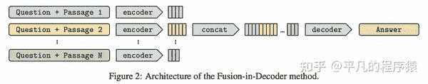

8. ControlNet

| 年份 | 2023 |
| --- | --- |
| 刊物 | ICCV [best paper](https://www.zhihu.com/search?q=best%20paper&amp;search_source=Entity&amp;hybrid_search_source=Entity&amp;hybrid_search_extra=%7B%22sourceType%22%3A%22article%22%2C%22sourceId%22%3A680709198%7D) |
| 定位 | 提出框架来添加空间条件控制在大的、预训练好的SD模型上 |

**创新点 **：

锁**住SD原**本模型，只微调

在微调部分也保留SD的稳定骨架

使用 zero convolutions 来逐步增加参数

架构图：

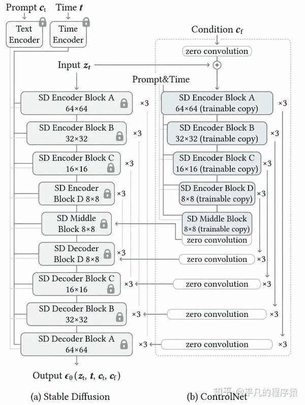

9.Hybrid Hierarchical Retrieval for Open-Domain Question Answering

| 年份 | 2023 |
| --- | --- |
| 刊物 | ACL-finding |
| 定位 | 侧重检索结构 |

**创新点 **：

[层次化检索 ](https://www.zhihu.com/search?q=%E5%B1%82%E6%AC%A1%E5%8C%96%E6%A3%80%E7%B4%A2&search_source=Entity&hybrid_search_source=Entity&hybrid_search_extra=%7B%22sourceType%22%3A%22article%22%2C%22sourceId%22%3A680709198%7D)[（即先检索d](https://www.zhihu.com/search?q=top-k&search_source=Entity&hybrid_search_source=Entity&hybrid_search_extra=%7B%22sourceType%22%3A%22article%22%2C%22sourceId%22%3A680709198%7D)**oc，再检**索段落）更好且更快

同时稀疏检索与语义检索结果合并为 top-k 效果更好

架构图： 无

10. A Survey for Efficient Open Domain Question Answering

| 年份 | 2023 |
| --- | --- |
| 刊物 | ACL |
| 定位 | ODQA效率综述 |

**创新点 **：

**三种架构**

几种减小内存消耗，增加速度的方法

架构图:

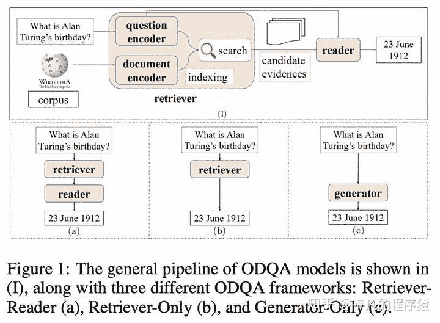

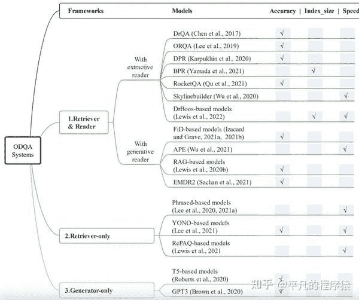

11. STREAM-LLM：EFFICIENT STREAMING LANGUAGE MODELS WITH ATTENTION SINKS

| 年份 | 2023 |
| --- | --- |
| 刊物 | Archive |
| 定位 | 针对大模型对长序列文本记忆丢失问题 |

**创新点 **：

**保留前k**个固定token保留注意力分布不被破坏

后续新添加token，使用滑动窗口向后滑动，使得模型可以记忆长文本

架构图：

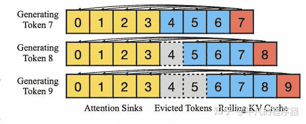

## 五.总结

针对RAG的问答场景，目前还存在以下问题:

知识混淆: 将世间客观知识和知识库中知识混淆

+   乙醇和乙烯的关系是什么?

+   其实都是有机物，但是容易和文档中相关的信息干扰。

召回结果混淆: 知识库中存在多个高度相似的内容

+   销量最高的产品是什么?

+   该数据是动态变化的，不同时间段会有不同的结果

[**多条件约束 **](https://www.zhihu.com/search?q=%E5%A4%9A%E6%9D%A1%E4%BB%B6%E7%BA%A6%E6%9D%9F&search_source=Entity&hybrid_search_source=Entity&hybrid_search_extra=%7B%22sourceType%22%3A%22article%22%2C%22sourceId%22%3A680709198%7D)过滤准确率较低: 不能准确地召回符合多个条件的片段

+   近三日销量最高的产品是什么？

+   要求时间为近三日，同时要求销量最高

全篇类意图识别准确率较低: 知识跨度较大时，体验不好

+   近期《独家新闻》系列文章对哪些行业关注度最高？

+   涉及到跨文章问答，基本凉凉

复杂逻辑推理不准确: 无显性且稠密性相关内容时，难以召回相关片段

+   大豆销量和 [豆奶 ](https://www.zhihu.com/search?q=%E8%B1%86%E5%A5%B6&search_source=Entity&hybrid_search_source=Entity&hybrid_search_extra=%7B%22sourceType%22%3A%22article%22%2C%22sourceId%22%3A680709198%7D)市场价格的关系？

+   除非原文中有显性且密集型相关内容，大模型可能能够直接回答正确，否则凉凉的概率极高。

行业公式计算推理不准: 特定领域知识相关

+   昨天哪些股票发生了涨停？

+   如何让大模型理解“涨停”意味着 (收盘价/昨日收盘价-1)≥10%