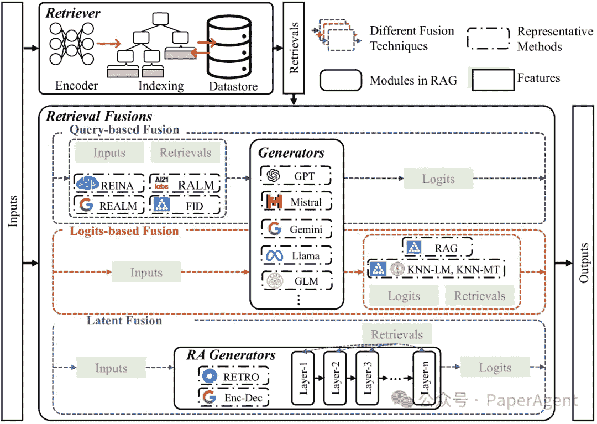
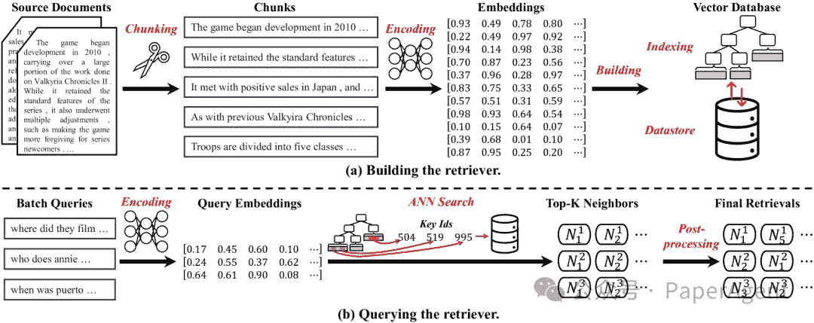
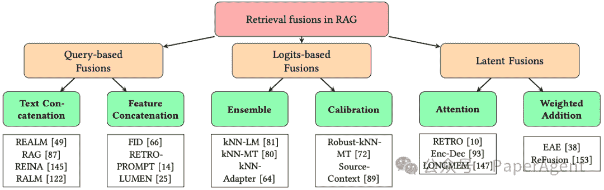
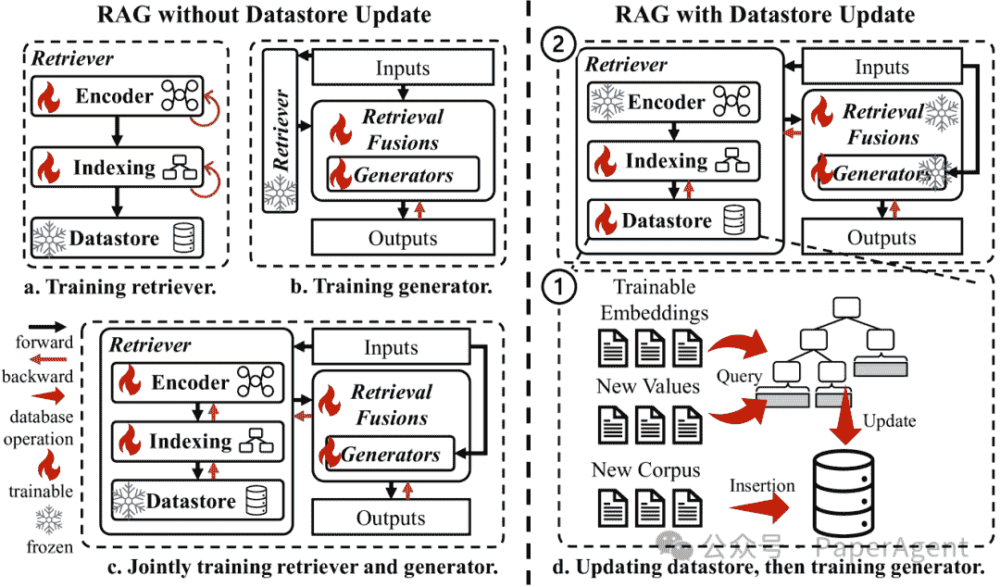

# 一篇RAG全栈技术最新综述

> 来源：[https://agijuejin.feishu.cn/docx/Y4N8dAzRxoanZJxcBLgcZbiEnSg](https://agijuejin.feishu.cn/docx/Y4N8dAzRxoanZJxcBLgcZbiEnSg)

> 作者：PaperAgent

> 原文： [https://mp.weixin.](https://mp.weixin.qq.com/s/gaEGL2N3JH26QCB6q84N1Q)qq.com/s/gaEGL2N3...

检索增强生成（RAG）的出现，利用外部知识数据库来增强LLMs，弥补了LLMs的 幻觉问题、知识更新等问题：

+   **系统地介**绍了**RAG的每**个组成部分， 特别是 检索器 和 检索融合 重要技术 ，以及带有教程代码的检索融合技术。

+   展示了不同的 **RAG训练策略 **，包括 **带或不带数据存储更新的RAG **。

+   讨论了RAG在下游 **NLP任务和实际NLP场景 **中的应用。

**自**然语言处理 NLP 中检索增强生成的概述   ： 检索器（Retriever） 、 检索融合（Retrieval Fusions） 、 生成器（Generator）



1. 检索器（Retriever）

检索器（Retriever） 是检索增强生成（RAG）中的一个关键组件，其主要作用是从一个外部知识库中检索与输入相关的信息。

使用检索器的 **两个阶段two-stages**



**构建阶段 **：将文档分割成小块，对这些块进行编码，并建立索引以支持高效的检索。

1.  分块语料库（Chunking Corpus） ：

+   **固定长度分块 **：通过设定长度参数顺序地分割文档。

+   **基于语义的分块 **：根据语义标志（如句号或新行字符）切割文档。

+   **基于内容的分块 **：根据文档的结构特征（如电子病历的章节或编程代码的功能块）进行分割。

1.  编码块（Encoding Chunks） ：

+   **BERT及其变体 **：如RoBERTa、DistilBERT、ELECTRA，生成密集的语义嵌入。

+   Siamese Encoders ：设计用于学习输入之间相似性的神经网络，如DPR、SimCSE。

+   LLM-based Encoders ：利用大型语言模型的表示能力，如text-embedding-ada-002、bge-embedding。

+   **稀疏编码 **：如词袋模型（BoW）、TF-IDF，通过高维向量表示文本，其中大部分元素为零。

+   **密集编码 **：使用深度神经网络模型生成向量，每个维度都可以捕捉语义特征。包括：

1.  索引构建（Building the Index） ：

1.  索引的目的是加速多维查询嵌入的搜索过程，主要关注支持高效的近似最近邻搜索。

1.  **选择相似性度量（Choice of **Similarity Metrics） ：

+   **余弦相似度 **、 **欧几里得相似度 **、 **曼哈顿距离 **、 **雅卡尔相似度 **等，用于衡量查询嵌入和块嵌入之间的相关性。

1.  **降维（Dimension Reduc**tion on Embeddings） ：

+   **主成分分析（PCA） **：一种统计技术，用于将原始数据转换为新坐标系，同时保留最重要的特征。

+   **局部敏感哈希（LSH） **：通过将数据映射到桶中来显著降低维度，同时保留原始输入数据的相似性。

+   **乘积量化（PQ） **：将高维空间划分为更小的、独立量化的子空间。

1.  高级ANN索引（Advanced ANN Indexing） ：

+   **IVFPQ **：结合倒排文件系统和乘积量化，用于高效和可扩展的ANN搜索。

+   **HNSW **：使用分层图结构在高维空间中高效执行ANN搜索。

+   **基于树的索引 **：如KD-Trees、Ball Trees和VP-Trees，用于组织高维向量。

1.  **构**建数据存储（Building the Datastore with Key-Value Pairs） ：

+   使用专门的数据库（如LMDB或RocksDB）存储和管理数据，以支持高效的检索和数据持久性。

+   最近的一些工作提出了各种最先进的向量数据库，包括索引和数据存储，例如Milvus 、FAISS]、LlamaIndex等。

** 查询阶段 **：使用相同的编码器对查询进行编码，然后利用预建索引和数据存储进行近似最近邻搜索，以检索相关值。

1.  编码查询（Encoding Queries） ：

+   使用与构建检索器时相同的编码器对查询进行编码，确保查询嵌入与检索器的嵌入空间一致。

1.  近似最近邻搜索（ANN Search） ：

+   利用预构建的索引和数据存储执行近似最近邻搜索，找到与查询最相似的数据。

+   搜索过程涉及比较查询嵌入与聚类嵌入，选择候选聚类，然后在每个聚类内执行产品量化，找到最近邻。

1.  索引搜索（Indexing Search） ：

+   搜索预构建的索引，找到k个最近邻，并返回这些最近邻的唯一标识符。

1.  数据存储检索（Datastore Retrieval） ：

+   根据最近邻的唯一标识符从数据存储中获取相应的值。

1.  后处理（Post-Processing） ：

+   **重排序（Reranking） **：根据任务特定的目标重新排序检索到的知识，以提高相关性。

+   重要性加权（Importance Weighting） ：为检索到的知识分配重要性权重，过滤掉不太相关的上下文。

2. 检索融合（Retrieval Fusions）

深入探讨了如何将检索到的知识整合到生成模型中，以提高性能：

**RAG中融合方法的类别 **



1.  **检索融合类型 **：

+   基于查询的融合（Query-based Fusion） ：将检索到的信息与输入查询直接连接或合并。

+   潜在融合（Latent Fusion） ：在生成模型的隐藏层中整合检索到的信息。

+   基于对数的融合（Logits-based Fusion） ：在生成模型的输出层整合检索到的信息。

1.  **基于查询的融合技术 **：

+   文本连接（Text Concatenation） ：将检索到的文本与查询文本直接连接。

+   特征连接（Feature Concatenation） ：将检索到的文本编码成特征向量后与查询特征向量合并。

+   **FID **：一种特征融合方法，将检索到的文本编码为稀疏或密集表示，并将连接的特征作为输入。

1.  **潜在融合技术 **：

+   基于注意力的融合（Attention-based Fusion） ：使用交叉注意力机制将检索到的知识嵌入到模型的隐藏状态中。

+   **RETRO **：一种使用检索增强的预训练语言模型，引入了一个新的交叉注意力模块。

+   加权添加（Weighted Addition） ：通过学习权重将检索到的知识嵌入以加权的方式添加到模型的隐藏状态中。

1.  **基于对数的融合技术 **：

+   集成融合（Ensemble-based Fusion） ：将检索到的知识的对数与模型输出的对数结合起来，作为集成预测的一部分。

+   **kNN-LM **和 **kNN-MT **：利用最近邻模型的对数进行语言模型和机器翻译的增强。

+   校准融合（Calibration-based Fusion） ：使用检索到的知识的对数对模型的预测进行校准或调整。

3. 生成器（Generator）

讨论了在检索增强生成（RAG）中使用的生成器类型及其特点：

1.  **生成器类型 **：

+   默认生成器（Default Generators） ：包括大多数预训练/微调的大型语言模型，如GPT系列、Mistral模型和Gemini系列模型。

+   **检索增强生成器（Retrieval-Augment**ed (RA) Generators） ：这些是包含融合检索信息模块的预训练/微调生成器，例如RETRO和EncDec。

1.  **生成器的功能 **：

+   生成器负责生成响应或进行预测，它们通常基于输入和相应的检索结果来生成文本。

1.  **生成器的架构 **：

+   生成器通常采用或修改基于Transformer的架构，专注于解码器模块，包括注意力模块和前馈网络模块。

**4. RAG训练策略**

深入讨论了检索增强生成（RAG）模型的训练方法和策略：

RAG的不同训练策略，包括/不包括数据存储更新



1.  **RAG训练分类 **：

+   **不更新数据存储的RAG训练 **：只更新RAG中每个模块的可训练参数，数据存储中的知识保持不变。

+   **更新数据存储的RAG训练 **：先更新数据存储中的知识，然后更新RAG中每个模块的参数。

1.  **数据存储更新（RAG withou**t Datastore Update） ：

1.  检索器训练（Training Retriever） ：

+   训练检索器编码器并重建索引，通常涉及密集编码方法。

+   根据训练目标，可能需要更换编码器或使用对比学习训练现有编码器。

1.  生成器训练（Training Generator） ：

+   更新生成器的参数或检索融合模块中的参数。

+   采用参数高效的微调技术，如LoRA，以解决大型语言模型（LLMs）的微调问题。

1.  **联**合训练检索器和生成器（Jointly Training Retriever and Generator） ：

+   同时训练检索器和生成器以提高下游任务的性能。

+   确保从输入到输出的正向过程中的可微性，以实现端到端优化。

1.  数据存储更新（Datastore Update） ：

+   种场景涉及两个阶段：更新知识库，然后训练检索器和生成器。更新知识库有三种情况，即用可训练的嵌入更新、用新值更新和用新语料库更新。

+   在第一种情况下，值通常是可训练的嵌入，并且与RAG中的参数同时/异步更新。最后两种情况通常指的是用最新信息更新知识库。

+   以问答语料库为例，用新值更新指的是更新现有问题的答案，而用新语料库更新指的是添加新的问答对。要更新现有键的值，首先需要查询现有的键值对，然后执行就地更新。对于新的语料库，数据存储首先需要执行插入操作，然后重建或更新新键的索引。更新数据存储后，训练检索器和生成器类似于没有数据存储更新的RAG。

**5. RAG的应用场景**

RAG技术在各种自然语言处理（NLP）任务中的应用：

1.  语言模型（Language Modeling） ：

+   使用RAG提高预训练阶段的语言模型能力，通过修改生成器架构或在输入和输出中加入检索信息。

1.  机器翻译（Machine Translation） ：

+   利用RAG技术通过将外部知识融入翻译过程来提升翻译质量，可以是文本拼接或对数融合。

1.  文本摘要（Text Summarization） ：

+   应用RAG技术通过检索外部知识和相似文档来增强文本摘要任务，包括提取式和抽象式摘要。

1.  问答系统（Question Answering） ：

+   RAG技术结合信息检索和模型生成，适用于开放域和封闭域的问答系统，提高问题理解和信息检索的准确性。

1.  信息提取（Information Extraction） ：

+   使用RAG技术提高信息提取任务的性能，包括命名实体识别（NER）、关系提取（RE）等子任务。

1.  文本分类（Text Classification） ：

+   利用RAG技术增强文本分类任务，如情感分析，通过不同的外部知识融合策略来提升模型性能。

1.  对话系统（Dialogue Systems） ：

+   应用RAG技术改进对话系统，通过检索历史对话或相关信息来生成更连贯、相关的响应。

### RAG技术在实际应用场景中的具体实现和作用：

1.  LLM-based Autonomous Agents ：

+   利用RAG为基于大型语言模型的自主智能体提供更广泛的信息访问能力，增强决策和问题解决能力。

+   **利用RAG从外部记忆检索信息 **：

+   智能体可以使用RAG从自己的外部记忆中检索相关信息，以增强其理解和决策能力。

+   **利用RAG使用工具搜索网络 **：

+   智能体可以利用工具搜索网络，获取最新信息，这对于需要最新知识的情境非常有用。

1.  **框架（Frameworks） **：

+   介绍了如Langchain和LLaMAindex等框架，它们通过集成复杂的检索机制与生成模型，促进了外部数据在语言生成过程中的整合。

```
https://arxiv.org/pdf/2407.13193
Retrieval-Augmented Generation for Natural Language Processing: A Survey
```

**推荐阅读**

+   对齐LLM偏好的直接偏好优化方法：DPO、IPO、KTO

+   2024：ToB、Agent、多模态

+   [RAG全景图：从RAG启蒙到高级RAG之](http://mp.weixin.qq.com/s?__biz=Mzk0MTYzMzMxMA==&mid=2247487375&idx=1&sn=e16bc2fdaac04e58e99cfd2a1dc0b0cb&chksm=c2ce35fef5b9bce80dcf0a70b753707036fe7f962d7888d60396490841a538b0f46e952f53f0&scene=21#wechat_redirect)36技，再到终章Agentic RAG！

+   [A](http://mp.weixin.qq.com/s?__biz=Mzk0MTYzMzMxMA==&mid=2247485322&idx=1&sn=71ffb345fca514aa5ce2848cb2c9f071&chksm=c2ce3dfbf5b9b4edd5b98e45c6179890bdea748fb5220636d25f42006954ea5c81afa8735725&scene=21#wechat_redirect)gent到多模态Agent再到多模态Multi-Agents系统的发展与案例讲解（1.2万字，20+文献，27张图）

---

欢迎关注我的公众号“ **PaperAgent **”， 每天一篇大模型（LLM）文章来锻炼我们的思维，简单的例子，不简单的方法，提升自己。