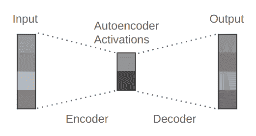
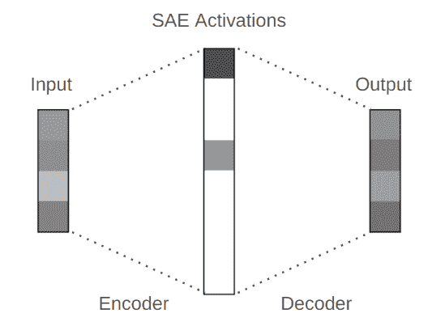
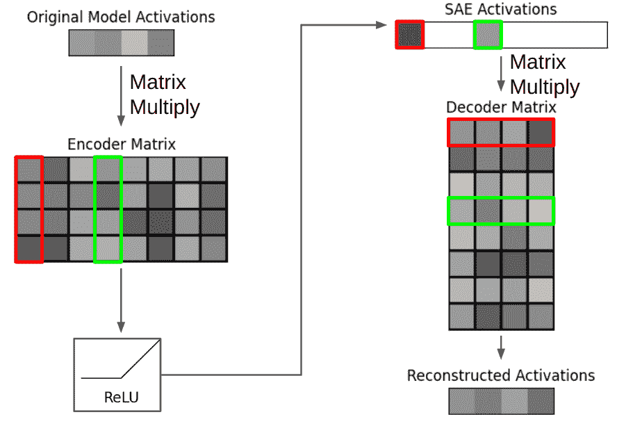
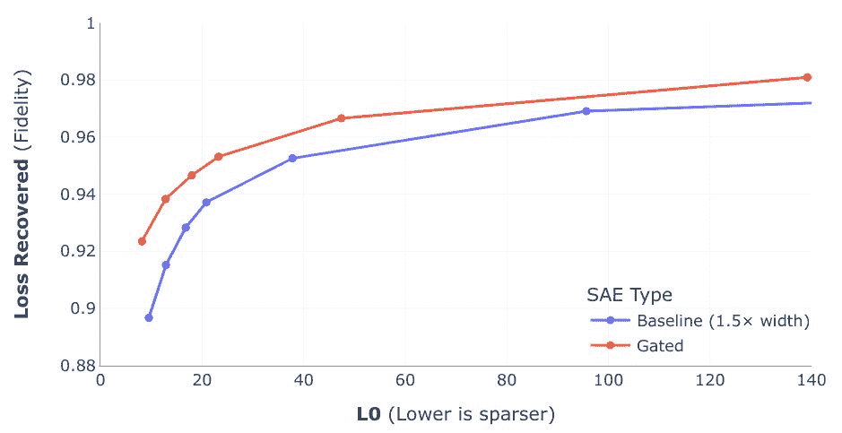

# LLM可解释性的未来希望？稀疏自编码器是如何工作的，这里有一份直观说明

> 来源：[https://agijuejin.feishu.cn/docx/Wl7bdNLG4oRZcWxCljocpXR6nvd](https://agijuejin.feishu.cn/docx/Wl7bdNLG4oRZcWxCljocpXR6nvd)

> 作者：机器之心

> 编辑：Panda

> 原文： [https://mp.weixin.](https://mp.weixin.qq.com/s/M05XtoTrLcToueATeJU1rA)qq.com/s/M05XtoTr...

> 简而言之：矩阵 → ReLU 激活 → 矩阵

在解释机器学习模型方面，稀疏自编码器（SAE）是一种越来越常用的工具（虽然 SAE 在 1997 年左右就已经问世了）。

机器学习模型和 LLM 正变得越来越强大、越来越有用，但它们仍旧是黑箱，我们并不理解它们完成任务的方式。理解它们的工作方式应当大有助益。

SAE 可帮助我们将模型的计算分解成可以理解的组件。近日，LLM 可解释性研究者 Adam Karvonen 发布了一篇博客文章，直观地解释了 SAE 的工作方式。

**可解释性的难题**

神经网络最自然的组件是各个神经元。不幸的是，单个神经元并不能便捷地与单个概念相对应，比如学术引用、英语对话、HTTP 请求和韩语文本。在神经网络中，概念是通过神经元的组合表示的，这被称为叠加（superposition）。

之所以会这样，是因为世界上很多变量天然就是稀疏的。

举个例子，某位名人的出生地可能出现在不到十亿分之一的训练 token 中，但现代 LLM 依然能学到这一事实以及有关这个世界的大量其它知识。训练数据中单个事实和概念的数量多于模型中神经元的数量，这可能就是叠加出现的原因。

近段时间，稀疏自编码器（SAE）技术越来越常被用于将神经网络分解成可理解的组件。SAE 的设计灵感来自神经科学领域的稀疏编码假设。现在，SAE 已成为解读人工神经网络方面最有潜力的工具之一。SAE 与标准自编码器类似。

常规自编码器是一种用于压缩并重建输入数据的神经网络。

举个例子，如果输入是一个 100 维的向量（包含 100 个数值的列表）；自编码器首先会让该输入通过一个编码器层，让其被压缩成一个 50 维的向量，然后将这个压缩后的编码表示馈送给解码器，得到 100 维的输出向量。其重建过程通常并不完美，因为压缩过程会让重建任务变得非常困难。



一个标准自编码器的示意图，其有 1x4 的输入向量、1x2 的中间状态向量和 1x4 的输出向量。单元格的颜色表示激活值。输出是输入的不完美重建结果。

**解释稀疏自编码器**

**稀疏自编码器的工作方式**

稀疏自编码器会将输入向量转换成中间向量，该中间向量的维度可能高于、等于或低于输入的维度。在用于 LLM 时，中间向量的维度通常高于输入。在这种情况下，如果不加额外的约束条件，那么该任务就很简单，SAE 可以使用单位矩阵来完美地重建出输入，不会出现任何意料之外的东西。但我们会添加约束条件，其中之一是为训练损失添加稀疏度惩罚，这会促使 SAE 创建稀疏的中间向量。

举个例子，我们可以将 100 维的输入扩展成 200 维的已编码表征向量，并且我们可以训练 SAE 使其在已编码表征中仅有大约 20 个非零元素。



稀疏自编码器示意图。请注意，中间激活是稀疏的，仅有 2 个非零值。

我们将 SAE 用于神经网络内的中间激活，而神经网络可能包含许多层。在前向通过过程中，每一层中和每一层之间都有中间激活。

举个例子，GPT-3 有 96 层。在前向通过过程中，输入中的每个 token 都有一个 12,288 维向量（一个包含 12,288 个数值的列表）。此向量会累积模型在每一层处理时用于预测下一 token 的所有信息，但它并不透明，让人难以理解其中究竟包含什么信息。

我们可以使用 SAE 来理解这种中间激活。SAE 基本上就是「矩阵 → ReLU 激活 → 矩阵」。

举个例子，如果 GPT-3 SAE 的扩展因子为 4，其输入激活有 12,288 维，则其 SAE 编码的表征有 49,512 维（12,288 x 4）。第一个矩阵是形状为 (12,288, 49,512) 的编码器矩阵，第二个矩阵是形状为 (49,512, 12,288) 的解码器矩阵。通过让 GPT 的激活与编码器相乘并使用 ReLU，可以得到 49,512 维的 SAE 编码的稀疏表征，因为 SAE 的损失函数会促使实现稀疏性。

通常来说，我们的目标让 SAE 的表征中非零值的数量少于 100 个。通过将 SAE 的表征与解码器相乘，可得到一个 12,288 维的重建的模型激活。这个重建结果并不能与原始的 GPT 激活完美匹配，因为稀疏性约束条件会让完美匹配难以实现。

一般来说，一个 SAE 仅用于模型中的一个位置举个例子，我们可以在 26 和 27 层之间的中间激活上训练一个 SAE。为了分析 GPT-3 的全部 96 层的输出中包含的信息，可以训练 96 个分立的 SAE—— 每层的输出都有一个。如果我们也想分析每一层内各种不同的中间激活，那就需要数百个 SAE。为了获取这些 SAE 的训练数据，需要向这个 GPT 模型输入大量不同的文本，然后收集每个选定位置的中间激活。

下面提供了一个 SAE 的 PyTorch 参考实现。其中的变量带有形状注释，这个点子来自 Noam Shazeer，参见：https://medium.com/@NoamShazeer/shape-suffixes-good-coding-style-f836e72e24fd 。请注意，为了尽可能地提升性能，不同的 SAE 实现往往会有不同的偏置项、归一化方案或初始化方案。最常见的一种附加项是某种对解码器向量范数的约束。更多细节请访问以下实现：

+   OpenAI：https://github.com/openai/sparse_autoencoder/blob/main/sparse_autoencoder/model.py#L16

+   SAELens：https://github.com/jbloomAus/SAELens/blob/main/sae_lens/sae.py#L97

+   dictionary_learning：https://github.com/saprmarks/dictionary_learning/blob/main/dictionary.py#L30

+

+

+

+

+

+

+

+

+

+

+

+

+

+

+

+

+

+

+

+

+

+

+

+

+

+

+

+

+

+

+

```
import torchimport torch.nn as nn
# D = d_model, F = dictionary_size# e.g. if d_model = 12288 and dictionary_size = 49152# then model_activations_D.shape = (12288,) and encoder_DF.weight.shape = (12288, 49152)
class SparseAutoEncoder (nn.Module):    &quot;&quot;&quot;    A one-layer autoencoder.    &quot;&quot;&quot;    def __init__(self, activation_dim: int, dict_size: int):        super ().__init__()        self.activation_dim = activation_dim        self.dict_size = dict_size

        self.encoder_DF = nn.Linear (activation_dim, dict_size, bias=True)        self.decoder_FD = nn.Linear (dict_size, activation_dim, bias=True)

    def encode (self, model_activations_D: torch.Tensor) -&gt; torch.Tensor:        return nn.ReLU ()(self.encoder_DF (model_activations_D))
    def decode (self, encoded_representation_F: torch.Tensor) -&gt; torch.Tensor:        return self.decoder_FD (encoded_representation_F)
    def forward_pass (self, model_activations_D: torch.Tensor) -&gt; tuple [torch.Tensor, torch.Tensor]:        encoded_representation_F = self.encode (model_activations_D)        reconstructed_model_activations_D = self.decode (encoded_representation_F)        return reconstructed_model_activations_D, encoded_representation_F
```

标准自编码器的损失函数基于输入重建结果的准确度。为了引入稀疏性，最直接的方法是向 SAE 的损失函数添加一个稀疏度惩罚项。对于这个惩罚项，最常见的计算方式是取这个 SAE 的已编码表征（而非 SAE 权重）的 L1 损失并将其乘以一个 L1 系数。这个 L1 系数是 SAE 训练中的一个关键超参数，因为它可确定实现稀疏度与维持重建准确度之间的权衡。

请注意，这里并没有针对可解释性进行优化。相反，可解释的 SAE 特征是优化稀疏度和重建的一个附带效果。下面是一个参考损失函数。

+

+

+

+

+

+

+

+

+

+

```
# B = batch size, D = d_model, F = dictionary_sizedef calculate_loss (autoencoder: SparseAutoEncoder, model_activations_BD: torch.Tensor, l1_coeffient: float) -&gt; torch.Tensor:    reconstructed_model_activations_BD, encoded_representation_BF = autoencoder.forward_pass (model_activations_BD)    reconstruction_error_BD = (reconstructed_model_activations_BD - model_activations_BD).pow (2)    reconstruction_error_B = einops.reduce (reconstruction_error_BD, &#x27;B D -&gt; B&#x27;, &#x27;sum&#x27;)    l2_loss = reconstruction_error_B.mean ()
    l1_loss = l1_coefficient * encoded_representation_BF.sum ()    loss = l2_loss + l1_loss    return loss
```


稀疏自编码器的前向通过示意图。

这是稀疏自编码器的单次前向通过过程。首先是 1x4 大小的模型向量。然后将其乘以一个 4x8 的编码器矩阵，得到一个 1x8 的已编码向量，然后应用 ReLU 将负值变成零。这个编码后的向量就是稀疏的。之后，再让其乘以一个 8x4 的解码器矩阵，得到一个 1x4 的不完美重建的模型激活。

**假想的 SAE 特征演示**

理想情况下，SAE 表征中的每个有效数值都对应于某个可理解的组件。

这里假设一个案例进行说明。假设一个 12,288 维向量 [1.5, 0.2, -1.2, ...] 在 GPT-3 看来是表示「Golden Retriever」（金毛犬）。SAE 是一个形状为 (49,512, 12,288) 的矩阵，但我们也可以将其看作是 49,512 个向量的集合，其中每个向量的形状都是 (1, 12,288)。如果该 SAE 解码器的 317 向量学习到了与 GPT-3 那一样的「Golden Retriever」概念，那么该解码器向量大致也等于 [1.5, 0.2, -1.2, ...]。

无论何时 SAE 的激活的 317 元素是非零的，那么对应于「Golden Retriever」的向量（并根据 317 元素的幅度）会被添加到重建激活中。用机械可解释性的术语来说，这可以简洁地描述为「解码器向量对应于残差流空间中特征的线性表征」。

也可以说有 49,512 维的已编码表征的 SAE 有 49,512 个特征。特征由对应的编码器和解码器向量构成。编码器向量的作用是检测模型的内部概念，同时最小化其它概念的干扰，尽管解码器向量的作用是表示「真实的」特征方向。研究者的实验发现，每个特征的编码器和解码器特征是不一样的，并且余弦相似度的中位数为 0.5。在下图中，三个红框对应于单个特征。



稀疏自编码器示意图，其中三个红框对应于 SAE 特征 1，绿框对应于特征 4。每个特征都有一个 1x4 的编码器向量、1x1 的特征激活和 1x4 的解码器向量。重建的激活的构建仅使用了来自 SAE 特征 1 和 4 的解码器向量。如果红框表示「红颜色」，绿框表示「球」，那么该模型可能表示「红球」。

那么我们该如何得知假设的特征 317 表示什么呢？目前而言，人们的实践方法是寻找能最大程度激活特征并对它们的可解释性给出直觉反应的输入。能让每个特征激活的输入通常是可解释的。

举个例子，Anthropic 在 Claude Sonnet 上训练了 SAE，结果发现：与金门大桥、神经科学和热门旅游景点相关的文本和图像会激活不同的 SAE 特征。其它一些特征会被并不显而易见的概念激活，比如在 Pythia 上训练的一个 SAE 的一个特征会被这样的概念激活，即「用于修饰句子主语的关系从句或介词短语的最终 token」。

由于 SAE 解码器向量的形状与 LLM 的中间激活一样，因此可简单地通过将解码器向量加入到模型激活来执行因果干预。通过让该解码器向量乘以一个扩展因子，可以调整这种干预的强度。当 Anthropic 研究者将「金门大桥」SAE 解码器向量添加到 Claude 的激活时，Claude 会被迫在每个响应中都提及「金门大桥」。

下面是使用假设的特征 317 得到的因果干预的参考实现。类似于「金门大桥」Claude，这种非常简单的干预会迫使 GPT-3 模型在每个响应中都提及「金毛犬」。

+

+

+

+

+

```
def perform_intervention (model_activations_D: torch.Tensor, decoder_FD: torch.Tensor, scale: float) -&gt; torch.Tensor:    intervention_vector_D = decoder_FD [317, :]    scaled_intervention_vector_D = intervention_vector_D * scale    modified_model_activations_D = model_activations_D + scaled_intervention_vector_D    return modified_model_activations_D
```

**稀疏自编码器的评估难题**

使用 SAE 的一大主要难题是评估。我们可以训练稀疏自编码器来解释语言模型，但我们没有自然语言表示的可度量的底层 ground truth。目前而言，评估都很主观，基本也就是「我们研究一系列特征的激活输入，然后凭直觉阐述这些特征的可解释性。」这是可解释性领域的主要限制。

研究者已经发现了一些似乎与特征可解释性相对应的常见代理指标。最常用的是 L0 和 Loss Recovered。L0 是 SAE 的已编码中间表征中非零元素的平均数量。Loss Recovered 是使用重建的激活替换 GPT 的原始激活，并测量不完美重建结果的额外损失。这两个指标通常需要权衡考虑，因为 SAE 可能会为了提升稀疏性而选择一个会导致重建准确度下降的解。

在比较 SAE 时，一种常用方法是绘制这两个变量的图表，然后检查它们之间的权衡。为了实现更好的权衡，许多新的 SAE 方法（如 DeepMind 的 Gated SAE 和 OpenAI 的 TopK SAE）对稀疏度惩罚做了修改。下图来自 DeepMind 的 Gated SAE 论文。Gated SAE 由红线表示，位于图中左上方，这表明其在这种权衡上表现更好。



Gated SAE L0 与 Loss Recovered

SAE 的度量存在多个难度层级。L0 和 Loss Recovered 是两个代理指标。但是，在训练时我们并不会使用它们，因为 L0 不可微分，而在 SAE 训练期间计算 Loss Recovered 的计算成本非常高。相反，我们的训练损失由一个 L1 惩罚项和重建内部激活的准确度决定，而非其对下游损失的影响。

训练损失函数并不与代理指标直接对应，并且代理指标只是对特征可解释性的主观评估的代理。由于我们的真正目标是「了解模型的工作方式」，主观可解释性评估只是代理，因此还会有另一层不匹配。LLM 中的一些重要概念可能并不容易解释，而且我们可能会在盲目优化可解释性时忽视这些概念。

**总结**

可解释性领域还有很长的路要走，但 SAE 是真正的进步。SAE 能实现有趣的新应用，比如一种用于查找「金门大桥」导向向量（steering vector）这样的导向向量的无监督方法。SAE 也能帮助我们更轻松地查找语言模型中的回路，这或可用于移除模型内部不必要的偏置。

SAE 能找到可解释的特征（即便目标仅仅是识别激活中的模式），这一事实说明它们能够揭示一些有意义的东西。还有证据表明 LLM 确实能学习到一些有意义的东西，而不仅仅是记忆表层的统计规律。

SAE 也能代表 Anthropic 等公司曾引以为目标的早期里程碑，即「用于机器学习模型的 MRI（磁共振成像）」。SAE 目前还不能提供完美的理解能力，但却可用于检测不良行为。SAE 和 SAE 评估的主要挑战并非不可克服，并且现在已有很多研究者在攻坚这一课题。

有关稀疏自编码器的进一步介绍，可参阅 Callum McDougal 的 Colab 笔记本： https://www.lesswrong.com/posts/LnHowHgmrMbWtpkxx/intro-to-superposition-and-sparse-autoencoders-colab

参考链接：

https://www.reddit.com/r/MachineLearning/comments/1eeihdl/d_an_intuitive_explanation_of_sparse_autoencoders/

https://adamkarvonen.github.io/machine_learning/2024/06/11/sae-intuitions.html


© THE END

转载请联系本👸号获得授权

投稿或寻求报道：content@jiqizhixin.com