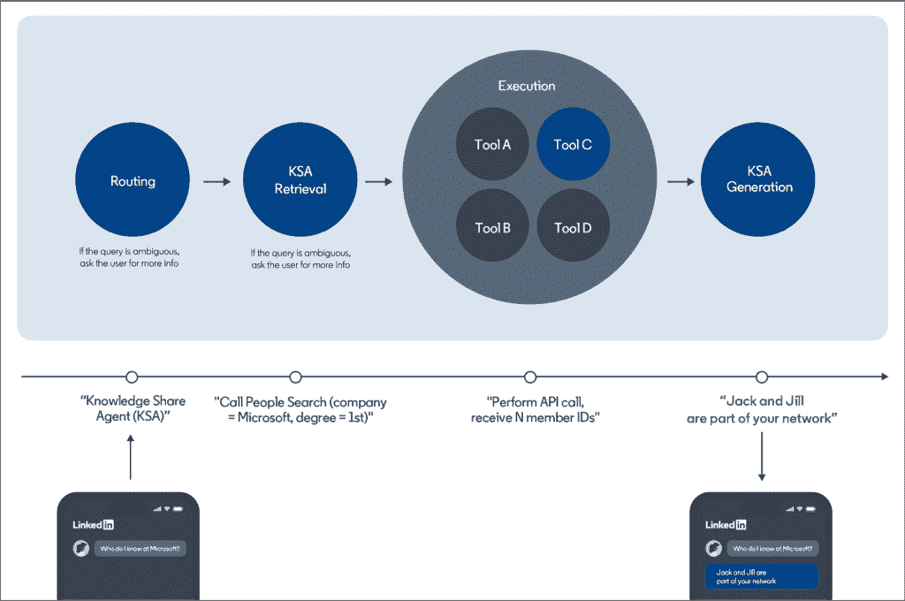
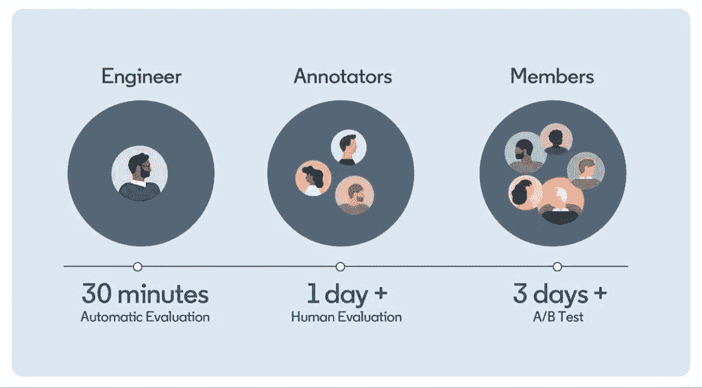
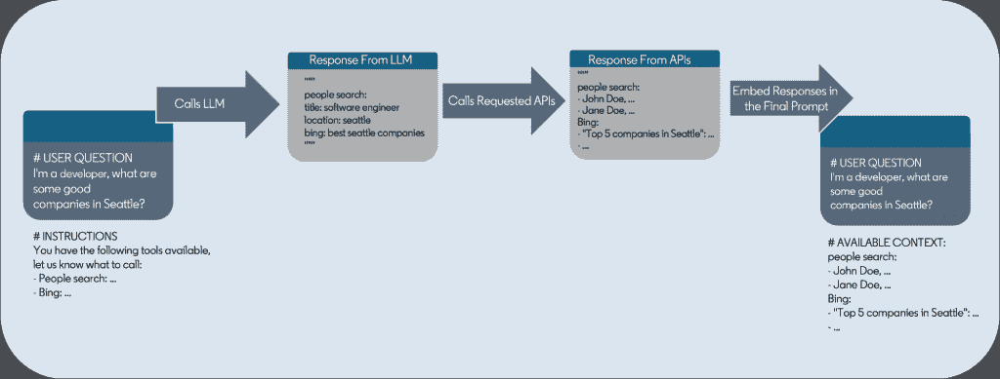
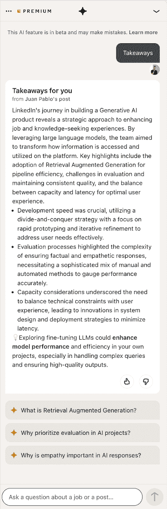

# 错误率从10%降至0.01%，领英全面分享LLM应用落地经验

> 来源：[https://agijuejin.feishu.cn/docx/J59pdQNlTof3ehxtLAYcrIann7c](https://agijuejin.feishu.cn/docx/J59pdQNlTof3ehxtLAYcrIann7c)

> 作者：Juan Pablo Bottaro、Karthik Ramgopal

> 编辑：机器之心

> 原文链接： [https://mp.weixin.](https://mp.weixin.qq.com/s/YBTX1tBCFZGceraxaIH5yQ)qq.com/s/YBTX1tBC...

随着大型语言模型（LLM）技术日渐成熟，各行各业加快了 LLM 应用落地的步伐。为了改进 LLM 的实际应用效果，业界做出了诸多努力。

近期，领英（LinkedIn）团队分享了他们在构建生成式 AI 产品的过程中总结的宝贵经验。领英表示基于生成式人工智能构建产品并非一帆风顺，他们在很多地方都遇到了困难。

以下是领英博客原文。

过去六个月，我们 LinkedIn 团队一直在努力开发一种新的人工智能体验，试图重新构想我们的会员如何进行求职和浏览专业内容。

生成式人工智能的爆发式增长让我们停下来思考，一年前不可能实现的事情现在有了哪些可能。我们尝试了很多想法，但都没有成功，最终发现产品需要如下关键点：

+   更快地获取信息，例如从帖子中获取要点或了解公司最新动态。

+   将信息点连接起来，例如评估您是否适合某个职位。

+   获取建议，例如改善您的个人资料或准备面试。

+   ......

我们通过一个现实场景来展示新开发的系统是如何工作的。想象一下，您正在滚动浏览 LinkedIn 信息流，偶然发现了一篇关于设计中的可访问性的有趣帖子。除了这篇文章之外，您还会刷到一些入门问题，以便更深入地研究该主题，您很好奇，例如点击「科技公司中可访问性推动商业价值的例子有哪些？」

系统后台会发生如下操作：

+   选择合适的智能体：系统会接受您的问题并决定哪个 AI 智能体最适合处理它。在这种情况下，它会识别您对科技公司内部可访问性的兴趣，并将您的查询路由到专门执行通用知识搜索的 AI 智能体。

+   收集信息：AI 智能体调用内部 API 和 Bing 的组合，搜索具体示例和案例研究，突出设计的可访问性如何为技术领域的商业价值做出贡献。

+   制定回复：有了必要的信息，智能体现在可以撰写回复。它将数据过滤并合成为连贯、信息丰富的答案，为您提供清晰的示例，说明可访问性计划如何为科技公司带来商业价值。为了使体验更具交互性，系统会调用内部 API 来使用文章链接或帖子中提到的人员简介等附件。

你可能会提问「我如何将我的职业生涯转向这个领域」，那么系统会重复上述过程，但现在会将你转给职业和工作（career and job）AI 智能体。只需点击几下，您就可以深入研究任何主题，获得可行的见解或找到下一个工作机会。

大部分新功能是借助 LLM 技术才成为可能。

**总体设计**

系统 pipeline 遵循检索增强生成（RAG），这是生成式人工智能系统的常见设计模式。令人惊讶的是，建设 pipeline 并没有我们预期的那么令人头疼。在短短几天内，我们就建立并运行了基本框架：

+   路由：决定查询是否在范围内，以及将其转发给哪个 AI 智能体。

+   检索：面向 recall 的步骤，AI 智能体决定调用哪些服务以及如何调用（例如 LinkedIn 人物搜索、Bing API 等）。

+   生成：面向精度的步骤，筛选检索到的噪声数据，对其进行过滤并生成最终响应。

图 1：处理用户查询的简化 pipeline。KSA 代表「知识共享智能体」，是数十种可以处理用户查询的智能体之一。

关键设计包括：

+   固定三步 pipeline；

+   用于路由 / 检索的小型模型，用于生成的较大模型；

+   基于嵌入的检索 (EBR)，由内存数据库提供支持，将响应示例直接注入到提示（prompt）中；

+   每步特定的评估 pipeline，特别是对于路由 / 检索。

**开发速度**

我们决定将开发任务拆分为由不同人员开发独立智能体：常识、工作评估、职位要点等。

通过并行化开发任务，我们提高了开发速度，但这是以「碎片」为代价的。当与通过不同的模型、提示或工具进行管理的助手（assistant）进行后续交互时，保持统一的用户体验变得具有挑战性。

为了解决这个问题，我们采用了一个简单的组织结构：

一个小型「水平（horizontal）」工程 pod，处理通用组件并专注于整体体验，其中包括：

+   托管产品的服务

+   评估 / 测试工具

+   所有垂直领域使用的全局提示模板（例如智能体的全局身份（identity）、对话历史、越狱防御等）

+   为 iOS/Android/Web 客户端共享 UX 组件

+   服务器驱动的 UI 框架，用于发布新的 UI 更改，而无需更改或发布客户端代码。

关键设计包括：

+   分而治之，但限制智能体数量；

+   具有多轮对话的集中式评估 pipeline；

+   共享提示模板（例如「身份（identity）」定义）、UX 模板、工具和检测

**评估**

事实证明，评估响应的质量比预期的更加困难。这些挑战可大致分为三个领域：制定指南（guideline）、扩展注释和自动评估。

制定 guideline 是第一个障碍。以工作评估为例：点击「评估我是否适合这份工作」并得到「你非常适合」并没有多大用处。我们希望响应既真实又富有同理心。一些用户可能正在考虑转行到他们目前不太适合的领域，并需要帮助了解差距和后续步骤。确保这些细节一致对注释器非常关键。

扩展注释是第二步。我们需要一致和多样化的注释器。我们内部的语言学家团队构建了工具和流程，以评估多达 500 个日常对话并获取相关指标：整体质量得分、幻觉率、AI 违规、连贯性、风格等。

自动评估工作目前仍在进行中。如果没有自动评估，工程师只能目测结果并在一组有限的示例上进行测试，并且要延迟 1 天以上才能了解指标。我们正在构建基于模型的评估器来评估上述指标，并努力在幻觉检测方面取得一些成功，端到端自动评估 pipeline 将实现更快的迭代。

图 2：评估步骤。

**调用内部 API**

LinkedIn 拥有大量有关人员、公司、技能、课程等的独特数据，这些数据对于构建提供差异化价值的产品至关重要。然而，LLM 尚未接受过这些信息的训练，因此无法使用它们进行推理和生成响应。解决此问题的标准模式是设置检索增强生成 (RAG) pipeline，通过该 pipeline 调用内部 API，并将其响应注入到后续的 LLM 提示中，以提供额外的上下文来支持响应。

许多此类数据通过各种微服务中的 RPC API 在内部公开。虽然这对于人类以编程方式调用非常方便，但对 LLM 来说并不友好。我们通过围绕这些 API 包装「技能」来解决这个问题。每个技能都有以下组件：

+   关于 API 的功能以及何时使用的人类友好描述

+   调用 RPC API 的配置（端点、输入模式、输出模式等）

+   LLM 友好的输入和输出模式

+   原始类型（字符串 / 布尔 / 数字）值

+   JSON 模式的输入和输出模式描述

+   LLM 友好模式和实际 RPC 模式之间映射的业务逻辑

这些技能 旨在让 LLM 能够执行与产品相关的各种操作，例如查看个人资料、搜索文章 / 人员 / 职位 / 公司，甚至查询内部分析系统。同样的技术也用于调用非 LinkedIn API，例如 Bing 搜索。

图 3：使用技能调用内部 API。

我们编写提示，要求 LLM 决定使用什么技能来解决特定的工作（通过规划选择技能），然后输出参数来调用技能（函数调用）。由于调用的参数必须与输入模式匹配，因此我们要求 LLM 以结构化方式输出它们。大多数 LLM 都接受过用于结构化输出的 YAML 和 JSON 训练。我们选择 YAML 是因为它不太冗长，因此比 JSON 消耗更少的 token。

我们遇到的挑战之一是，虽然大约 90% 的情况下，LLM 响应包含正确格式的参数，但大约 10% 的情况下，LLM 会出错，并且经常输出格式无效的数据，或者更糟糕的是甚至不是有效的 YAML。

这些错误对人类来说是微不足道的，但却会导致解析它们的代码崩溃。10% 是一个足够高的数字，我们不能轻易忽视，因此我们着手解决这个问题。

解决此问题的标准方法是检测它，然后重新提示 LLM 要求其纠正错误并提供一些额外的指导。虽然这种方法有效，但它增加了相当大的延迟，并且由于额外的 LLM 调用而消耗了宝贵的 GPU 容量。为了规避这些限制，我们最终编写了一个内部防御性 YAML 解析器。

通过对各种有效负载的分析，我们确定了 LLM 所犯的常见错误，并编写了代码以在解析之前适当地检测和修补（patch）这些错误。我们还修改了提示，针对其中一些常见错误注入提示，以提高修补的准确率。我们最终能够将这些错误的发生率减少到约 0.01%。

我们目前正在构建一个统一的技能注册表，用于在我们的生成式人工智能产品中，动态发现和调用打包为 LLM 友好技能的 API / 智能体。

**容量和延迟**

容量和延迟始终是首要考虑因素，这里提及一些考量维度：

+   质量与延迟：思想链 (CoT) 等技术对于提高质量和减少幻觉非常有效，但需要从未见过的 token，因此增加了延迟。

+   吞吐量与延迟：运行大型生成模型时，通常会出现 TimeToFirstToken (TTFT) 和 TimeBetweenTokens (TBT) 随着利用率的增加而增加的情况。

+   成本：GPU 集群不易获得且成本高昂。一开始我们甚至必须设定测试产品的时间表，因为会消耗太多 token。

+   端到端流式处理（streaming）：完整的答案可能需要几分钟才能完成，因此我们流式处理所有请求，以减少感知延迟。更重要的是，我们实际上在 pipeline 中端到端地进行流式处理。例如，决定调用哪些 API 的 LLM 响应是逐步解析的，一旦参数准备好，就会触发 API 调用，而无需等待完整的 LLM 响应。最终的综合响应也会使用实时消息传递基础设施一路传输到客户端，并根据「负责任的 AI」等进行增量处理。

+   异步非阻塞 pipeline：由于 LLM 调用可能需要很长时间才能处理，因此我们通过构建完全异步非阻塞 pipeline 来优化服务吞吐量，该 pipeline 不会因 I/O 线程阻塞而浪费资源。

感兴趣的读者可以阅读博客原文，了解更多研究内容。

原文链接：https://www.linkedin.com/blog/engineering/generative-ai/musings-on-building-a-generative-ai-product