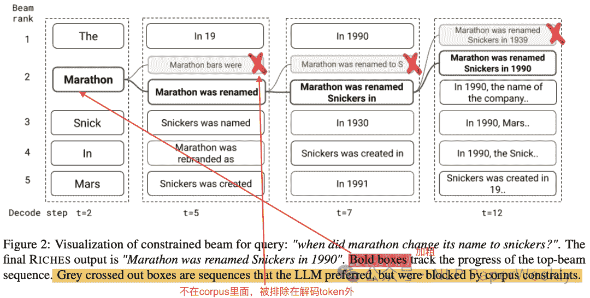
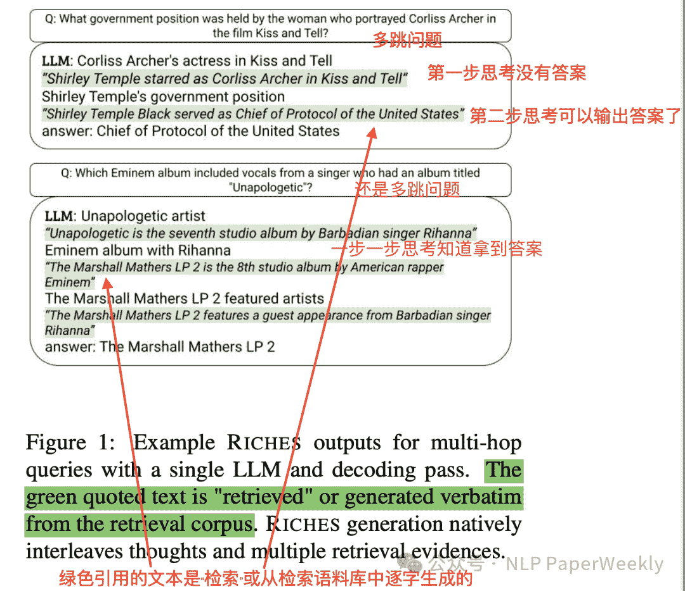
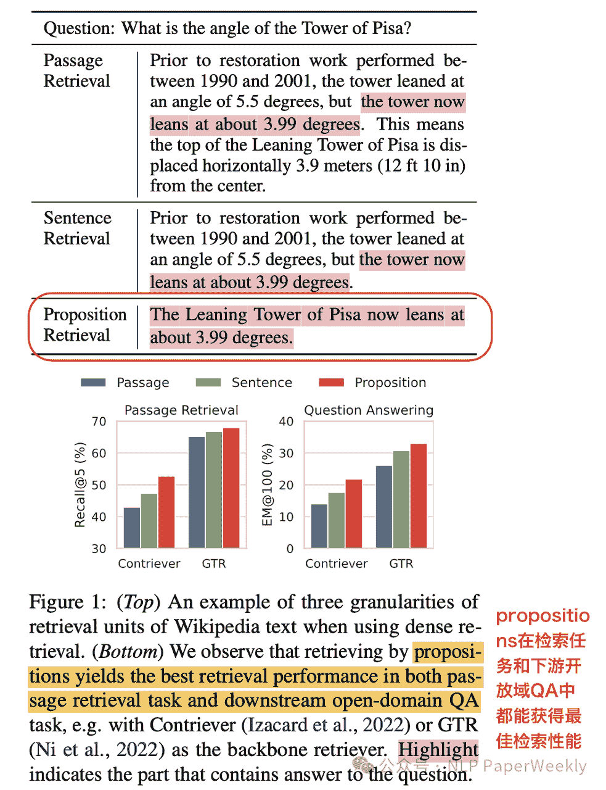
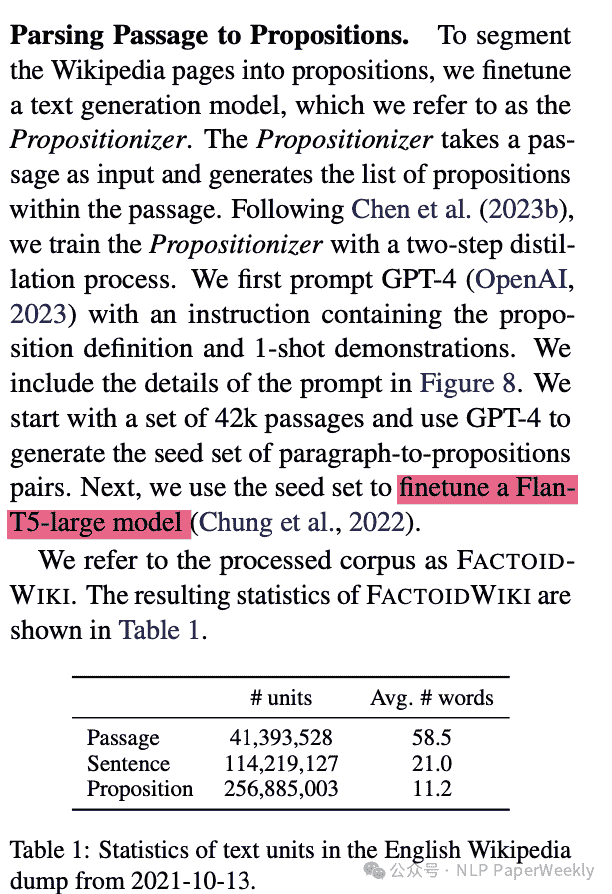
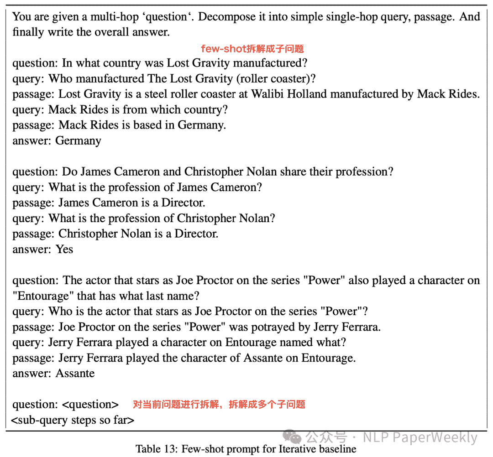
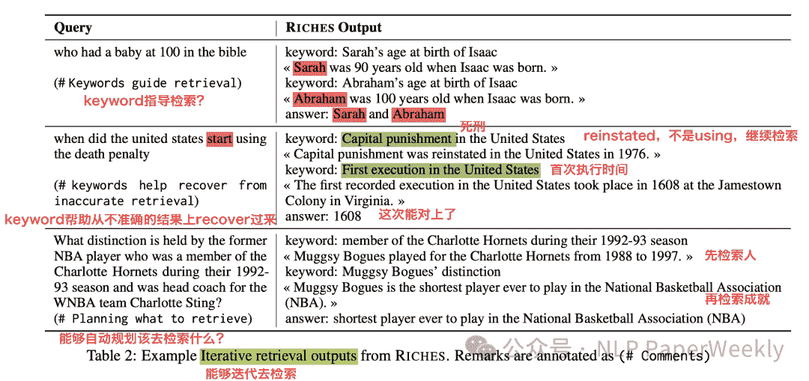
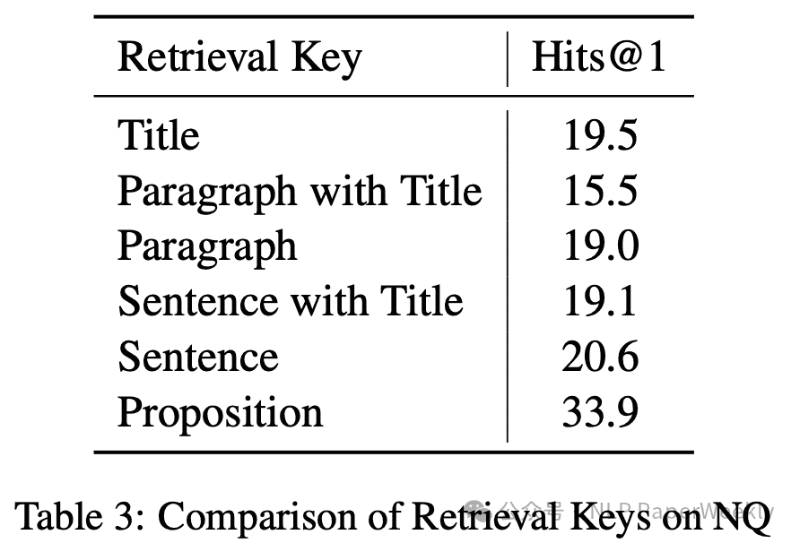
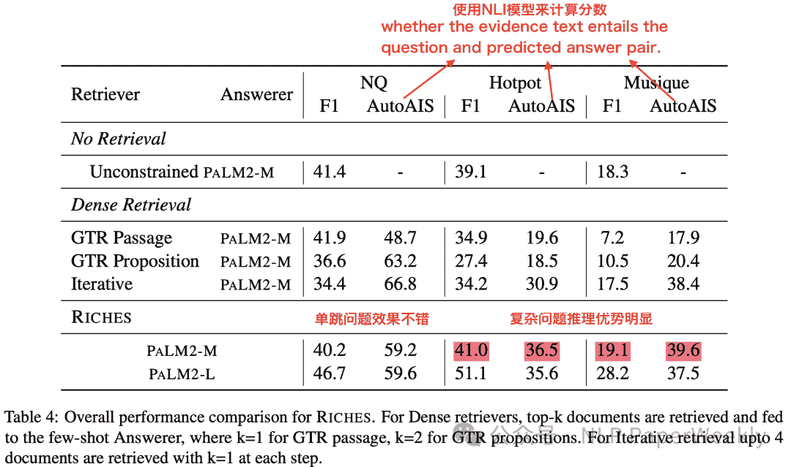
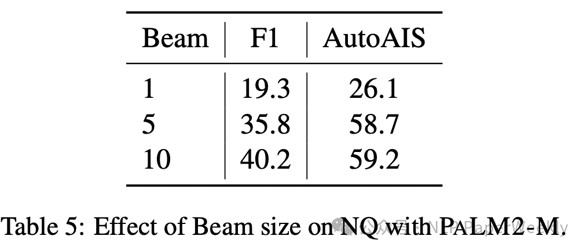
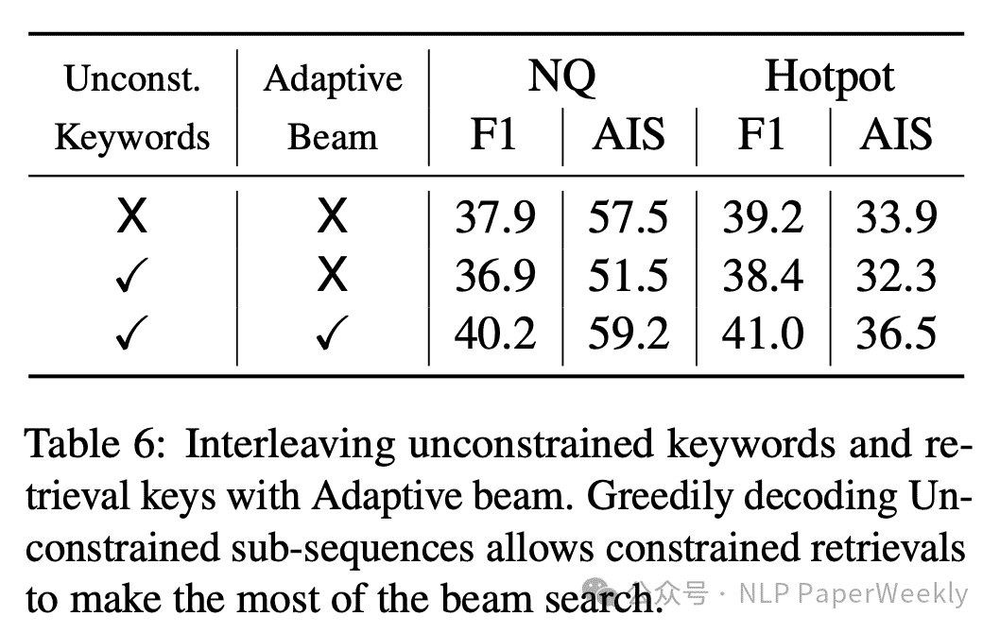

# DeepMind | 在生成的过程中进行检索：一种有潜力完全替代RAG的思路"RICHES"

> 来源：[https://agijuejin.feishu.cn/docx/O8GmdFnBCoddSjxQ1ONc6l4Tncl](https://agijuejin.feishu.cn/docx/O8GmdFnBCoddSjxQ1ONc6l4Tncl)

> 作者：NLP PaperWeekly

> 原文链接： [https://mp.weixin.](https://mp.weixin.qq.com/s/IbYwnLpu-d4EK7tt7sbJ2w)qq.com/s/IbYwnLpu...


大家好，我是HxShine

今天分享一篇 Google DeepMind 公司的一篇文章，Title: From RAG to RICHES: Retrieval Interlaced with Sequence Generation：从 RAG 到 RICHES：在生成过程中完成检索。

这篇文章提出了一种新的方法 **RICHES **，它 **将检索RAG与生成完全结合在一块。RICHES 消除了对单独构建R**AG**系统再结合LLM进行生成的模式**，为传统的 RAG 系统**提**供了一种替代方案。 它 通过直接解码其内容来检索文档 ，并受到语料库的约束。 RICHES允许我们仅通过提示即可适应各种新任务。 RICHES 可以与任何指令微调模型一起使用，而 无需额外的训练。它提供属性证据，支持多跳检索，并在单个 LLM 解码过程中交织思维以规划下一步要检索的内容。 实验表明RICHES 在 ODQA 任务（包括属性和多跳 QA）中都有非常好的性能。

RICHES是 **非常有潜力能替代RAG **的一种方案，他能做到 **在生成的过程中完成检索，并且能做到边检索，边**思考，边纠错，能解决复杂的多步推理问题 。后续 RICHES或许能成为LLM接入外部知识的一种新方案 。同时其对检索数据的构建方法也有了更高的要求，需要在decode上做额外的设计，也增加了其使用难度。

## **一、概述**

+   • **Title: **From RAG to RICHES: Retrieval Interlaced with Sequence Generation

+   • **URL: **https://arxiv.org/pdf/2407.00361

+   • **Authors: **Palak Jain, Livio Baldini Soares, Tom Kwiatkowski

+   • **Institution: **Google DeepMind

### **1 Motivation**

+   • 当前的 RAG 系统 需要将检索和生成分开，导致多系统流水线复杂且难以训练。

+   • LLMs 容易产生幻觉，无法及时引入新内容，无法解释新鲜的、在训练时无法获得的知识。

### **2 Methods**

RICHES 通过 **将**检索**与**生成统一到单一的解码过程中，RICHES旨在通过提示（prompting）适应多样化的新任务，从而减少对额外训练的需求。 其 通过直接解码文档内容或与之相关的自然语言检索键，提高了检索效率，并允许在单个解码过程中进行多跳检索和思考规划。



#### **1 RICHES 的工作流程**

1.  1. **输入问题 **：用户输入一个问题。

1.  2. 生成检索键：从 FM-Index 中生成指向相关文档的检索键。

1.  3. 解码过程：使用 LLM 进行解码，生成包含检索键和非约束文本的序列。

1.  4. 选择最优序列：从多个候选序列中选择最优序列作为答案。

1.  5. **输出答案 **：输出答案，并可以提供属性证据，指明答案的来源。

#### **2 详细方法和步骤**

1.  1. **检索键生成 ****: 通过**解码文档内容或相关的自然语言 检索键 来检索文档，这些键指向它们生成的文档。

+   • **FM-Index 索引 **：使用 **FM-Index 索引检索语料库，将文本的所有**后缀按照字典序排列并压缩成更紧凑的形式。

+   • **检索键：从 FM-Index 中生成指**向文档的检索键，例如段落、句子或命题。 检索键可以是文本片段，也可以是经过命题化处理的文本片段。

1.  2. **约束解码 **: 使用 FM-index 对模型输出进行约束，以确保它们存在于语料库中。

+   • **约束条件 **：在解码过程中添加约束条件，确保生成的序列与检索语料库中的序列一致。

+   • **约束解码技术： **使用多种约束解码技术，例如：

+   • **掩码技术 **：将不在检索语料库中的词汇的概率设置为 0，防止模型生成不存在的词汇。

+   • **前缀匹配 **：确保生成的序列以检索键开头。

+   • **长度限制 **：限制生成序列的长度，避免生成过长的序列。

```
def constrain(input_prefix):
    # Fetch continuations for prefix 
    allowed_tokens = fm_index.get_continuations(input_prefix)
    # Get next token probabilities
    logprobs = LLM.logprobs(input_prefix)
    # Disallowed tokens are set to -inf
    for i in logprobs:
        token = vocab[i]
        if token not in allowed_tokens:
                logprobs[i] -= np.inf 
    return logprobs
```

1.  1. 自适应beamsearch大小 : 使用自适应beamsearch大小来平衡约束和非约束生成。

+   • **束搜索 **：使用束搜索技术来生成多个候选序列，从中选择最优序列作为答案。

+   • **自适应束大小 **：根据是受限序列还是非受限序列自适应调整beamsearch窗口大小。

+   • **约束序列 **：对于约束序列，使用较小的束大小，因为约束序列的搜索空间较小。

+   • **非约束序列 **：对于非约束序列，使用较大的束大小，因为非约束序列的搜索空间较大。

### 3 Few-shot prompt（QA的提示词）

#### **1 single-hop QA**


**特点：**

+   **• keyword引入思考过程， **辅助检索相关内容，同时keyword生成为非受限解码，给足充分的思考空间。

+   **• passage生成《》内部用限**制解码， 精确解码检索相关知识，同时可以设置大的Beam size，充分发挥其能力。

+   • 迭代生成多个keyword，可以 用于检索多个知识，以及修复检索错误的结果。

#### **2 multi-hop QA**


**特点：**

+   • keyword **引入思考过程，辅助检索相关内容，同时keywor**d生成为非受限解码，给足充分的思考空间。

+   **• passage生成《》内部用限**制解码， 精确解码检索相关知识，同时可以设置大的Beam size，充分发挥其能力。

+   **• 迭代生成多个keyword， 解决多跳问**答需要搜索多个知识问题，同时迭代生成还能对其进行纠错，修复检索错误的结果。

#### **4 特点总结**

1.  1. **统一检索与生成 **：将检索操作与文本生成过程统一到一个单一的解码过程中，消除了对单独检索器和生成器的需求。

1.  2. 受限解码**（Constrained Decoding）** ：通过 标记特殊的开始和结束符号来识别检索键，确保生成的文本是存在于预定义的语料库中的序列。

1.  3. 自适应束搜索（Adaptive Beam Search） ：为了处理交替出现的受限和非受限文本生成任务，引入了自适应束搜索策略， 在受限序列生成时使用全束搜索，而在非受限生成时则使用贪心解码。

1.  4. **高效的约束实现 **： **利用FM-index数据结构来支持快速的子字符串搜索操作，从**而在解码过程中对模型输出进行语料库约束 ，确保生成的文本符合要求。

1.  5. **多种检索键选择 **：提供了 **多种检索键的选择，包括文档标题、段落子字符串、句子子**字符串和命题索引，以适应不同的检索需求。

1.  6. **无需额外训练 **： **可以与任何指令调整（Instruction-t**uned）模型一起工作，无需额外的训练 ，这得益于统一检索与生成的方法可以直接通过提示适应新任务。

1.  7. **多跳检索和思考规划 **：支持多跳检索任务， **允许模型在生成过程中穿插“思考”步骤，以帮助指导搜索过程，**避免重复检索，并在必要时纠正错误的检索。



#### **5 索引构建策略对比**


**多种索引策略优缺点分析 **：

+   • **文档标题和章节标题：**

+   • **优点 **：这种策略利用了检索语料库的结构化信息，例如 Wikipedia 中的标题和章节标题，可以 有效地组织文档并提供层次化的检索。

+   • **缺点 **：这种策略依赖于检索语料库的结构，对于结构不规范的语料库可能不适用。

+   • **段落子字符串：**

+   • **优点 ****：这种策略将段落作为检索单**元，可以 有效地检索段落级别的信息 ，例如开放式问答中的证据段落。

+   • **缺点 **：这种策略可能导致检索结果过多，因为每个段落都可能对应多个检索键。

+   • **句子子字符串：**

+   • **优点 **：这种策略将句子作为检索单元，可以 检索句子级别的信息，例如翻译任务中的翻译示例。

+   • **缺点 **：句子可能不够完整，无法提供足够的信息来回答问题。

+   • 命题索引（需要额外对文本进行分析拆解）：

+   • **优点 **：这种策略 **将**文档分解为原子命题，每个命题包含一个事实性信息。命题索引可以有效地检索事实性信息，例如开放式问答中的答案。

+   • **缺点 **：命题化过程需要额外的计算成本，并且可能无法涵盖所有类型的知识。

### **4 QA**

#### Q1：如何选择合适的索引策略？ ：

+   • **任务类型 **：根据任务类型选择合适的索引策略。例如， 对于开放式问答任务，可以选择段落子字符串或命题索引。

+   • **语料库结构 **：根据检索语料库的结构选择合适的索引策略。例如，**对于结构化的语料库，可以选择文档标题和章节标题。

**实验结论：RICHES 论文中的实验结果表明，命题索引在开放式问答任务中表现最**好，因为它可以有效地检索事实性信息，并且与 RICHES 的解码搜索策略更匹配 。

#### Q2：基于命题索引究竟是什么，怎么来的？

+   • **Proposition定义： **其需要对原始passage做原子处理，为文本中的原子表达式，每个Proposition命题都封装了独特的特征，并以简洁、自成一体的自然语言格式呈现一个知识点。



+   • **Proposition命题构建步骤一：利用GPT4将passag**e转化成propositions（构建Flan-T5-large模型的训练语料）


+   • **P**roposition命题构建步骤二：训练Flan-T5-large model生成大量Proposition



### **5 Conclusion**

+   • **RICHES 可以将检索与序列生成统一在**一起，不用去构建复杂的pipeline。

+   • **R**ICHES可以解决各种 ODQA 任务，同时其复杂任务推理能力中表现出色，并可以与任何指令微调模型一起使用，而无需额外的训练。

+   • **R**ICHES能在推理的过程中，一边检索知识，一边进行思考，还能对生成的结果进行校验，是比较有潜力替代RAG的一种方法。

+

## **二、详细内容**

### **1 实验设置**

+   • **数据集 **：多种开放域问答（ODQA）任务，包括单跳和多跳问答基准。单跳任务：Open-NQ数据集。多跳任务：Hotpot-QA和MusiqueAns数据集。

+   • **检索键 **：如 标题、段落、句子和命题等作为索引健

+   • **评估方法 **： **端到端答案的F1匹配准确率 ****和使用AutoAIS（自动归因分数）的答案归**因。 AutoAIS通过判断证据文本是否蕴含问题（NLI任务）和预测答案对来自动计算得分。

+   • **基座模型 **： PALM2-M和PALM2-L ，采用few-shot设置，没有进行微调。

+   • **对比Baseline：无检索、标准dense检索、**多跳QA迭代检索（拆解成子问题再检索）。



+

+   • PS：子问题拆解prompt

+   • **消融实验**

+   • **检索键的比较 **：实验比较了不同的检索键选项，包括标题、带标题的段落、单独段落、句子和命题，并发现命题索引与解码搜索策略最为一致。

+   • **束大小的影响 **：研究了不同束大小对搜索空间探索的影响，并发现较大的束可以提高性能，但回报逐渐减少。

+   • **自适应束与思考交织 **：研究了自适应束在交织受限和非受限序列时的重要性，并发现关键词的插入可以提高答案和检索性能。

+   • **其他分析：**

+   • **定性分析 **：通过检查50个成功和失败的案例，分析了系统的优势和局限性。

+   • **损失分类 **：对失败的查询进行了分类，包括索引失败、搜索失败和归因失败，并提供了每种失败类型的例子。

### 2 RICHES在单跳开放式问答任务上效果不错


+   • **效果对比： **RICHES方法能很好的检索出结果，同时，相对于dense retriever只能检索类似的句子， riches看着对上下文的理解可能更好，能检索出更好的结果。

+   • **总结 **：RICH**ES 在单跳开放式问答任务中能**够有效地检索相关文档， 验证了其替代RAG来检索相关知识的可行性 ，同时其 无需调用额外的模型来生成答案 ，是其另外的一个的优点。

### 3 RICHES能自主思考迭代检索优化回答效果



**示例说明 **：

+   • **第一个例子 **：通过生成检索键 “keyword: Sarah’s age at birth of Isaac” 和 “keyword: Abraham’s age at birth of Isaac” 来检索 Sarah 和 Abraham 在 Isaac 出生时的年龄信息，并最终生成了答案 “Sarah and Abraham”。

+   • **第二个例子 **：

+   • **首次检索结果不正确： **首先生成检索键 “keyword: Capital punishment in the United States” 来检索美国恢复死刑的时间，发现结果不正确。

+   • **第二次搜索找到正确答案： **再次生成新的检索健“keyword: First execution in the United States”，从而找到正确的答案。

+   • **第三个例子 **：能通过迭代检索解决多跳问题

+   • 首先通过生成检索键 “keyword: member of the Charlotte Hornets during their 1992-93 season” 查询到对应的人然后通过生成检索健 “keyword: Muggsy Bogues’ distinction” 来检索 Muggsy Bogues 的信息，并最终生成了答案 “shortest player ever to play in the National Basketball Association (NBA)”。

**结论 **：

+   • Riches能检索多个结果并生成答案 ：RICHES能从多个文档中检索信息并生成最终的答案。

+   • Riches能在生成的过程中纠正检索错误 ：当检索不正确时，能够生成新的keyword继续进行检索，生成最终答案。

+   • Riches具有planning能力，能解决多跳等复杂推理问题 ：多跳问题需要复杂的推理，Riches能通过生成“想法”来计划下一步需要检索的内容，从而拿到复杂推理的结果。

### **4 命题索引 **(Proposition)****更适合 RICHES 的解码搜索策略



**实验设计：**

+   • **Open-NQ： **单跳开放式问答数据集。

+   • **标题 (Title) **: 使用文档标题和章节标题作为检索键。

+   • 带标题的段落 (Paragraph with Title) : 使用文档标题、章节标题和段落文本作为检索键。

+   • **段落 (Paragraph) **: 只使用段落文本作为检索键。

+   • 带标题的句子 (Sentence with Title) : 使用文档标题、章节标题和句子文本作为检索键。

+   • **句子 (Sentence) **: 只使用句子文本作为检索键。

+   • 命题 (Proposition) : 使用从段落中提取的命题作为检索键，这个需要额外对原始语料进行处理。

**实验结论：**

+   • **句子检索键表现较差 **：句子可能不够完整，无法提供足够的信息来回答问题，因此句子检索键的检索性能较差。

+   • **命题索引更适合 RICHES **：命题索引可以有效地检索事实性信息，并且与 RICHES 的解码搜索策略更匹配。

### 5 RICHES 在不同数据集上的整体性能



**实验设置：对比Baseline：无检索、标准dense检索、**多跳QA迭代检索（拆解成子问题再检索）。

实验结论：

+   • 无检索方案看起来效果也不错（为啥非受限解码的效果也非常不错？反而GTR Passage效果比较差？）

+   • RICHES 在复杂推理任务上有着明显的优势 ，其能够有效地进行多层次推理，并从多个文档中检索和整合知识。

+   • 使用更大的模型 PALM2-L，RICHES 的性能进一步提。

### **6 消融实验**

#### 1 Beam size越大效果越好



#### **2 自适应Beam Size可以让constrai**ned retrievals效果发挥更好



+   • **结**论：迭代生成unconstrained keywords（可以纠错以及解决多跳问题）和自适应beam size结合使用能有效提升最终效果。

+

## **三、总结**

**RICHES 是一种很有前途的新方法，可以将检索与序列生成交织在一起。它在各种 ODQA 任务中表现出色，并可以与**任何指令微调模型一起使用，而无需额外的训练。尽管存在一些局限性，但 RICHES 为未来检索和生成的研究开辟了新的途径。

特点总结：

+   • 提出一种可以 **无缝集成检索和生成的方法。**

+   **• 充分调研索引构建的方式和搜索策略对**RICHES方法的影响， 实验表明命题索引和自适应Beam search可以有效提升RICHES的效果。

+   • 在各种 QA 任务上的实验表明 RICHES能适应各种任务，特别在复杂推理问题问答上有着比较好的效果。

+   • **RICHES基于corpus构建索引来解码，生成**的知识的正确性更有保障，有利于减轻幻觉。


+   **👇**关注 NLP PaperWeekly ， 对话框输入“ RICHES ”获取Paper ， 快关注吧 👇

**添加微信请备注**昵称+公司/学校+研究方向，否则不予通过