# 一篇模块化RAG之最新全面系统性综述

> 来源：[https://agijuejin.feishu.cn/docx/BN1cdzMwtobfIpxidG3cWibanSg](https://agijuejin.feishu.cn/docx/BN1cdzMwtobfIpxidG3cWibanSg)

> 作者：PaperAgent

> 原文：[https://mp.weixin.](https://mp.weixin.qq.com/s/LBfw-PC6r4uzhJwBZVqh6Q)qq.com/s/LBfw-PC6...

RAG访问外部知识库增强了LLMs处理知识密集型任务的能力，随着应用场景需求的增加，RAG系统变得更加复杂。传统的RAG依赖于简单的相似性检索， 面对复杂查询和变化多端的文本块时表现不佳： 对查询的浅层理解、检索冗余和噪声。

**朴素RAG和高级RAG的案例 **。面对复杂问题时， **两者都遇到了限制 **，难以提供令人满意的答案。尽管高级RAG通过分层索引、检索前和检索后的过程提高了检索精度，但这些相关文档并没有被正确使用。

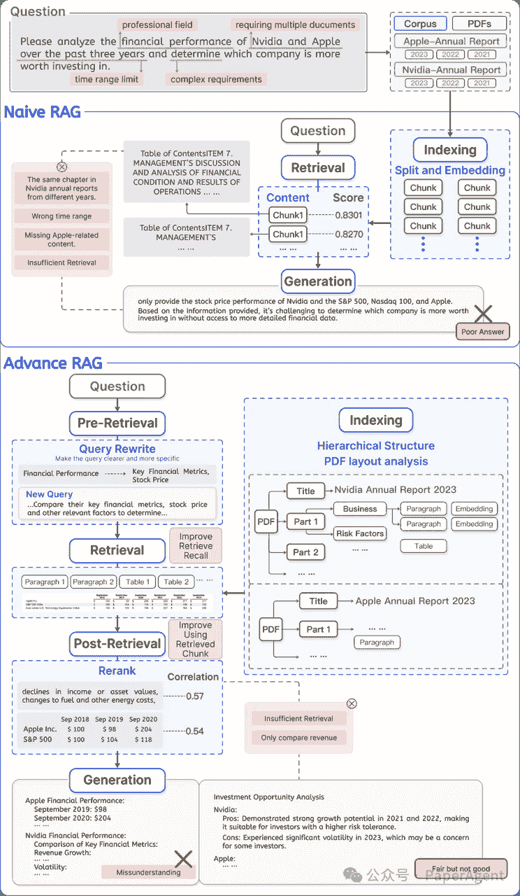

提出了一种 **新的 模块化RAG框架 ****，通过将复杂的RAG系**统分解为 三层架构设计（ 模块、子模块和操作符 ）以统一和结构化的方式定义RAG系统，增强了系统的灵活性和可扩展性， 这种框架超越了传统的线性架构， 采用了集成路由、调度和融合机制的更先进设计 。

**当前模块化RAG的案例 **。该系统整合了多样化的数据和更多功能性组件。过程不再局限于线性，而是由多个控制组件控制检索和生成，使整个系统更加灵活和复杂。

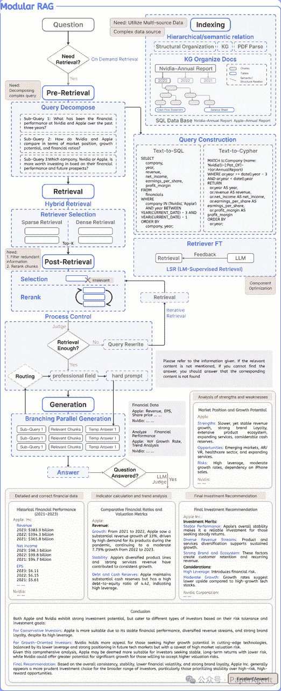

## **模块化RAG 框架与符号**

1.  **RAG系统组成 **：典型的RAG系统主要由三个关键部分组成：索引（Indexing）、检索（Retrieval）和生成（Generation）。

1.  **索引（Indexing） **：文档被分割成可管理的块（chunks），并通过嵌入模型转换成向量，存储在向量数据库中。这一步骤是系统组织的关键。

1.  **检索（Retrieval） **：使用相同的编码模型将查询转换成向量，然后根据向量相似度筛选出最相关的文档块。

1.  **生成（Generation） **：获取相关文档后，将查询和检索到的文档一起输入到大型语言模型（LLM）中，生成最终答案。

1.  **模块化RAG框架 **：随着RAG技术的发展，系统整合了越来越多的功能组件。模块化RAG框架包括三个层次，从大到小分别是：

+   L1 模块（Module）：RAG系统的核心过程。

+   L2 子模块（Sub-module）：模块内的功能模块。

+   L3 操作符（Operator）：模块或子模块中具体的功能实现。

1.  **RAG Flow **：模块和操作符的排列构成了RAG Flow，这是RAG系统的工作流程。RAG Flow可以分解为子功能的图形表示，在最简单的情况下，图形是线性链。

1.  **符号描述 **：文中提供了一个重要符号的表格，定义了如下符号：

1.

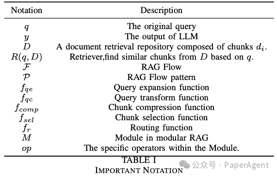

## **模块化RAG模块和操作符**

详细介绍了模块化RAG框架下的六个主要模块以及所使用的的具体技术： 索引、检索前处理、检索、检索后处理、生成和编排 。

**三种RAG范式的比较 **。模块化RAG从之前的范式中发展而来，并与当前RAG系统的实际需求相一致。

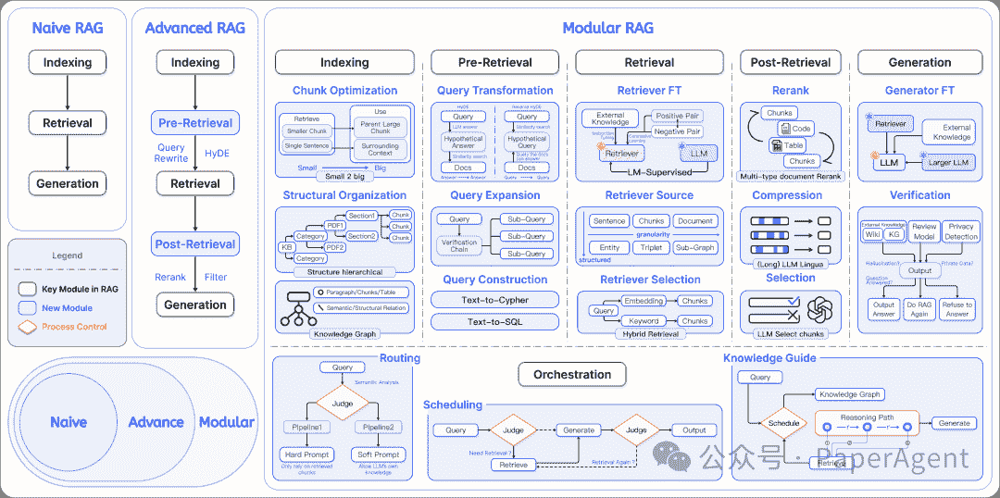

1.  **索引（Indexing） **：

+   将文档分割成易于管理的块，是系统组织的关键步骤。

+   面临的挑战包括内容表示不完整、块相似度搜索不准确和引用轨迹不清晰。

+   解决方案包括块优化（如调整块大小和重叠）、元数据附加和结构化组织。

+   技术包括：

+   块优化（Chunk Optimization）：调整块的大小和重叠以优化语义信息的捕获和噪声的控制。

+   元数据附加（Metadata Attachment）：为块附加元数据，如页码、文件名等，以增强检索的过滤能力。

+   结构化组织（Structure Organization）：建立文档的层次结构，如段落和句子的分割，以提高检索效率。

+   知识图谱索引（KG Index）：使用知识图谱来组织文档，明确概念和实体之间的关系。

1.  检索前处理（Pre-retrieval） ：

+   改进原始查询以提高检索效果，解决诸如查询表述不清、语言复杂性和歧义等问题。

+   方法包括查询扩展、查询转换和查询构造。

+   技术包括：

+   查询扩展（Query Expansion）：通过扩展查询来丰富上下文，提高检索的相关性。

+   查询转换（Query Transformation）：对原始查询进行改写或转换以提高检索的准确性。

+   查询构建（Query Construction）：根据需要将查询转换为不同的查询语言，如SQL或Cypher，以访问结构化数据。

1.  **检索（Retrieval） **：

+   利用强大的嵌入模型在潜在空间中高效表示查询和文本，建立问题与文档之间的语义相似性。

+   考虑因素包括检索器的选择、检索器微调以及检索效率和质量。

+   技术包括：

+   检索器选择（Retriever Selection）：根据任务需求选择合适的检索器，包括稀疏检索器、密集检索器和混合检索器。

+   检索器微调（Retriever Fine-tuning）：对检索器进行微调以适应特定领域的数据和术语。

1.  检索后处理（Post-retrieval） ：

+   对检索到的文档块进行后处理，以更好地利用上下文信息。

+   包括重新排序、压缩和选择操作，以提高最终生成答案的质量。

+   技术包括：

+   重排（Rerank）：根据相关性对检索到的文档块进行重新排序。

+   压缩（Compression）：压缩检索到的内容，以减少噪声并提高LLM对关键信息的识别。

+   选择（Selection）：直接移除不相关或冗余的文档块。

1.  **生成（Generation） **：

+   使用大型语言模型基于用户的查询和检索到的上下文信息生成答案。

+   考虑因素包括生成器微调和答案的验证。

+   技术包括：

+   生成器微调（Generator Fine-tuning）：根据特定领域或数据特性对生成器进行微调，以提高生成答案的质量。

+   验证（Verification）：通过知识库或模型基础的方法对生成的答案进行验证，以减少错误信息。

1.  编排（Orchestration） ：

+   控制RAG过程的模块，包括路由、调度和融合。

+   动态选择后续步骤，根据前一个结果进行决策。

+   技术包括：

+   路由（Routing）：根据查询的类型或内容将查询定向到不同的处理流程。

+   调度（Scheduling）：管理RAG流程中的决策点，如何时进行检索或生成。

+   融合（Fusion）：整合来自多个分支的信息，以形成一个全面且一致的响应。

## **模块化RAG流程及其模式**

详细探讨了模块化RAG系统中的工作流模式，即RAG流程（RAG Flow）及其模式（Flow Pattern）。

**RAG Flow的定义：**

RAG Flow是模块和操作符之间的协作，形成模块化RAG系统中的工作流程。

通过控制逻辑，操作符可以按照预定的管道执行，也可以在必要时执行条件、分支或循环操作。

RAG Flow Pattern：

识别并定义了一组常见的RAG流程模式，这些模式跨越不同的应用领域，展现出高度的一致性和可重用性。

RAG流程模式可以定义为一系列模块的有序连接，每个模块包含一组操作符。

+   线性模式（Linear Pattern）：

最简单且最常用的模式，模块按照固定的顺序执行。

线性RAG流程模式。每个模块按固定的顺序依次处理。

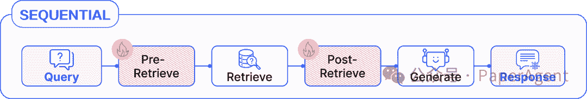

技术包括查询转换（Query Transform Module）、检索（Retrieval）、重排（Rerank）、生成（Generation）。

例如，RRR（RewriteRetrieve-Read）模型，它在检索前引入了一个可学习的查询改写模块。

**RRR是一种典型的线性流程 **，它在检索之前引入了一个可学习的查询重写模块。该模块基于大型语言模型（LLM）的输出结果进行强化学习。

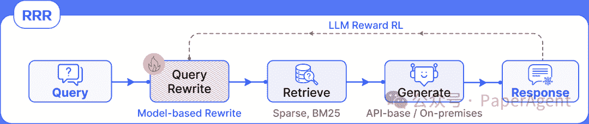

+   条件模式（Conditional Pattern）

根据不同的条件选择不同的RAG管道。

通过路由模块决定流程的下一个模块。

条件流程模式。存在一个路由模块 ，它控制查询被导向哪个 RAG 流程。通常，不同的流程用于不同的配置，以满足 RAG 系统的一般要求。

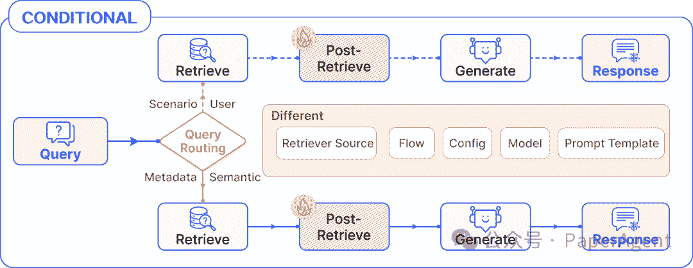

+   分支模式（Branching Pattern）

RAG流程可能有多个并行运行的分支，通常是为了增加生成结果的多样性。

分为检索前分支（Pre-retrieval Branching）和检索后分支（Post-retrieval Branching）。

**检索前分支模式（Pre-retrieval** Branching Pattern）:

技术包括查询扩展（Query Expansion）、并行检索（Parallel Retrieval）、生成（Generation）、合并（Merge）。

**检索前分支流程模式 **。每个分支分别执行检索和生成，然后在最后进行聚合。

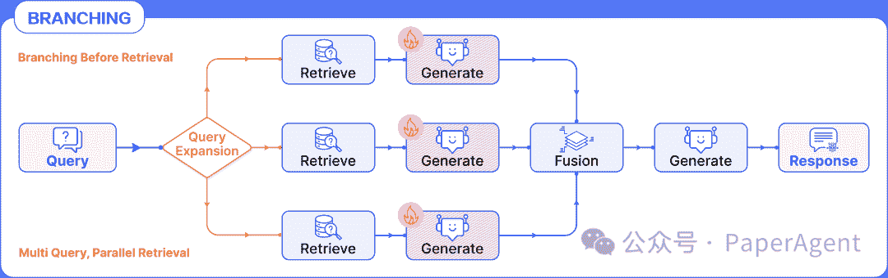

**检索后分支模式（Post-retrieval** Branching Pattern）:

技术包括单一查询检索（Single Query Retrieval）、并行生成（Parallel Generation）、合并（Merge）。

检索后分支流程模式。只执行一次检索 ，然后对每个检索到的文档块分别进行生成，随后进行聚合。

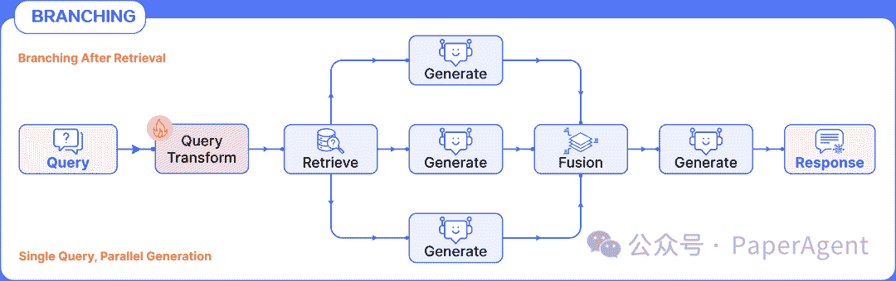

**REPLUG中的 RAG **流程， 遵循典型的检索后分支模式 。每个检索到的块都经历并行生成，然后使用加权概率集合进行聚合。

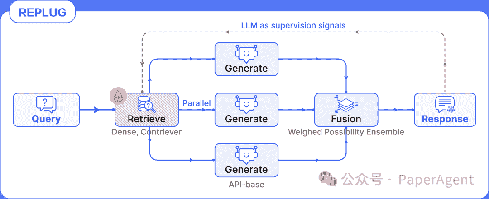

+   循环模式（Loop Pattern）

涉及检索和生成步骤的相互依赖，通常包括一个调度模块来控制流程。

包括迭代检索（Iterative Retrieval）、递归检索（Recursive Retrieval）、自适应检索（Adaptive Retrieval）。

**循环流程模式 **。通常，RAG 系统执行多轮检索和生成。它可以被分类为三种形式：迭代、递归和自适应。

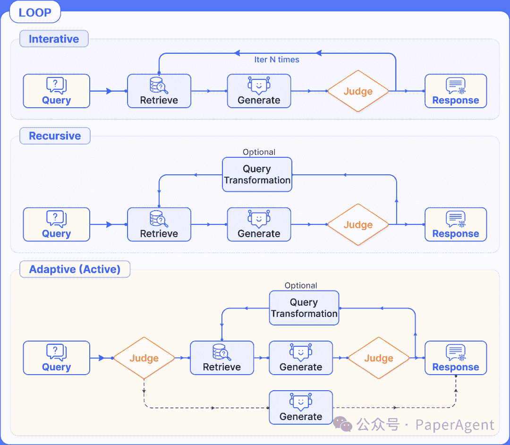

**ITER-**RETGEN是一种典型的 迭代结构 。在最大迭代次数的限制内执行多轮检索和生成。

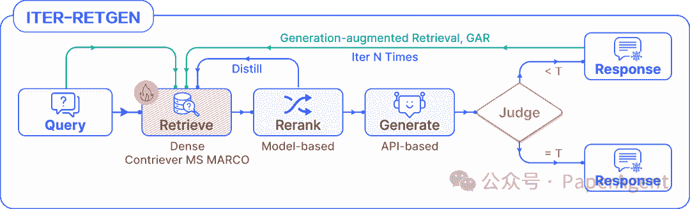

**ToC的 **RAG 流程。这个过程的一个典型特点是，每次 递归检索 都使用前一步生成的新查询，从而逐步深化对原始复杂查询的分析。

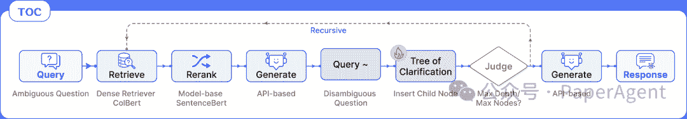

自适应检索：FLARE的RAG流程 。生成的临时答案将进行置信度评估。如果它未达到所需的置信度水平，流程将返回到检索阶段并重新生成。评估标准是通过提示实现的。

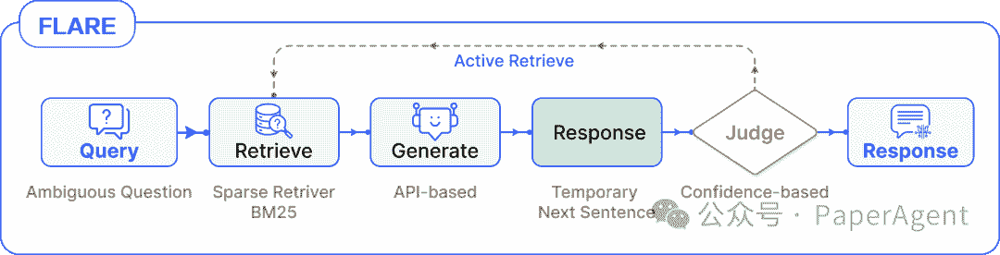

自适应检索：SELF-RAG的RAG流程 。首先，它提示 GPT-4 获取一个合适的指令微调数据集，以微调部署的开源大型语言模型（LLM）。这允许模型在生成过程中输出四个特定的令牌，这些令牌用于控制 RAG 流程。

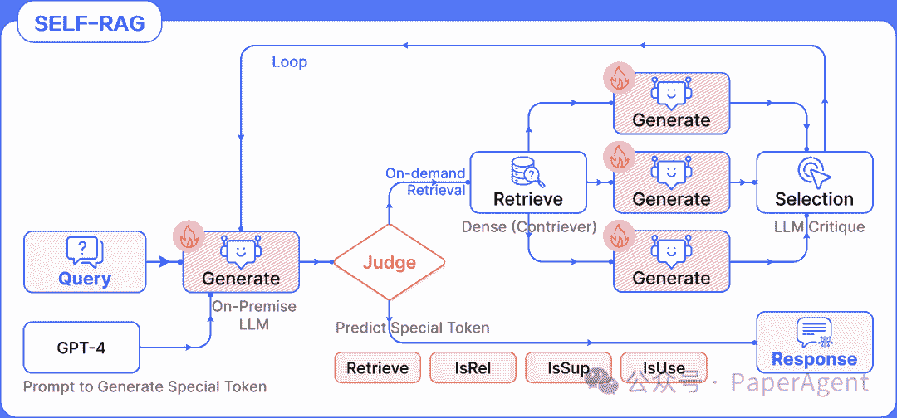

+   调优模式（Tuning Pattern）

RAG不断整合更多的LLM相关技术，其中许多组件由可训练的语言模型组成。

通过微调，可以进一步优化组件的性能和与整体流程的兼容性。

包括检索器微调（Retriever Fine-tuning）、生成器微调（Generator Fine-tuning）、双重微调（Dual Fine-tuning）。

**检索器微调模式 **，主要包括直接的直接微调（SFT）、添加可训练的适配器、受语言模型监督的检索和基于大型语言模型（LLM）奖励的强化学习（RL）。

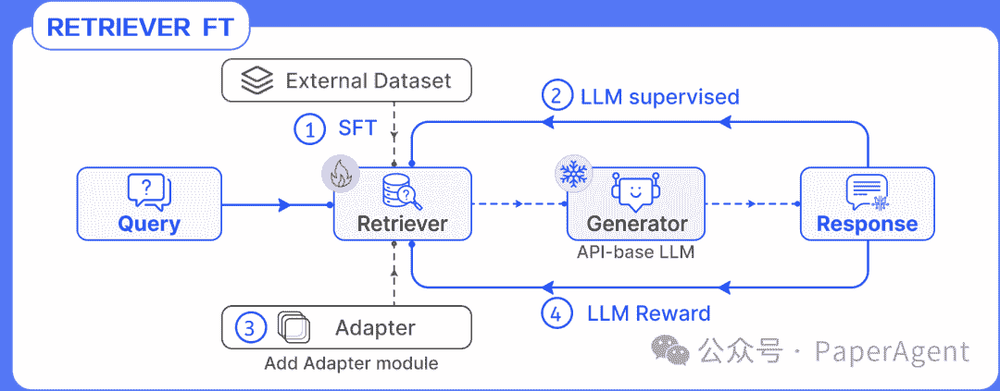

**生成器微调模式 **，主要方法包括直接微调（SFT）、蒸馏以及来自大型语言模型（LLM）/人类反馈的强化学习（RL）。

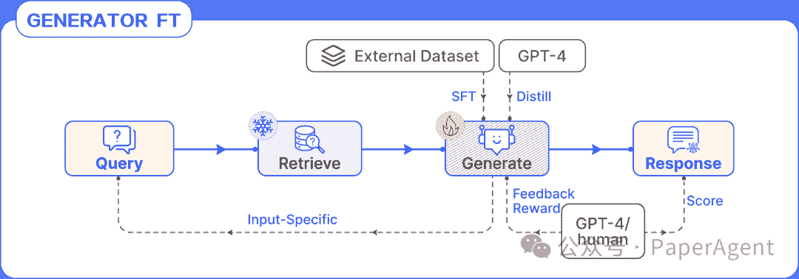

**双重微调模式 **。在这种模式下，检索器和生成器都参与微调，它们的偏好将被对齐。

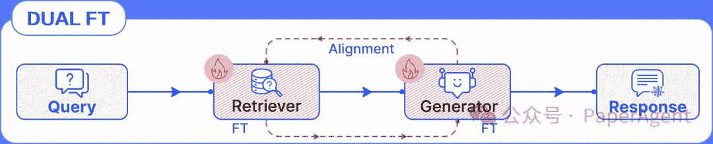

**最**后，PaperAgent团队也根据在RAG方面的实践经验，梳理了一张模块化RAG全景框架图，共计8个模块，36种技术：

PaperAgent-RAG专栏试看：

**https://docs.qq.com/a**io/DR0dBWm9WYlJNckxw

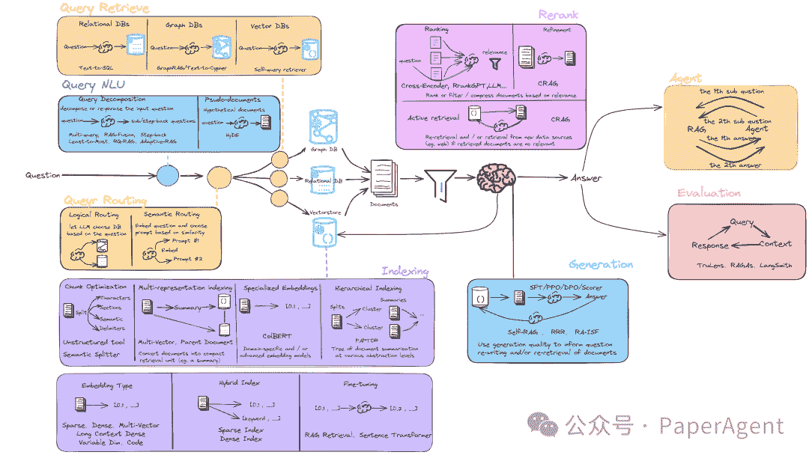

```
https://arxiv.org/abs/2407.21059
Modular RAG: Transforming RAG Systems into LEGO-like Reconfigurable Frameworks
```

**推荐阅读**

+   对齐LLM偏好的直接偏好优化方法：DPO、IPO、KTO

+   一篇搭建AI大模型应用平台架构的全面指南

+   [RAG全景图：从RAG启蒙到高级RAG之](http://mp.weixin.qq.com/s?__biz=Mzk0MTYzMzMxMA==&mid=2247487375&idx=1&sn=e16bc2fdaac04e58e99cfd2a1dc0b0cb&chksm=c2ce35fef5b9bce80dcf0a70b753707036fe7f962d7888d60396490841a538b0f46e952f53f0&scene=21#wechat_redirect)36技，再到终章Agentic RAG！

+   [A](http://mp.weixin.qq.com/s?__biz=Mzk0MTYzMzMxMA==&mid=2247485322&idx=1&sn=71ffb345fca514aa5ce2848cb2c9f071&chksm=c2ce3dfbf5b9b4edd5b98e45c6179890bdea748fb5220636d25f42006954ea5c81afa8735725&scene=21#wechat_redirect)gent到多模态Agent再到多模态Multi-Agents系统的发展与案例讲解（1.2万字，20+文献，27张图）

---

欢迎关注我的公众号“ **PaperAgent **”， 每天一篇大模型（LLM）文章来锻炼我们的思维，简单的例子，不简单的方法，提升自己。