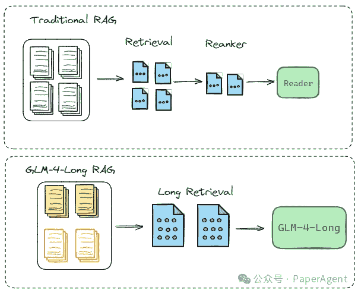
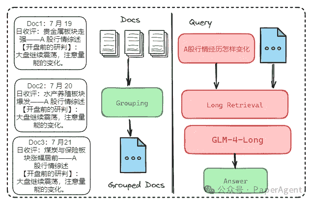
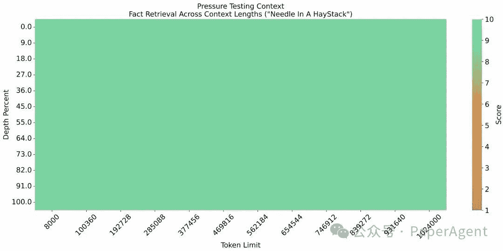
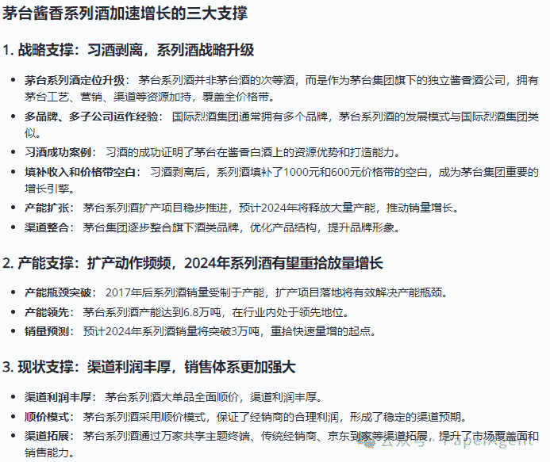
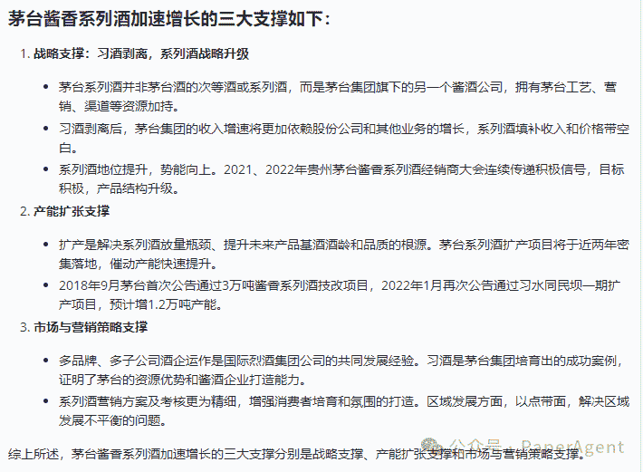
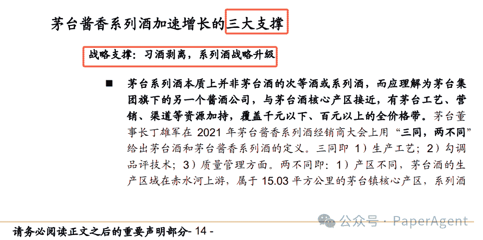
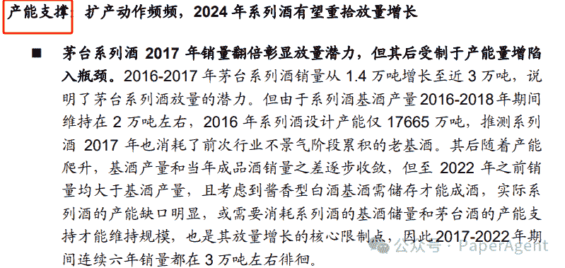
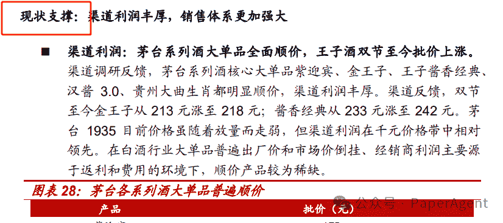
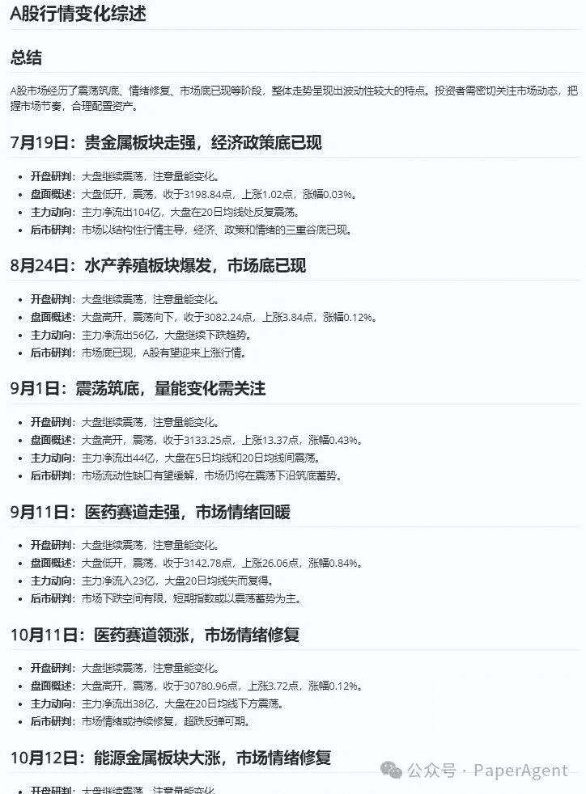
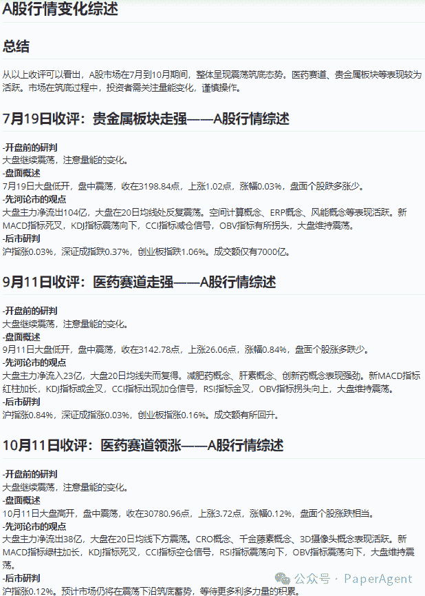

# GLM-4-Long加持的RAG：更准，更简，更全！

> 来源：[https://agijuejin.feishu.cn/docx/OVWjdzAxqoGLMPxrjUicAboBnsf](https://agijuejin.feishu.cn/docx/OVWjdzAxqoGLMPxrjUicAboBnsf)

> 作者：PaperAgent

> 原文： [https://mp.weixin.](https://mp.weixin.qq.com/s/Mw57OGnMD90Yuw4PLSEI9Q)qq.com/s/Mw57OGnM...

一**直以来，“RAG派”与**“长上下**文派”之**间争论不休，然而二者各有优劣，如何选择？最佳答案来了：拒绝选择， 全都要。 今天 实操一种 GLM-4-Long 加持的 RAG 新方法（金融领域研报数据），旨在实现更简洁架构 ， 更精准、更全面的问题解答。

**GLM-4-Long **加持的 **RAG **（参考LongRAG）



# **一、更简**

GLM-4-Long加持的RAG框架通过简化设计，显著提升了效率。它由以下几个核心组件构成：

+   **长检索单元 **：使用整个文档库或将多个相关文档组合成长检索单元，例如32K个token

+   **长检索器 **：负责从大量文本中检索出与问题粗略相关的长文本单元，数量不用太多

+   **长阅读器GLM-4-Long ****：处理检索到**的长**文本，提取和生成答案，**最大支持 1M上下文 （ 约1**50-200**万字 ），大约相当于2本红楼梦或者 125篇论文

这种设计大大减轻了传统RAG中检索器的负担，因为它不再需要在海量的短文本中寻找答案，而是在较少的长文本单元中进行操作。



**尽管“长阅读器”在处理****长文本时可能会带来计算成本问题**， GLM-4-Long 以其极具竞争力的价格优势解决了这一难题：仅需 0.001元/千tokens ，使得即便是超长文本的处理也变得经济高效。

```
pip install --upgrade zhipuai

from zhipuai import ZhipuAI
client = ZhipuAI(api_key=&quot;&quot;) # 填写您自己的APIKey
response = client.chat.completions.create(
    model=&quot;glm-4-long&quot;,  # 填写需要调用的模型编码
    messages=[
        {&quot;role&quot;: &quot;user&quot;, &quot;content&quot;: &quot;作为一名营销专家，请为智谱开放平台创作一个吸引人的slogan&quot;},
        {&quot;role&quot;: &quot;assistant&quot;, &quot;content&quot;: &quot;当然，为了创作一个吸引人的slogan，请告诉我一些关于您产品的信息&quot;}
    ],
)
print(response.choices[0].message)
```

# **二、更准**

GLM-4-Long加持的RAG在回答问题时表现出更高的准确性。利用GLM-4-Long接口，模型能够：

+   精确定位：在大量信息中精确找到与问题直接相关的内容。

+   深度理解：对长文本进行深入分析，确保答案的准确性。

GLM-4-Long大海捞针效果



**【案例说明】**

检索粒度： **Passage**

以**研报文件“ **中泰证券-贵州茅台(600519)茅台系列酒面面观2：多大单品蓄势待发，产能推动放量在即.pdf ”， query =“茅台酱香系列酒加速增长的三大支撑？”为例：

**G**LM-4-Long RAG效果 ：准确的回答出了三大支撑的内容-“战略支撑、产能支撑、现状支撑 ” ，而且回答的很有深度。



**Traditional RAG效果：答案不正确，“**市场与营销策略支撑 ”是编造出来的结果。



原因是 Traditional RAG 会把“三大支撑 ” 完整内容切分成多个小chunk（1.5K长度），检索召回的内容不完整导致。







# **三、更全**

GLM-4-Long加持的RAG在全面性方面也表现出色。通过GLM-4-Long接口，模型能够：

+   全面分析：对检索到的长文本进行全面分析，确保答案覆盖所有相关信息。

+   多角度回答：从不同角度审视问题，提供更全面的答案。

**【案例说明】**

检索粒度： Grouped Documents

以6**天的A股市场**行情研报为例：“7 月 19 日收评：贵金属板块走强.pdf”、“8月24日收评：水产养殖板块爆发.pdf”.......“10月12日收评：能源金属板块大涨.pdf”， query =“A股行情经历了怎样的变化”为例。

**GLM-4-Long RAG 效果 ：**包含了所有6天A股行情的数据，答案全面。



**Traditional RAG效**果：答案只包含3天A股行情数据，不全面。



**推荐阅读**

+   对齐LLM偏好的直接偏好优化方法：DPO、IPO、KTO

+   一篇搭建AI大模型应用平台架构的全面指南

+   [RAG全景图：从RAG启蒙到高级RAG之](http://mp.weixin.qq.com/s?__biz=Mzk0MTYzMzMxMA==&mid=2247487375&idx=1&sn=e16bc2fdaac04e58e99cfd2a1dc0b0cb&chksm=c2ce35fef5b9bce80dcf0a70b753707036fe7f962d7888d60396490841a538b0f46e952f53f0&scene=21#wechat_redirect)36技，再到终章Agentic RAG！

+   [A](http://mp.weixin.qq.com/s?__biz=Mzk0MTYzMzMxMA==&mid=2247485322&idx=1&sn=71ffb345fca514aa5ce2848cb2c9f071&chksm=c2ce3dfbf5b9b4edd5b98e45c6179890bdea748fb5220636d25f42006954ea5c81afa8735725&scene=21#wechat_redirect)gent到多模态Agent再到多模态Multi-Agents系统的发展与案例讲解（1.2万字，20+文献，27张图）

---

欢迎关注我的👸号“ **PaperAgent **”， 每天一篇大模型（LLM）文章来锻炼我们的思维，简单的例子，不简单的方法，提升自己。