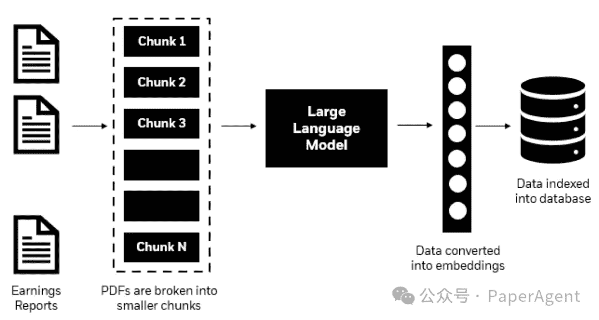
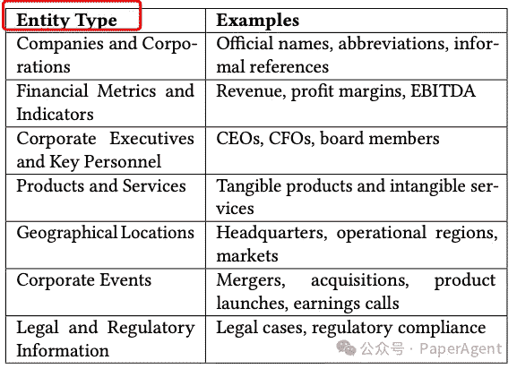
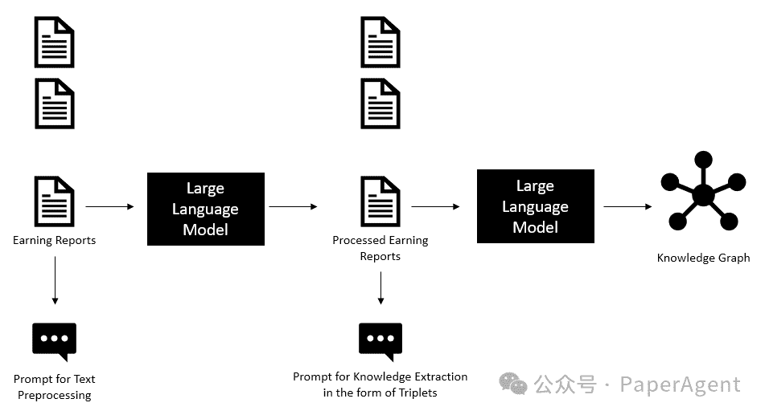
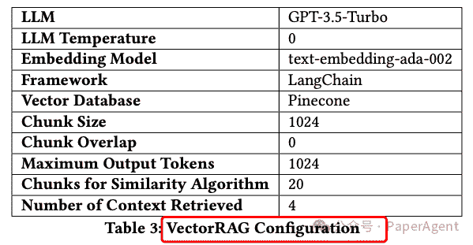
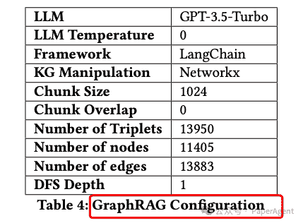
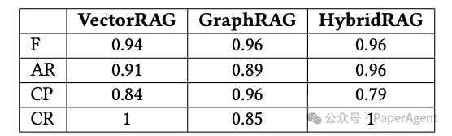

# GraphRAG与VectorRAG我都选：HybridRAG

> 来源：[https://agijuejin.feishu.cn/docx/D0lKdy1rYoMeEKxYm3HchK13ntg](https://agijuejin.feishu.cn/docx/D0lKdy1rYoMeEKxYm3HchK13ntg)

> 作者：PaperAgent

> 原文： [https://mp.weixin.](https://mp.weixin.qq.com/s/59e_bEcxGkM4N0GeCTTF4w)qq.com/s/59e_bEcx...

在金融领域，从非结构化文本数据（如财报电话会议记录）中提取和解释复杂信息对大型语言模型（LLMs）来说是一个挑战，尤其是当这些文档包含特定领域的术语和复杂格式时。

**为了解决这些问题，提****出了****一种新的方法 Hy**bridRAG ， 它结合了**基于知识图谱的 RA**G 技术 GraphRAG 和基于向量的 RAG 技术 VectorRAG 。HybridRAG 的目的是增强问答（Q&A）系统，以便从金融文档中提取信息，并能够生成准确且与上下文相关的回答。

**一、VectorRAG**

VectorRAG 从与外部文档相关的查询开始，这些文档不是 LLM 训练数据集的一部分。查询用于搜索外部存储库（如向量数据库或索引语料库），以检索包含有用信息的相关文档或段落。检索到的文档随后作为额外上下文反馈到 LLM 中，从而生成基于查询的响应。这确保了生成内容不仅基于内部训练数据，还结合了检索到的外部信息。

描述RAG应用向量数据库创建的示意图



**二、GraphRAG**

利用知识图谱来增强 NLP 任务的性能，通过将知识图谱与 RAG 技术整合，GraphRAG 能够基于从金融文档中提取的结构化信息生成更准确和上下文感知的回答。

1.  **知识图谱构建（Knowledge **Graph Construction） ：这包括三个主要步骤：知识提取、知识改进和知识适应。知识提取涉及从非结构化或半结构化数据中提取结构化信息，包括实体识别、关系提取和共指消解。知识改进旨在通过移除冗余和填补信息空白来提高 KG 的质量和完整性。知识融合则结合来自多个源的信息，创建一个一致和统一的 KG。



1.  **GraphRAG **：基于知识图谱的 RAG（GraphRAG）也是从用户输入的查询开始。与 VectorRAG 的主要区别在于检索部分。在这里，查询用于搜索 KG 以检索与查询相关的节点（实体）和边（关系）。然后从完整的 KG 中提取包含这些相关节点和边的子图，以提供上下文。

描述GraphRAG知识图谱创建过程的示意图



**三、HybridRAG**

结合了 VectorRAG 和 GraphRAG 的优势，从向量数据库和知识图谱中检索上下文信息，以提供给 LLMs，从而生成更准确的回答。





**通过在一组金融收益电**话会议记录上的实验，展示了 HybridRAG 在检索和生成阶段的性能优于单独使用 VectorRAG 或 GraphRAG：

+   **在忠实度方面 **，GraphRAG 和 HybridRAG 显示出更优越的性能，两者都达到了0.96的得分，而 VectorRAG 略低一些，得分为0.94。

+   **答案相关性得分 **在不同方法之间有所不同 ，HybridRAG 以0.96的得分领先，其次是 VectorRAG 的0.91，GraphRAG 的0.89。

+   **上下文精确度 **方**面，Graph**RAG 以0.96的得分最高，显著超过了 VectorRAG 的0.84 和 HybridRAG 的0.79。然而，在 上下文召回率 方面，VectorRAG 和 HybridRAG 都达到了完美的1分，而 GraphRAG 落后于0.85。



```
https://arxiv.org/pdf/2408.04948
HybridRAG: Integrating Knowledge Graphs and Vector Retrieval Augmented Generation for Efficient Information Extraction
```

**推荐阅读**

+   对齐LLM偏好的直接偏好优化方法：DPO、IPO、KTO

+   一篇搭建AI大模型应用平台架构的全面指南

+   [RAG全景图：从RAG启蒙到高级RAG之](http://mp.weixin.qq.com/s?__biz=Mzk0MTYzMzMxMA==&mid=2247487375&idx=1&sn=e16bc2fdaac04e58e99cfd2a1dc0b0cb&chksm=c2ce35fef5b9bce80dcf0a70b753707036fe7f962d7888d60396490841a538b0f46e952f53f0&scene=21#wechat_redirect)36技，再到终章Agentic RAG！

+   [A](http://mp.weixin.qq.com/s?__biz=Mzk0MTYzMzMxMA==&mid=2247485322&idx=1&sn=71ffb345fca514aa5ce2848cb2c9f071&chksm=c2ce3dfbf5b9b4edd5b98e45c6179890bdea748fb5220636d25f42006954ea5c81afa8735725&scene=21#wechat_redirect)gent到多模态Agent再到多模态Multi-Agents系统的发展与案例讲解（1.2万字，20+文献，27张图）

---

欢迎关注我的👸号“ **PaperAgent **”， 每天一篇大模型（LLM）文章来锻炼我们的思维，简单的例子，不简单的方法，提升自己。