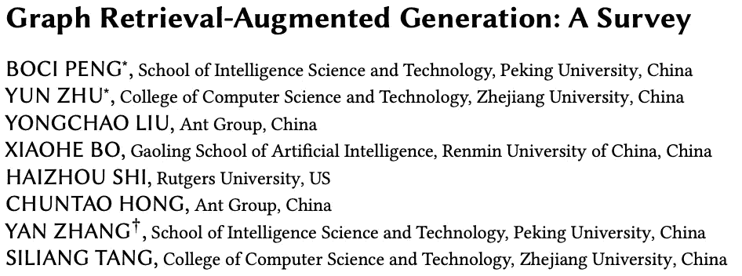
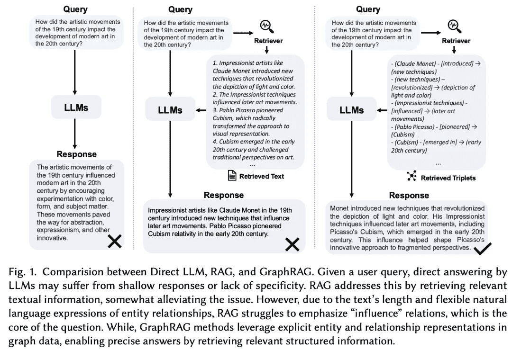
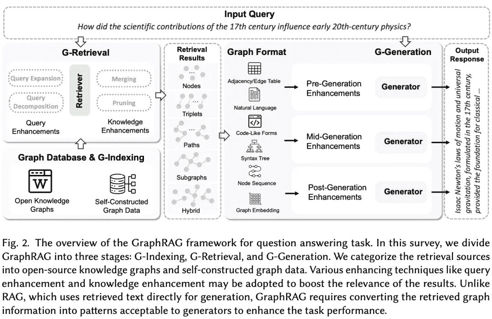

# GraphRAG综述：LLM下一里程碑，给RAG加上图的能力

> 来源：[https://agijuejin.feishu.cn/docx/X01Xdjby1otd2ZxydOtc4B50nGh](https://agijuejin.feishu.cn/docx/X01Xdjby1otd2ZxydOtc4B50nGh)

> 作者：朝亿 | AI 搜索引擎

> 原文： [https://mp.weixin.](https://mp.weixin.qq.com/s/pl1VdKWYuAKg0G8-YRKJfg)qq.com/s/pl1VdKWY...

由北京大学，浙江大学，蚂蚁集团，中国人大联合发表的首篇GraphRAG综述新鲜出炉！

**Graph Retrieval-Augmented **Generation: A Survey

**论文地址： **https://www.arxiv.org/pdf/2408.08921

## **论文概述**

这篇论文是对GraphRAG技术这一新兴研究领域的全面回顾。

GraphRAG技术是大型语言模型（LLMs）进步的一个重要里程碑，它通过将外部库转化为知识图谱来增强语言模型的能力，使得模型在不重新训练的情况下，能够更准确、更全面地生成和理解语言。

这项技术的出现，响应了当前LLMs面临的挑战，如生成不准确信息的“幻觉”现象、缺乏特定领域的知识以及信息更新滞后等问题。 作者们对GraphRAG的工作流程、核心技术、训练方法、下游应用、评估标准以及工业案例进行了系统化的梳理和讨论。

此外，论文还对GraphRAG的未来发展进行了展望，提出了新的研究方向，旨在推动该领域理论和实践的进一步发展。

## **核心内容**

### 2.1 GraphRAG 与现有方法的比较

Retrieval-Augmented Generation (RAG) 是一种将检索机制与生成模型相结合的方法，通过首先检索与问题相关的文档或知识，然后生成模型基于检索结果生成答案或文本。

最近的研究表明，RAG可以显著提高各种基准的生成质量。上图提供了一个直观的比较，展示了直接使用大型语言模型（LLMs）、传统的检索增强生成（RAG）和GraphRAG三者在处理用户查询时的不同方法和效果。

1.  **直接LLM： **在这种方法中，用户查询直接由LLM进行回答，可能会导致回答过于笼统或缺乏专业性。

1.  **RAG： **RAG通过检索相关文本信息来增强LLM的回答，可以在一定程度上缓解直接LLM回答可能存在的问题。然而，这种方法不能挖掘数据之间的关联关系。

1.  **GraphRAG： **与RAG不同，GraphRAG利用图数据中明确的实体和关系表示，通过检索相关结构化信息来实现精确回答。GraphRAG方法能够更有效地捕捉和利用实体间的连接关系，从而提供更准确和全面的答案。

### **2.2 GraphRAG 架构**

文章将GraphRAG分为三个主要阶段：G-Indexing（基于图的索引）、G-Retrieval（图检索）和G-Generation（图增强的生成）。以下是对这三个阶段的具体介绍：

1.  G-Indexing（基于图的索引）： 这是GraphRAG流程的初始阶段，目的是识别或构建一个与下游任务对齐的图数据库G，并在其上建立索引。图数据库可以来源于公开的知识图谱、图数据，或基于专有数据源（如文本或其他形式的数据）构建。索引过程包括映射节点和边的属性、建立连接节点之间的指针，以及组织数据以支持快速遍历和检索操作。

1.  G-Retrieval（图检索）： 继图索引之后，图检索阶段专注于根据用户查询或输入从图数据库中提取相关信息。给定一个用自然语言表达的用户查询，检索阶段的目标是从知识图谱中提取最相关的元素（例如实体、三元组、路径、子图）。

1.  G-Generation（图增强的生成）： 图增强的生成阶段涉及基于检索到的图数据合成有意义的输出或响应。这可能包括回答用户查询、生成报告等。在这个阶段，生成器采用查询、检索到的图元素和一个可选的提示（prompt）作为输入，以生成响应。

## **总结**

这篇综述论文为GraphRAG技术提供了一个全面的概述，从理论基础到实际应用，再到未来的发展。论文不仅系统地回顾了当前的技术和方法，还深入探讨了GraphRAG在不同领域的应用潜力和面临的挑战。 此外，论文还提出了未来研究的方向，为该领域的研究者提供了宝贵的参考和启示。

随着人工智能技术的不断进步，GraphRAG作为一种新兴的技术，其在提高语言模型的准确性和全面性方面展现出巨大的潜力。

👆 关注 A**I 搜索引擎 ，**获取更多专业技术分享 ~