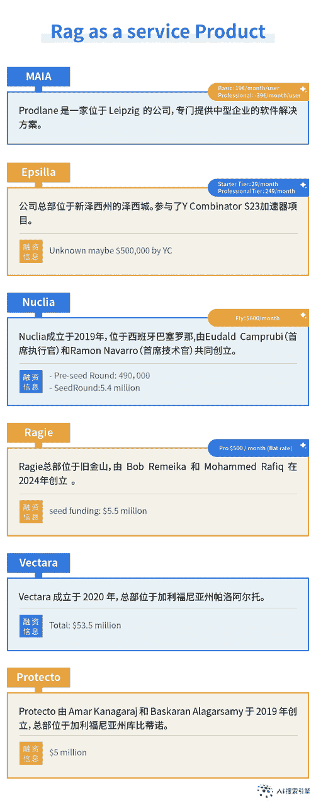
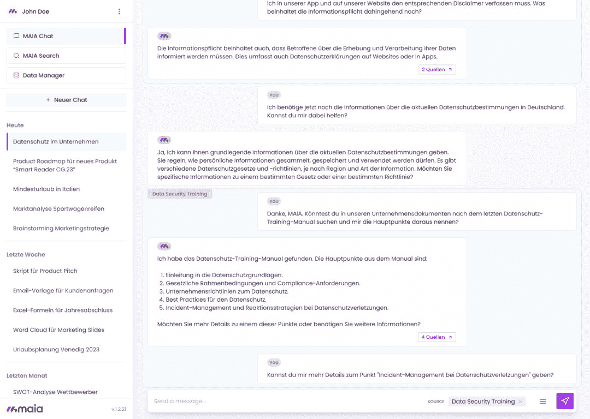
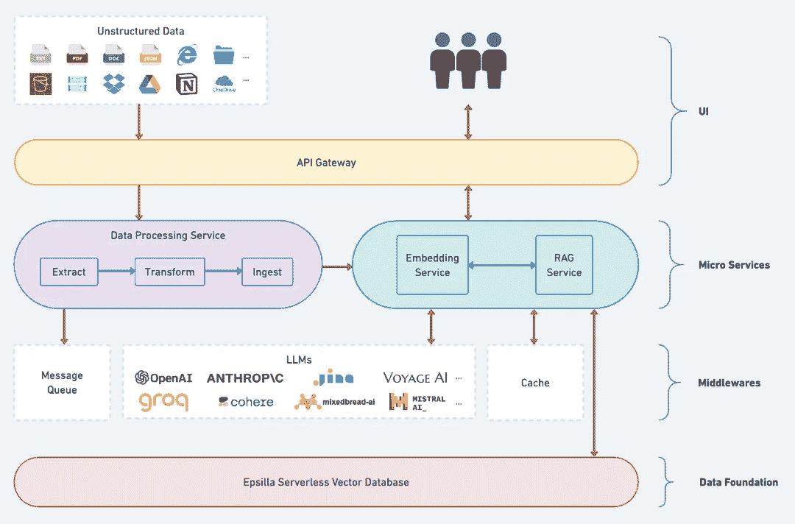
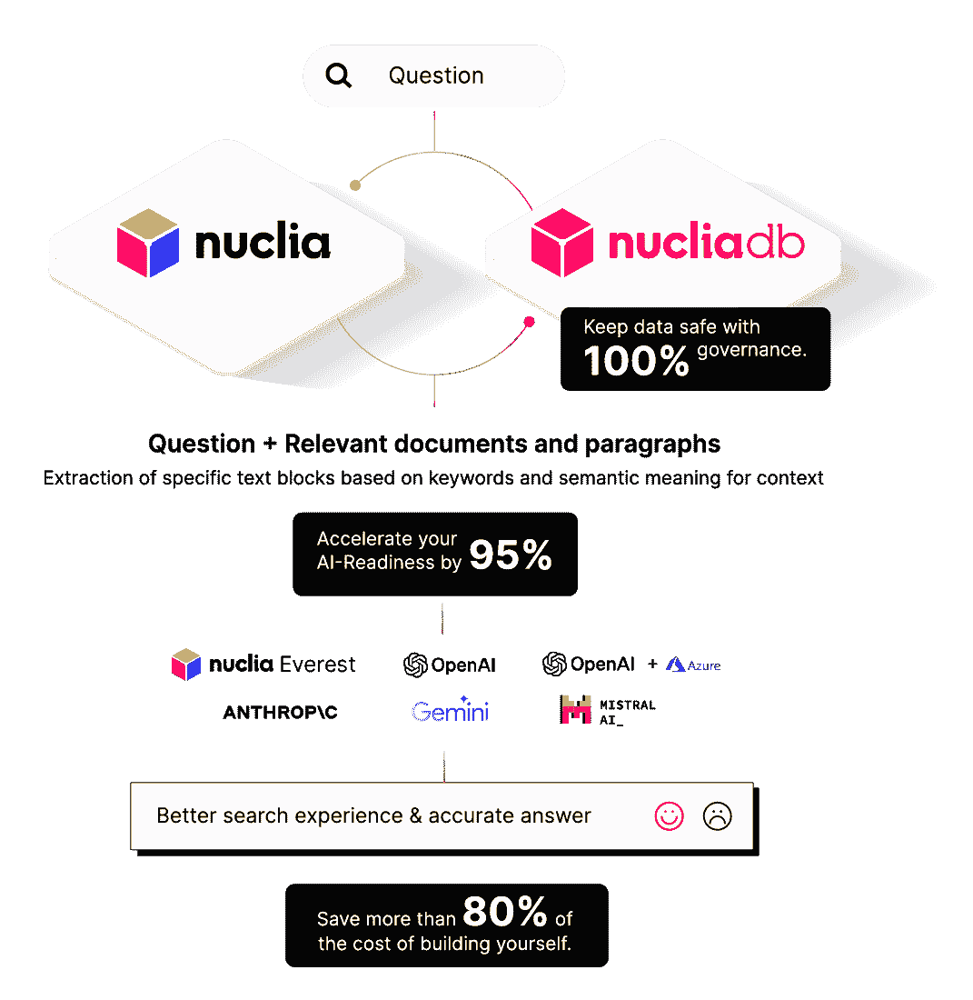
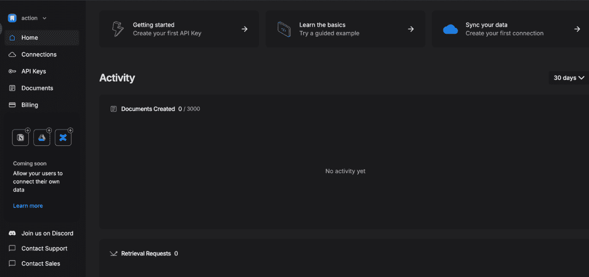
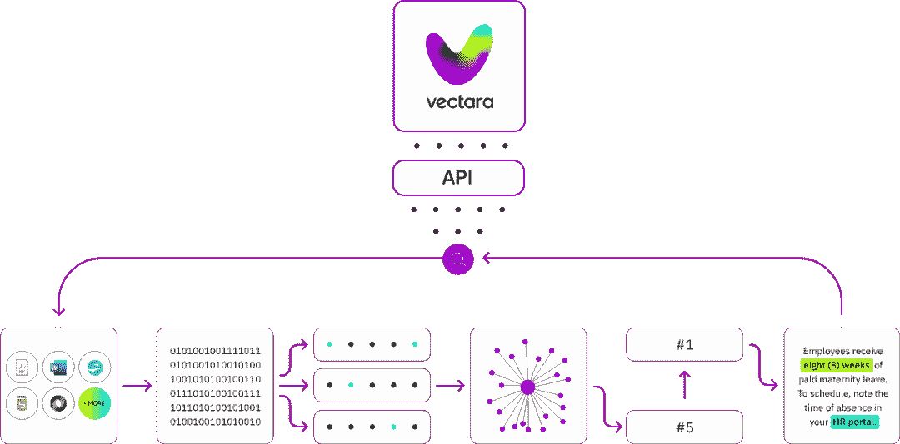

# RAG as a Service？

> 来源：[https://agijuejin.feishu.cn/docx/OQhFdPdbmozHCbxxnBLc5KhknRh](https://agijuejin.feishu.cn/docx/OQhFdPdbmozHCbxxnBLc5KhknRh)

> 作者：苏鹏 | AI 搜索引擎

> 原文： [https://mp.weixin.](https://mp.weixin.qq.com/s/gmk_4JDslcMh4GDPFAa0Og)qq.com/s/gmk_4JDs...

目前我们知道有好多中间层的产品，例如：Dify[1]、扣子[2]、vectorshift[3] 等等。

最近还看到了有一些公司在做 RAG as a Service，还不知道这个新概念的产品是做什么，本篇文章就是来了解一下目前在做 RAG as a Service 的产品都有哪些。

> RAG as a Service (RAGaaS) is a service model that provides the benefits of RAG technology via cloud-based platforms. --- MAIA[4]

## **MAIA**

> With MAIA[5], you can easily complete your daily tasks with access to the entire company knowledge at the touch of a button for better results in less time - your AI platform for company knowledge.

MAIA 从介绍上来看主打的是安全性与隐私保护，从介绍的功能上来看有：文档上传、不同部门之间的数据权限与共享、对话。

## **Epsilla**

> Epsilla[6] is a one-stop RAG-as-a-Service platform for building production ready LLM applications connected with your proprietary data.

从演示视频里可以看到其能够选择 LLM，上传数据，选择场景：Chat bot、Agent、search、recommendation。

## **Nuclia**

> Nuclia[7] automatically indexes files and documents, from internal and external sources, to fuel diverse company use cases with LLMs. Get modular RAG in different Nuclia deployment options.

+   对任何类型的数据进行索引，无论这些数据使用何种语言

+   自定义数据检索的策略

+   自定义 Chunking 策略

+   不同 embedding 模型选择

## **Ragie**

> RAG. Right out of the box. Meet Ragie[8], fully managed RAG-as-a-Service for developers.

+   可以连接 Google Drive, Notion, Confluence 上的数据，并保持持续更新

+   内置re-ranking, summary index, entity extraction, flexible filtering, and hybrid semantic and keyword search 策略

## **Vectara[9]**

> Mitigating Hallucinations and Copyright Concerns, Minimizing Bias, Enhancing Explainability, and Broadening Cross-Lingual Reach. Your TRUSTED entry point for GenAI.

能够处理 emails, social media comments, web pages, customer support tickets, messages, survey responses, tweets 和 documents，

# **总结**

RAG as a Service 的相关产品，看下来更像是 Dify 类产品的抽象，Langchain 的可视化，更像一个知识库的解决方案，但是功能上又比 Glean[10] 弱些。

现在的一些向量数据库产品正在朝这个方向走，比如 RAGFlow[11] 其实也可以叫做 RAG as a Service 的产品。

但是用户到底需要个什么样的知识库产品？光知识问答足够么？其他的业务场景如何满足？到底有多少的开放度更合适？Workflow 适合什么样的用户使用？这些问题目前看下来还是在探索的过程中。

# **相关连接**

[1] https://dify.ai/

[2] https://www.coze.cn/

[3] https://vectorshift.ai/

[4] https://en.getmaia.ai/glossary/rag-as-a-service#:~:text=RAGaaS%20is%20based%20on%20the,the%20needs%20of%20different%20applications

[5] https://en.getmaia.ai/

[6] https://epsilla.com/

[7] https://nuclia.com/

[8] https://www.ragie.ai/

[9] https://vectara.com/

[10] https://www.glean.com/

[11] https://github.com/infiniflow/ragflow

👆 关注 A**I 搜索引擎 ，**获取更多专业技术分享 ~