# 披上Agent盔甲的RAG，从此不再只是召回生成！

> 来源：[https://agijuejin.feishu.cn/docx/FJBndJtvnoeX2mxPndFcpDuVngc](https://agijuejin.feishu.cn/docx/FJBndJtvnoeX2mxPndFcpDuVngc)

> 作者：猕猴桃 | 探索AGI

> 原文： [https://mp.weixin.](https://mp.weixin.qq.com/s/nNsJ3ZzyrP2bZUgL5oZIIw)qq.com/s/nNsJ3Zzy...

嘿，大家好！这里是一个专注于AI智能体的频道！

今天我要和大家聊聊一些实战相关的内容。大模型在实际的工业场景下最常见的2个场景分别为应用助手（copilot）, 文档/知识库问答（RAG）。事实上后者也逐渐在往更复杂的Agentic方向发展了，今天我们来看以下如何搭建一个可控的RAG Agent。

RAG Agent核心是它的“大脑”，一个复杂的确定性图，它能让AI进行复杂的推理。而且，这个系统一般还能防止“幻觉”。确保所有答案都基于提供的数据，而不是凭空想象。

那我们要完成的这个系统需要具备哪些方面的能力呢？

+   可控自主，能够回答自定义数据集中的重要问题。

+   充当系统的“大脑”agent ，能实现复杂的推理。

+   幻觉低，确保答案仅基于提供的数据，避免人工智能幻觉。

+   多步骤推理，将复杂的用户查询分解为可管理的子任务。

+   适应性规划，根据新信息不断更新其计划。

大体的框架图如下：

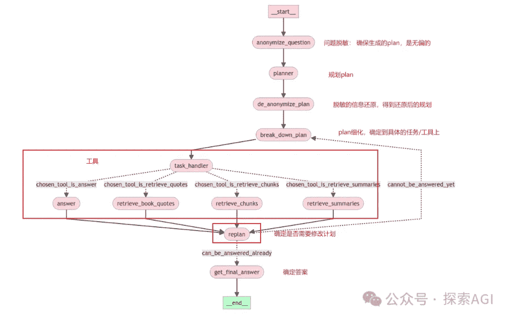

它是怎么工作的呢？简单来说，就是先把PDF文档加载进来，然后进行文本预处理，生成每个章节的摘要，再把这些内容编码到向量库中。当有人问问题时，AI会先对问题脱敏，生成一个规划，然后再根据这个规划进行细化出执行任务，最后生成最终答案。详细步骤如下：

##  S1：构建adavanced RAG

数据准备，召回的retriever，可以理解为给文档建立出索引，用户后续的召回。当然在S1的搭建高级RAG中，我们只需要分段的即可。

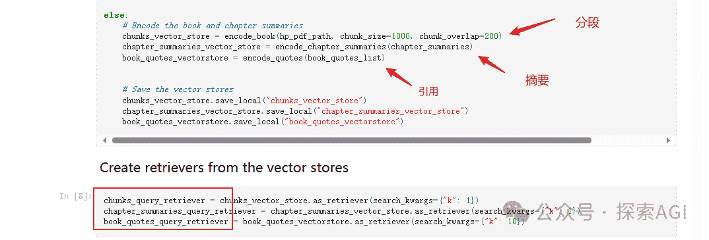

接下来，可以构建标准的adavanced RAG的流程，召回块 -> 保留与query相关的块 -> 根据是否相关来决定是否需要改写 -> 答案如果可用则结束了 （这里的很多函数都可以在langgraph的官方examples中找到）

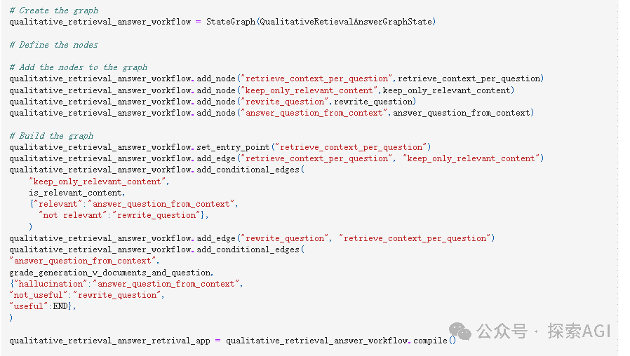

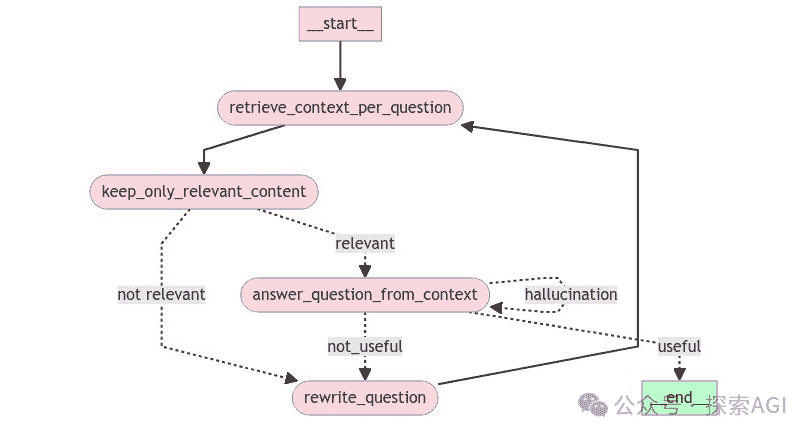

##  S2：从adavanced RAG 到 Agent

对于更复杂的任务，仅通过基于语义相似性检索信息无法回答问题，需要更复杂的pipeline。为了实现这一目标，我们先忘记adavanced rag的流程。我们需要定义出Agent的工具，一般RAG的tool就是S1中的retriever（召回）。（为了更复杂一些，我们在S1数据准备中，准备了3个retriever（文档块、摘要、引用）单独作为不同的tool）

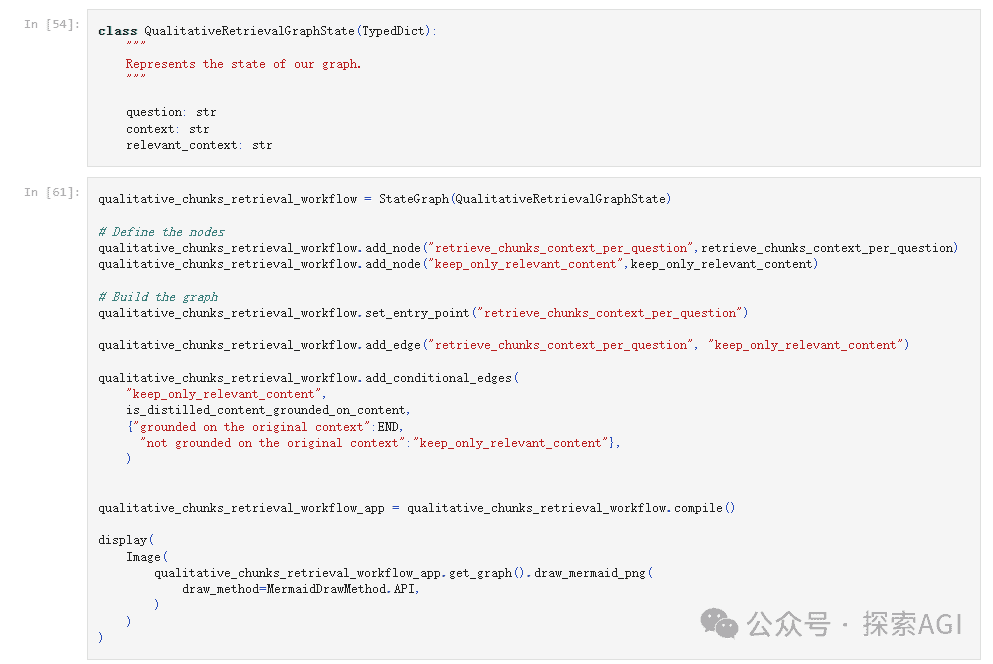

可以得到3个子图：

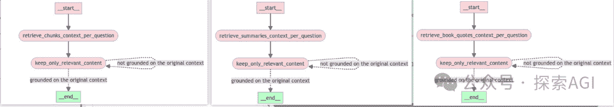

有了工具，那接下来就是Agent的核心，planning部分了。

###  **计划制定 **

首先需要制定计划->计划细化到工具上

1.  制定计划

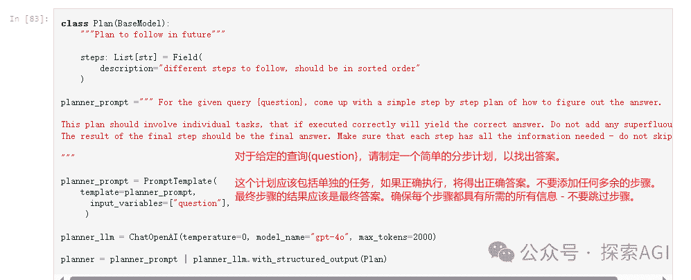

1.

1.  计划细化

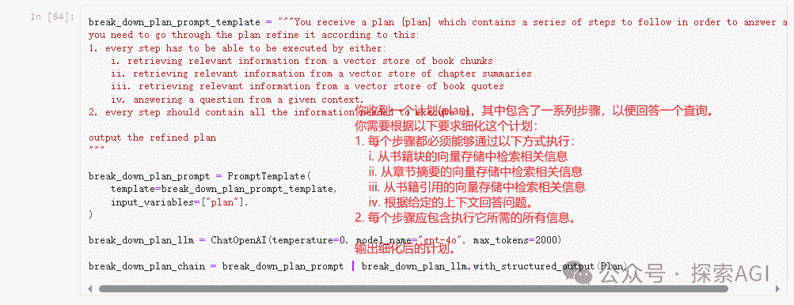

1.

示例：

```
question = {&quot;question&quot;: &quot;主人公是如何打败反派的？&quot;}
my_plan = planner.invoke(question) # Generate a plan to answer the question
print(my_plan)
refined_plan = break_down_plan_chain.invoke(my_plan.steps) # Refine the plan
print(refined_plan)

#### output
steps1 = [
    &#x27;识别故事中的主人公和反派。&#x27;,
    &#x27;找到主人公和反派之间的高潮或最终对决。&#x27;,
    &#x27;分析主人公在这次对决中采取的行动。&#x27;,
    &#x27;确定导致反派失败的具体行动或策略。&#x27;,
    &#x27;总结发现，回答主人公是如何打败反派的。&#x27;
]

steps2 = [
    &#x27;通过从书籍块的向量存储、章节摘要或书籍引用中检索相关信息来识别故事中的主人公和反派。&#x27;,
    &#x27;通过从书籍块的向量存储、章节摘要或书籍引用中检索相关信息来定位主人公和反派之间的高潮或最终对决。&#x27;,
    &#x27;通过从书籍块的向量存储、章节摘要或书籍引用中检索相关信息来分析主人公在这次对决中采取的行动。&#x27;,
    &#x27;通过从书籍块的向量存储、章节摘要或书籍引用中检索相关信息来确定导致反派失败的具体行动或策略。&#x27;,
    &#x27;通过根据给定上下文回答问题来总结发现，回答主人公是如何打败反派的。&#x27;
]
```

###  **计划更新 **

给定原始问题、当前计划、过去的步骤以及迄今为止汇总的信息，更新计划 （这个类似于一个迭代用到的，一次计划无法完成任务，通过多次收集信息迭代）

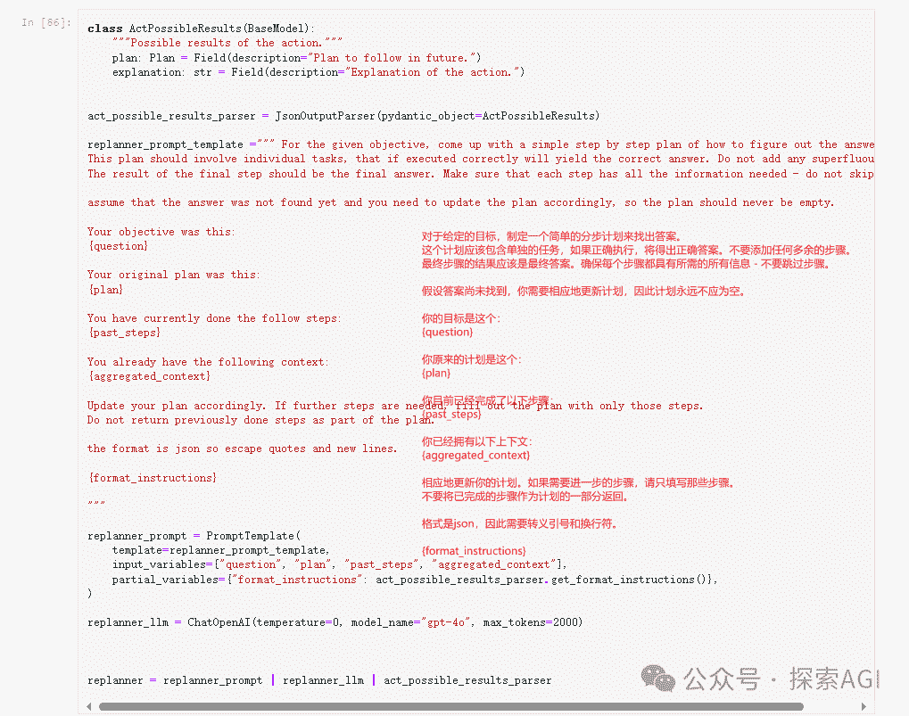

###  **任务处理 **

定义任务处理程序 - 决定是使用哪个工具来处理计划中的每个任务

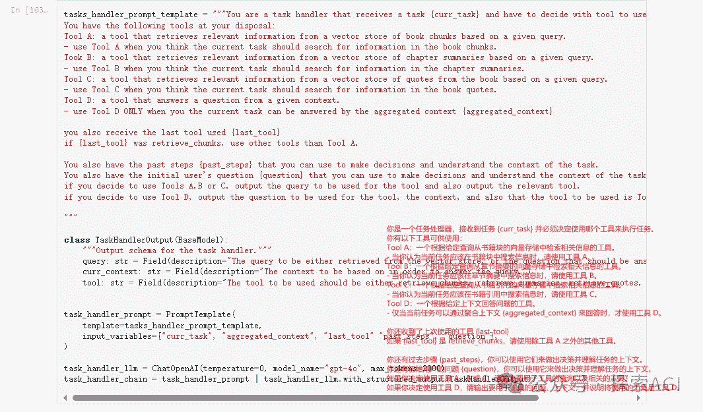

###  **问题脱敏 **

####  **脱敏 **

为了生成一个总体计划，不带任何基于任何先验知识的偏见LLM，我们首先对输入问题进行匿名化，并将名称实体映射到变量中

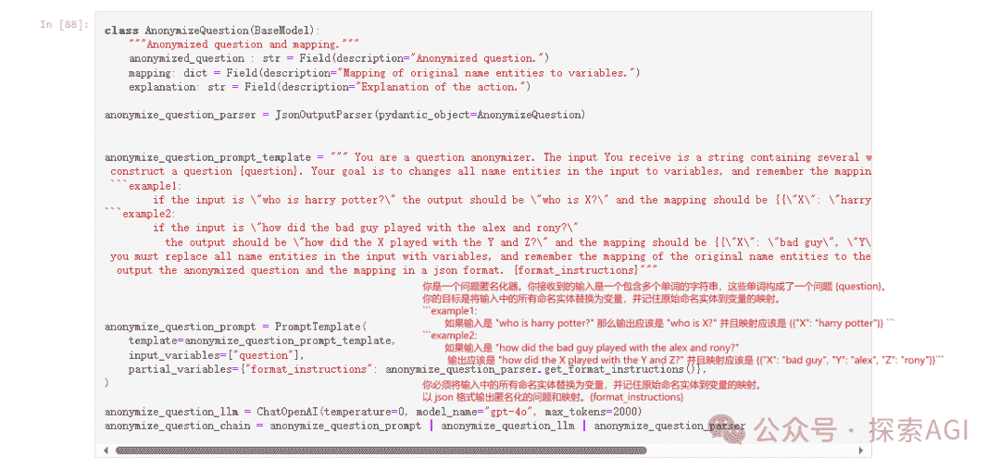

####  **还原 **

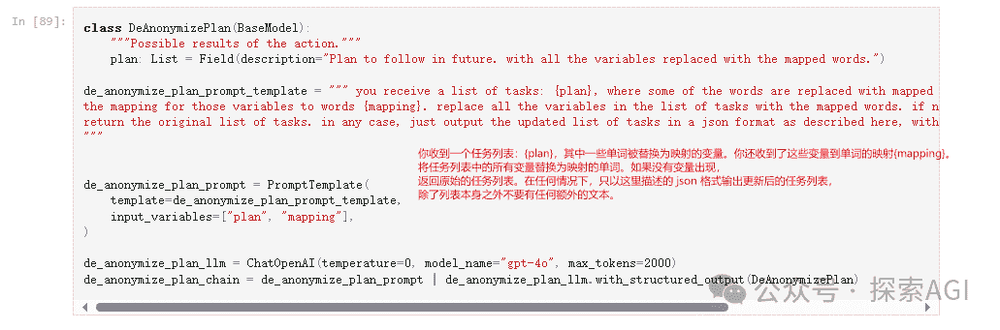

上面的串联起来

```
# 用户问题
state1 = {&#x27;question&#x27;: &quot;how did the harry beat quirrell? \n&quot;} 
print(f&#x27;question: {state1[&quot;question&quot;]}&#x27;)

# 脱敏
anonymized_question_output = anonymize_question_chain.invoke(state1) 

## 脱敏后的问题和脱敏字段
anonymized_question = anonymized_question_output[&quot;anonymized_question&quot;]
mapping = anonymized_question_output[&quot;mapping&quot;] 


print(f&#x27;anonimized_querry: {anonymized_question} \n&#x27;)
print(f&#x27;mapping: {mapping} \n&#x27;)

# 制定计划
plan = planner.invoke({&quot;question&quot;: anonymized_question})
print(text_wrap(f&#x27;plan: {plan.steps}&#x27;))
print(&quot;&quot;)

# 计划的脱敏信息还原
deanonimzed_plan = de_anonymize_plan_chain.invoke({&quot;plan&quot;: plan.steps, &quot;mapping&quot;: mapping})

## 还原后的计划
print(text_wrap(f&#x27;deanonimized_plan: {deanonimzed_plan.plan}&#x27;))


# output
question：harry是如何打败Quirrell的？

anonimized_querry：X是如何打败Y的？

mapping：{&#x27;X&#x27;: &#x27;harry&#x27;, &#x27;Y&#x27;: &#x27;Quirrell&#x27;}

plan：[
    &#x27;确定查询的上下文或领域（例如，体育、竞赛、游戏等）。&#x27;,
    &#x27;收集X和Y参加的事件或竞赛的信息。&#x27;,
    &#x27;找到X与Y竞争的特定实例或比赛。&#x27;,
    &#x27;查找那个特定实例或比赛的结果。&#x27;,
    &#x27;分析比赛的细节，以了解X是如何设法打败Y的。&#x27;,
    &#x27;总结解释X如何打败Y的关键点。&#x27;
]

deanonimized_plan：[
    &#x27;确定查询的上下文或领域（例如，体育、竞赛、游戏等）。&#x27;,
    &#x27;收集harry和Quirrell参加的事件或竞赛的信息。&#x27;,
    &#x27;找到harry与Quirrell竞争的特定实例或比赛。&#x27;,
    &#x27;查找那个特定实例或比赛的结果。&#x27;,
    &#x27;分析比赛的细节，以了解harry是如何设法打败Quirrell的。&#x27;,
    &#x27;总结解释harry如何打败Quirrell的关键点。&#x27;
]
```

最后在加一个判断，确定是否能根据信息推出答案

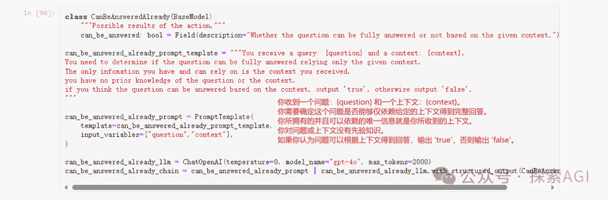

整体的流程图如下：

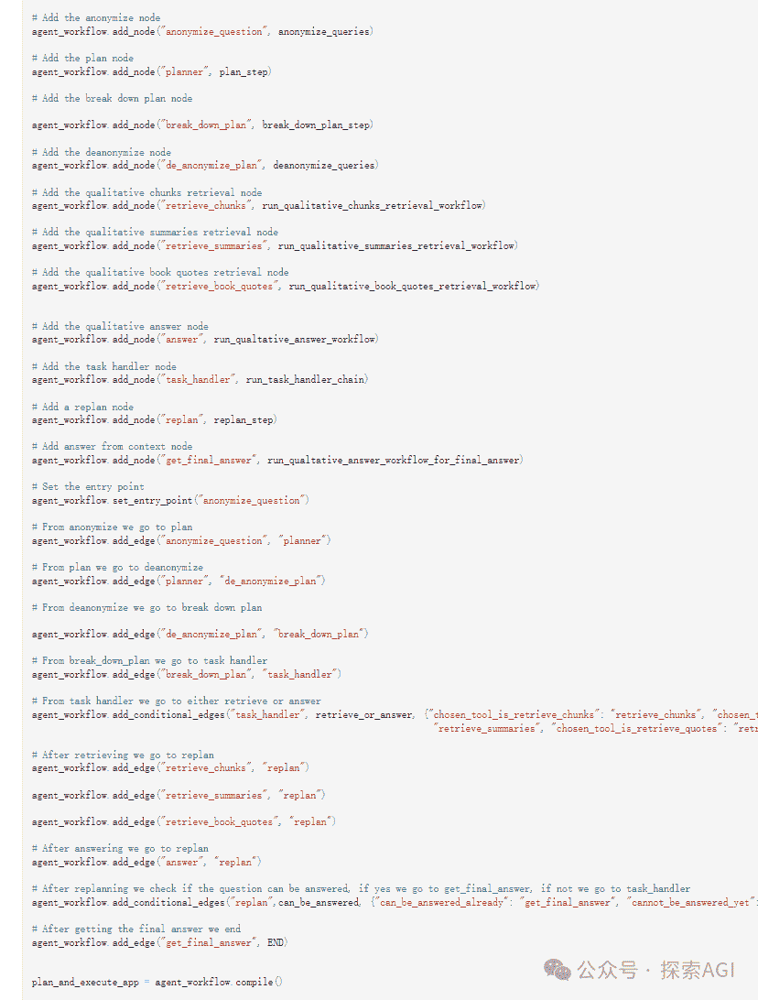

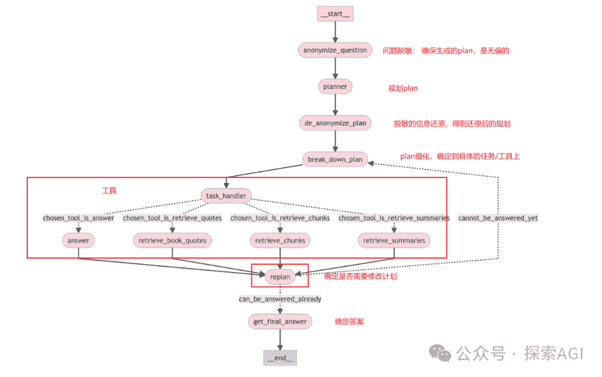

好了，这就是我今天想分享的内容。如果你对构建AI智能体感兴趣，别忘了点赞、关注噢~