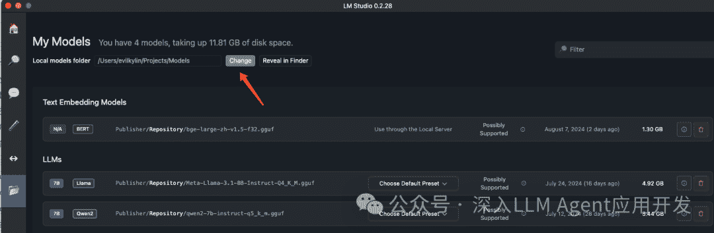
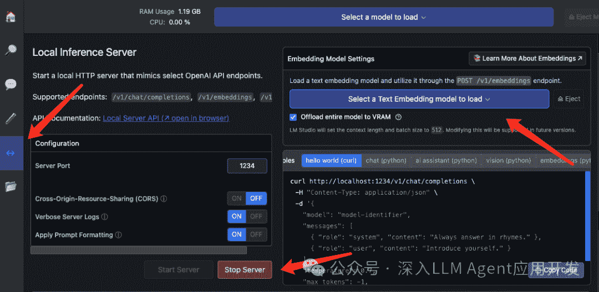
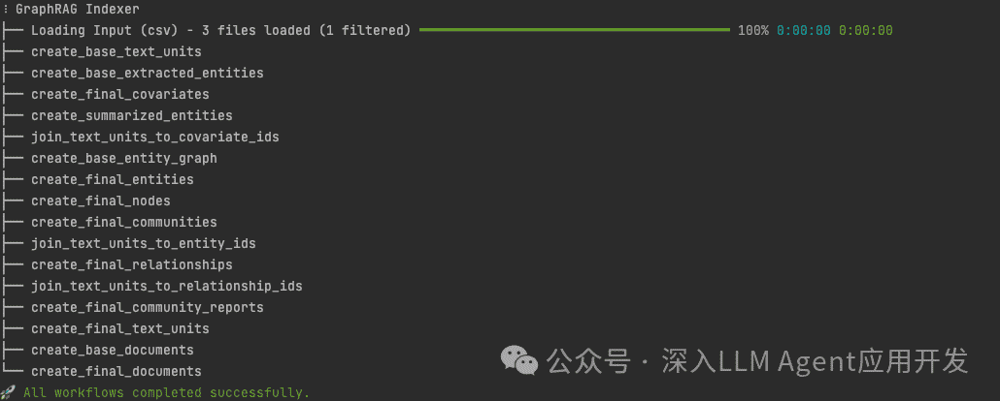
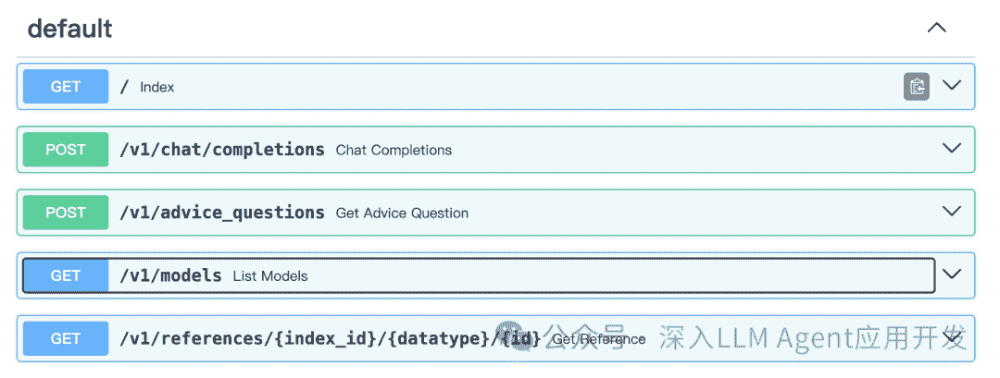
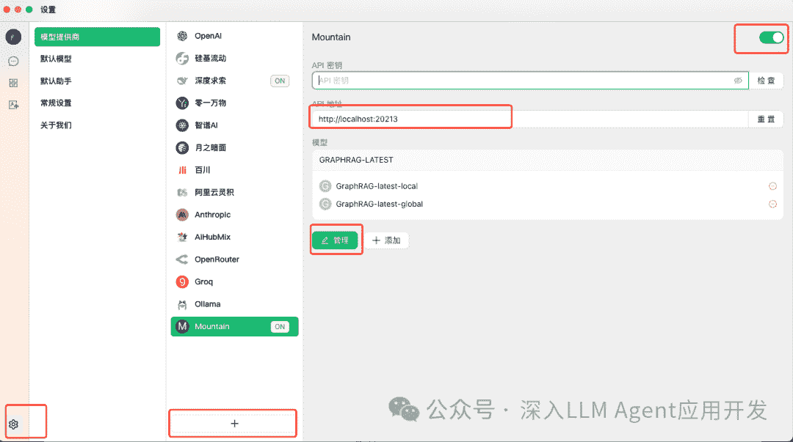
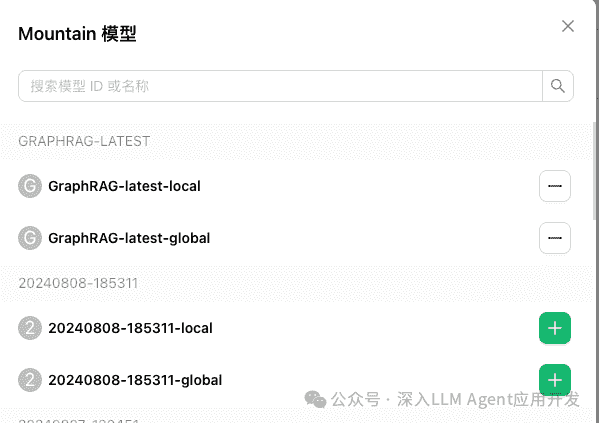
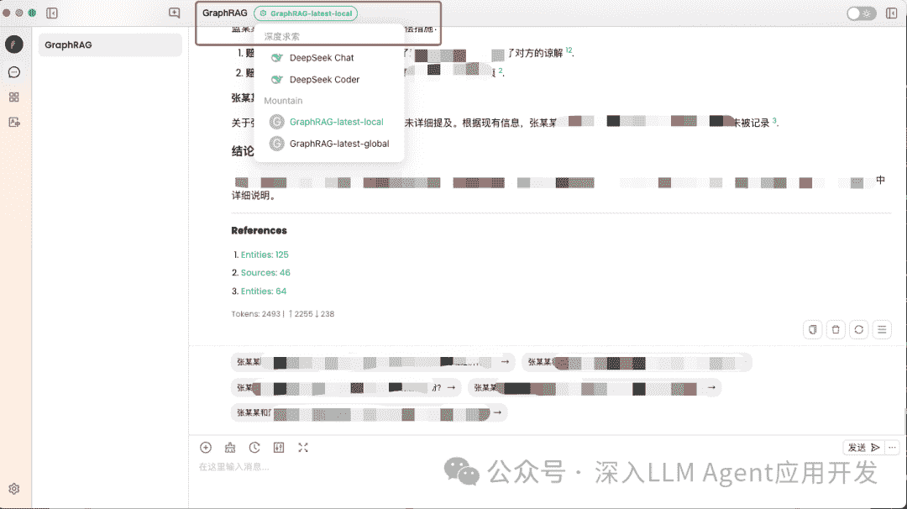

# 小白也能看懂，手把手教你启动graphrag-server

> 来源：[https://agijuejin.feishu.cn/docx/Wz5udINCgoEs3Sx0lHlcIVC2nRc](https://agijuejin.feishu.cn/docx/Wz5udINCgoEs3Sx0lHlcIVC2nRc)

> 作者：还就可 | 深入LLM Agent应用开发

> 原文： [https://mp.weixin.](https://mp.weixin.qq.com/s/qBlDMw7WXo0i1BvoiQy23w)qq.com/s/qBlDMw7W...

最近我基于微软GraphRAG，编写了一个支持极速流式输出的Web服务graphrag-server，还支持可访问的参考文档链接。然而很多粉丝说之前的视频不够傻瓜，今天我就带你手把手安装graphrag-server，并配合桌面应用使用，告别使用命令行傻等结果。极速流式输入的演示效果，可参考上一个视频《 不要再傻等了GraphRAG查询极速流式输出，秒速回复 》。本文分为安装、配置、索引、启动web服务和配置桌面应用。可视化请参考前文《 喂饭教程！全网首发Neo4J可视化GraphRAG索引 》，脚本已经内置在graphrag-server的script中。

> 我最近还建立了🛰️群，方便大家交流，有需要的同学可以后台回复进群即可。

## ** 1. 安装**

+   克隆本项目

```
git clone https://github.com/KylinMountain/graphrag-server.git
cd graphrag
```

+   使用conda建立虚拟环境

```
conda create -n graphrag python=3.10
conda activate graphrag
```

+   安装poetry

```
curl -sSL https://install.python-poetry.org | python3 -
```

**如果poetry你**安装不上，你可以直接下载这个 安装文件 [1] ，并保存为 .py 文件，假设叫做 installer-poetry.py ，然后执行 python installer-poetry.py 也可以安装。

对于Windows用户，你还需要根据Poetry安装之后的提示，将poetry的执行路径添加到系统的环境变量中。

+   安装依赖

```
poetry install
```

考虑国内用户，可能下载依赖较慢，咱们可以设置环境变量设置镜像源。mac或者linux

```
export POETRY_REPOSITORIES_TUNA_URL=&quot;https://pypi.tuna.tsinghua.edu.cn/simple&quot;
export POETRY_REPOSITORIES_TUNA_NAME=&quot;tuna&quot;
poetry install
```

windows用户

```
set POETRY_REPOSITORIES_TUNA_URL=https://pypi.tuna.tsinghua.edu.cn/simple
set POETRY_REPOSITORIES_TUNA_NAME=tuna
poetry install
```

+   安装webserve依赖

```
pip install -r webserver/requirements.txt
```

如果以上安装都没问题，接下来就可以开始初始化了。

+   初始化GraphRAG

```
poetry run poe index --init --root .
```

初始化成功后，会在当前目录中新增以下几个目录：prompts、output、.env和settings.yaml。要想索引，我们还需要进行一番详细配置。

## ** 2. 配置**

首次跑，我建议你采用线上的大模型和本地的Embedding模型服务，这样能确保你一次通过，之后你再尝试修改为本地的大模型服务。

###  2.1 安装本地Embedding服务

**我这里使用的是**LM Studio，可以到 官网 [2] 进行下载。然后我们下载嵌入模型，LM Studio只支持GGUF格式的嵌入模型。如果你的文档主要是中文，咱们可以使用bge-large-zh-v1.5，下载地址：https://huggingface.co/CompendiumLabs/bge-large-zh-v1.5-gguf。

接下来，我们打开LM Studio，左侧选择目录，将我们下载bge模型放入进入。



接下来进入模型服务页面，我们选择刚才下载的模型，然后点击左下角的 Start Server 启动模型嵌入服务，该服务兼容OpenAI Embedding API。



###  2.2 配置settings.yaml

首先你需要将你的LLM API Token，设置到.env中进去。

```
GRAPHRAG_API_KEY=sk-xxxxx
```

我们主要需要配置settings.yaml中llm和embedding两项。这里我使用的是deepseek线上的大模型，首次注册赠送500万Token额度，足够玩耍。那么llm中

+   api_base设置为deepseek的API地址或者你自己的大模型API地址

+   max_tokens设置为4096，表示你的大模型最大输出token数量，注意这不是模型的上下文窗口长度。

+   tokens_per_minute 和 requests_per_minute 表示大模型的限制，本地模型无需配置

+   top_p 可以设置0.99，有些模型诸如通义千问一定要设置比1小的数值。

+   concurrent_requests 并发，也需要根据你线上模型的限制，deepseek其实没限制，你设置100也没关系，本地模型如果能力比较弱，尽量设置1

+   sleep_on_rate_limit_recommendation 表示说遇到线上并发限制时候，它可以按照建议进行等待时间再次发送请求，所以最好设置为true。

```
encoding_model: cl100k_base
skip_workflows: []
llm:
  api_key: ${GRAPHRAG_API_KEY}
  type: openai_chat # or azure_openai_chat
  model: deepseek-chat
  model_supports_json: true # recommended if this is available for your model.
  api_base: https://api.deepseek.com/v1
  max_tokens: 4096
  concurrent_requests: 100 # the number of parallel inflight requests that may be made
  tokens_per_minute: 500000 # set a leaky bucket throttle
  requests_per_minute: 100 # set a leaky bucket throttle
  top_p: 0.99
  # request_timeout: 180.0
  # api_version: 2024-02-15-preview
  # organization: &lt;organization_id&gt;
  # deployment_name: &lt;azure_model_deployment_name&gt;
  max_retries: 3
  max_retry_wait: 10
  sleep_on_rate_limit_recommendation: true # whether to sleep when azure suggests wait-times
```

接下来，咱们配置embeddings项。对于LM Studio，你只需要将api_base设置为 http://localhost:1234/v1 即可，然后 batch_size 和 concurrent_requests 最好是设置为1，本地机器能力有限，不然容易卡住，具体合适的数值需要你自行测试。

```
embeddings:
  ## parallelization: override the global parallelization settings for embeddings
  async_mode: threaded # or asyncio
  llm:
    api_key: ${GRAPHRAG_API_KEY}
    type: openai_embedding # or azure_openai_embedding
    model: text-embedding-ada-002
    api_base: http://localhost:1234/v1
    batch_size: 1 # the number of documents to send in a single request
    concurrent_requests: 1 # the number of parallel inflight requests that may be made
    # batch_max_tokens: 8191 # the maximum number of tokens to send in a single request
...
```

然后简单配置一下全局查询和局部查询的参数，其实主要是max_tokens和llm_max_tokens，graphrag在这里比较模型，他们混用了最大输出和上下文窗口，导致这里其实配置起来比较歧义，具体还是要看代码。

```
local_search:
  # text_unit_prop: 0.5
  community_prop: 0.1
  # conversation_history_max_turns: 5
  # top_k_mapped_entities: 10
  # top_k_relationships: 10
  max_tokens: 4096

global_search:
   max_tokens: 4096
   top_p: 0.99
   temperature: 0
   data_max_tokens: 128000
   map_max_tokens: 2000
  # reduce_max_tokens: 2000
  # concurrency: 32
```

更多的配置说明可以参考 GraphRAG官方文档 [3]

## ** 3. 索引**

GraphRAG默认的输入目录是input，因此你需要手动在当前目录中新增该目录。然后将你的文本文件放入其中，如果你的输入文件是csv，你可以参考我之前的文章《 GraphRAG如何配置处理csv文件 》进行配置。开始索引

```
poetry run poe index --root .
```

如果模型能力没问题，那么基本能够一把通过。如果使用本地模型，可能会有指令跟随的问题，即无法按照要求的格式输出，导致解析错误，从而出现各种索引失败的情况。



## ** 4. 启动web服务**

如果索引成功，咱们就可以启动web服务了，基本上默认的配置即可启动，它会自动读取settings.yaml中的配置，并在20213端口上启动web服务。

```
**class** **Settings**(BaseSettings):
    server_port: int = 20213
    website_address: str = f&quot;http://127.0.0.1:{server_port}&quot;
    data: str = (
        &quot;./output&quot;
    )
    lancedb_uri: str = (
        &quot;./lancedb&quot;
    )
```

在graphrag-server根目录，执行以下命令启动服务

```
python -m uvicorn webserver.main:app --reload --port 20213 --host 0.0.0.0
```

服务采用FastAPI编写，因此自带API文档，方便查看。



## ** 5. 配置桌面应用**

这里我们推荐使用 Cherry-Studio [4] 这样一个桌面应用，它对GraphRAG的一些使用进行了一些优化，比如支持建议提问。在安装好之后，我们开始配置Cherry-Studio，使他能够将graphrag-server作为大模型一样使用。

点击Cherry-Studio左下角的设置，点击中间的加号，设置api base为 http://localhost:20213 ，然后点击管理加载模型列表。我将所有索引输出的目录分别配置为global和local，这样方便选择不同的索引目录。



分别选中你刚才的目录，然后添加local和global模型。为了便于使用，我最近增加了最新模型，即它会自动选择最新的索引输出目录进行回答，从而方便经常使用索引的同学。



模型选择好之后，我们在该页面的右上角有个按钮，使能它。然后在侧边栏选择对话窗口。在上面选择模型，我们选择最新的local模型进行问答。



你将能够在1秒内获得流式输出的答案，并且在输出结束后，显示参考的实体、关系、报告等可访问链接，从而方便我们确认信息是否可靠。

同时在回答完毕后，它会默认根据输入的历史问题，推荐5个可能问题，从我的使用来看，推荐问题都是非常相关的问题，还是非常好用的。

## ** 6. 总结**

本文主要讲解了如何安装graphrag-server的依赖、安装模型嵌入服务LM Studio、配置settings.yaml、启动web服务和使用Cherry Studio进行流畅体验GraphRAG，希望本文能够帮助各位更快更好的体验和使用GraphRAG。

此外，我最近在给各种文档Prompt Tune的时候，我认为想要让GraphRAG表现的更好一些，我强烈推荐你阅读这本书，了解一下到底什么是实体，什么是三元组，你如何定义实体，是你想要提取的信息就是实体吗？

### **要关注、**点赞、分享、在看、进群啊～  参考资料

[1]poetry安装文件: https://install.python-poetry.org

[2]LM Studio官网: https://lmstudio.ai/

[3]GraphRAG官方配置文档: https://microsoft.github.io/graphrag/posts/config/json_yaml/

[4]Cherry-Studio: https://cherry-ai.com/