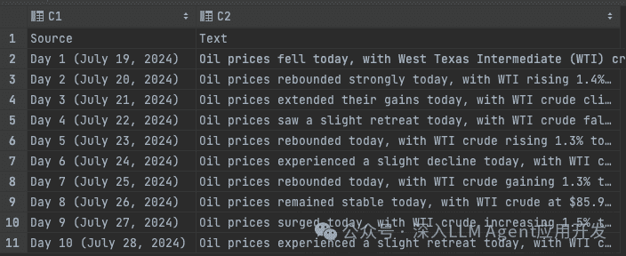
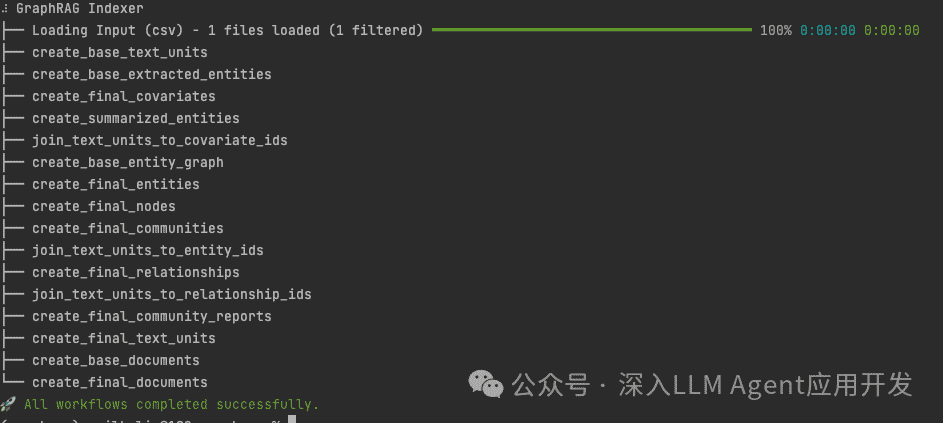
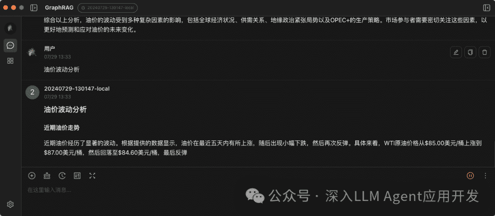

# GraphRAG如何配置处理csv文件

> 来源：[https://agijuejin.feishu.cn/docx/DYsWdpR6hoIHzuxB5xpcKeeWnte](https://agijuejin.feishu.cn/docx/DYsWdpR6hoIHzuxB5xpcKeeWnte)

> 作者：还就可 | 深入LLM Agent应用开发

> 原文： [https://mp.weixin.](https://mp.weixin.qq.com/s/qhQeYfdXaTAv2QBazQmL7A)qq.com/s/qhQeYfdX...

经常有粉丝朋友在群里问，GraphRAG怎么处理CSV文件啊？你会发现如果只是按照生成的settings.yaml模板配置，你是不可能成功的。比如这样

```
input:
  type: file # or blob
  file_type: csv # or csv
  base_dir: &quot;input&quot;
  file_encoding: utf-8
  file_pattern: &quot;.*\\.csv&quot;
```

为什么呢？让我们一探究竟。

> 我已经建了一个LLM Agent应用和GraphRAG讨论群，如果希望进群交流的朋友，后台回复加群即可。

## ** 1. 配置csv文件输入**

GraphRAG的索引输入代码位于 graphrag/index/config/input.py ，它目前支持加载csv文件和txt文本文件。因此如果你想实现类似PDF加载，我们需要在这里实现相应代码。回到正题，让我们看一下csv.py代码。

```
 **async** **def** **load_file**(path: s**tr**, grou**p: **d**ic**t | None) -&gt; pd.**DataFr**ame:
        ...**.
****  ** **   **  if &quot;**id&quot;** not in da**ta.**c**ol**umns:
      **    ****  data**[&quot;id&quot;] = data.ap**pl****y(**l**amb**da x: **gen**_md5_has**h(x**,** x**.keys()), ax**is=1**)
        # 获取指定的sourc**e列，并保存**为source列
       ** i****f **c**sv_**config**.so**urce_colu**mn **i**s **not None and &quot;source&quot; n**ot in **data.columns**:
****  ** **   **      ...**
   **        ** else:**
                data[&quot;source&quot;] = data.apply(
                    lambda x: x[csv_config.source_column], axis=1
                )
        # 获取指定的text列，并保存为text列
        if csv_config.text_column is not None and &quot;text&quot; not in data.columns:
            ...
            else:
                data[&quot;text&quot;] = data.apply(lambda x: x[csv_config.text_column], axis=1)
        # 获取指定的title_column并将其保存为tilte列
        if csv_config.title_column is not None and &quot;title&quot; not in data.columns:
            ...
                data[&quot;title&quot;] = data.apply(lambda x: x[csv_config.title_column], axis=1)
    # 获取指定的时间列，处理时间列timestamp_column
        if csv_config.timestamp_column is not None:
          ...
         else:
            data[&quot;timestamp&quot;] = pd.to_datetime(
                      data[csv_config.timestamp_column], format=fmt
                  )
        return data
```

所以如果我们要处理CSV，需要通过指定配置说明你的文本，标题，来源和时间，当然你也可以直接修改你的csv文件来包含这几个列名。那么通过配置的话，我们有哪些选项可以配置呢？

```
type: The type of input to use. Options are file or blob.
file_type: The file type field discriminates between the different input types. Options are csv and text.
base_dir: The base directory to read the input files from. This is relative to the config file.
file_pattern: A regex to match the input files. The regex must have named groups for each of the fields in the file_filter.
post_process: A DataShaper workflow definition to apply to the input before executing the primary workflow.
source_column (type: csv only): The column containing the source/author of the data
text_column (type: csv only): The column containing the text of the data
timestamp_column (type: csv only): The column containing the timestamp of the data
timestamp_format (type: csv only): The format of the timestamp
```

如果你需要timestamp列， 你一定要配置timestamp_format列 ，告诉它如何解析，解析代码在上面。所以对于一个形如以下的csv文件



我们只需要如下配置，设定文本列为Text，设定来源为Source列，标题列也为Source即可。

```
input:
  type: file # or blob
  file_type: csv # or csv
  base_dir: &quot;input&quot;
  file_encoding: utf-8
  file_pattern: &quot;.*\\.csv&quot;
  source_column: Source
  text_column: Text
  title_column: Source
```

## ** 2. 开始索引**

```
poetry run poe index --root .
```

然后索引完成。



## ** 3. 测试**

准备测试。我最近为GraphRAG开发了一个流式服务器，并修**改了部分Gra**phRAG代码，使之能够 秒速输出内容 ，相比较之前使用命令行查询，动辄等待十几秒的，这体验提升的太明显了，丝滑～

启动Web服务，然后下载cherry-studio配置API端点和模型即可。

```
python -m uvicorn webserver.main:app --reload --port 20213 
```



## ** 4. 总结**

本篇介绍了如何为GraphRAG配置csv文件输入，并最终通过自己编写的web服务进行查询测试，体验丝滑。下一篇，我将介绍如何实现秒速查询响应流式输出和UI配置。

关注点赞评论，一键三连呐，不要忘啦。另外如果你有致力于了解GraphRAG，推荐你研读了解一下知识图谱的基本知识。

参考链接：

cherry-studio: https: //cherry-ai .co m/