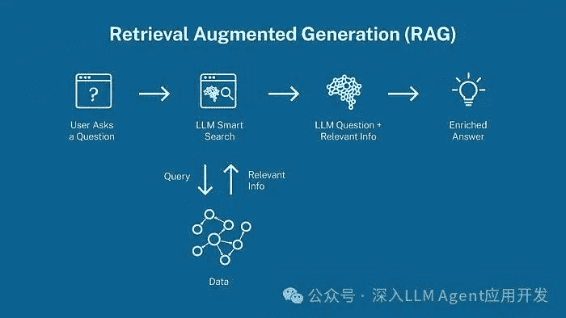
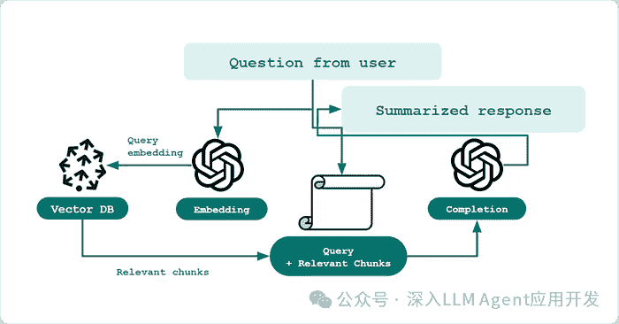
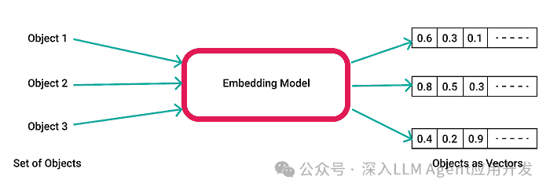
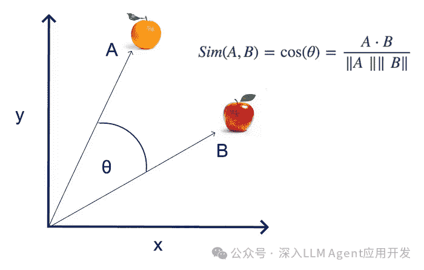
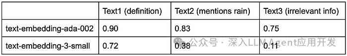
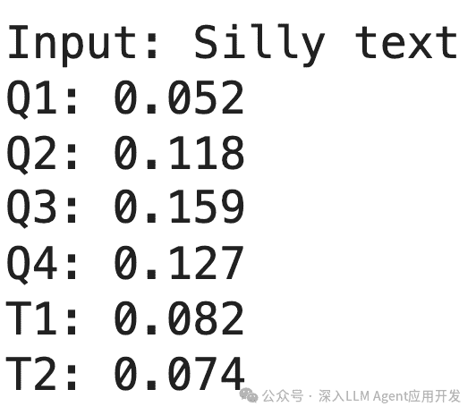

# 为什么你的RAG不起作用?如何解决语义失谐

> 来源：[https://agijuejin.feishu.cn/docx/Dn6SdNspqo5bhnxFD6wc43z1nDd](https://agijuejin.feishu.cn/docx/Dn6SdNspqo5bhnxFD6wc43z1nDd)

> 作者：还就可 | 深入LLM Agent应用开发

> 原文： [https://mp.weixin.](https://mp.weixin.qq.com/s/B2xE6ZCLsY2t0swuejx7mw)qq.com/s/B2xE6ZCL...

本文分享Meduim深度好文《 Why Your RAG Doesn’t Work [1] 》，本文主要探讨了检索增强生成（RAG）系统在实际应用中存在的问题，以及如何通过解决语义失谐等问题，提高RAG的性能，使其更接近生产环境。以下为翻译全文，这篇文章中依然透露出一个观点，即嵌入是否与你的领域匹配的问题，与上篇《 为何RAG应用在生产中难以成功？ 》分享的一致。

---

无数企业正在尝试使用检索增强生成 (RAG)，但他们普遍感到失望，因为他们很难让这些系统达到生产质量。他们的 RAG 不仅效果不佳，而且他们不知道为什么以及下一步该怎么做。

在**过去的几个月**里，我与数十个 AI 团队和专家进行了交**谈。通过这**些对话和个人经验，我发现阻碍 RAG 系统的一个关键罪魁祸首是 语义不一致 ——任务的预期含义、RAG 对它的理解以及存储的底层知识之间的不一致。而且由于 嵌入向量 的底层技术是不透明的，总体不一致很难诊断，这使其成为生产化的一大障碍。

我们的目标是 **揭开普通RAG失败的主要原因 **，并 提供具体的策略和策略，让您的 RAG 更接近生产。

在本文中，我们将：

+   区分理想的 RAG与 现实的RAG

+   解释语义不一致是如何产生的

+   说明如何诊断和抑制语义失调

+   总结其他高级策略，让您的 RAG 做好生产准备

（注意：为简单起见，我们重点关注基于问答文本的示例，但核心思想可以推广到其他用例） 。

## ** 1. 为什么选择 RAG？**

RAG（检索增强生成）是一种目前正在经历炒作周期的范式。它听起来很时髦，本质上是你的人工智能的搜索引擎。作为一名曾经有抱负的音乐家，我有点希望有人把它称为更像 ROCK（检索策划的知识？）的东西。GPT-3 大获成功后，RAG 很快就取得了进展。企业在构建 LLM 驱动的 AI 时面临的一个直接问题是，像 GPT 这样的模型并没有针对其特定的数据和领域进行训练。然而，LLM 从业者很快发现，当提示中直接提供业务特定的上下文（例如支持文档）时，GPT 的效果出奇地好。这为企业提供了一种替代艰巨的微调模型任务的替代方案。

输入 RAG。原则上，它是您的 AI 的专用搜索引擎。向它提出一个问题，也许还附带用户特定的信息，它将返回与 GPT 最相关的上下文。

虽然这在理论上听起来很棒，但实现生产级 RAG 仍面临重大挑战，我们将在以下部分中进行探讨。

img

##  2. RAG 前景光明，普通RAG 才刚刚开始

RAG 只是一个框架，一个功能完备的 R**AG（无论其后端**如何）将为无数用户提供巨大的价值。在本节中，我们将提供 普通RAG 的教学概述和语义搜索的底层工作原理 。如果您已经经历了令人费解的合理化、拒绝和最终接受向量嵌入的魔力的旅程，那么 请随意跳过本节 。

> **普通 RAG **（定义）：一种单步语义搜索引擎，使用现成的嵌入模型将业务知识（例如支持文档）存储在向量数据库（例如 Pinecone）中。然后通过从问题文本创建向量嵌入并使用比较度量（例如余弦相似度）对前 k 个最相关的文档进行排序来执行信息检索。

img

让我们进一步分解这些想法。**向量嵌入模型接受任意字符串并返回固定维度的数学向量。**流行的嵌入模型包括 OpenAI 的 *text-embedding-ada-002* [2] 及其最新模型 text-embedding-3-small 。这些模型将文本块转换为约 1500 维的向量，并且几乎没有人类可解释性。

img

**向量是一种非常**实用的工具，因为它可以将 非定量的事物 1）分解成丰富的维度，然后2)对其进行定量比较。以下是一些示例：

+   （红、绿、蓝）调色板是一个矢量，其中每个值介于 0-255 之间。

+   按照 Barra 这样的行业标准，股票可以表示为一个向量，量化其对美国整体经济增长、利率变化等经济因素的敏感性。

+   Netflix 等平台可以将用户偏好分解为向量，其中的组件可以代表类型和其他特征。

**余弦相似度 **可以说是语义搜索中比较向量的实际指标，其工作原理是通过点积将余弦应用于两个向量之间的角度。余弦越接近 1，向量就越相似。（还有其他测量语义相似度的方法，但通常这不是最容易实现的方法，我们将始终使用余弦相似度）。

img

**然而，需要强调的是，向量比较指标（如余弦相似度）**的使用非常微妙，因为它们没有绝对的意义 ——其值完全取决于嵌入模型和所涉及文本的上下文。假设你将问题与答案进行匹配，得到的余弦相似度为 0.73。这是一个好的匹配吗？简单来说，我们以”什么是雨？“这个问题为例，并将其与三个相关性不同的文本进行比较。我们在下表中看到，使用两个不同的 OpenAI 模型得到的余弦相似度的范围和解释截然不同。对于 第一个模型，0.73 表示完全不相关的匹配，而对于第二个模型，0.73 表示高度相关 。这表明任何运行良好的 RAG 系统都需要校准自己对这些分数含义的理解。

> 文本 1（定义）：“雨是从云中析出的水滴，当它们变得太重而无法悬浮在空中时就会落到地面。”

> 文本 2（提到下雨）：“风把水分吹过山上，导致西雅图下雨。”

> 文本 3（不相关信息）：“Stripe 是一家支付基础设施公司。”

img

## ** 3. 语义不一致导致问题**

**普通RAG **的几**个挑战可以归因于 **语义不一致 和 嵌入的可解释性差 。 语义不一致是指任务的预期含义、RAG 对它的理解以及存储的底层知识之间的不一致。

这是如何发挥作用的？

+   苹果和橘子之间的比较

可以粗略地说“问题在语义上与其答案并不相同”，因此直接将问题与原始知识库进行比较只会有成果。假设一位律师需要搜索数千份文件以寻找投资者欺诈的证据。问题“ 什么证据表明鲍勃犯了金融欺诈行为？ ”与“鲍勃于 3 月 14 日购买了 XYZ 股票”在语义上基本上没有任何重叠（其中隐含 XYZ 是竞争对手，3 月 14 日是收益公告发布前一周）。

+   向量嵌入和余弦相似度是模糊的

向量在完全捕捉任何给定语句的语义内容方面存在固有缺陷。另一个微妙的缺陷是，余弦相似度不一定能产生精确的排名，因为它隐含地假设每个维度都是平等的。

在实践中， 使用余弦相似度的语义搜索往往在方向上是正确的，但本质上是模糊的 。它可以很好地预测前 20 个结果，但通常要求它单独可靠地将最佳答案排在第一位是过分的要求。

+   在互联网上训练的嵌入模型不了解你的业务和领域

我曾经在 Stripe 工作过，当时我们有 Connect、Radar 和 Link 等产品。除此之外，Direct 是一个常用形容词，根据我们谈论的产品，它的含义非常不同。不用说，即使在 Stripe 的员工之间，语义上的不一致也是显而易见的。这是一个深刻而重要的话题，可以进一步探讨，值得专门写一篇博客文章。

总体而言，语义不一致的来源 **不断增加，导致排名不可靠 **。在下一节中，我们将说明如何诊断和解决语义不一致，在最后一节中，我们将概述改进 RAG 实施的高级技巧。

##  4. 说明：诊断和抑制语义失调

在此图中，我们将诊断您的 RAG 中存在完全语义不一致的情况 — 即当您的比较与随机噪声一致且因此不可靠时。我们还将看到如何使用附加结构来提高性能的早期迹象。

这个例子源自一个现实生活中的用例，但为了深入探讨和说明关键点，本博文也故意将其简化。

### ** 4.1 设置 **

**可以在 [3] **Google Colab Notebook中找到设置的完整详细信息。

想象一下一家电子商务初创公司的用例，该公司正在构建一个供内部使用的 RAG，用于为给定的业务问题找到最佳 SQL 表。以下是示例的设置，其中我们：

1）创建两个不同的 SQL 表模式（使用 ChatGPT）

+   events.purchase_flow：产品流程中高度详细的原始用户事件

+   聚合体.purchases：带有摘要分析的汇总表

2）创建了一些假设性问题（使用 ChatGPT）用于评估

+   IP地址对于浏览和购买的商品类型有何影响？

+   本季度鞋类销售的总体趋势如何？

+   每小时的几秒钟内是否存在异常行为？

+   在新年等重大事件期间，用户参与度有何变化？

3）生成其他元数据（使用 ChatGPT），包括

+   每个表的简要说明

+   每个表格都具有唯一回答的示例问题

4）通过将输入文本与“垃圾”进行比较，检查噪声余弦相似度得分

5）比较四种不同的检索策略进行排名，看看哪些类型的文本与我们的输入“在语义上最相似”。

+   策略 1：仅使用表架构

+   策略 2：表格模式+简要说明

+   策略 3：表格模式+简要说明+示例问题

+   策略 4：仅提供示例问题

### ** 4.2 发现噪声余弦相似性 **

为了直观地了解噪音是什么样子的，我们比较了每个问题和原始表格文本的随机文本片段的余弦相似度（见下图）。 我们发现垃圾输入的余弦相似度约为 0.04–0.23 。以下是示例比较：

img

不相关文本、“愚蠢文本”和问题和 SQL 表语句的原始文本之间的余弦相似度值。这有助于制定基准，以识别何时存在弱或无语义重叠。

### ** 4.3 四种策略的比较 **

从下面的结果可以看出，策略 4（仅将问题与示例问题进行比较）具有最高的语义重叠度和最佳排名。策略 1 和 2 的表现彼此相似并且与噪声一致 — 也就是说，业务问题和 SQL 表语句之间的语义重叠度很弱（如果有的话）。

这可能感觉很明显，但话又说回来，我经常看到 RAG 的开发采用类似的苹果和橘子比较。但可能不明显的是，将 所有内容混合在一起的策略 3 的表现不如策略 4 ，后者在没有额外细节的情况下将问题孤立出来。有时使用手术刀比使用大锤更好。

> 噪声（随机、不相关的文本）：余弦相似度在 0.04–0.23 之间。策略 1（仅表格模式）：值介于 0.17–0.25 之间（与噪声一致）。策略 2（表格模式 + 描述）：值介于 0.14–0.25 之间（仍然与噪声一致）。策略 3（表格结构 + 描述 + 示例问题）：值介于 0.23–0.30 之间。明显改善，我们开始从噪音中看到信号。策略 4（仅限示例问题）：值介于 0.30–0.52 之间。显然这是表现最佳的策略，并且完全超出了噪声范围。此外，它导致正确表和错误表的余弦相似度之间的分离最大，因此信号更强。

### ** 4.4 要点概览 **

回顾一下，我们首先建立了一个余弦相似度值的基线范围，用于指示与随机垃圾的比较。然后，我们比较了四种不同的检索策略。使用我们开发的基线，我们发现两种策略看起来与噪音一致。最好的策略不是将业务问题直接与原始 SQL 表匹配，而是将其与已知表可以回答的示例业务问题进行匹配。

##  5. 改善 RAG 的进一步策略

我们只是触及了表面。以下是一些值得采用的方法，可帮助您在 RAG 中实现阶跃函数改进。

###  5.1 构建数据以进行同类比较

在上面的说明中，我们看到了早期的提示即您**可以通过附加结构来改进 RAG，**即首先将问题链接到现有问题库，然后问题库会将您引导至正确答案。这与直接将问题链接到正确文本的步骤相反。对于基于支持文档构建的问答系统，您很可能会发现，与问题→支持文档相比，问题→问题比较将显著提高性能。从实用角度来说，您可以要求 ChatGPT 为每个支持文档生成示例问题，并让人类专家对其进行整理。本质上，您将预先填充自己的 Stack Overflow。

想要进一步推进这个“Stack Overflow”方法论吗？

+   对于每个文档，要求 ChatGPT 生成一份它可以回答的 100 个问题的列表

+   这些问题并不完美，因此对于你生成的每个问题，计算与其他文档的余弦相似度

+   筛选出那些能将正确文档排在第一位的问题

+   通过对正确文档与排名第二的文档的余弦相似度差异最大的问题进行排序，找出质量最高的问题

+   发送给人类进行进一步的整理

### ** 5.2 语义+相关性排名 **

这可能是最划算的选择之一，而且您使用的几乎所有主流搜索引擎都这样做。我们已经看到余弦相似度对于大致预测非常有用，但最终无法实现更高保真度的排名。

**幸运的是，您的企业可能有更多信息来帮助 AI 做出更好的决策。**例如，您可能已经收集了页面浏览量和点赞等指标，甚至更好的是，您可能按角色收集这些指标。您可以创建一个相关性分数，其中包含广泛的用户/任务特征，以微调您的排名并使您的 RAG 更好地工作。具体来说，您可以将您的排名变成线性组合，

rank = (cosine similarity) + (weight) x (relevance score)

###  5.3 使用人工智能就像是手术刀，而不是大锤

几十年来，软件工程实践逐渐倾向于采用大量小型组件的设计，并保证其严密、定义明确。聊天界面的热潮彻底颠覆了这一模式，5 年后，这种模式很容易被视为可疑的。

Ch**atGPT 和许多新兴生态系统**都激励了“给我任何文本，我就会给你任何文本”的范式。它们无法保证有效性，甚至无法保证成本和延迟，但这些人工智能却承诺“我有时可能有点正确”。然而，企业可以通过 提供范围更广、更有主见的界面 来构建更强大的人工智能。

以分析为例，目前 还没有人 能够成功兑现承诺，即回答任意数据问题并提供准确的 SQL 查询。不要气馁，你仍然可以构建非常有用的技术。例如，范围更广的人工智能可以帮助用户从由数据科学家策划的固定 SQL 表和模板查询中进行搜索。甚至更好的是，由于大多数数据驱动的业务问题在过去都得到了解答，也许你的人工智能只需要成为 Slack 中针对数据问题的搜索机器人。

## ** 6. 总结**

我们正目睹人工智能的新时代即将到来。这个时代的新特点不是 NLP 和语言模型的出现——谷歌已经在这方面耕耘多年。相反，一个主要因素是现成的技术降低了企业利用自然语言技术实现特定用例的门槛。但我们不应忽视这样一个事实：这项技术目前仍处于早期开发阶段，在为人工智能构建 RAG 时，您是在知识库之上构建一个复杂的搜索引擎。这是可以实现的，但了解这些挑战并解决这些限制是成功的一半。

### **参考资料**

# [1]

Why Your RAG Doesn’t Work: https://medium.com/@cdg2718/why-your-rag-doesnt-work-9755726dd1e9

# [2]

text-embedding-ada-002 : https://platform.openai.com/docs/guides/embeddings

# [3]

可以在: https://colab.research.google.com/drive/1qo_Aq_gLTXq4hP7SAmZl6j4TeCp-QyBQ?usp=sharing