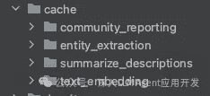

# GraphRAG新增文件会重新索引所有文件吗？探究缓存何时生效

> 来源：[https://agijuejin.feishu.cn/docx/JrmjdExPaonzdFxHZ0Ic0zhvnJg](https://agijuejin.feishu.cn/docx/JrmjdExPaonzdFxHZ0Ic0zhvnJg)

> 作者：还就可 | 深入LLM Agent应用开发

> 原文： [https://mp.weixin.](https://mp.weixin.qq.com/s/YAlI2Do_WZhMH4IMzY6dGQ)qq.com/s/YAlI2Do_...

GraphRAG索引消耗Token巨大，所以你可能会问？新增文件后，我之前的文件会不会重新索引一次啊？什么情况下会利用缓存呢？本文带你一探究竟。

GraphRAG默认使用文件缓存，配置如下。当然你也可以考虑使用Azure云端的缓存。

```
cache:
  type: file # or blob
  base_dir: &quot;cache&quot;
  # connection_string: &lt;azure_blob_storage_connection_string&gt;
  # container_name: &lt;azure_blob_storage_container_name&gt;
```

缓存放在cache目录下，并根据流程分为实体提取、总结描述、社区报告和文本嵌入四个部分，所以缓存基本涵盖了所有涉及LLM调用或者Embedding调用的部分。



缓存的文件名类似 chat-0a0edbed8a583fd6ef2647112f565bd9 create_community_report-chat-v2-0a8d6dcd76f6d92edb9388681da40d1d ，tag和hash值组合而成。缓存的内容是什么呢？其实就LLM的请求输入和响应输出，或者是embedding API的调用回复。

```
{
    &quot;result&quot;: &quot;(\&quot;entity\&quot;&lt;|&gt;\&quot;Retrieval-Augmented Generation\&quot;&lt;|&gt;\&quot;technique\&quot;&lt;|&gt;...&lt;|COMPLETE|&gt;&quot;,
    &quot;input&quot;: &quot;-Goal-\nGiven a text document ...&quot;,
    &quot;parameters&quot;: {
        &quot;model&quot;: &quot;deepseek-chat&quot;,
        &quot;temperature&quot;: 0,
        &quot;frequency_penalty&quot;: 0,
        &quot;presence_penalty&quot;: 0,
        &quot;top_p&quot;: 0.99,
        &quot;max_tokens&quot;: 4096,
        &quot;n&quot;: 1
    }
}
```

那么何时缓存会生效？修改哪些部分会影响缓存呢？让我们看GraphRAG中如下代码，它是为缓存文件生成文件名，也就是上文看到文件名。

```
**def** **create_hash_key**(ope**ration**: str, prompt: str, parameters: dict) -&gt; str:
    &quot;&quot;&quot;Compute cache key from prompt and associated model and settings.

    Args:
        prompt (str): The prompt run through the language model.
        llm_string (str): The language model version and settings.

    Returns
    -------
        str: The cache key.
    &quot;&quot;&quot;
    llm_string = _llm_string(parameters)
    return f&quot;{operation}-{_hash(prompt + llm_string)}&quot;
```

从这份代码上，我们能够了解到，有两个影响hash值的生成

+   输入的Prompt，包含用户输入

+   LLM的参数

这是实际运行过程中打印的参数

```
tag: chat
llm_string: {&#x27;model&#x27;: &#x27;llama3-70b-8192&#x27;, &#x27;temperature&#x27;: 0.0, &#x27;frequency_penalty&#x27;: 0.0, &#x27;presence_penalty&#x27;: 0.0, &#x27;top_p&#x27;: 0.99, &#x27;max_tokens&#x27;: 2000, &#x27;n&#x27;: 1}
[(&#x27;frequency_penalty&#x27;, 0.0), (&#x27;max_tokens&#x27;, 2000), (&#x27;model&#x27;, &#x27;llama3-70b-8192&#x27;), (&#x27;n&#x27;, 1), (&#x27;presence_penalty&#x27;, 0.0), (&#x27;temperature&#x27;, 0.0), (&#x27;top_p&#x27;, 0.99)]
```

所以当你

+   换一个LLM，或者修改LLM的参数，都会导致重新索引

+   加入新的文件，只会索引该文件，已经索引的文件不会重新索引。

+   修改现有文件，可能导致整个文件重新索引，或者是部分，因为修改文件，如果只是部分chunk改变，那么只会是这部分chunk需要重新索引。

因此， **如果你的单个文档较大，并且可能会经常修改，可以考虑将其拆**分，以充分利用缓存，节省你的Money。