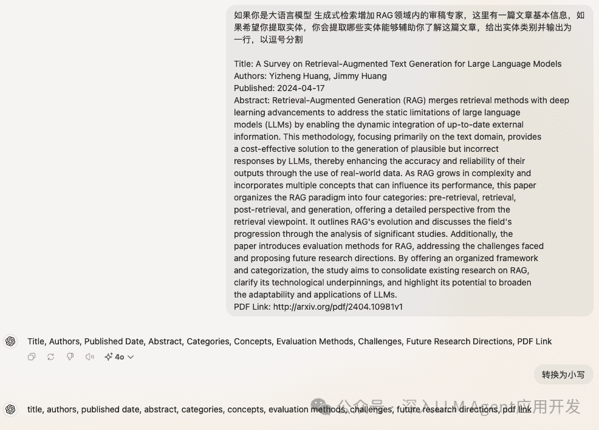
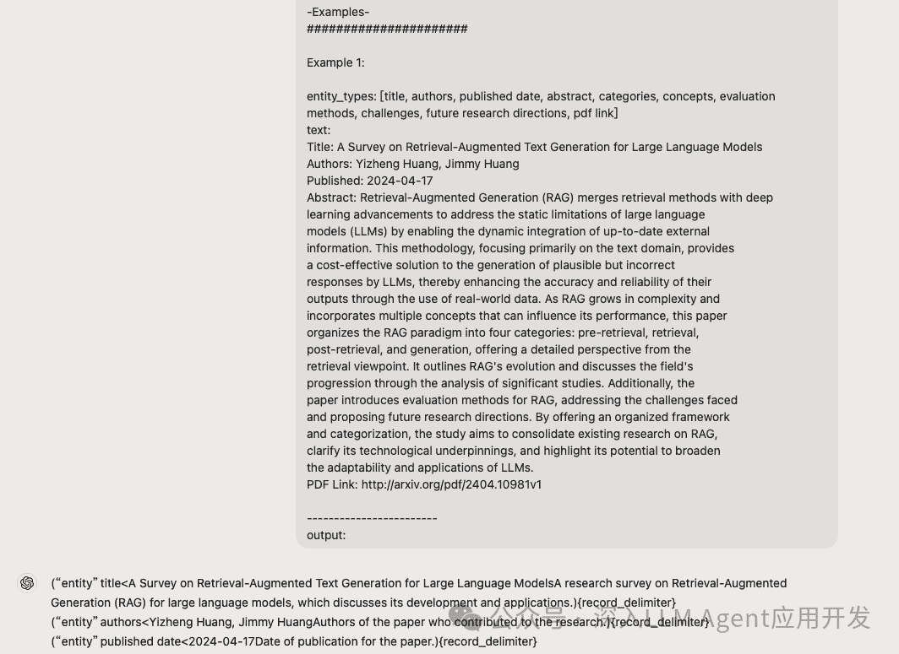
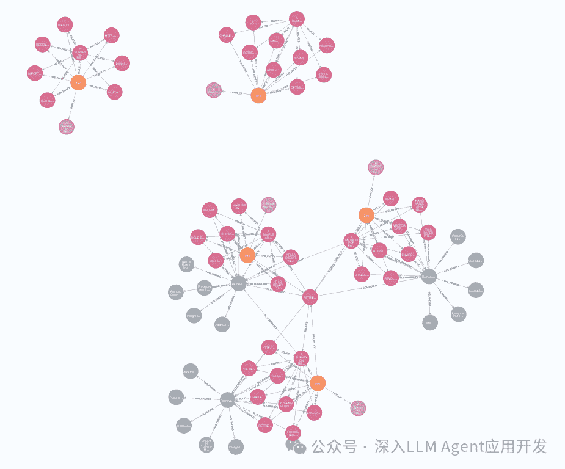

# GraphRAG手调Prompt提取自定义实体

> 来源：[https://agijuejin.feishu.cn/docx/PU5nd9PHfoWUwZxcOx0cFdK8nsQ](https://agijuejin.feishu.cn/docx/PU5nd9PHfoWUwZxcOx0cFdK8nsQ)

> 作者：还就可 | 深入LLM Agent应用开发

> 原文： [https://mp.weixin.](https://mp.weixin.qq.com/s/93PmTk0IImPH00aUAdX1MA)qq.com/s/93PmTk0I...

GraphRAG在使用Prompt-Tune根据领域自动生成的实体总是不理想怎么办？这个时候就需要手动调整啦，当然我们还需要借助ChatGPT类的助手帮助我们生成一些Example。

## ** 1. 手调Prompt**

话不多说，进入正题，上文《 GraphRAG失效？快用Prompt Tune适配文档的领域和语言 》最后说到:

> 虽然我们通过Prompt-Tune借助LLM的能力自动微调Prompt以适配输入文件的领域，但我发现Prompt-Tune的给出实体列表就跟抽卡似的，同一个领域每次都不同。

+   person, organization, technology, dataset, method

+   model, person, publication, technology, optimization strategy

+   model, technique, metric, architecture, dataset

当使用以下命令微调提示词Promt时候，它只生成了三个文件：community_report.txt、entity_extraction.txt和summarize_descriptions.txt。

```
python -m graphrag.prompt_tune --root . --domain &quot;scholarly papers about retrieval augmented generation&quot; --method random --limit 2 --chunk-size 500 --output prompt-paper
```

其中summarize_descriptions.txt和community_report.txt都是根据领域，在设定角色的时候设定它是XX领域内的专家等信息，所以他们和实体提取关系不大，也无需调整。所以重点看一下entity_extraction.txt，它的结构如下，翻译为中文方便阅读:

```
-**任务目**标-
给定一个可能与此活动相关的文本文档和一个实体类型列表，从文**本中识别**出这些类型的所有实体以及这些实体之间的所有关系。

-步骤-**
1.**识**别所**有实体。对于每个识别出的**实体，****提取以**下信息：
 • entity_name: 实体名称**，首字母**大写
 • entity_typ**e: ****以下类****型之一**：[author, publication** da****te,** methodology, technology, evaluation method, research direction]
 • entity_description: 实体属性和活动的全面描述
格式化每个实体为 (“entity”{tuple_delimiter}&lt;entity_name&gt;{tuple_delimiter}&lt;entity_type&gt;{tuple_delimiter}&lt;entity_description&gt;){record_delimiter}

2.从步骤1中识别出的实体中，识别出所有明显相关的 (source_entity, target_entity) 对。
对于每对相关的实体，提取以下信息：
 • source_entity: 在步骤1中识别出的源实体名称
 • target_entity: 在步骤1中识别出的目标实体名称
 • relationship_description: 解释为什么认为源实体和目标实体彼此相关
 • relationship_strength: 表示源实体和目标实体之间关系强度的整数评分，范围为1到10

格式化每个关系为 (“relationship”{tuple_delimiter}&lt;source_entity&gt;{tuple_delimiter}&lt;target_entity&gt;{tuple_delimiter}&lt;relationship_description&gt;{tuple_delimiter}&lt;relationship_strength&gt;){record_delimiter}

 3. 使用 {record_delimiter} 作为列表分隔符。
 4. 返回输出文本的主要语言为“英语”。作为步骤1和2中识别出的所有实体和关系的单个列表。如果需要翻译，只需翻译描述部分，其余部分保持不变。
 5. 当完成时，输出 {completion_delimiter}

示例
######################

示例1:
entity_types: [author, publication date, methodology, technology, evaluation method, research direction]
text:
Title: A Survey on Retrieval-Augmented Text Generation for Large Language Models
Authors: Yizheng Huang, Jimmy Huang
Published: 2024-04-17
Abstract: Retrieval-Augmented Generation (RAG) merges retrieval methods with deep
learning advancements to address the static limitations of large language
models (LLMs) by enabling the dynamic integration of up-to-date external
information. This methodology, focusing primarily on the text domain, provides
a cost-effective solution to the generation of plausible but incorrect
responses by LLMs, thereby enhancing the accuracy and reliability of their
outputs through the use of real-world data. As RAG grows in complexity and
incorporates multiple concepts that can influence its performance, this paper
organizes the RAG paradigm into four categories: pre-retrieval, retrieval,
post-retrieval, and generation, offering a detailed perspective from the
retrieval viewpoint. It outlines RAG&#x27;s evolution and discusses the field&#x27;s
progression through the analysis of significant studies. Additionally, the
paper introduces evaluation methods for RAG, addressing the challenges faced
and proposing future research directions. By offering an organized framework
and categorization, the study aims to consolidate existing research on RAG,
clarify its technological underpinnings, and highlight its potential to broaden
the adaptability and applications of LLMs.
PDF Link: http://arxiv.org/pdf/2404.10981v1
ouput:
#############################
-实际数据-
######################
entity_types: [author, publication date, methodology, technology, evaluation method, research direction]
text: {input_text}
######################
output:

```

这个结构和我在文章《 敲黑板！吴恩达LLM Agent工作流Prompt精华全解析 》中总结的一样，再重复一次。

> 解决任务的方法

> 任务的输入和输出

> 任务的Example，3到5个左右

> 任务的历史纪录，如果有的话

> 用户输入的问题。

只是这个任务输出要求非常高，要求输出的格式还是有点小复杂的，这也是为何很多小模型可能在实体提取阶段就失败的原因之一。所以如何手调呢？首先你需要知道你的输入文章都有哪些实体，对于论文我们咨询一下ChatGPT看看。



根据GPT生成的实体，我们修改entity_extraction.txt中任务说明部分、Example中的entity_types和Real Data部分的entity_types。既然需要提取的实体类别已经更新，接下来就是更新few shot的Example输出了。拷贝Prompt开头到Example的output，然后粘贴至ChatGPT中，他会根据Prompt中的指令继续扩写后续的output。



**然**而GPT-4o-mini输出的结果完全不对，你就知道这Prompt写的有多拉胯了，或者说GPT-4o-mini也有点拉胯了 。复制到DeepSeeker，重新输出example，这就完全一致了。不知道是不是DeepSeeker本身训练代码出身的，我感觉它的输出格式很稳定。

```
(&quot;entity&quot;{tuple_delimiter}A Survey on Retrieval-Augmented Text Generation for Large Language Models{tuple_delimiter}title{tuple_delimiter}The title of the paper discussing Retrieval-Augmented Generation for large language models){record_delimiter}
(&quot;entity&quot;{tuple_delimiter}Yizheng Huang, Jimmy Huang{tuple_delimiter}authors{tuple_delimiter}The authors of the paper on Retrieval-Augmented Generation){record_delimiter}
(&quot;entity&quot;{tuple_delimiter}2024-04-17{tuple_delimiter}published date{tuple_delimiter}The date the paper on Retrieval-Augmented Generation was published){record_delimiter}
...
(&quot;relationship&quot;{tuple_delimiter}A Survey on Retrieval-Augmented Text Generation for Large Language Models{tuple_delimiter}http://arxiv.org/pdf/2404.10981v1{tuple_delimiter}The title of the paper is linked to its PDF version{tuple_delimiter}10){record_delimiter}
{completion_delimiter}
```

当你使用其他的在线对话应用时，一定要注意输出的每条entity应是以 (){record_delimiter} 这样的格式化输出，否则你会遇到无法构建知识图谱网络的问题。我们拷贝上述输出的Example并粘贴到我们的entity_extraction.txt中，重新开始小批量Index测试。

## ** 2. 索引与可视化**

```
poetry run poe index --root .
```

可视化



## ** 3. 查询**

+   问题1 这些论文的主要提出了哪些方法优化RAG?

```
 poetry run poe query --method global &quot;这些论文的主要提出了哪些方法优化RAG&quot;
```

> SUCCESS: Global Search Response: ### 优化RAG的主要方法 这些论文主要提出了多种方法来优化Retrieval-Augmented Generation (RAG)，以下是详细的总结：

1.  集成RAG与MOE 论文提出了一种新颖的架构，该架构将Retrieval-Augmented Generation (RAG) 与Mixture of Experts (MOE) 集成在一起，以增强大型语言模型（LLMs）的角色基础安全性和北约清关级别 [Data: Reports (20, 23, 25, 26, 27 +more)].

1.  解析和向量化半结构化数据 论文介绍了一种新颖的方法，用于解析和向量化半结构化数据，从而增强了RAG在大型语言模型中的功能 [Data: Reports (10, 13, 16, 17 +more)].

1.  RAG的阶段分类 论文将RAG范式分为四个不同的阶段：预检索、检索、后检索和生成，提供了一种结构化的方法来实施RAG [Data: Reports (41)].

1.  RAG的评估方法 论文引入了特定的评估方法，这对于评估检索增强生成过程的有效性至关重要 [Data: Reports (42)].

1.  解决RAG的挑战 论文识别并解决了RAG中的挑战，为未来研究改进该方法奠定了基础 [Data: Reports (43)]. 这些方法共同为RAG的优化和实施提供了全面的框架和工具。

+   问题2 最新的RAG研究综述

```
poetry run poe query --method local &quot;最新的RAG研究综述&quot;
```

> SUCCESS: Local Search Response: ### 最新关于RAG的调查 最近，关于检索增强生成（Retrieval-Augmented Gener**ation**, RAG**）的调查引起了计算**语言学界的广泛关注。与传统的生成模型相比，RAG在许多自然语言处**理（NLP）任**务中显示出显著的优势，并取得了最先进的性能。以下是关于RAG的最新调查的详细信息。 调查概述 调查论文《A Survey on Retrieval-Augmented Text Generation for Large Language Models》由Yizheng Huang和Jimmy Huang撰写，于2024年4月17日发表。该论文详细探讨了RAG如何结合检索方法与深度学习进展，以解决大型语言模型（LLMs）的静态限制问题，通过动态整合最新的外部信息来增强模型的准确性和可靠性。 RAG的四个分类 论文将RAG范式分为四个主要类别：预检索、检索、后检索和生成。这种分类从检索的角度提供了对RAG性能影响因素的详细视角，并讨论了该领域的进展。 未来研究方向 此外，该论文还介绍了RAG的评估方法，并提出了未来的研究方向，旨在通过提供一个有组织的框架和分类，来整合现有的RAG研究，阐明其技术基础，并突出其扩大LLMs适应性和应用的潜力。这些信息提供了关于RAG的最新调查的全面概述，展示了其在NLP领域中的重要性和未来的发展潜力。以上信息参考了以下数据记录：

+   实体（Entities）：36, 38, 41

+   关系（Relationships）：35

+   来源（Sources）：4 希望这些信息能帮助您更好地理解最新的RAG调查。

给出了最新综述的标题、发表时间、作者以及一个简单的介绍。并给出该论文的关键见解，将RAG分为四种主要范式：检索前、检索、检索后和生成，讨论RAG的发展和分析重要的研究，同时也介绍了各种评估RAG的方法。最后给出了关于该论文的链接地址。其实输入的5个文档中，还有一份综述是2022年，显然相较于最新，它自动选择了2024年。若是能将这些实体的ID做成链接自动作为hint查询显示，就厉害了。

## ** 4. 总结**

本篇通过介绍如何手调Prompt来生成更符合自己设定的实体，并讨论了可能会出现的问题如何修复等，最后介绍优化后的实体提取Prompt，在索引RAG相关论文、可视化和检索方面的测试。从测试结果来看，相比前文《 GraphRAG失效？快用Prompt Tune适配文档的领域和语言 》可以说是本质的提升。

记得关注，收藏、点赞、评论和加星鸭。如果有疑问，可以后 台 回复加群，与同行交流AI技术。

别忘记买书深度学习Neo4J呀！