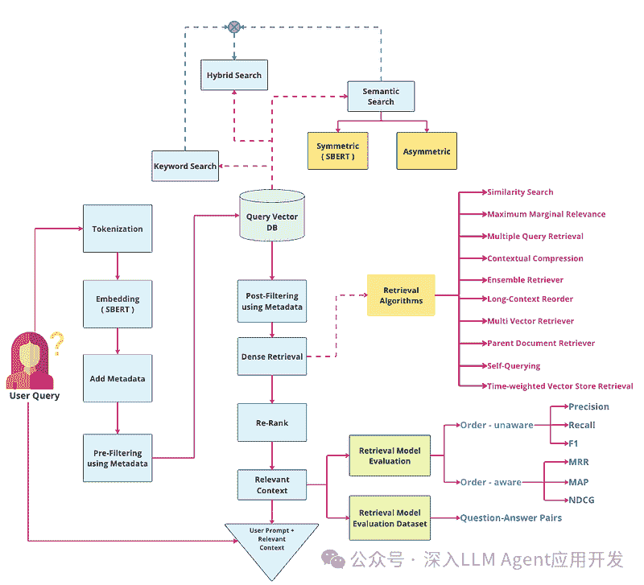

# 为何RAG应用在生产中难以成功？

> 来源：[https://agijuejin.feishu.cn/docx/FLF3dFn5eoU9PSxt61zcn8eQnAe](https://agijuejin.feishu.cn/docx/FLF3dFn5eoU9PSxt61zcn8eQnAe)

> 作者：还就可 | 深入LLM Agent应用开发

> 原文： [https://mp.weixin.](https://mp.weixin.qq.com/s/AzMPwrDTxbbqFPUWfBLfvw)qq.com/s/AzMPwrDT...

RAG常常陷入一周出Demo、半年用不好**的窘境。本文分享Meduim深度好文《 Why **RAG Applications Fail in Production [1] 》探讨RAG应用程序常见的陷阱和成功部署的见解，以下为翻译全文。

---

检索增强生成 (RAG) 应用程序已成为大型语言模型 (LLM) 领域的强大工具，通过集成外部知识增强了其功能。尽管 RAG 应用程序前景光明，但在从原型过渡到生产环境时，它们经常面临挑战。本文深入探讨了 RAG 应用程序的复杂性，探索了常见的陷阱和成功部署的战略见解。

## ** 2. 从原型到生产**

在生产环境中部署 RAG 应用程序充满挑战。将生成式 LLM 与检索机制集成的复杂性意味着任何数量的元素都可能出现故障，从而导致潜在的系统故障。例如，系统的可扩展性和稳健性至关重要；它必须处理不可预测的负载并在高需求下保持运行。此外，在实时环境中预测用户与系统的交互具有挑战性，需要持续监控和调整以保持性能和可靠性。

## ** 3. RAG的类型**

**根据检索方法 **：RAG 模型可以根据其使用的检索方法进行分类，例如使用 BM25（传统信息检索功能）或更高级的密集检索器，利用基于神经网络的嵌入来查找相关文档。检索器的选择会影响模型从语料库中获取相关信息的能力。

**基于生成机制 **：RAG 的生成组件通常采用基于 Transformer 的模型，如 BERT、GPT-2 或 GPT-3。这些模型根据检索到的文档生成响应，定制输出以使其与上下文相关且详细

**顺序处理与并行处理 **：一些 RAG 模型按顺序处理检索和生成步骤，其中系统首先检索所有相关文档，然后根据它们生成响应。相比之下，其他人可能会采用更并行的方法，以更交织的方式连续检索和生成

**微调方法 **：RAG 模型可以通过不同的方式进行微调，以使检索和生成过程适应特定任务。这包括对特定知识密集型任务进行微调，其中模型学习更好地将检索到的信息与生成的文本对齐以回答问题或提供解释

## ** 4. 配置和定制**

RAG 配置允许进行广泛的定制，以根据特定需求定制模型。主要配置选项包括：

+   **要检索的文档数量（ ****n_docs**** ） **：定义检索器应获取多少个文档，这会影响生成响应时考虑的信息广度。

+   **最大组合长度（ ****max**_combined_length ） ：限制用于生成响应的上下文的总长度，影响生成文本的细节和范围。

+   **检索向量大小 **：确定用于检索的嵌入的大小，影响查询和文档之间的语义匹配的粒度。

+   **检索批次大小 **：指定同时处理多少个检索查询，影响检索速度和效率

## ** 5. 应用和注意事项**

RAG 模型在需要深度知识整合和情境理解的应用中尤其有效，例如法律研究、科学文献综述和复杂的客户服务查询。检索和生成过程的集成使 RAG 模型能够提供基于外部信息源的准确、详细且与情境相关的响应。

## ** 6. 主要故障类型和规避策略**

**检索质量**

有效的检索是 RAG 成功的基础。确保系统检索到的文档既相关又多样化，以响应查询至关重要。此方面的失败可能会导致不准确或不相关的响应，从而损害系统的实用性和用户信任。通常，检索将使用某种相似性矩阵完成。算法很重要！余弦相似度将具有一般匹配，但在特定领域的应用中可能会失败。特别是在医疗保健领域，准备使用多查询检索器、自查询甚至集成检索器。

**幻觉**

RAG 系统有时会生成与检索到的文档无关的信息，这种现象称为幻觉。这些会严重影响系统的可信度和准确性，因此需要强大的机制来过滤噪音并整合来自多个来源的信息，以提供连贯而准确的响应

**隐私和安全问题**

隐私泄露和安全漏洞是重大风险，尤其是在处理敏感信息时。RAG 应用程序必须设计为防止未经授权披露个人或机密数据，并抵御可能损害系统完整性的操纵攻击。这是企业应用程序中的一个特殊痛点。实际上，问题不在于您是否保护了应用程序，而在于您是否一丝不苟。您必须证明您已经尽一切努力保护企业数据。

**恶意使用和内容安全**

确保 RAG 应用程序不会助长非法活动或生成有害内容至关重要。这包括实施保护措施，防止创建或传播可用于恶意目的的内容。这可能不会成为所有企业用户和用例的担忧，因为这些用例将使用特定数据满足特定受众的需求。没有企业会冒险使用 RAG 中的所有信息。

**特定领域**

针对特定领域量身定制的 RAG 应用程序必须有效地处理域外查询，确保即使查询超出其主要知识库，它们也能提供相关且准确的响应。稍后的成功部分将对此进行详细介绍 - 但这很麻烦。简而言之，对于您领域的细分市场，您最好考虑将特定领域的大型模型与通用大型模型（如 OpenAI/Claude/whatever）结合使用。

**完整性和品牌完整性**

响应的完整性和品牌完整性的维护对于用户满意度和信任度至关重要。RAG 系统应提供全面且符合语境的答案，同时避免可能损害品牌声誉的内容。

**技术和运营问题**

递归检索、句子窗口检索以及自托管和基于 API 的 LLM 部署之间的平衡等问题会显著影响 RAG 应用程序的性能和成本效益。每个元素都需要仔细考虑，以优化检索准确性和系统效率。

## ** 7. 成功策略**

为了降低这些风险，RAG 应用应该经过合理广**泛的规划。最好的解决方案就是预测未来，** 它还应该在多个场景中进行广泛的测试，包括检索质量、幻觉预防、隐私保护和安全性。

现实世界是几乎所有生产数据产品的致命弱点。是的，使用相同的旧 pubmed 数据将为您提供一个有效的管道，但**是当 RAG 与来自不同期刊的真实数据交互时**，它将彻底失败。根据实际使用情况和反馈监控和更新系统对于持续改进至关重要。 重要的是使用来自各种来源的真实数据以较小的规模构建 RAG，然后将其扩展到大规模。 在当今世界，计算和空间都很便宜，因此请专注于信息安全、基础设施、SSO 集成、SOC2 证书等，这样一旦您构建了 RAG，您就可以放心地与客户共享。

此外， 选择正确的技术基础设施、确保数据质量和实施强大的安全措施 是成功在生产环境中部署 RAG 应用程序的关键。考虑未来的数据管道。提出“假设”场景并相应地构建文档和代码库。没有人谈论它，但要以一种让您的客户知道可能的“失败”和就地“故障保护”的方式构建您的合同。

如果您正在处理 特定领域，请记住用**于创建嵌入的模型很重要 。我已经看到人们 倾向于使用较小的模**型进行嵌入；但是，如果该模型的词汇量不包含您所在领域的关键词，那么您就注定要失败 。是的，这意味着要多花一点钱，或者如果您的口袋很宽裕，那么要花更多的钱来构建自己的 LLM，以维护您所在领域的词汇表。 对模型进行简单的微调并不能解决这个问题 。请记住，您想要检索的内容越高，性能就越差。

最后一个是品牌完整性。让我们直言不讳。品牌是一种虚构的身份。我们希望尽可能地模仿品牌。将此任务视为 RAG 蛋糕上的最后一点“糖霜”。首先，完成任务，提取所需内容，并从抽象中生成平面文本，这样您就有了准确度指标。然后，只有这样，才能要求将其改写成品牌术语。

### **参考资料**

# [1]

Why RAG Applications Fail in Production: https://pub.towardsai.net/why-rag-applications-fail-in-production-a-technical-deep-dive-15cc976af52c