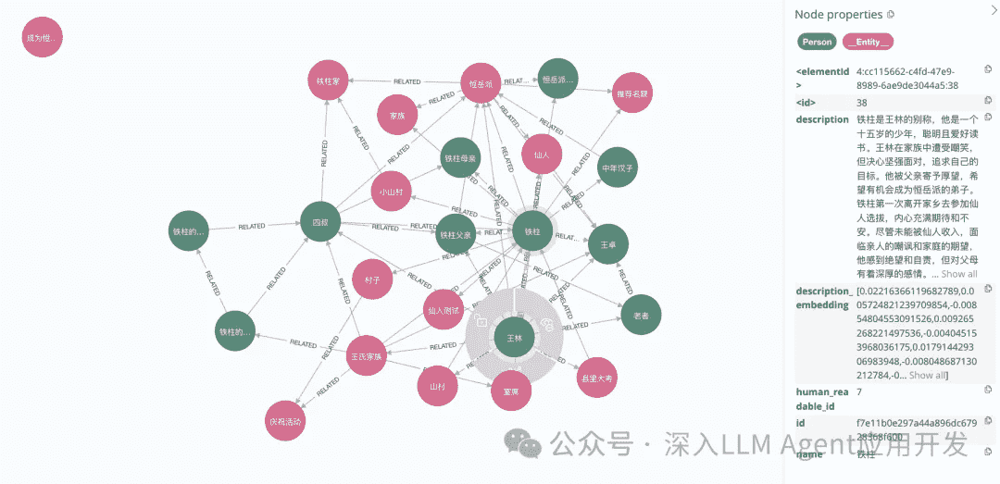
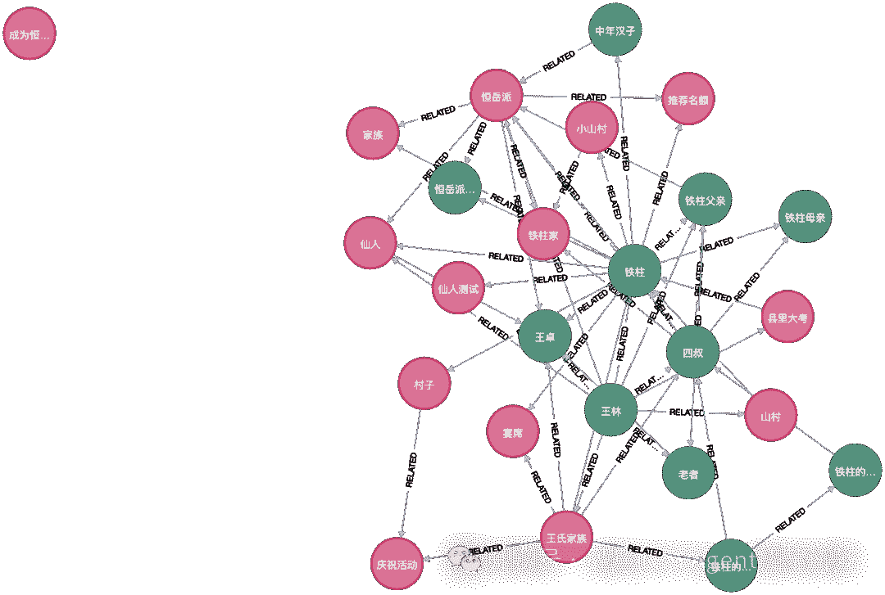
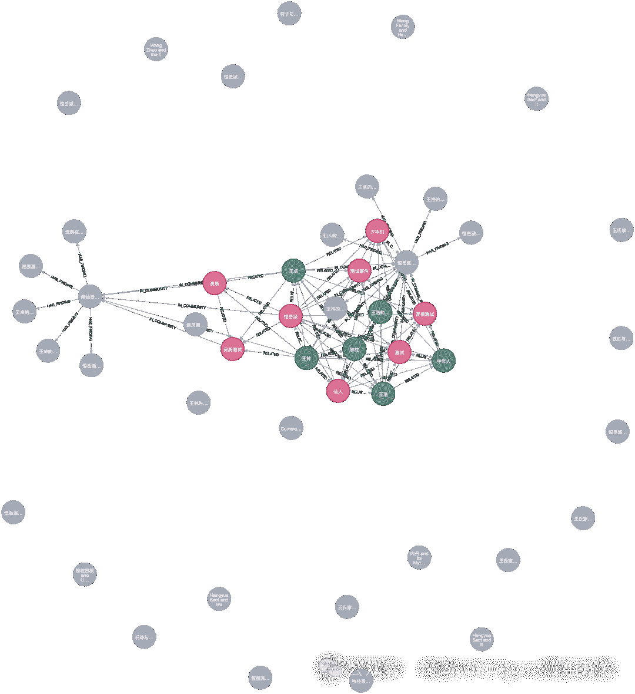
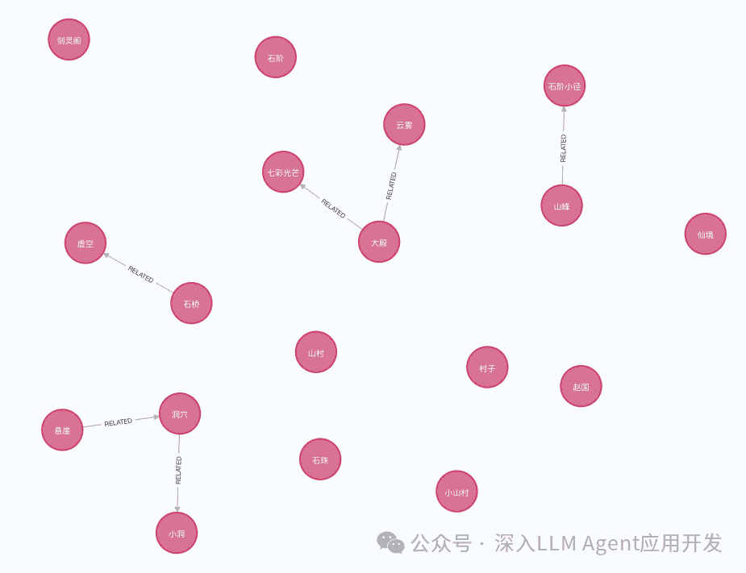
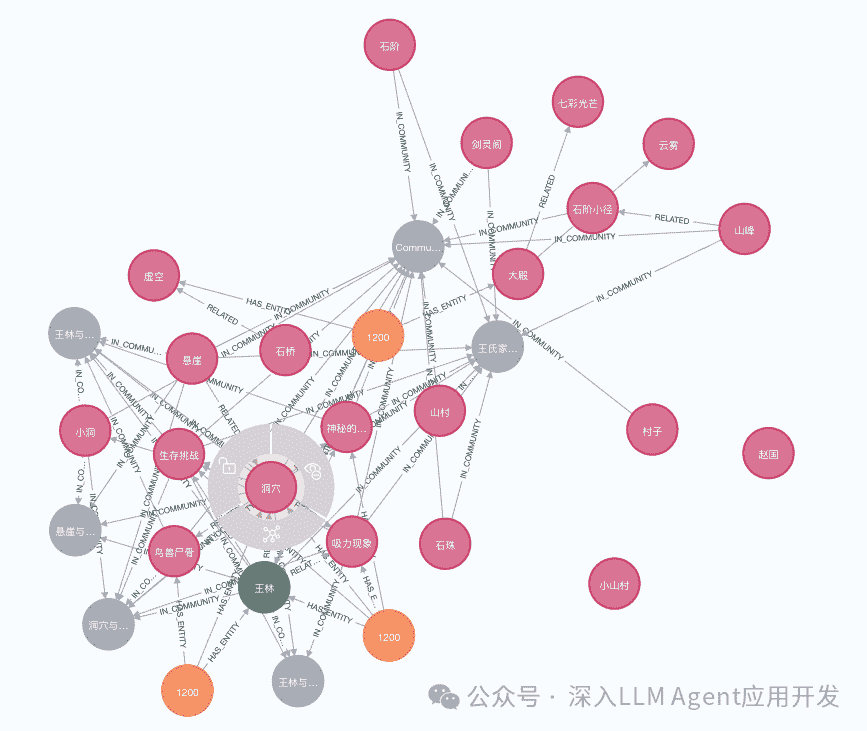

# 喂饭教程！全网首发Neo4J可视化GraphRAG索引

> 来源：[https://agijuejin.feishu.cn/docx/Cui2dqwXaoqvcPxHG1Pc5Eimnwf](https://agijuejin.feishu.cn/docx/Cui2dqwXaoqvcPxHG1Pc5Eimnwf)

> 作者：还就可 | 深入LLM Agent应用开发

> 原文： [https://mp.weixin.](https://mp.weixin.qq.com/s/0niNzA_ZG_L81Ah_PAflLg)qq.com/s/0niNzA_Z...

GraphRAG通过结合知识图谱，增加RAG的全局检索能力。今天我将讲解如何使用Neo4J可视化GraphRAG索引的结果，以便进一步的处理、分析。本篇仍然以小说 《仙逆》 提取的实体为例，一图胜千言。本文分为4小节，安装neo4j、导入GraphRAG索引文件、Neo4J可视化分析和总结，所有坑都已经帮你趟过啦，放心食用。



**Neo4j [1] **是由 Neo4j Inc. 开发的图数据库管理系统，是图数据库技术领域的领导者——强大的原生图存储、数据科学和分析，具备企业级的安全性。无约束地扩展您的事务和分析工作负载。已下载超过1.6亿次。Neo4j 存储的数据元素包括节点、连接它们的边以及节点和边的属性。


## **1. 安装Neo4j**

Neo4j支持使用云端服务和本地社区开源版本，使用如下Docker命令启动Neo4J实例。

```
docker run \
    -p 7474:7474 -p 7687:7687 \
    --name neo4j-apoc \
    -e NEO4J_apoc_export_file_enabled=true \
    -e NEO4J_apoc_import_file_enabled=true \
    -e NEO4J_apoc_import_file_use__neo4j__config=true \
    -e NEO4J_PLUGINS=\[\&quot;apoc\&quot;\] \
    neo4j:5.21.2
```

浏览器打开http://localhost:7474/，然后输入默认用户名 neo4j ，默认密码 neo4j 即可登录，登录之后要求重设密码。

接下来，安装neo4j的依赖包

```
pip install --quiet pandas neo4j-rust-ext
```

##  2. 导入GraphRAG的索引结果

**为了更好地支持中文提取，本次采**用 deepseeker [2] 的deep-seek-chat模型（为啥不用qwen2？因为我的免费额度使用完了）。注册之后免费500万Token，索引一次通过，支持128K上下文，最大输出Tokens为4096。所以设置LLM的时候， 务必把max_tokens设置为4096 ，未明确说明TPM和RPM，根据平台符合自动调整。

+   导入依赖库

```
**import** pandas **as**** pd
**from ne**o4j im****port G**raphDatabase
import time
```

+   联结本地Neo4j实例

```
NEO4J_URI = &quot;neo4j://localhost&quot;  # or neo4j+s://xxxx.databases.neo4j.io
NEO4J_USERNAME = &quot;neo4j&quot;
NEO4J_PASSWORD = &quot;password&quot; #你自己的密码
NEO4J_DATABASE = &quot;neo4j&quot;

# Create a Neo4j driver
driver = GraphDatabase.driver(NEO4J_URI, auth=(NEO4J_USERNAME, NEO4J_PASSWORD))
```

+   配置本次索引目录

```
GRAPHRAG_FOLDER = &quot;./output/20240716-192226/artifacts&quot;
```

+   创建Neo4j索引

在Neo4j中，索引仅用于查找图查询的起始点，例如快速查找两个节点以进行连接。约束用于避免重复，主要在实体类型的id上创建。我们使用带有两个下划线的类型作为标记，以区分它们与实际的实体类型。

```
**sta**tements = &quot;**&quot;&quot;**
cre**at****e **constraint chunk_id if not exists for (c:__Chunk__) require c.id is unique;
create constraint document_id if not exists for (d:__Document__) require d.id is unique;
create constraint entity_id if not exists for (c:__Community__) require c.community is unique;
create constraint entity_id if not exists for (e:__Entity__) require e.id is unique;
create constraint entity_title if not exists for (e:__Entity__) require e.name is unique;
create constraint entity_title if not exists for (e:__Covariate__) require e.title is unique;
create constraint related_id if not exists for ()-[rel:RELATED]-&gt;() require rel.id is unique;
&quot;&quot;&quot;.split(&quot;;&quot;)

for statement in statements:
    if len((statement or &quot;&quot;).strip()) &gt; 0:
        print(statement)
        driver.execute_query(statement)
```

+   创建批量导入函数

```
**def** **batched_import**(sta**tem**ent, df**, **batc**h_size**=1000):
    &quot;&quot;&quot;
    Import a dataframe into Neo4j using a batched approach.
    Parameters: statement is the Cypher query to execute, df is the dataframe to import, and batch_size is the number of rows to import in each batch.
    &quot;&quot;&quot;
    total = len(df)
    start_s = time.time()
    for start in range(0,total, batch_size):
        batch = df.iloc[start: min(start+batch_size,total)]
        result = driver.execute_query(&quot;UNWIND $rows AS value &quot; + statement, 
                                      rows=batch.to_dict(&#x27;records&#x27;),
                                      database_=NEO4J_DATABASE)
        print(result.summary.counters)
    print(f&#x27;{total} rows in { time.time() - start_s} s.&#x27;)    
    return total
```

+   导入文档

```
doc_df = pd.read_parquet(f&#x27;{GRAPHRAG_FOLDER}/create_final_documents.parquet&#x27;, columns=[&quot;id&quot;, &quot;title&quot;])
doc_df.head(2)

# import documents
statement = &quot;&quot;&quot;
MERGE (d:__Document__ {id:value.id})
SET d += value {.title}
&quot;&quot;&quot;

batched_import(statement, doc_df)
```

+   导入text units

```
text_df = pd.read_parquet(f&#x27;{GRAPHRAG_FOLDER}/create_final_text_units.parquet&#x27;,
                          columns=[&quot;id&quot;,&quot;text&quot;,&quot;n_tokens&quot;,&quot;document_ids&quot;])
text_df.head(2)

statement = &quot;&quot;&quot;
MERGE (c:__Chunk__ {id:value.id})
SET c += value {.text, .n_tokens}
WITH c, value
UNWIND value.document_ids AS document
MATCH (d:__Document__ {id:document})
MERGE (c)-[:PART_OF]-&gt;(d)
&quot;&quot;&quot;

batched_import(statement, text_df)
```

+   加载实体

```
entity_df = pd.read_parquet(f&#x27;{GRAPHRAG_FOLDER}/create_final_entities.parquet&#x27;,
                            columns=[&quot;name&quot;, &quot;type&quot;, &quot;description&quot;, &quot;human_readable_id&quot;, &quot;id&quot;, &quot;description_embedding&quot;,
                                     &quot;text_unit_ids&quot;])
entity_df.head(2)

entity_statement = &quot;&quot;&quot;
MERGE (e:__Entity__ {id:value.id})
SET e += value {.human_readable_id, .description, name:replace(value.name,&#x27;&quot;&#x27;,&#x27;&#x27;)}
WITH e, value
CALL db.create.setNodeVectorProperty(e, &quot;description_embedding&quot;, value.description_embedding)
CALL apoc.create.addLabels(e, case when coalesce(value.type,&quot;&quot;) = &quot;&quot; then [] else [apoc.text.upperCamelCase(replace(value.type,&#x27;&quot;&#x27;,&#x27;&#x27;))] end) yield node
UNWIND value.text_unit_ids AS text_unit
MATCH (c:__Chunk__ {id:text_unit})
MERGE (c)-[:HAS_ENTITY]-&gt;(e)
&quot;&quot;&quot;

batched_import(entity_statement, entity_df)
```

+   导入关系

```
rel_df = pd.read_parquet(f&#x27;{GRAPHRAG_FOLDER}/create_final_relationships.parquet&#x27;,
                         columns=[&quot;source&quot;, &quot;target&quot;, &quot;id&quot;, &quot;rank&quot;, &quot;weight&quot;, &quot;human_readable_id&quot;, &quot;description&quot;,
                                  &quot;text_unit_ids&quot;])
rel_df.head(2)

rel_statement = &quot;&quot;&quot;
    MATCH (source:__Entity__ {name:replace(value.source,&#x27;&quot;&#x27;,&#x27;&#x27;)})
    MATCH (target:__Entity__ {name:replace(value.target,&#x27;&quot;&#x27;,&#x27;&#x27;)})
    // not necessary to merge on id as there is only one relationship per pair
    MERGE (source)-[rel:RELATED {id: value.id}]-&gt;(target)
    SET rel += value {.rank, .weight, .human_readable_id, .description, .text_unit_ids}
    RETURN count(*) as createdRels
&quot;&quot;&quot;

batched_import(rel_statement, rel_df)
```

+   导入社区

```
community_df = pd.read_parquet(f&#x27;{GRAPHRAG_FOLDER}/create_final_communities.parquet&#x27;,
                               columns=[&quot;id&quot;, &quot;level&quot;, &quot;title&quot;, &quot;text_unit_ids&quot;, &quot;relationship_ids&quot;])

community_df.head(2)

statement = &quot;&quot;&quot;
MERGE (c:__Community__ {community:value.id})
SET c += value {.level, .title}
/*
UNWIND value.text_unit_ids as text_unit_id
MATCH (t:__Chunk__ {id:text_unit_id})
MERGE (c)-[:HAS_CHUNK]-&gt;(t)
WITH distinct c, value
*/
WITH *
UNWIND value.relationship_ids as rel_id
MATCH (start:__Entity__)-[:RELATED {id:rel_id}]-&gt;(end:__Entity__)
MERGE (start)-[:IN_COMMUNITY]-&gt;(c)
MERGE (end)-[:IN_COMMUNITY]-&gt;(c)
RETURn count(distinct c) as createdCommunities
&quot;&quot;&quot;

batched_import(statement, community_df)
```

+   导入社区报告

```
community_report_df = pd.read_parquet(f&#x27;{GRAPHRAG_FOLDER}/create_final_community_reports.parquet&#x27;,
                                      columns=[&quot;id&quot;, &quot;community&quot;, &quot;level&quot;, &quot;title&quot;, &quot;summary&quot;, &quot;findings&quot;, &quot;rank&quot;,
                                               &quot;rank_explanation&quot;, &quot;full_content&quot;])
community_report_df.head(2)
# import communities
community_statement = &quot;&quot;&quot;MATCH (c:__Community__ {community: value.community})
SET c += value {.level, .title, .rank, .rank_explanation, .full_content, .summary}
WITH c, value
UNWIND range(0, size(value.findings)-1) AS finding_idx
WITH c, value, finding_idx, value.findings[finding_idx] as finding
MERGE (c)-[:HAS_FINDING]-&gt;(f:Finding {id: finding_idx})
SET f += finding&quot;&quot;&quot;
batched_import(community_statement, community_report_df)
```

以上我们导入了文档、TextUnits、实体、关系、社区和社区报告后，打开浏览器后就可可视化分析这些实体关系和社区之间的信息了。Here we go

## ** 3. 可视化分析**

打开浏览器输入地址http://localhost:7474/browser/。

+   实体

每个实体可点开，查看进一步的关联关系，王林和铁柱的关系也是一目了然。



+   社区

社区有很多，基本上是对某一个特定事件进行整合，比如测试事件都关联了哪些人、哪些测试。



+   地点



点开洞穴可以进一步查看该洞穴关联的实体和人物、文本单元。



## ** 4. 总结**

本文通过使用Neo4J可视化分析GraphRAG索引结果，让我们能够更为直观的了解整个GraphRAG索引结果，需要完整脚本的同学发送消息neo4j即可领取。

别忘记关注我，加🌟获得及时更新哦～

若你期望更进一步了解图数据库理论和Neo4j，你可以参考以下四本销量还不错的书籍。

# **参 考资料**

# [1]

Neo4j: https://neo4j.com/

# [2]

deepseeker: https://platform.deepseek.com/